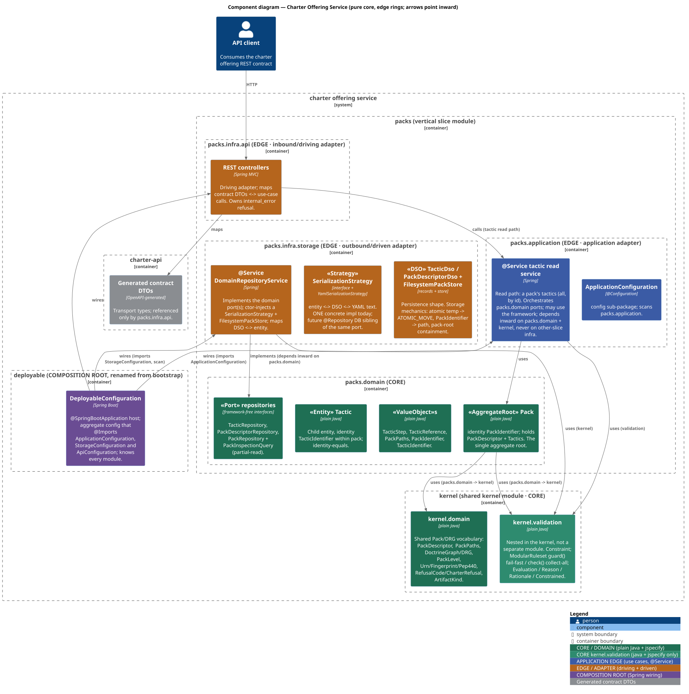
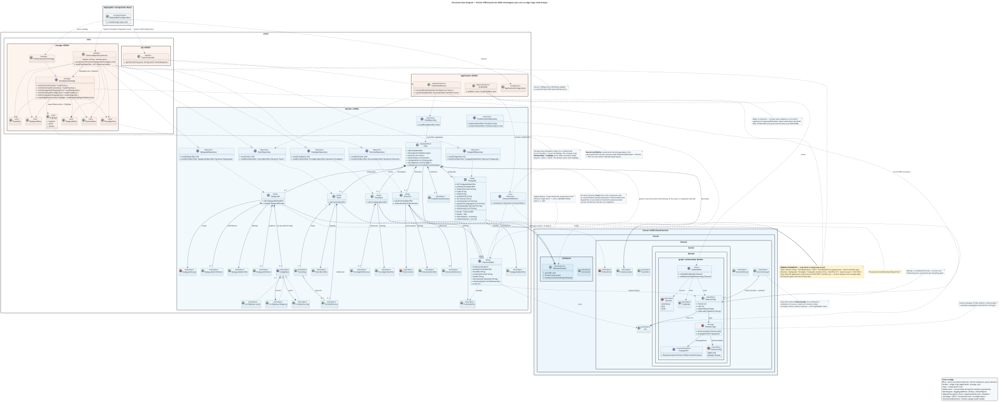

# Architectural patterns applied

[ADR-0006](/adr/0006-onion-vertical-slices-archunit/) decided the structure; this page shows
it as built by the pack repositories and validation mission, and names the pattern each part
plays. Three patterns combine.

- **Hexagonal (ports and adapters).** The domain declares the ports it needs. Adapters implement
  them (driven side) or call the application (driving side). The core never names an adapter.
- **Onion layering.** Dependencies point inward only: `infra` depends on `application`, which
  depends on `domain`, which depends on nothing outward.
- **Screaming architecture.** The top-level modules and packages name what the system is about
  (`packs`, `validation`) rather than the framework it uses. A new reader opening `service/`
  sees the subject first.

The patterns are named after their authors' work: hexagonal architecture (Alistair Cockburn),
onion architecture (Jeffrey Palermo) and screaming architecture (Robert C. Martin).

## The layout

```text
service/
  kernel/      ai.speckitty.charter.kernel.{domain, validation}
  packs/       ai.speckitty.charter.packs.{domain, application, infra.storage, infra.api}
  bootstrap/   ai.speckitty.charter.bootstrap
  charter-api/ generated contract types
```

The earlier flat, role-named modules (`charter-domain`, `charter-read-app`, `adapter-in-rest`,
`adapter-out-yaml`, `charter-service`) are superseded. The names screamed the technology; the new
ones scream the concern.

## Concern to pattern role

| Concern | Pattern role | What lives there |
|---|---|---|
| `kernel.domain` | Shared kernel | Vocabulary every slice may read: `PackDescriptor`, `DoctrineGraph`, `Urn`, `RefusalCode` |
| `kernel.validation` | Shared kernel, pure library | `ModularRuleset`, `Constraint`, `Evaluation`, `Reason`; `java` and `jspecify` only |
| `packs.domain` | Domain core | Aggregate root `Pack`, child entity `Tactic`, value objects, identifier value objects, ports |
| `packs.application` | Application ring (use cases) | Contract-neutral read use cases such as `ActionContextQuery` |
| `packs.infra.storage` | Outbound, driven adapter | `DomainRepositoryService` (`@Service`), `SerializationStrategy`, DSO records |
| `packs.infra.api` | Inbound, driving adapter | REST controllers, Problem handling, the only users of generated DTOs |
| `bootstrap` | Composition root | Spring Boot application and wiring; the only code that knows every module |

Each `domain` package also holds the **ports**: `TacticRepository`, `PackDescriptorRepository`,
the aggregating `PackRepository` and the `PackInspectionQuery`. Serialization is a **strategy**
(`SerializationStrategy`, with `YamlSerializationStrategy` today) so a database-backed sibling
could be added behind the same port.

## The diagrams

The component diagram shows containers and the direction of every dependency.



The class diagram shows the DDD stereotypes of the types, with the core above the edge.



The sources are `diagrams/c4-components.puml` and `diagrams/class-diagram.puml`. They show the
realized layout.

## Walk through: CharterPack to Tactic to steps and references

Reading a tactic through the service touches every ring, once, in order.

1. A client calls the REST contract. A controller in `packs.infra.api` maps the request to a
   use-case call and never touches storage (`ENTRYPOINT_OVER_APPLICATION`).
2. The use case in `packs.application` asks a domain port, such as `TacticRepository.load(packId,
   tacticId)`, for the tactic. It names only domain types.
3. `DomainRepositoryService` in `packs.infra.storage` implements that port. It finds the file for
   the identifiers inside the pack root, reads the YAML through the
   `YamlSerializationStrategy` into a `TacticDso` record, and maps the DSO into a `Tactic`.
4. `Tactic` is built through its builder. Its `ModularRuleset` runs `guard`, so a tactic with no
   steps cannot exist. Its `TacticStep` and `TacticReference` lists are value objects whose
   order and duplicates are kept.
5. The `Tactic` is returned inward. The controller maps it to a generated DTO on the way out.

A write runs the same path in reverse: entity to DSO to YAML, written to a temporary file and
moved into place atomically, so a failed write leaves the original untouched. Round-trip fidelity
is asserted on the DSO's value equality, not on the entity (see
[How to DDD here](/development/how-to-ddd/#identity-and-fidelity-are-different-concerns)).
A broken element file is excluded from `load` and reported by the `PackInspectionQuery`, so one
bad tactic does not hide the rest of the pack.

The aggregating `PackRepository.load(packId)` assembles a lightweight `Pack` (descriptor plus
tactics). The older graph-coupled `CharterPack` remains in `packs.domain` for existing behavior,
with convergence planned for a later mission.

## How it is gated

`HexagonalArchitectureTest` in `bootstrap` imports the whole service and enforces the structure:
inward-only onion dependencies, a pure domain and kernel, ports in the domain and their
implementations in storage, storage returning domain types, transport types confined to the
inbound adapter, slices not crossing, and a pure validation library. Every rule has a known-bad
control that proves it can fail. See [Code style and conventions](/development/code-style-and-conventions/).
