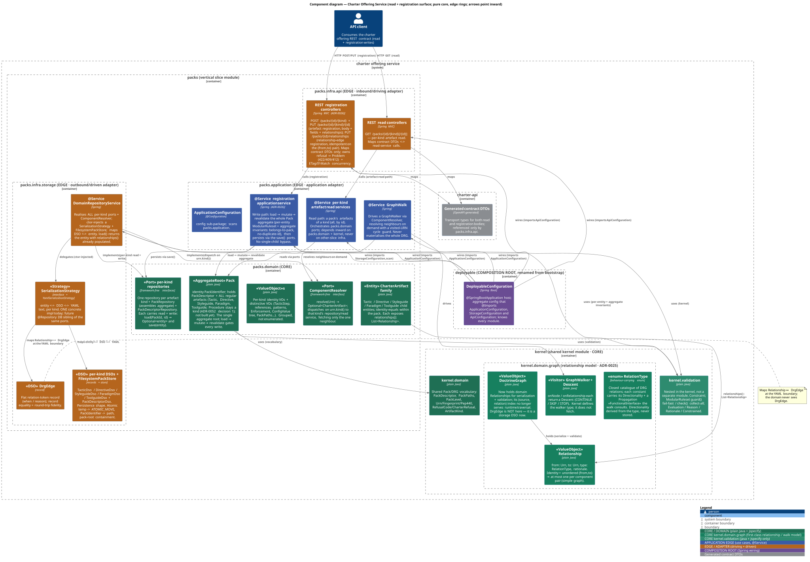
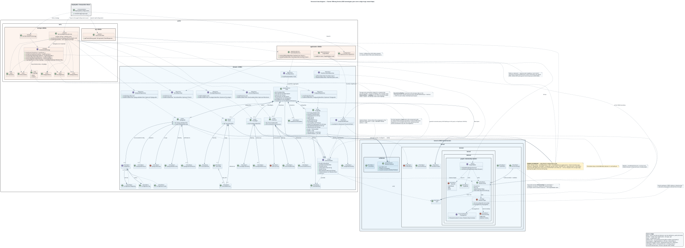
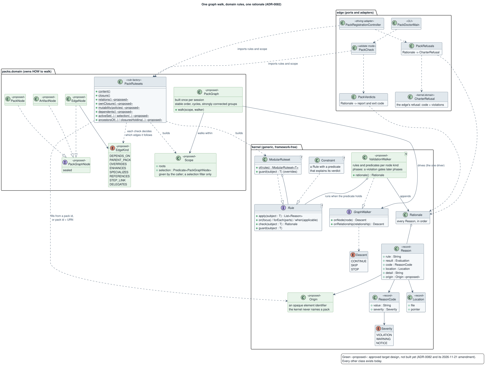
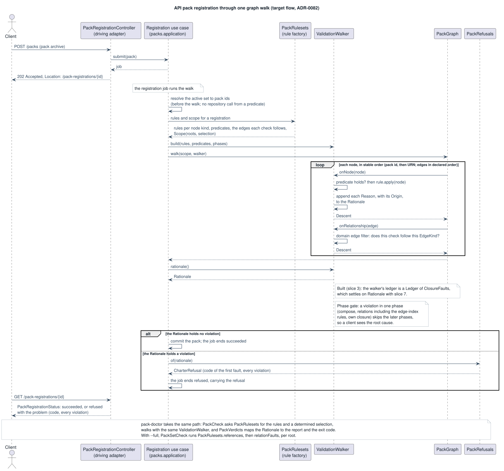

# Architectural patterns applied

[ADR-0006](/adr/0006-onion-vertical-slices-archunit/) decided the structure; this page shows
it as built by the pack repositories and validation mission, and names the pattern each part
plays. Three patterns combine.

- **Hexagonal (ports and adapters).** The domain declares the ports it needs. Adapters implement
  them (driven side) or call the application (driving side). The core never names an adapter.
- **Onion layering.** Dependencies point inward only: `infra` depends on `application`, which
  depends on `domain`, which depends on nothing outward.
- **Screaming architecture.** The top-level modules and packages name what the system is about
  (`packs`, `validation`) rather than the framework it uses. A new reader opening `service/`
  sees the subject first.

The patterns are named after their authors' work: hexagonal architecture (Alistair Cockburn),
onion architecture (Jeffrey Palermo) and screaming architecture (Robert C. Martin).

## The layout

```text
service/
  kernel/      ai.speckitty.charter.kernel.{domain, validation}
  packs/       ai.speckitty.charter.packs.{domain, application, infra.storage, infra.api}
  deployable/  ai.speckitty.charter.deployable   (renamed from bootstrap)
  charter-api/ generated contract types
```

The earlier flat, role-named modules (`charter-domain`, `charter-read-app`, `adapter-in-rest`,
`adapter-out-yaml`, `charter-service`) are superseded. The names screamed the technology; the new
ones scream the concern.

## Concern to pattern role

| Concern | Pattern role | What lives there |
|---|---|---|
| `kernel.domain` | Shared kernel | Vocabulary every slice may read: `PackDescriptor`, `DoctrineGraph`, `Urn`, `RefusalCode` |
| `kernel.validation` | Shared kernel, pure library | `Rule`, `ModularRuleset`, `Constraint`, `Reason`, `Rationale`, `Severity`, `Location`; `java` and `jspecify` only |
| `packs.domain` | Domain core | Aggregate root `Pack` (artifacts keyed by kind, CRG documents), child entities such as `Tactic`, value objects, identifier value objects, ports |
| `profiles.domain` | Domain core of the profiles slice | `AgentProfile` and its value objects; it implements the kernel's `CharterArtifact` and never depends on `packs`. The pack store binds the kind (ADR-0037, amendment of 2026-10-27) |
| `packs.application` | Application edge (use cases) | `@Service` read use cases, such as the tactic read service, that orchestrate domain ports. An outer edge, peer to storage; not pure |
| `packs.infra.storage` | Outbound, driven adapter | `DomainRepositoryService` (`@Service`), the `KindBindings` registry, `SerializationStrategy`, `WholePackStore`, DSO records |
| `packs.infra.api` | Inbound, driving adapter | REST controllers, Problem handling, the only users of generated DTOs |
| `deployable` | Composition root | The `@SpringBootApplication` and an aggregate `DeployableConfiguration` that imports each layer's `@Configuration`; the only code that knows every module |

Each `domain` package also holds the **ports**: `TacticRepository`, `PackDescriptorRepository`,
the aggregating `PackRepository` and the `PackInspectionQuery`. Serialization is a **strategy**
(`SerializationStrategy`, with `YamlSerializationStrategy` today) so a database-backed sibling
could be added behind the same port. Each stored kind registers a `KindBinding` (its DSO and the
mapping to its entity) and a YAML format, and the aggregate, the store and the strategy handle
every kind through that registry ([ADR-0037](/adr/0037-kind-keyed-pack-registry-and-whole-pack-seam/)).
`WholePackStore` loads a whole pack directory into the aggregate and writes it to a new
directory.

## Edge rings around a pure core

Only `packs.domain` and `kernel` are pure. `packs.application`, `packs.infra.storage` and
`packs.infra.api` are peer **edge** rings around them (see the 2026-10-21 revision of
[ADR-0006](/adr/0006-onion-vertical-slices-archunit/)). Each edge owns a `@Configuration` in a
`config` sub-package (`ApplicationConfiguration`, `StorageConfiguration`, `ApiConfiguration`). The
`deployable` module's `DeployableConfiguration` component-scans their `config` sub-packages, so a
test can load one slice of the wiring without the whole application.

## The diagrams

The component diagram shows containers and the direction of every dependency.



The class diagram shows the DDD stereotypes of the types, with the core above the edge.



The sources are `diagrams/c4-components.puml` and `diagrams/class-diagram.puml`. They show the
realized layout: the service as built. The class diagram's note says that Procedure stays a kind
([ADR-0052](/adr/0052-procedures-tightened-and-anti-patterns-as-authored-artifacts/) decision 1; not built
yet). The pack-model diagrams on [Descriptor schemas](/architecture/descriptor-schemas/)
draw the decided design instead.

## Walk through: Pack to Tactic to steps and references

Reading a tactic through the service touches every ring, once, in order.

1. A client calls `GET /packs/{packId}/artifacts/tactic/{artifactId}` (or lists
   `GET /packs/{packId}/artifacts?kind=tactic`). `ArtifactController` in `packs.infra.api` maps the request to an
   application service call and never touches storage (`ENTRYPOINT_OVER_APPLICATION`).
2. `ArtifactReadService` in `packs.application` resolves the pack and the kind, and delegates the item to the
   kind's own read service, `TacticReadService`. That `@Service` asks a domain port, such as
   `TacticRepository.load(packId, tacticId)`, for the tactic. It names only domain types.
3. `DomainRepositoryService` in `packs.infra.storage` implements that port. It finds the file for
   the identifiers inside the pack root, reads the YAML through the
   `YamlSerializationStrategy` into a `TacticDso` record, and maps the DSO into a `Tactic`
   through the tactic's `KindBinding`.
4. `Tactic` is built through its builder. Its `ModularRuleset` runs `guard`, so a tactic with no
   steps cannot exist. Its `TacticStep` and `TacticReference` lists are value objects whose
   order and duplicates are kept.
5. The `Tactic` is returned inward. The controller maps it to a generated DTO on the way out, inside the
   `Artifact` envelope, and builds its `_links` from the request.

A write runs the same path in reverse: entity to DSO to YAML, written to a temporary file and
moved into place atomically, so a failed write leaves the original untouched. Round-trip fidelity
is asserted on the DSO's value equality, not on the entity (see
[How to DDD here](/development/how-to-ddd/#identity-and-fidelity-are-different-concerns)).
A broken element file is excluded from `load` and reported by the `PackInspectionQuery`, so one
bad tactic does not hide the rest of the pack.

The aggregating `PackRepository.load(packId)` assembles a lightweight `Pack` (descriptor plus
tactics). `Pack` is the single aggregate root; the earlier graph-coupled `CharterPack` and the
pack-listing and action-context endpoints are removed.

## How it is gated

`HexagonalArchitectureTest` in `deployable` imports the whole service and enforces the structure:
inward-only onion dependencies, a pure domain and kernel, an application edge that stays within
its slice (`APPLICATION_IS_EDGE`), ports in the domain and their
implementations in storage, storage returning domain types, transport types confined to the
inbound adapter, slices not crossing, and a pure validation library. Every rule has a known-bad
control that proves it can fail. See [Code style and conventions](/development/code-style-and-conventions/).

## Applied patterns: one graph walk, domain rules, one rationale

[ADR-0082](/adr/0082-the-domain-owns-every-graph-walk-and-ports-transform-and-interface/) decides the principle: the
packs domain owns how any walk over packs and artifacts is done, there is one walking mechanism, rules run on the
elements a predicate selects, every finding lands in one `Rationale`, a static factory hands out the rules, and ports
only transform formats and talk to users. This section explains the patterns behind that decision and how they map
onto the code.

**What exists and what is proposed.** Each part below is marked. *Exists* means the type is in the code today.
*Proposed* means it is part of the target design from the design squad of 2026-11-21, approved by the operator the same
day but not built yet. Each migration slice lands as its own change (ADR-0082, amendment of 2026-11-21).

### The problem, before and after

Before: the walk down `depends_on` and `parent_pack` is written five times, four of them in `packs.application`.
Walks over references, step links and relationships are written by hand in several more places. Cycle detection lives
in application code. Results come back in several shapes beside `Rationale`. A new check means a new walk.

After (proposed): one domain-owned walk. A caller picks a scope and asks the rule factory for rules. The walk visits
each selected element once, runs the matching rules, and collects one `Rationale`. The edge maps that `Rationale`
once, to an HTTP problem or to a CLI exit code.

In this section, **the edge** means the ports and adapters layer, around the domain. It is not a graph edge: an edge
of the graph is a relation between two packs or artifacts, such as `depends_on`.



### Visitor, and its modern form: a sealed type with a pattern switch

**What it is.** A Visitor separates *walking* a structure from *doing something* at each element. The walker knows
how to move from element to element. The visitor is called at each element and decides what to do there. You can add
a new operation (a new visitor) without touching the walk.

The classic form uses double dispatch: each element has an `accept(visitor)` method that calls back the right
`visit` method. Java 25 offers a simpler form. A `sealed` interface lists every kind of element it permits. A
`switch` over it with type patterns (`case PackNode p -> ...`) then handles each kind, and the compiler refuses a
switch that forgets one. No `accept` methods are needed.

**Why here.** Every pack check is "walk some part of the graph, and judge what you meet". The walk is the same each
time; the judging differs. A Visitor lets one walk serve every check.

**How it maps.**

- *Exists:* `{@link ai.speckitty.charter.kernel.domain.GraphWalker}` is the visitor, generic over the node and the
  relationship it is handed (`GraphWalker<N, E>`, slice 3). It is called with `onNode` and `onRelationship`, and
  answers a `{@link ai.speckitty.charter.kernel.domain.Descent}`: `CONTINUE` (go deeper), `SKIP` (do not go below this
  element) or `STOP` (end the walk). The artifact walk's driver,
  `{@link ai.speckitty.charter.packs.application.GraphWalk#walk}`, still lives in the application layer (epic #636's
  checklist).
- *Proposed (still open):* `PackGraph` absorbs the reverse index of `ClosureRoots` and keeps `EdgeIndex` as its index
  (slice 4 and later). The kernel keeps only the visitor contract (`GraphWalker`, `Descent`); rules plug in as
  visitors and never drive. Rules use a pattern switch over `PackGraphNode`; there is no double dispatch.
- *Built (slice 3, #638):* the node types are in `packs.domain.graph` (`PackGraphNode`, `PackNode`, `ArtifactNode`,
  `EdgeNode` with the edge as written, `EdgeKind`). `PackGraph.of(packs in merge order, factsOf)` builds the graph
  over a closure's packs, reading facts lazily, and `PackGraph#walk(scope, mode, visitor)` is the driver: the roots'
  composition closure once each, in the graph's order, the scope's selection handed over, the mode's edges in declared
  order. The domain's modes (`PACKS`, and `RELATIONS` for slice 4) decide the edges; a rule's check carries its mode,
  so a caller never picks one. No mode emits an `ArtifactNode` or the descriptor, reference and delegation edges yet;
  the rule that needs one adds its mode. `packs.domain.graph` and `packs.domain` depend on each other (the nodes take
  `ConfiguredPack`, `PackOrigins` and the delegation candidate; the driver takes the nodes); no slice-cycle rule
  forbids it, and the graph package goes one way when those types move.
- *Built (slice 2, #637):* `PackGraph` (`packs.domain`) holds the walks the application layer
  wrote by hand: the edges a pack builds on, the descent along them, the composition closure, the packs building on a
  pack, its direct dependents, `cyclesIn` (with the Tarjan pass), the `enhances` grounding, and the composition
  resolver's `depends_on`-only closure, `parent_pack` line, dependency order and leftover cycles. No application class
  walks the pack graph or reads a descriptor's edges to walk them (`PackGraphWalkBoundaryTest`). `EdgeIndex` is not yet
  its index. The node types and the visitor driver are still proposed.

Reference: Gamma, Helm, Johnson and Vlissides, *Design Patterns* (1994);
[refactoring.guru: Visitor](https://refactoring.guru/design-patterns/visitor).

### Specification, as a predicate

**What it is.** A Specification is a small object that answers one yes-or-no question about a candidate: "is this
element one I care about?". Specifications combine with `and`, `or` and `not`. In Java the plain form is
`java.util.function.Predicate<T>`.

**Why here.** A caller must narrow the walk without changing it: "only the packs of this active set", "only the
artifacts this write touched". A predicate says that as data, so the walker stays the same.

**How it maps.**

- *Exists:* `{@link ai.speckitty.charter.kernel.validation.Constraint}` is a Specification that also explains its
  verdict: a rule with a predicate, whose location and detail are functions of the subject.
- *Proposed:* a **scope**, `record Scope(roots, Predicate<PackGraphNode> selection)`: the caller gives where the walk
  starts and which elements it selects (an active set, or a determined selection). It is only a selection filter.
  Which edge kinds are followed is not part of the scope: the domain rule or check decides it (the compose check
  follows `DEPENDS_ON` and `PARENT_PACK`, for example). Each rule in a walk also carries a predicate; the rule runs
  only on the elements its predicate selects.
- *Built (slice 3, #638):* `{@link ai.speckitty.charter.packs.domain.graph.Scope}` as above;
  `PackRulesets.ownClosureOf(declaring)` is the first named scope.

Reference: Evans and Fowler, [*Specifications*](https://martinfowler.com/apsupp/spec.pdf); Evans, *Domain-Driven
Design* (2003), chapter 9.

### Notification

**What it is.** Instead of throwing on the first error, a check collects every problem it finds into one object, the
notification, and hands it back. The caller then decides what to do with all of them.

**Why here.** A pack author wants every violation in one answer, not one per attempt. The API, pack-doctor and the
active-set doctor need the same list, ranked by severity.

**How it maps.**

- *Exists:* `{@link ai.speckitty.charter.kernel.validation.Rationale}` is the notification. Each entry is a
  `{@link ai.speckitty.charter.kernel.validation.Reason}` (rule, result, code, location, detail). Its weight comes from
  `{@link ai.speckitty.charter.kernel.validation.ReasonCode#severity}`, a
  `{@link ai.speckitty.charter.kernel.validation.Severity}`: `VIOLATION`, `WARNING` or `NOTICE`. Where it was found is a
  `{@link ai.speckitty.charter.kernel.validation.Location}` (a file and a pointer into it).
- *Built (slice 1, #614; [ADR-0083](/adr/0083-one-answer-on-every-surface-preset-items-stale-manifests-and-pack-doctor/)
  decision 15):* an `Origin` on each `Reason`, an opaque element identifier owned by the kernel. `packs.domain` fills
  it from a pack id, or a pack id and a URN (`PackOrigins`). The kernel never names a pack. `CompositionFault` is
  deleted, and one `ClosureFault.of(...)` factory builds every closure fault.
- *Proposed:* a `ValidationWalker` appends to the `Rationale` as it walks. No parallel result shape is kept beside it:
  `PackCompositionResolver.Refusal`, `ClosureVerdict` and the string notices of `ImpactCheck` fold into it.
- *Built (slice 3, #638), as an interim shape:* the walker's ledger is `Ledger`, a list of `ClosureFault`s whose
  `reason()` is the kernel's `Reason`, with `rationale()` projecting it in order. A `ClosureFault` also carries the
  packs, violations and `requiredBy` the edge maps; the ledger settles on `Rationale` with slice 7 (ruling R-x, recorded in
  [ADR-0083](/adr/0083-one-answer-on-every-surface-preset-items-stale-manifests-and-pack-doctor/) decision 15).

Reference: Fowler, [*Replacing Throwing Exceptions with Notification in
Validations*](https://martinfowler.com/articles/replaceThrowWithNotification.html).

### Strategy (and Composite)

**What it is.** A Strategy is an interchangeable piece of behavior behind one interface. The caller holds "a rule"
and does not care which one. A Composite lets a group of strategies stand in for one.

**Why here.** The walker must run any check without knowing what it checks. Each check is a strategy the walker is
given.

**How it maps.**

- *Exists:* `{@link ai.speckitty.charter.kernel.validation.Rule}` is the strategy: `apply` returns a list of
  `Reason`s, and `on`, `forEach` and `when` compose it. `{@link ai.speckitty.charter.kernel.validation.ModularRuleset}`
  is a `Rule` that holds rules, so it is both strategy and composite. `Rule<T>` also carries `check` (which returns a `Rationale`) and
  `guard` (which throws on a violation); `ModularRuleset` overrides `guard`.
- *Proposed:* `Rule<T>` is the validator, and no `Validator<T>` is added beside it. `ValidationWalker<N>` is a
  `GraphWalker` built from rules and predicates per node kind. It runs in phases behind a **phase gate**: once a
  phase records a `VIOLATION`, later phases do not run, so a client sees the root cause instead of its knock-on
  faults.
- *Built (slice 3, #638):* `{@link ai.speckitty.charter.packs.domain.ValidationWalker}` is a `GraphWalker` the driver
  feeds. A phase holds checks: an `OnNode` check (a node kind, a predicate, a rule) or an `OnClose` check (a rule over
  the selected nodes, run after the traversal). Each check keeps a bucket, joined in check order, so findings come rule
  first. The gate is on `VIOLATION`. Interim: a check's rule returns `ClosureFault`s rather than a kernel `Rule<T>`'s
  reasons, for the reason above; it converges with `Rule<T>` in slice 7.

Reference: [refactoring.guru: Strategy](https://refactoring.guru/design-patterns/strategy).

### Static factory

**What it is.** A class with public static methods that build and return ready-made objects, with names that say what
you get (`closure()`, `activeSet(..)`). Callers never assemble the parts themselves.

**Why here.** The API, pack-doctor and the active-set doctor must use the *same* rules and scopes. One public factory in the
domain is the single place they come from.

**How it maps.** ADR-0082 decides that the domain exposes its walkers, and a public static rule factory built on
generic functional interfaces such as `Predicate<T>`.

- *Exists:* `{@link ai.speckitty.charter.packs.domain.rules.PackRulesets}` with `content()` and `closure()`;
  `ModularRuleset.of` builds a ruleset.
- *Proposed:* `PackRulesets` grows `relations()`, `ownClosure()`, `mutability(policies)` and `dependents()`, and the
  scopes `activeSet(..)`, `selection(..)`, `ancestorsOf(..)` and `closuresHolding(..)`.
- *Built (slice 3, #638):* `PackRulesets.ownClosure(closureFacts, profiles, merge)` hands out a `GraphCheck` (the
  `PACKS` mode, one phase: fallback profile, own role pins, pin conflicts, profile enhancements), run over
  `ownClosureOf(declaring)`; `references(..)` runs its three checks as three phases of the walker.
  Interim: `references(..)` feeds the walker its members directly, not through `PackGraph#walk`, because its nodes are
  the callers' members (a subset of the closure, in the caller's order), not a scope's composition closure; slice 4
  moves it onto a graph walk.

Reference: Bloch, *Effective Java*, 3rd edition, Item 1.

### Hexagonal ports and adapters

**What it is.** The domain sits in the middle. Ports are the interfaces through which the outside reaches it or it
reaches the outside. Adapters plug into the ports: a driving adapter (an HTTP controller, a CLI) calls in, a driven
adapter (a file store) is called out to. The domain never names an adapter.

**Why here.** ADR-0082 gives ports two jobs only: transform formats (storage to the canonical domain shape, a
`Rationale` to a wire shape) and talk to users (the API, the CLIs, runners). No port judges a pack.

**How it maps.**

- *Exists:* the reading port `PackReading` and the storage reader `FileSystemPackInspector`; the driving adapters
  `{@link ai.speckitty.charter.packs.infra.api.PackRegistrationController}` and the `pack-doctor` CLI's
  `{@link ai.speckitty.charter.packdoctor.PackDoctorMain}`, which runs validate mode,
  `{@link ai.speckitty.charter.packvalidation.PackCheck}`; the mappers
  `{@link ai.speckitty.charter.packs.application.PackRefusals}` (to a
  `{@link ai.speckitty.charter.kernel.domain.CharterRefusal}`) and
  `{@link ai.speckitty.charter.packvalidation.PackVerdicts}` (to a report and an exit code). `PackRefusals`, pack-doctor
  and the stored reads share the wording in `{@link ai.speckitty.charter.packs.domain.PackRefusalMapping}`; slice 7
  settles where it lives.
- *Proposed:* the judging ports of PR #618 (`ClosureWalk`, `ImpactCheck`, `MutabilityCheck`) are replaced.
  `ClosureWalk` becomes a pure domain function (*built*, slice 3, #638: the port and `OwnClosureWalk` are deleted).
  `MutabilityCheck` goes; the real port is
  `MutabilityPolicyRepository` plus a closure reader. `ImpactCheck` becomes an application use case with no domain
  port. `packs.application` keeps orchestration only: sessions, the before-and-after difference that yields notices,
  and the activations gate.

Reference: Cockburn, [*Hexagonal architecture*](https://alistair.cockburn.us/hexagonal-architecture/).

### Each check as walker, scope and rules (proposed)

| Check | Scope | Rules |
|---|---|---|
| Compose (`CLOSURE`) | the roots; the check follows `DEPENDS_ON` and `PARENT_PACK` | per pack: the descriptor checks; at the end: duplicates, names, ranges, sibling contests, cycles, presets |
| Relations | the composed closure; the check follows `OVERRIDES`, `ENHANCES` and `SPECIALIZES` | per edge: self override, not permitted, a locked step enhanced, a stray step edge, the edge-index refusals; at the end: conflicts, one cycle fault per strongly connected group |
| Own closure | a single-root closure; predicate: the declaring pack or its profiles | fallback profile, role pins, profile enhancements (moved to `packs.domain.rules`); then the preset-item phase, built (`PresetItemRules`: `preset_item_not_held`, `preset_item_undeclared`; ADR-0083) |
| Case-only answer | the composed closure of each root; every member's mentions against every member's holdings | a preset item or a policy lock that names a held artifact only by letter case, built (`CaseOnlyRules`, one body: registration's phase 6 and pack-doctor's `CLOSURE`; R-y, R-z, ADR-0083 decision 20) |
| Impact | `closuresHolding(written)` | per closure, in phase order: compose (gate), relations including the edge-index rules (gate), own closure; then the application's notices and `requireComposable` |
| Mutability | `ancestorsOf(pack)`; predicate: the written artifacts | the policy level; one fault per refused write |
| Removal dependents | the removed pack; the check follows reverse edges, plus `REFERENCES` into it | `pack_has_dependents`, judged first |
| pack-doctor `validate` | a determined selection (the CLI's entries) | default: `CLOSURE`, in order the composition faults, the preset contests, the preset items and the case-only answer; `--full` adds `REFERENCES` when no rooted closure fails to compose (R-aa), per root over the composed closure, every pack in it (R-ae): the substep delegations, the references and the step enhancements' targets, one body with registration's (`PackRulesets.references`, R-ab; built, ADR-0083) |
| Active-set doctor (planned) | the active set | all of the above, collect-all, every severity |

### A registration, step by step (proposed)



The use case resolves the scope to pack ids first, asks `PackRulesets` for the rules and the scope, builds the
`ValidationWalker`, and lets `PackGraph` walk in stable order. The phase gate stops later phases after a violation.
A passing `Rationale` commits the pack; a failing one goes through `PackRefusals` to a problem with every violation.
pack-doctor takes the same path and ends in `PackVerdicts` and an exit code.

### The refusal mapping at the edge (unchanged)

The answer a client reads does not change. The `Rationale` maps to the closure verdict (the payload view, from
PR #618) and then through `PackRefusals#of` to a `CharterRefusal`. One fault answers exactly as before. The first
fault decides the refusal code; every violation is listed. The "In the closure rooted at ..." prefix of a detail moves
from the impact check into `PackRefusals`, so it is written in one place.

### Pitfalls and guards

- **The walker never learns a storage format.** No paths, YAML or storage records. A file location reaches a reason
  only as a `Location`.
- **A scope predicate is pure.** It reads values already loaded. Resolve the active set to ids *before* the walk;
  never call a repository from a predicate.
- **One traversal per phase.** A phase runs all its rules in one traversal, never one traversal per rule. A
  violation in a phase skips the later phases. ADR-0075 decision 7 still holds: `CLOSURE`
  needs every pack's descriptor, not the closure walk.
- **Determinism.** The first fault decides the refusal code, so order matters. The ledger order is phase order
  (compose, relations including the edge-index rules, own closure; then activations), then rule order within a phase
  (one bucket per rule, joined in the factory's declared order), then the graph's visit order: packs in the caller's
  merge order and, within a pack, its artifacts and edges in declared order. A whole-closure rule orders its own
  findings. *Amended 2026-11-25 (Accepted, operator ruling D1): the earlier text ordered nodes by pack id in code-point
  order, which would change today's first code on a multi-fault closure.*
  Never order work by iterating a `HashMap` or `HashSet`. Phase gates keep today's cascade suppression: the specific
  code wins.
- **No god walker.** The walker owns the traversal order, the edge filter, cycle handling and `Descent`. Rules,
  scopes, formatting and refusal mapping live outside it. If `walk` grows a parameter per caller, stop.
- **No second refusal model.** `CharterRefusal` stays the edge's projection, mapped once in `PackRefusals` and
  `PackVerdicts`. ADR-0075 already deleted parallel types once.
- **Performance.** Build `PackGraph` once per session, index rules by node kind, append to the ledger, keep the phase
  gates, and measure with `PackRegistrationScaleTest`, report-only
  ([ADR-0057](/adr/0057-performance-budgets-never-block-a-pull-request/)).

### Vocabulary

- **Severity**, not criticality: how much a `Reason` weighs (`VIOLATION`, `WARNING`, `NOTICE`). The glossary also
  uses "severity" for anti-patterns (`smell`, `severe`, `breaking`); that is a different scale.
- **Rationale**: the ledger of a check. **Reason**: one entry in it.
- **Refusal**: the outcome at the edge, a `CharterRefusal`.
- **Scope** (new): the selection filter a caller hands a walk: its roots and its selection predicate. It never
  names edges; the domain decides which edges a check follows. An *active set* is one way to pick the roots; a
  *closure* is what a walk from them reaches.
- **The edge**: the ports and adapters layer. A **graph edge** is a relation between two nodes.
- The code spells the artifact type `CharterArtifact`; the proposed node is `ArtifactNode`, to match.

### Migration slices (approved, not built yet)

Smallest first. Each replaces outright, with no deprecation window (the charter's rule). Within one slice the old
walk and the new path never coexist: each slice deletes what it replaces. Slices 3, 5 and 6 assume PR #618 has
merged; otherwise they delete nothing and #618's ports are not built.

1. **Ledger entry.** `Origin` on `Reason`; unify `CompositionFault` and `Refusal` into the closure fault (#614). No
   behavior change. Fixtures, contract examples and round-trip checks assert `Origin`; no test excludes it.
   *Built 2026-11-21 (#614, ADR-0083 decision 15): `CompositionFault` is deleted; the resolver's `Refusal` and
   `ClosureVerdict` stay, and slice 7 removes `ClosureVerdict`.*
2. **`PackGraph` and `Scope` in the domain.** Move the composition closure, the `ClosureRoots` index, and the cycle
   and strongly-connected-group code; delete the duplicate walks in `InboundReferences`, `PackMutabilityPolicy` and
   `RemovalDependents`.
   *Built 2026-11-25 (#637): `PackGraph` holds the walks, the application's and the resolver's, and the old ones are
   deleted. `Scope` and the node types are built in slice 3 (operator ruling D1, 2026-11-25).*
3. **`ValidationWalker` and the factory.** `PackRulesets` becomes the factory; the own-closure rules move into
   `packs.domain.rules`; delete `ClosureWalk` and `OwnClosureWalk`.
   *Built 2026-11-25 (#638): the generic visitor contract, the node types, `Scope`, the `PackGraph` driver, the
   `ValidationWalker`; the own-closure rules and `REFERENCES` run on it; `ClosureWalk` (with `Profiles`, now
   `ProfileReader`) and `OwnClosureWalk` are deleted.*
4. **Relations as rules.** The relation refusals and the edge-index refusals become rules of the relations phase;
   `EdgeIndex` stays as the graph's index.
5. **Mutability.** Delete `MutabilityCheck`.
6. **Impact.** The closure impact check becomes a walker orchestration; delete `ImpactCheck`; remove the fault's lift
   from a `CharterRefusal`.
7. **Callers.** `PackSetCheck` moves onto the factory; the doctor starts here.
