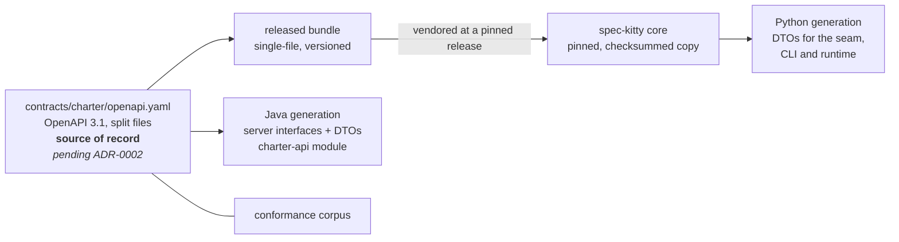

# Contract and DTOs

> **State:** design only. `contracts/charter/` does not exist yet, here or in core. Core has
> one contract module today, `contracts/mission-status/`, and the tooling this contract
> will reuse.

## One document, two generators

The operator's direction (2026-10-13) is that an OpenAPI spec is ingested by the core and
used to generate the DTOs that runtime execution (the CLI, the `next` state machine) uses.
The service is built against the same document.

- **The service** generates its server interfaces and transport DTOs at build time
  (`charter-api`). Controllers implement the generated interfaces, so a contract change that
  the code does not follow fails the build.
- **The core** ingests a released bundle of the contract (pinned and checksummed, the way
  core ADR `2026-08-16-2` plans to vendor built-in packs; core #3504, not built yet) and
  generates Python DTOs from it. The seam
  `charter.offering.api` returns those DTOs; the CLI and the runtime consume them. No Python
  code hand-writes a charter response shape. This is decided in [ADR-0004](/adr/0004-public-api-returns-generated-dtos/): the
  contract generates DTOs per client language (Python here, Java for the service, others as
  needed).
- **Neither side imports the other.** Python and Java agree by contract and by fixtures, not
  by sharing code.

Where the contract is authored is decided in
[ADR-0002](/adr/0002-contract-source-of-record/) (Proposed): here, in this repository,
with core consuming releases. Core ADR `2026-10-03-1` placed it in core's `contracts/`; that
placement predates the charter getting its own repository.

## What the contract carries

Following core ADR `2026-10-03-1` ("Cross-language contract"), the **charter contract** is
the OpenAPI document plus four more parts:

1. the versioned **OpenAPI 3.1** document and the **YAML document schemas** of the inputs
   (pack descriptor, org charter, DRG fragment and graph shards, artifact files,
   `charter.yaml`);
2. the **semantic rules**: merge, activation, traversal and resolution;
3. **canonical identifiers and diagnostics**: refusal codes such as `PACK_LEVEL_MISMATCH`
   are part of the contract, not implementation detail;
4. **fixtures**: positive, negative, provenance and conflict cases;
5. **expected results**: action-scoped context and graph-query answers for each fixture.

Items 2 to 5 are what let two implementations give one answer.

## Conventions

The contract follows core's `contracts/README.md` so the same tooling can check it:

- a module directory with a root `openapi.yaml` that holds only info, servers, tags and the
  path-to-file map; one file per path under `paths/`; `schemas/`, `parameters/`,
  `responses/` and `examples/`, each listed in an `_index.yaml`;
- plain relative `$ref`s only (no URLs, absolute paths or braces);
- `servers: [{url: /api/v1}]`; paths never carry the prefix;
- the shared vocabulary core already defines (`Problem` for refusals, `PageInfo`,
  `PageCursor`) is reused, not copied with changes;
- its own `info.version` and `CHANGELOG.md`.

## Versioning

- Response schemas are **closed** (`additionalProperties: false`). Any change to a response
  shape ships as a new schema version and a new published contract release.
- An unreleased version carries a `-SNAPSHOT` suffix.
- A breaking-change check compares each release with the previous one; a breaking change
  needs a new major version and a core-side migration of its DTO consumers.
- The core pins one contract release. Raising the pin regenerates its DTOs in the same
  change, and the conformance corpus of that release must pass against the Python
  implementation while it still answers.

## Generator choice

Core's `contracts/build.gradle` already pins `org.openapi.generator` 7.25.0 for validation
and client smoke tests. Using it for the Java server stubs is the default. The Python DTO
generator is the core's choice, made when the seam is built; it must emit plain data classes
with no runtime dependency on this repository.
