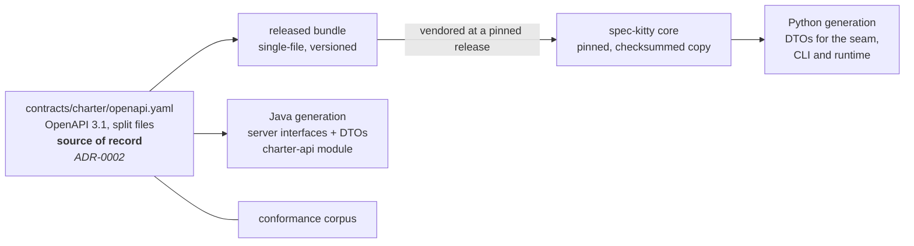

# Contract and DTOs

How one OpenAPI document becomes the DTOs on both sides: the service generates its server interfaces from it, and core ingests a pinned release to generate its own. The page also lists what the contract carries and how it is versioned.

> **Status:** partly built. `contracts/charter/` exists here at `0.1.0-SNAPSHOT` with three read operations and its contract scenarios, the charter's own contract checks run in the build, and the service generates its interfaces from it. No release is cut and core ingests nothing yet. [What the labels mean](/#status).

## One document, two generators

The operator's direction (2026-10-13) is that an OpenAPI spec is ingested by the core and
used to generate the DTOs that runtime execution (the CLI, the `next` state machine) uses.
The service is built against the same document.

- **The service** generates its server interfaces and transport DTOs at build time
  (`charter-api`). Controllers implement the generated interfaces, so a contract change that
  the code does not follow fails the build.
- **The core** ingests a released bundle of the contract (pinned and checksummed, the way
  core ADR [`2026-08-16-2`](https://github.com/spec-kitty/spec-kitty/blob/main/docs/adr/3.x/2026-08-16-2-open-packs-is-source-of-truth-for-built-in-doctrine.md) (open-packs as the built-in source) Option B re-vendors built-in packs; core #3504, in progress) and
  generates Python DTOs from it. The seam
  `charter.offering.api` returns those DTOs; the CLI and the runtime consume them. No Python
  code hand-writes a charter response shape. This is decided in [ADR-0004](/adr/0004-public-api-returns-generated-dtos/): the
  contract generates DTOs per client language (Python here, Java for the service, others as
  needed).
- **Neither side imports the other.** Python and Java agree by contract and by fixtures, not
  by sharing code.

Where the contract is authored is decided in
[ADR-0002](/adr/0002-contract-source-of-record/) (Accepted 2026-10-18): here, in this repository,
with core consuming releases. Core ADR [`2026-10-03-1`](https://github.com/spec-kitty/spec-kitty/blob/main/docs/adr/4.x/2026-10-03-1-charter-read-write-service-strangler.md) (the staged Java service strangler) placed it in core's `contracts/`; that
placement predates the charter getting its own repository; its Amendment 2026-10-18 points
here.

The behavior half of the contract is written as **contract scenarios** in
`contracts/charter/scenarios/`, beside the OpenAPI document
([ADR-0008](/adr/0008-rewrite-and-replace-against-bdd-and-openapi-contracts/)). Each scenario
names pack files, calls one operation and states the answer; the service runs every scenario
tagged `@contract` in its build, and another implementation can bind the same steps. Where
the scenarios live, and the other two scenario homes:
[Behavior and acceptance scenarios](/architecture/behavior-and-scenarios/#where-they-live).

## What the contract carries

Following core ADR `2026-10-03-1` ("Cross-language contract"), the **charter contract** is
the OpenAPI document plus four more parts:

1. the versioned **OpenAPI 3.1** document and the **YAML document schemas** of the inputs
   (pack descriptor, org charter, DRG fragment and graph shards, artifact files,
   `charter.yaml`);
2. the **semantic rules**: merge, activation, traversal and resolution;
3. **canonical identifiers and diagnostics**: refusal and diagnostic codes such as
   `pack_level_mismatch` are part of the contract, not implementation detail. They are
   snake_case on the wire; the integration seam in core maps them to core's own spellings;
4. **fixtures**: positive, negative, provenance and conflict cases;
5. **expected results**: action-scoped context and graph-query answers for each fixture.

Items 2 to 5 are what let two implementations give one answer.

## Conventions

The contract keeps the layout of core's `contracts/README.md`, but the charter owns its
conventions and the checks that enforce them (operator, 2026-10-18): core's contract tools
do not run here, and where core's conventions differ, the integration seam in core adapts.
The charter's own checks run in `./gradlew verifyAll` through the `:contracts` project: a
lint ruleset in `contracts/lint/` with at least one planted fixture per rule, the bundle
core vendors, a Java checker that every response schema is closed, and the breaking-change
check. The rules and tasks are listed in [`contracts/lint/README.md`](https://github.com/spec-kitty/spec-kitty-charter/blob/main/contracts/lint/README.md).

The layout:

- a module directory with a root `openapi.yaml` that holds the info, servers, root `security`,
  tags, the path-to-file map and the `components` that declare `securitySchemes`; one file per
  path under `paths/`; `schemas/`, `parameters/`, `responses/` and `examples/`, each listed in
  an `_index.yaml`;
- plain relative `$ref`s only (no URLs, absolute paths or braces);
- `servers: [{url: /api/v1}]`; paths never carry the prefix;
- the shared vocabulary that came from core (`Problem` for refusals, `PageInfo`,
  `PageCursor`, in `contracts/_shared/`) is kept close to its origin, but this repository's
  copy is canonical: a change is made here when there is reason to, listed in
  `contracts/_shared/VENDORED.md`, and consumers adapt
  ([ADR-0015](/adr/0015-charter-repository-is-canonical-for-charter-structure/));
- its own `info.version` and `CHANGELOG.md`;
- `x-source` or `x-derived` on every resource property, citing where its value comes from,
  and `x-provisional` on a part whose behavior is not decided yet, naming the decision.

## Versioning

- Response schemas are **closed** (`additionalProperties: false`), so a strict consumer such
  as core's integration seam may reject a member it does not know. Adding a response
  property, optional or required, is therefore a **breaking** change (DM
  `01M5986E711JT296MA6NDN91MG`), like any other change to a response shape: it needs a new
  major version and a core-side migration of its DTO consumers.
- **New capabilities arrive as additive contract sets** (provisional,
  [ADR-0009](/adr/0009-contract-1-0-reservations-and-additive-contract-sets/)). Activation,
  persistent exclusions, value sets and the creed come as new endpoints or a new OpenAPI
  contract set beside the existing one. A new path is not a breaking change, and a client
  chooses whether to use it. Existing response shapes are not widened for them.
- **1.0 reserves what the cutover needs.** Because a later addition to an existing response
  is breaking, 1.0 carries:
  - the `impacts` relation, modeled as a signed, authored edge; `in_tension_with` is dropped
    and `reconciles_tension` targets `impacts < 0` pairs;
  - the refusal codes `governance_policy_violation` (still raised by nothing) and `stale_input`
    (now raised);
  - an integer `depth` request parameter on the context read that counts `suggests` hops (0 to
    2), echoed in the response with no maximum;
  - an info endpoint with `serviceVersion`, and `Charter-Contract-Version`, `Charter-Worktree`
    and `Charter-Source-Fingerprint` response headers (the last on 200 answers only);
  - a governance fingerprint on context responses.

  Core aligns to these at the cutover. Until then, core's seam maps its `in_tension_with`
  edges to negative `impacts` edges.
- A breaking-change check (`checkContractCompatibility`) compares the bundle with the last
  released version of the same major version. Until the first release there is no baseline,
  and the check says so. How the released version is found, and the release procedure, are in
  [the released baseline](https://github.com/spec-kitty/spec-kitty-charter/blob/main/contracts/lint/README.md#the-released-baseline).
- A release is tagged on `main` after its pull request merges. Publishing the bundle and the
  conformance corpus from a tag is not built yet; it is a follow-up (DM
  `01M5986KJ7B18K7GQ25E47J989`).
- The core pins one contract release. Raising the pin regenerates its DTOs in the same
  change, and the conformance corpus of that release must pass against the Python
  implementation while it still answers.

## Generator choice

Core's `contracts/build.gradle` already pins `org.openapi.generator` 7.25.0 for validation
and client smoke tests. Using it for the Java server stubs is the default. The Python DTO
generator is the core's choice, made when the seam is built; it must emit plain data classes
with no runtime dependency on this repository.
