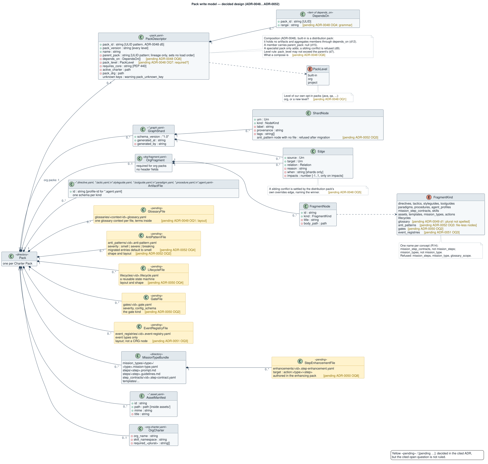
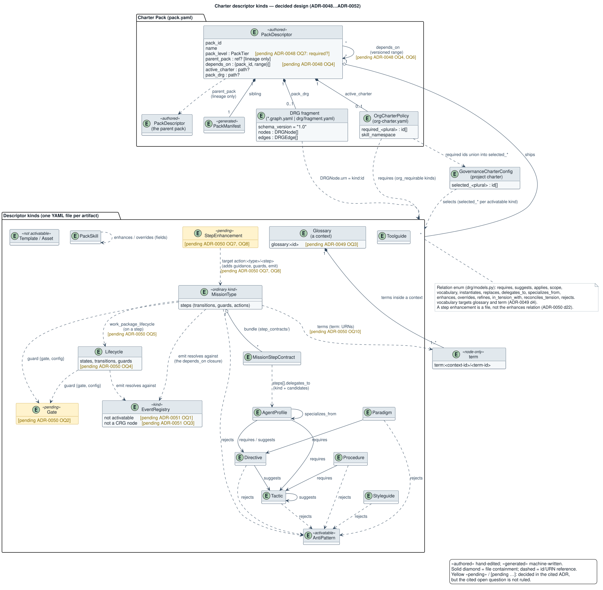
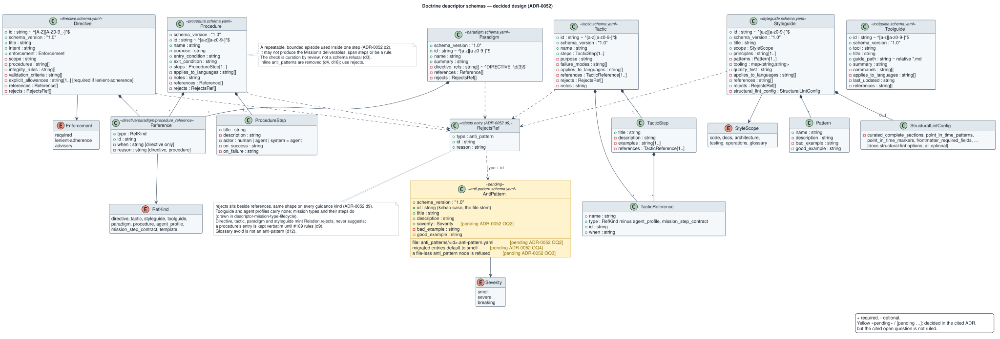
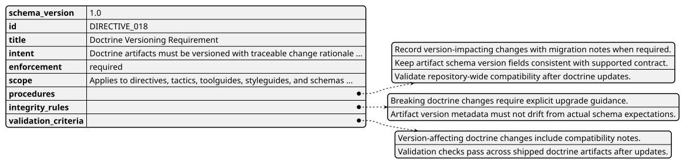
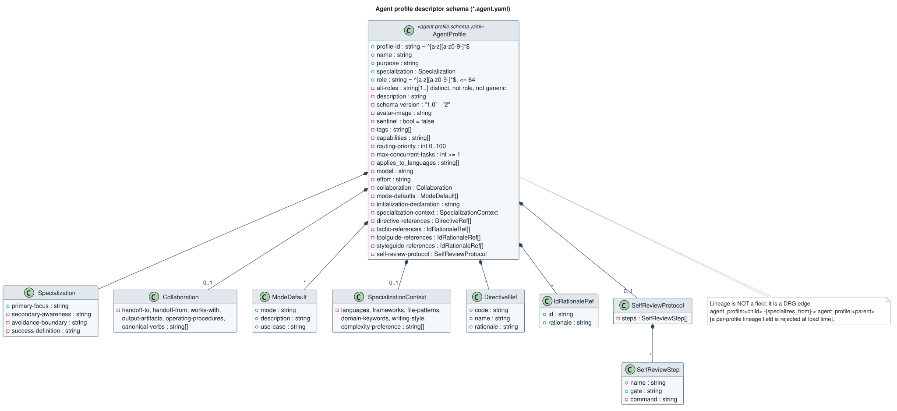
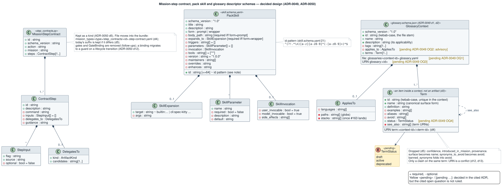
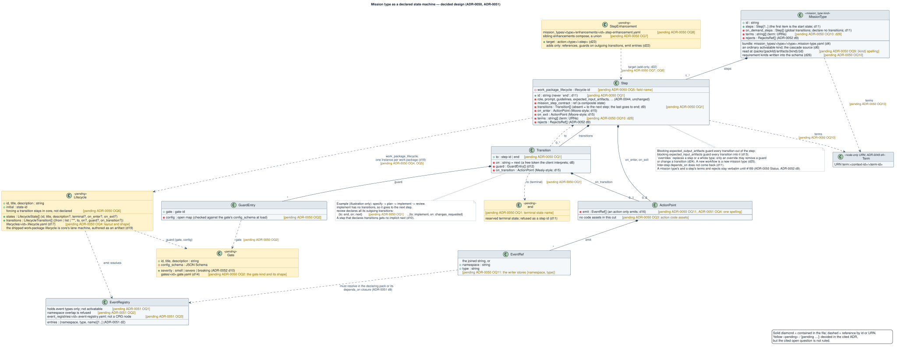
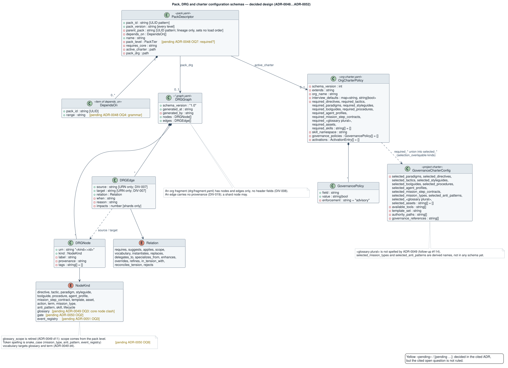

# Descriptor schemas

The structural authority for every descriptor file is the set of JSON Schemas in
[`contracts/packs/schemas/`](https://github.com/spec-kitty/spec-kitty-charter/tree/main/contracts/packs/schemas)
(23 schemas), canonical here and edited in place under
[ADR-0017](/adr/0017-pack-schemas-imported-as-canonical-json-schema/) and
[ADR-0015](/adr/0015-charter-repository-is-canonical-for-charter-structure/) (first imported from core's models;
the import's changes are tabled in the
[mission research](https://github.com/spec-kitty/spec-kitty-charter/blob/main/kitty-specs/pack-schemas-and-level-policy-01M5AFMA/research.md#import-changes-c1-c16)). The service's YAML adapter validates against them. The authored
files and how they nest are drawn in the [pack write model](#pack-write-model). Six diagrams on this
page draw the decided design of ADR-0048 to ADR-0052 (each names its ADRs in its title), not
today's schemas or code: the pack write model, the descriptor kinds, the charter kinds, the
mission-step contract, skill and glossary schemas, the mission type, and the pack, CRG and charter
configuration schemas. The agent-profile and directive-example diagrams are not decided design: they
show today's schema and an instance. Where a decided-design diagram differs from a schema, the
difference is the decision, not an error. Yellow «pending» classes and `[pending ADR-00xx OQn]` marks show an open question that
no ruling has settled yet. Each of the 23 schemas also has its own page, with a diagram, under
[Pack schemas](/architecture/pack-schemas/). Notation in the field diagrams: `+` required, `-`
optional, `~` regex pattern, `[1..]` non-empty list, `= x` default.

All `src/charter/...` and `packs/...` paths on this page are in core,
[`spec-kitty/spec-kitty`](https://github.com/spec-kitty/spec-kitty).

These diagrams are explained by [Descriptors](/architecture/descriptors/). Where a diagram
and a schema disagree about structure, the schema wins; where this page and
[Descriptors](/architecture/descriptors/) disagree about meaning, that page wins. The diagrams
show the decided design, so they do not draw today's details. The service's schemas already
diverge from core's in a few places (see the
[Divergence register](/conformance/divergence-register/)), and the diagrams follow the service
for the divergences below. The graph shard and org fragment follow DIV-007 (URN endpoints only),
DIV-008 (no fragment header fields), DIV-009 (`generated_by` optional) and DIV-019 (no edge
provenance); the procedure follows `procedure.schema.json`.

Known core-derived details: the field lists of the project charter configuration and
the node and relation enums on the governance diagram, and of the directive, tactic, paradigm,
styleguide and toolguide on the charter kinds diagram, are read from core's models and are not
cross-checked field by field against the service schemas. Check the schema before relying on one.
Whether `pack_level` becomes required is still open (ADR-0048 open question 7).

## Pack write model



The authored pack files at C4 code level: the pack descriptor, graph shards, the org fragment, nodes, edges,
artifact files and the asset manifest, with their multiplicities. The org charter is not drawn: it is retired (#431). It draws the decided
design ([ADR-0048](/adr/0048-pack-composition-and-the-named-packs-split/) to
[ADR-0052](/adr/0052-procedures-tightened-and-anti-patterns-as-authored-artifacts/)), not the files the
service reads today. Source: `diagrams/pack-write-model.puml`. A node of a fragment names its kind with one
canonical plural (`mission_step_contracts`, not `mission_steps`); see [Domain](/context/domain/). An
artifact file's identity is `id`, or `profile-id` in a `*.agent.yaml`. A shard node may carry an optional
`provenance`; an edge may not. `charter.schema.json` is not drawn: it validates the project's
`charter.yaml`, which is not a pack file (`file-kinds.yaml`). The pack-level `preset` and `pack-manifest`
schemas are not drawn yet; they are described in [Pack-level schemas](#pack-level-schemas). Today's
`mission-type` schema with its step companions is not drawn either; it is described in [Mission
type](#mission-type), which also has the decided-design diagram. The other two Markdown structure schemas
are not drawn either: `toolguide-guide` is described in [Descriptors](/architecture/descriptors/), and
`pack-document` in the [logical model](/architecture/logical-model/).

## Kinds, containment and edges



A Charter Pack (`pack.yaml`) ships descriptor files, an optional CRG fragment and optional
presets. CRG nodes refer to descriptors by URN `<kind>:<id>`. A preset's must-have items are
the required floor of the projects whose closure holds the pack; core's org charter, whose
`required_<plural>` lists overlaid the project charter's `selected_<plural>` lists, is retired in
the service (#431, [Enforce presets on an organization's projects](/guides/enforce-org-presets/)).

> **Decided design:** this diagram draws the kinds as decided in ADR-0048 to ADR-0052: `glossary` for
> `glossary_pack`, an `AntiPattern` kind, `lifecycle`, an ordinary `MissionType` and an event registry
> (activation pending ADR-0051 OQ1). Today's code and schemas still have the old shape; the sources for that
> shape are `src/charter/offering/artifact_kinds.py` and `src/charter/offering/drg/models.py` in core.

## Charter kinds



> **Decided design:** this diagram draws
> [ADR-0052](/adr/0052-procedures-tightened-and-anti-patterns-as-authored-artifacts/): anti-patterns are
> authored files that `rejects` references, not inline fields. Today's schemas still carry the inline
> anti-patterns. Today's shape comes from
> `src/charter/offering/schemas/{directive,tactic,paradigm,styleguide,toolguide,procedure}.schema.yaml` in
> core.

Example instance (`packs/built-in/directives/018-doctrine-versioning-requirement.directive.yaml`, folded text shortened):



## Agent profile



Source: `src/charter/offering/schemas/agent-profile.schema.yaml` (schema-version 2).

## Mission-step contract, pack skill, glossary pack



> **Decided design:** the diagram above draws [ADR-0049](/adr/0049-glossary-contexts-and-terms/) and
> [ADR-0050](/adr/0050-mission-types-and-lifecycles-as-declared-state-machines/): `glossary_pack` becomes
> `glossary`, a glossary context that holds terms. Today's code and schemas still have the old shape. In
> core, the mission-step contract and the glossary pack have no JSON Schema file; their Pydantic models
> (`src/charter/offering/missions/step_contracts.py`, `src/charter/offering/glossary_packs/models.py`) are
> the schema, and the skill schema is `src/charter/offering/schemas/skill.schema.yaml`. This repository
> holds a closed JSON Schema for each (`contracts/packs/schemas/`).

## Mission type

The `mission-type` schema and the structure schemas of a step's two Markdown companions were
designed here, not imported: core has no mission-type artifact kind (DIV-501) and reads a mission
type from files the service retires (DIV-502). All three are closed
([ADR-0044](/adr/0044-mission-types-consolidated-into-one-sanitized-shape/), accepted 2026-10-31).
[Descriptors](/architecture/descriptors/) explains the
fields.

> **Decided design:** [ADR-0050](/adr/0050-mission-types-and-lifecycles-as-declared-state-machines/) adds
> explicit transitions, guards and the `lifecycle` kind to the mission type, and a `guard` kind implemented by
> executable assets ([ADR-0054](/adr/0054-guards-are-enforced-checks-implemented-by-executable-assets/); the proposed
> `gate` kind was not taken), and [ADR-0048](/adr/0048-pack-composition-and-the-named-packs-split/) renames
> `missions/` to `mission_types/`. The diagram below draws that design, and the code does not do it yet. The
> field list below it is the schema the service reads today.



The mission type as a declared state machine, as decided in ADR-0050 and ADR-0051. The `lifecycle` and `guard` kinds are stored and checked (#156).

**`mission-type`** (`missions/<id>/<id>.mission-type.yaml`):

- `+ schema_version`: `"1.0"`
- `+ id`: `~ ^[a-z][a-z0-9]*(-[a-z0-9]+)*$`, at most 64 characters, equal to the file stem
- `+ title`, `+ description`; `- content`
- `- requires_substantive_spec`: only `true`
- `- path_conventions`: at least one of `workspace`, `tests`, `deliverables`, `documentation`,
  `data`
- `- expected_output_artifacts`, `- references`: each `[1..]`
- `+ steps`: `[1..]` steps, in run order; `- on_demand_steps`: `[1..]` steps
- a step: `+ id` (the id grammar, at most 64 characters), `+ title`, `- description` (1 to 160 characters), `- role`
  (`~ ^[a-z][a-z0-9-]*$`), `- prompt_path`, `- guidelines_path`, `- expected_input_artifacts`,
  `- expected_output_artifacts`, `- references`
- an input: `+ artifact_key` (at most 255 characters), `+ path_pattern`, `- blocking` (only `true`)
- an output: `+ artifact_key` (at most 255 characters), `+ artifact_class`, `+ path_pattern`, `- blocking`,
  `- template_path`
- a reference: `+ type` (a guidance kind), `+ id`, `- when`, `- reason`

**`mission-step-prompt`** and **`mission-step-guidelines`** (`steps/<id>.prompt.md`,
`steps/<id>.guidelines.md`) are structure schemas over the Markdown model: an optional H1, a
preamble and H2 sections `{title, content}`. A prompt may have frontmatter holding only
`+ description`, its detailed description; guidelines have none.

## Pack, CRG and charter configuration



> **Decided design:** the diagram above draws ADR-0048 to ADR-0052.
> [ADR-0048](/adr/0048-pack-composition-and-the-named-packs-split/) adds `depends_on` to the pack descriptor
> and a ULID pattern to `pack_id` and `parent_pack`, and narrows `parent_pack` to lineage. The pack descriptor schema
> in this repository already has that shape; the diagram is the decided design for the other pack-level files. Its
> sources in core are `src/charter/offering/packs/pack_descriptor.py`, `src/charter/offering/drg/models.py`
> and `src/charter/activation/schemas.py`.

## Pack-level schemas

Three schemas cover the files that describe a pack as a whole. All three are closed
(`additionalProperties: false` at every level), so an unknown key is refused
([ADR-0042](/adr/0042-pack-level-files-sanitized-shapes-and-the-derived-manifest/), proposed). The
`preset` and `pack-manifest` schemas were designed here, not imported (the descriptor schema was
imported from core, ADR-0017): core's preset and manifest files have other shapes, and the
pinned built-in ones are refused until `spec-kitty-open-packs` adopts these.

**`pack-descriptor`** (`pack.yaml`). The fields are unchanged. The schema is closed now: a key it
does not declare, a retired one such as `accompanies_doctrine_pack` included, makes `pack.yaml`
unreadable. Its description says that `pack_level` is optional and `pack_version` is required at
every level.

**`preset`** (`presets/<id>.yaml`):

- `+ schema_version`: `"1.0"`
- `+ id`: `~ ^[a-z][a-z0-9]*(-[a-z0-9]+)*$`, at most 64 characters, equal to the file stem
- `+ description`: not empty
- `- activated_kinds`: `[1..]` unique kind plurals, from the 13 kinds a preset can gate (every artifact kind but
  `mission_type`, which a preset activates in its own `activated_mission_types` list)
- `- activated_directives`, `activated_tactics`, `activated_styleguides`, `activated_toolguides`,
  `activated_paradigms`, `activated_procedures`, `activated_agent_profiles`,
  `activated_mission_step_contracts`, `activated_anti_patterns`, `activated_mission_types`: each
  `[1..]` items
- an item: `+ id` (not empty), `- must_have` (only `true`: present means must-have)

**`pack-manifest`** (`pack-manifest.yaml`):

- `+ schema_version`: `"1.0"`
- `+ manifest_hash`: `~ ^[0-9a-f]{64}$`, derived
- `+ constituents`: a list, possibly empty, of `{+ kind, + id, + path, + content_hash}`; `kind` is
  an artifact kind token, `content_hash` is 64 lowercase hex characters, derived
- `- presets`: `[1..]` of `{+ id, + path, + content_hash}`; `path` matches `presets/<id>.yaml`
  for an id of the preset grammar, and a storage rule beyond the schema requires it to be the
  entry's own `presets/<id>.yaml`

A derived field is not authored: the service recomputes it on every whole-pack write.
`content_hash` is SHA-256 of the file's bytes with CRLF and lone CR replaced by LF; `manifest_hash`
is SHA-256 of the RFC 8785 canonical JSON of the manifest without `manifest_hash`. The fetched-pack
and charter-bundle fields of core's manifest (`charter`, `fetched_at`, `source_url`, `source_type`,
`generated_at`, `generated_by`, `provenance_path`) are not in the schema.

## Regenerating the diagrams

The `.puml` files in `docs/architecture/diagrams/` are the sources. The committed `.svg` files
are rendered from them with the repository's pinned PlantUML jar. The version, download URL and
SHA-256 of that jar are in `scripts/docs/plantuml_pins.json` (PlantUML 1.2026.6). The jar needs
Graphviz and Java 21. Download the jar, check its hash against the pin, then run it headless:

```bash
cd docs/architecture/diagrams && java -Djava.awt.headless=true -jar plantuml.jar -tsvg *.puml
```

CI checks that the committed SVGs are current: the "PlantUML diagrams are current" job of
`docs-cleanliness.yml` runs `python3 scripts/docs/check_docs.py plantuml`. To match CI exactly,
render in an `ubuntu:24.04` container with `python3`, `python3-venv`, `curl`, `git`, `graphviz`
and `openjdk-21-jre-headless` installed, and a virtual environment built from
`scripts/docs/requirements.txt`. Another PlantUML version or Graphviz build can produce SVGs that
differ and fail that job.

The docs site also renders diagrams, but at build time, through a render service pinned by image
digest (`plantuml/plantuml-server:jetty-v1.2026.9`). That is how the pages under
[Pack schemas](/architecture/pack-schemas/) get their diagrams. The SVGs committed here still come from the
repository jar, not from that service.

`_style.iuml` holds the shared styling and is included by every diagram.
