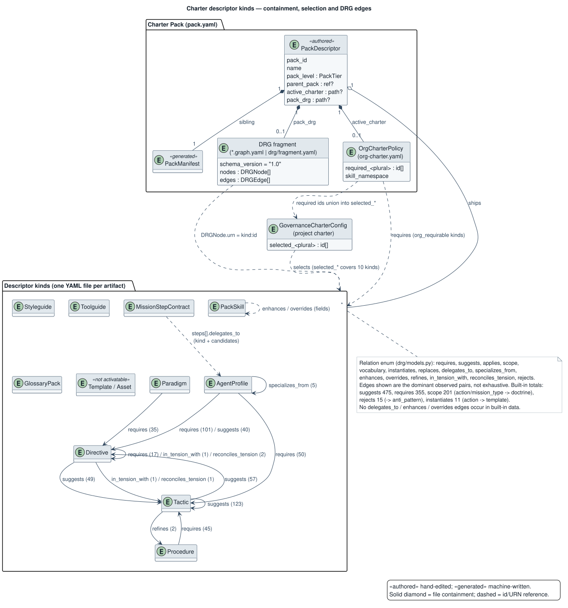
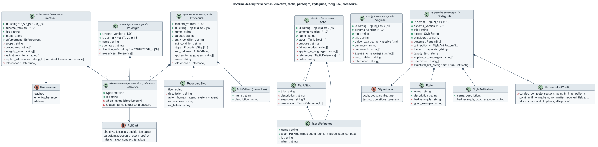
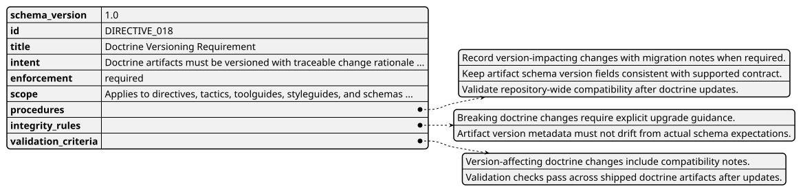
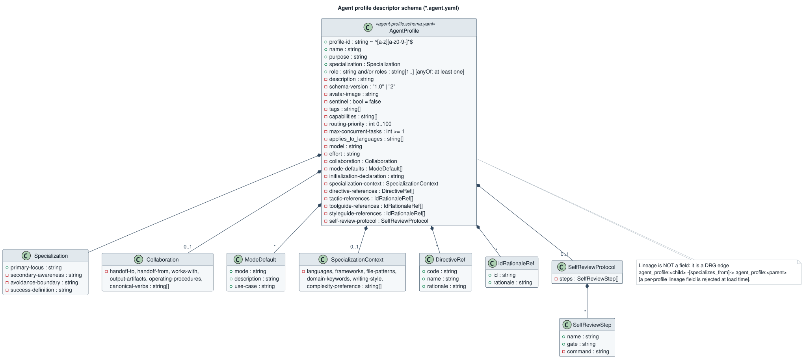
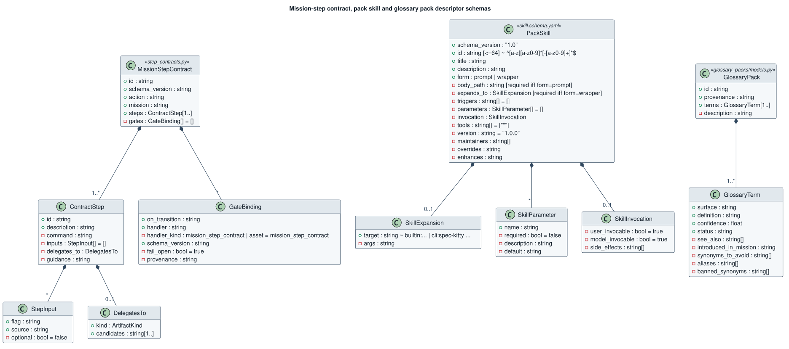
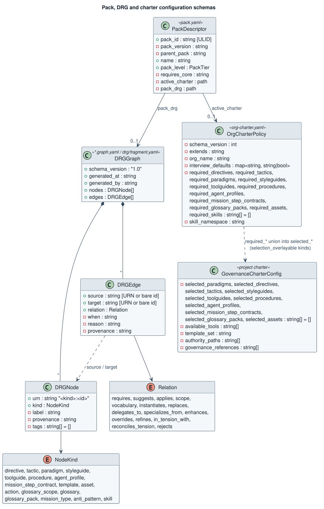

# Descriptor schemas

These diagrams describe the descriptor files the charter offering reads today in the
core `spec-kitty` repository. They are derived from the schema and model sources cited
in each section, not designed here. Notation in the field diagrams: `+` required, `-`
optional, `~` regex pattern, `[1..]` non-empty list, `= x` default.

All `src/charter/...` and `packs/...` paths on this page are in core,
[`spec-kitty/spec-kitty`](https://github.com/spec-kitty/spec-kitty).

These diagrams are derived from [Descriptors](/architecture/descriptors/); where the two
disagree, that page wins. For `pack.yaml`, core's `src/charter/diagrams/pack-descriptor-model.puml`
is authoritative and the view here is derived from it.

## Kinds, containment and edges



A Charter Pack (`pack.yaml`) ships descriptor files, an optional DRG fragment and an
optional org charter. DRG nodes refer to descriptors by URN `<kind>:<id>`. An org
charter's `required_<plural>` lists overlay the project charter's `selected_<plural>`
lists; which kinds do is in the [Artifact kinds table](/architecture/logical-model/#artifact-kinds). The edge counts come from
`packs/built-in/*.graph.yaml`.

Sources: `src/charter/offering/artifact_kinds.py`, `src/charter/offering/drg/models.py`,
`src/charter/offering/packs/pack_descriptor.py`, `src/charter/activation/org_charter.py`,
`src/charter/activation/schemas.py`, `packs/built-in/*.graph.yaml`.

## Doctrine kinds



Sources: `src/charter/offering/schemas/{directive,tactic,paradigm,styleguide,toolguide,procedure}.schema.yaml`.

Example instance (`packs/built-in/directives/018-doctrine-versioning-requirement.directive.yaml`, folded text shortened):



## Agent profile



Source: `src/charter/offering/schemas/agent-profile.schema.yaml` (schema-version 2).

## Mission-step contract, pack skill, glossary pack



Sources: `src/charter/offering/missions/step_contracts.py`,
`src/charter/offering/schemas/skill.schema.yaml` with `src/charter/offering/pack_skills/models.py`,
`src/charter/offering/glossary_packs/models.py`. The mission-step contract and the glossary
pack have no JSON Schema file; their Pydantic models are the schema.

## Pack, DRG and charter configuration



Sources: `src/charter/offering/packs/pack_descriptor.py`, `src/charter/offering/drg/models.py`,
`src/charter/activation/org_charter.py`, `src/charter/activation/schemas.py`.

## Regenerating the diagrams

The `.puml` files in `docs/architecture/diagrams/` are the sources; the committed `.svg`
files are rendered from them because the docs site renders diagrams client-side and has
no PlantUML step. After editing a source, run:

```bash
cd docs/architecture/diagrams && plantuml -tsvg descriptor-*.puml
```

`_style.iuml` holds the shared styling and is included by every diagram.
