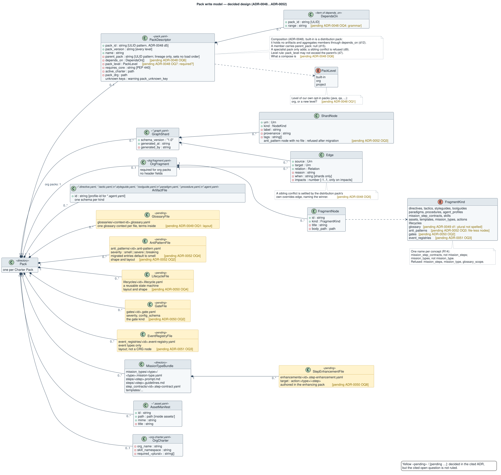

# Descriptors

A **descriptor** is a YAML file that declares one charter component. This page lists each
descriptor kind. The structural authority is the set of JSON Schemas in
[`contracts/packs/schemas/`](https://github.com/spec-kitty/spec-kitty-charter/tree/main/contracts/packs/schemas),
canonical here, first imported from core's models ([ADR-0017](/adr/0017-pack-schemas-imported-as-canonical-json-schema/));
this page explains them and does not restate them. Where this page and a schema disagree about structure, the schema
wins. Core ([`spec-kitty/spec-kitty`](https://github.com/spec-kitty/spec-kitty)) stays the oracle for
governance content, and every deliberate difference is in the
[Divergence register](/conformance/divergence-register/). The concepts behind the files are in
[Logical model](/architecture/logical-model/); entity diagrams are in
[Descriptor schemas](/architecture/descriptor-schemas/), and the authored files and how they
nest are drawn in the pack write model below.
"Required" lists the fields the schema requires; "key fields" adds the ones most descriptors carry.

> **Decided design:** the diagram draws the decided design of [ADR-0048](/adr/0048-pack-composition-and-the-named-packs-split/) to [ADR-0052](/adr/0052-procedures-tightened-and-anti-patterns-as-authored-artifacts/), and the code does not do all of it yet. Yellow «pending» classes and `[pending ADR-00xx OQn]` marks show open questions that no ruling has settled. Today's schemas are in `contracts/packs/schemas/`, with a page each under [Pack schemas](/architecture/pack-schemas/). [What the labels mean](/#status).

## Where descriptors live

The `built-in` root and the other `packs/` paths are paths in core, `spec-kitty/spec-kitty`. The charter service
keeps every pack it serves, of any level, in its own configuration root, `<charter.config-root>/packs/<pack>/`, at the
level the pack's `pack.yaml` declares ([ADR-0038](/adr/0038-one-configuration-root-a-directory-per-domain/)); inside
a pack the layout below holds.

| Pack level | Root | Per-kind directory | Graph |
|---|---|---|---|
| `built-in` | `packs/built-in/` | `<plural>/` (for example `directives/`, `agent_profiles/`) | one `<kind>.graph.yaml` shard per node kind that has built-in nodes, at the pack root |
| `org` | the configured pack path | `<plural>/` | one `drg/fragment.yaml` |
| `project` | `.kittify/charter-packs/` | `directive/`, `tactic/`, `styleguide/`, `procedure/` (singular); every other kind plural | project fragment |

Where each level is configured: `built-in` ships with Spec Kitty (source home moving to
`spec-kitty-open-packs`, core ADR [`2026-08-16-2`](https://github.com/spec-kitty/spec-kitty/blob/main/docs/adr/3.x/2026-08-16-2-open-packs-is-source-of-truth-for-built-in-doctrine.md)) and uses sharded graph files plus a generated
`pack-manifest.yaml`; `org` packs are listed under `charter_packs.org.packs` in
`.kittify/config.yaml` (core's `packs/internal/` is an org pack that never ships to
consumers); the `project` pack sits under `.kittify/charter-packs/`.

The singular project directories for four kinds are a deliberate asymmetry, declared once in
core's `PROJECT_KIND_DIRS`. Built-in step contracts live under
core's `packs/built-in/missions/built_in_step_contracts/`, and `mission_step_contract`, `template`
and `anti_pattern` have no built-in content directory of their own. "Content directory" means
the directory of a kind's layered repository; for example `packs/built-in/templates/` exists
but is not a content directory in this sense. Per-kind facts are in the
[Artifact kinds table](/architecture/logical-model/#artifact-kinds).

## Pack-level descriptors

### `pack.yaml` — pack descriptor

Authored, never machine-rewritten. Identifies the pack and declares its level.

| Field | Meaning |
|---|---|
| `pack_id` | ULID (26 characters, `^[0-9A-HJKMNP-TV-Z]{26}$`), the pack's stable identity; `parent_pack`, `depends_on[].pack_id` and `overrides[].member` take the same shape |
| `pack_version` | semantic version of the pack content; required at every level (open question 13; DIV-004) |
| `name` | human handle and the `<name>::` qualifier of a cross-pack reference, so it follows the identifier grammar `^[a-z0-9][a-z0-9_-]*$` (lower-case letters, digits, `-` and `_`, starting with a letter or digit) |
| `parent_pack` | parent pack, or `null` for a root pack; lineage only, and a pack may take one only at its own level or one nearer built-in |
| `pack_level` | required when `depends_on` is non-empty, otherwise optional; `built-in`, `org` or `project` (core ADR [`2026-10-11-2`](https://github.com/spec-kitty/spec-kitty/blob/main/docs/adr/4.x/2026-10-11-2-a-pack-declares-its-level-in-pack-yaml.md)); a mismatch with where the pack is configured refuses with `pack_level_mismatch`; a missing value is the diagnostic `pack_level_missing` ([`DiagnosticCode`](https://github.com/spec-kitty/spec-kitty-charter/blob/main/contracts/charter/schemas/DiagnosticCode.yaml)) |
| `requires_core` | optional; a PEP 440 range of supported core versions; a malformed value refuses the pack with `pack_unreadable` |
| `pack_drg` | org packs: path to the graph fragment, usually `drg/fragment.yaml` |
| `depends_on` | optional; the packs this pack builds on, each a closed item `{pack_id, range}` where `pack_id` is a ULID and `range` is a PEP 440 specifier set ([ADR-0048](/adr/0048-pack-composition-and-the-named-packs-split/), [ADR-0053](/adr/0053-operator-rulings-on-the-pack-ecosystem-open-questions/) decision 4). A pack that declares one must also declare `pack_level`. A pack may depend only on packs at its own level or one nearer built-in. The offering read resolves the compose and refuses a broken one; each refusal is in the table of [Compose packs](/guides/compose-packs/#read-a-refusal) |
| `overrides` | optional; the sibling conflicts this pack settles, each a closed item `{artifact, member}` where `member` is the contesting member's `pack_id`, a ULID; until #358 any pack of the compose may declare it, and until #357 it only clears the refusal, the member's version is not yet put in force ([ADR-0048](/adr/0048-pack-composition-and-the-named-packs-split/) decision 9, [ADR-0053](/adr/0053-operator-rulings-on-the-pack-ecosystem-open-questions/) decision 5); a second edge on one artifact refuses the descriptor |
| `fallback_profile` | optional; the profile-id (`^[a-z0-9][a-z0-9_-]*$`, 1 to 64 characters) of the agent profile the pack declares as its fallback, never `null` ([ADR-0068](/adr/0068-a-pack-declares-its-fallback-profile/)). A pack of the declaring pack's closure holds it, locked along the closure, with `role: generic` and no alt-roles; a breach refuses with `fallback_profile_unknown`, `fallback_profile_not_locked` or `fallback_profile_not_role_neutral` |

> **Accepted, partly built:** [ADR-0048](/adr/0048-pack-composition-and-the-named-packs-split/) adds `depends_on:
> [{pack_id, range}]` so packs compose into a graph, narrows `parent_pack` to lineage only, and adds a ULID pattern
> to `pack_id` and `parent_pack`. The schema accepts `depends_on` and `overrides` now, and the dependency resolver is
> built: the offering read resolves one compose, dependencies first, and refuses a broken one instead of serving part
> of it ([Compose packs](/guides/compose-packs/) has the refusal table). The offering response exposes what a compose
> resolved: each pack's configured `packId`, its `descriptorPackId`, and its declared dependencies with the version
> that satisfied each. The pack pin of an activation waits for the reserved activation reads (#125, #359). The
> [pack write model](/architecture/descriptor-schemas/#pack-write-model) and the [configuration diagram](/architecture/descriptor-schemas/#pack-crg-and-charter-configuration) draw the decided shape.

**Planned** (provisional, [ADR-0012](/adr/0012-pack-mutability-policy/)): `pack.yaml` also
points to the pack's mutability policy file at the pack root, so a reader finds every
concern file from the main pack file, and a pack that has a policy file declares the minimum
core version that understands it. Older CLIs then refuse the pack instead of ignoring its
locks. Field names are fixed when the schema lands.

An explicit `null` is refused ("must be a string") for `pack_id`, `pack_version`, `name` and
`pack_level`. `parent_pack`, `requires_core` and `pack_drg` accept `null`, as
well as a string. Only the fields the schema marks optional may be left out. The schema is
closed ([ADR-0036](/adr/0036-round-trip-fidelity-is-equality-of-meaning/) decision 3): a key it
does not declare, a retired core field such as `accompanies_doctrine_pack` included, is a schema
violation, and the pack is refused as `pack_unreadable`, naming the key. `pack_unknown_key` is
retired and never raised; DIV-005 and DIV-006 are closed (#195). `active_charter` is no longer a key (#431): a
`pack.yaml` that still declares it is refused as an unknown key, `pack_unreadable`.

CRG: none directly; it scopes the nodes the pack contributes.

### `pack-manifest.yaml` — generated pack manifest

Machine-written beside `pack.yaml` and never hand-edited. Lists the pack's `constituents`,
each with `id`, `kind`, `path`, `content_hash` and `provenance_path`. Core regenerates it with
`spec-kitty charter pack regenerate-graph`.

### `<kind>.graph.yaml` — built-in graph shard

One shard per node kind that has built-in nodes, at the built-in pack root (`directive.graph.yaml`,
`action.graph.yaml`, `mission_type.graph.yaml`, …).

| Field | Meaning |
|---|---|
| `schema_version` | `"1.0"` |
| `generated_at` | required provenance of the shard |
| `generated_by` | optional here, though core requires it (DIV-009) |
| `nodes[]` | `urn` (`<kind>:<id>`), `kind` (a `NodeKind`), `label` |
| `edges[]` | `source`, `target` (both URNs), `relation`, optional `when`, `reason`; `impacts` (a number from -1 to 1) on, and only on, an `impacts` edge |

The `impacts` edge field is current state; [ADR-0028](/adr/0028-impacts-is-a-value-list-and-tension-is-a-relationship/)
replaces the relation with `tension` and moves `impacts` onto the artifact as a per-value list.
The schema change is not yet decided.

Unknown keys refuse the document, with the refusal `drg_schema_error`. So does an endpoint
that is not a URN: there are no bare ids (DIV-007).

### `drg/fragment.yaml` — org graph fragment

The single graph file of an org pack.

| Field | Meaning |
|---|---|
| `nodes[]` | `id`, `kind` (the plural form, for example `directives`), `title`, `body_path` to the descriptor file, relative to the pack root and never leaving it (#254) |
| `edges[]` | `source` and `target` (URNs), `relation`, optional `when` and `reason`; `impacts` on an `impacts` edge |

A fragment has no header fields: core overwrites `pack_name`, `source_kind`, `source_ref`,
`layer_index` and `provenance_marker` from the operator's configuration, so a fragment that
carries one is refused as an unknown key (DIV-008). An org pack must ship the fragment, or the load
refuses it with `pack_unreadable`. The `kind` of a fragment node has one name per concept:
the plural of an artifact kind (`mission_step_contracts`, `anti_patterns`, `assets` and so on),
or `mission_types` or `actions`. `mission_steps` and `mission_type` are refused (DIV-011).

Edges in a fragment land in the same merged graph cascade reads.

### Parse failures and the first line of a finding

The adapter reads each file as a YAML event stream before it builds the document. A file that
is not valid YAML is refused with a code that follows the file's kind: a graph shard or
fragment with `drg_schema_error`, `pack.yaml` with `pack_unreadable`. The finding's first line
says what was wrong, but only a graph shard or fragment finding carries the first line in its
detail. A `pack.yaml` finding says only that `pack.yaml` of the pack is not valid YAML. Some
first lines are fixed by the adapter:

- "a mapping key is not a string";
- "the document is nested too deeply" (the cap is 200 nested collections, counted over the
  event stream before the document is composed);
- "the document contains itself" (an anchor that refers to its own collection);
- "a value is not a string, a number, a boolean or null" (a tag or type the schema cannot hold).

Other first lines are still the YAML library's own wording, for example "Non scalar key is
detected but it is not configured to be allowed.", and the raw exception text for tags such as
`!!seq`, `!!set [a]` and `!!int abc`. Treat that wording as unstable and read the file and
place, not the sentence.

A number that is not finite (`.nan`, `.inf`, `1e400`) is refused wherever the schema asks for a
number, and reported as `NaN`, `Infinity` or `-Infinity`, not as written in the file, so `.inf` and `1e400`
both read `Infinity`; a free-form place accepts it. The
`impacts` strength keeps the domain's own text, for example `'impacts' Infinity is outside [-1, 1]`.

### `README.md` — pack document

The pack's one documentation file, at the pack root (#451; [ADR-0042](/adr/0042-pack-level-files-sanitized-shapes-and-the-derived-manifest/)
decision 8 as amended 2026-11-11). Schema: the Markdown structure schema `pack-document`.

| Part | Meaning |
|---|---|
| frontmatter | optional YAML |
| H1 | optional title; independent of `pack.yaml`'s `name` |
| preamble, H2 sections | free Markdown; a `## Provenance` section takes what `PROVENANCE.md` held |

The service holds it as the pack's `PackDocument` and serves it at `GET /packs/{packId}/doc`, as `text/markdown` (the
file) or JSON (`title`, `body`). A carriage return, a byte order mark or an ambiguous heading refuses it; it is never
normalized. A `README.md` deeper in the pack is not the document. Other Markdown that no rule models is excluded: not
held, not refused.

### Retired pack-level files

`pack.md`, `PROVENANCE.md` and `org-charter.yaml` at the pack root are refused by name, with violation code `retired`
and a reason that says where the content moved (#451, #431). So is a root file that differs from one of them, or from
`README.md`, only in letter case. Org enforcement that `org-charter.yaml` held is a governing preset plus
`policy.yaml`: see [Enforce presets on an organization's projects](/guides/enforce-org-presets/).

### `presets/<id>.yaml` — activation preset

A named set of activations a pack ships. Schema: `preset`, closed
([ADR-0042](/adr/0042-pack-level-files-sanitized-shapes-and-the-derived-manifest/)).

| Field | Meaning |
|---|---|
| `schema_version`, `id`, `description` | required; `id` is the file stem |
| `activated_<plural>` | per-kind list of items `{id}` or `{id, must_have: true}`, `activated_mission_types` included; a list holds at least one item |

A preset with at least one must-have item is a governing preset: its must-have items are the required floor of every
project whose closure holds the pack. `activated_kinds` is refused (amendment 2026-11-07).

The built-in pack ships `default` (no per-kind lists) and `minimal` (curated directives and
tactics for `software-dev`).

## Artifact descriptors

Each artifact descriptor is one file named `<name>.<suffix>`, placed in the kind's directory.
Its `id` becomes the node URN `<kind>:<id>`; its relations to other artifacts live only in the
graph (shards or fragment), never in the descriptor
([ADR-0064](/adr/0064-graph-documents-are-the-only-source-of-relationships/)). A few fields name
other artifacts as data, not as relations: an agent profile's `*-references`, a skill's `enhances`
and `overrides`. A schema is closed, so a file that still carries a removed field, such as
`references`, `procedures` or `directive_refs`, is refused as an unknown field.

### Directive — `*.directive.yaml`

A binding rule. Schema: `directive.schema.yaml`.

- **Required:** `id`, `schema_version`, `title`, `intent`, `enforcement`.
- **Key fields:** `scope`, `integrity_rules`, `validation_criteria`,
  `explicit_allowances`. Its steps are procedure artifacts, which it `requires` through graph
  edges.
- **Naming:** `NNN-<slug>.directive.yaml` for numbered built-ins (id `DIRECTIVE_NNN`); ids
  match `^[A-Z][A-Z0-9_-]*$`.
- **CRG:** `directive:<ID>`; typically `requires` or `suggests` tactics.

### Tactic — `*.tactic.yaml`

A reusable technique as ordered steps. Schema: `tactic.schema.yaml`.

- **Required:** `id`, `schema_version`, `name`, `steps`.
- **Key fields:** `purpose`, `failure_modes`, `applies_to_languages`, `notes`. Neither the tactic
  nor its steps carry `references`.
- **Naming:** `<kebab-id>.tactic.yaml`; built-ins may sit in topic subdirectories.
- **CRG:** `tactic:<id>`; target of directive and action edges.

### Styleguide — `*.styleguide.yaml`

Conventions for a kind of work. Schema: `styleguide.schema.yaml`.

- **Required:** `id`, `schema_version`, `title`, `scope`, `principles`.
- **Principles:** at least one `{name, description}` item, in authored order
  ([ADR-0067](/adr/0067-paradigms-and-styleguides-state-named-principles/)); a name is 1 to 64
  characters, a description 1 to 255, neither blank, and a name is unique within the list,
  ignoring case and surrounding white space.
- **Key fields:** `patterns`, `anti_patterns`, `tooling`, `quality_test`,
  `applies_to_languages`, `structural_lint_config`. A citation that names no pack artifact lives
  in the text, as "(source: …)" or a closing "Sources: …" in the last principle.
- **CRG:** `styleguide:<id>`.

### Toolguide — `*.toolguide.yaml`

How to use one tool. Schema: `toolguide.schema.json`; the guide's shape is
[ADR-0043](/adr/0043-sanitized-artifact-shapes-procedures-and-toolguide-guides/) decision 4.

- **Required:** `id` (`^[a-z][a-z0-9]*(-[a-z0-9]+)*$`), `schema_version`, `tool`, `title`,
  `guide_path`, `summary`.
- **Key fields:** `commands`, `applies_to_languages`, `last_updated`. A citation that names no
  pack artifact lives in the guide's text.
- `guide_path` is `<id>.guide.md`, the toolguide's guide beside the descriptor. The guide is a
  structured Markdown companion (schema `toolguide-guide.schema.json`): no frontmatter, an H1
  equal to `title` (derived from it), no text before the first H2, a non-blank `## Overview`, then
  the fixed blocks `## When to use`, `## Setup`, `## Usage`, `## Cautions`, `## Known limitations`
  and `## References` in that order, with freeform H2 sections between `## Usage` and
  `## Cautions`. Over HTTP a registration sends the guide's Markdown as `guide` or names it with
  `guideUri`, never a path.
- **CRG:** `toolguide:<id>`.

### Paradigm — `*.paradigm.yaml`

A way of thinking about the work. Schema: `paradigm.schema.yaml`.

- **Required:** `schema_version`, `id`, `name`, `summary`.
- **Key fields:** `principles`, optional: when present, at least one `{name, description}` item,
  in authored order, under the same rules as a styleguide's
  ([ADR-0067](/adr/0067-paradigms-and-styleguides-state-named-principles/)). The directives it
  `requires` are graph edges.
- **CRG:** `paradigm:<id>`; some built-in paradigm nodes are re-kinded as `anti_pattern`.

### Procedure — `*.procedure.yaml`

A multi-step operating procedure with entry and exit conditions. Schema:
`procedure.schema.json`, the sanitized shape of
[ADR-0043](/adr/0043-sanitized-artifact-shapes-procedures-and-toolguide-guides/) decision 2.

- **Required:** `schema_version` (`"1.0"`), `id` (the file stem), `title`, `description`,
  `entry_condition`, `exit_condition`, `steps` (at least one).
- **Steps:** `{title, description?, role?, on_success?, on_failure?}`; `role` is an open role
  token such as `operator`, absent when any role may act.
- **Key fields:** `anti_patterns` (`{title, content?, bad_example?, good_example?}`), `notes`,
  `applies_to_languages`. An optional list holds at least one entry when present.
- **CRG:** `procedure:<id>`.

> **Decided, not built yet:** [ADR-0052](/adr/0052-procedures-tightened-and-anti-patterns-as-authored-artifacts/)
> tightens the procedure definition and drops the inline `anti_patterns` of a procedure and a styleguide in favor
> of authored anti-pattern files that a `rejects` graph edge targets. Today's schemas still carry them. The [Charter kinds diagram](/architecture/descriptor-schemas/#charter-kinds) draws the decided shape.

### Agent profile — `*.agent.yaml`

An agent's identity and specialization. Schema: `agent-profile.schema.yaml`. Field names are
kebab-case.

- **Required:** `profile-id`, `name`, `role`, `purpose`, `specialization`.
- **Key fields:** `description`, `schema-version`, `alt-roles`, `capabilities`,
  `routing-priority`, `max-concurrent-tasks`, `collaboration`, `mode-defaults`,
  `initialization-declaration`, `specialization-context`, `directive-references`,
  `tactic-references`, `toolguide-references`, `styleguide-references`,
  `self-review-protocol`, `model`, `effort`.
- **CRG:** `agent_profile:<id>`. Lineage is a `specializes_from` edge in the graph, never a
  profile field; `delegates_to` edges declare runtime handoff.
- **Roles:** `role` is the primary role and `alt-roles` an optional list of further roles, each
  a lowercase token of letters, digits and hyphens, starting with a letter, at most 64
  characters; alt-roles are distinct, never repeat `role` and are never `generic`. A step that
  asks for a role finds a primary fit, which outranks any alt-role fit
  ([ADR-0069](/adr/0069-a-profile-has-one-primary-role-and-optional-alt-roles/)). The retired
  `roles` list is no key of the schema.
- **Fallback:** `generic` is reserved for the fallback profile a pack names in `fallback_profile`
  in `pack.yaml`; it fits no role and is served only when no profile fits
  ([ADR-0068](/adr/0068-a-pack-declares-its-fallback-profile/)).
- **Selection:** `routing-priority` is the specificity level
  ([ADR-0032](/adr/0032-steps-name-roles-and-profile-selection-order/)).

### Mission step contract — `*.step-contract.yaml`

The structural sub-steps of one mission step and what each delegates to. The step's role and
expected artifacts live on the mission step in its mission-type file, not here
([ADR-0044](/adr/0044-mission-types-consolidated-into-one-sanitized-shape/) decision 2).

- **Fields:** `schema_version`, `id`, `action`, `mission`, `steps[]`. Each step has `id`,
  `description` and either a `command` or a `delegates_to` block (`kind` plus `candidates`).
- **CRG:** `mission_step_contract:<id>`, tied to `action:<mission>/<action>`.

### Glossary pack — `*.glossary-pack.yaml`

Terms a pack contributes.

- **Fields:** `id`, `description`, `provenance`, `terms[]` (each with `surface`,
  `definition`, `status`, `confidence`).
- **CRG:** `glossary_pack:<id>`.

> **Decided, not built yet:** [ADR-0049](/adr/0049-glossary-contexts-and-terms/) renames the kind `glossary`. Its
> artifact becomes a glossary context that holds terms addressed as `term:<context>/<term>`, and the file layout is
> still an open question there. Today's `*.glossary-pack.yaml` and `glossary_pack:<id>` stay until then. The [mission-step contract, skill and glossary diagram](/architecture/descriptor-schemas/#mission-step-contract-pack-skill-glossary-pack) draws the decided shape.

### Pack skill — `*.skill.yaml` plus body

A shared, parameterized entry point (core ADR [`2026-09-27-1`](https://github.com/spec-kitty/spec-kitty/blob/main/docs/adr/3.x/2026-09-27-1-pack-skills-share-commands-through-charter-packs.md)). Schema: `skill.schema.yaml`.

- **Required:** `schema_version` (`"1.0"`), `id`, `title`, `description`, `form`.
- **Key fields:** `triggers`, `body_path` (prompt form, for example `<id>.skill.md`),
  `expands_to` (`target` of `builtin:…` or `cli:spec-kitty …`), `parameters[]`,
  `invocation`, `tools`, `version`, `maintainers`, `enhances`, `overrides`.
- **Naming:** id is lowercase ASCII, `[a-z0-9]` segments joined by single `-`, at most 64
  characters. Rendered as `<skill_namespace>-<id>/SKILL.md`.
- **CRG:** `skill:<id>`.

### Asset — `*.asset.yaml` sidecar

Describes one blob. Model: `AssetManifest` (frozen, extra keys forbidden).

- **Fields:** `id`, `mime`, `path` (relative to the pack's `assets/` directory, contained),
  optional `title`.
- **Naming:** `<blob-file-name>.asset.yaml` beside the blob.
- **CRG:** `asset:<id>`.

### Mission type — `missions/<id>/<id>.mission-type.yaml`

One file per mission type, holding its steps as sub-items. Schema: `mission-type.schema.json`,
closed at every level, the sanitized shape of
[ADR-0044](/adr/0044-mission-types-consolidated-into-one-sanitized-shape/) decision 3. A mission
type is an artifact kind (`mission_type`, DIV-501); a mission step is not.

- **Required:** `schema_version` (`"1.0"`), `id` (`^[a-z][a-z0-9]*(-[a-z0-9]+)*$`, the file
  stem), `title`, `description`, `steps` (at least one).
- **Key fields:** `content` (standing context for every step's agent),
  `requires_substantive_spec` (only `true`; absent means not required), `path_conventions`
  (workspace directories: `workspace`, `tests`, `deliverables`, `documentation`, `data`),
  `expected_output_artifacts` (the mission's postconditions), `on_demand_steps`.
  An optional list holds at least one entry when present.
- **Steps:** `steps` is the one run order; `on_demand_steps` are invoked by a command, outside
  the sequence, and keep their authored order. Step ids are unique across both lists. A step is
  `{id, title, description?, role?, prompt_path?, guidelines_path?, expected_input_artifacts?,
  expected_output_artifacts?}`. `description` is a one-line summary of at most 160
  characters; `role` is a role token, never a profile
  ([ADR-0032](/adr/0032-steps-name-roles-and-profile-selection-order/)).
- **Expected artifacts:** a step's inputs are its preconditions and its outputs its
  postconditions. An input is `{artifact_key, path_pattern, blocking?}`; an output adds
  `artifact_class` (`input`, `output`, `evidence`, `workflow` or `runtime`) and `template_path`
  (relative to the mission-type file, for example `templates/spec-template.md`). `artifact_key`
  is an opaque dotted key, unique within one list; `path_pattern` is a glob in the mission's
  workspace, not a pack file; `blocking` is only `true`.
- **Guidance:** neither the type nor a step carries `references`. The type's recipe ingredients
  are the graph's `scope` edges from `mission_type:<id>`; a step's action-scoped guidance is the
  graph edges from its `action:<id>/<step>` node.
- **Companions:** `prompt_path` is `steps/<id>.prompt.md` and `guidelines_path` is
  `steps/<id>.guidelines.md`, both derived from the step id: whether a step has one is authored,
  any other value is refused. Both are Markdown companions (schemas `mission-step-prompt` and
  `mission-step-guidelines`). A prompt's frontmatter holds only `description`, the prompt's
  detailed description; guidelines have no frontmatter.
- **Templates:** files under `missions/<id>/templates/` are template payloads, held as bytes,
  with the id `<id>/<path>`.
- **Placement:** a `*.mission-type.yaml` anywhere but `missions/<id>/<id>.mission-type.yaml` is
  refused by the load and in validate mode.
- **Retired:** `mission_types/<t>.yaml`, `mission.yaml`, `mission-runtime.yaml`,
  `governance-profile.yaml`, `expected-artifacts.yaml`, `actions/<a>/index.yaml`,
  `mission-steps/**` and `command-templates/*` are refused by name (DIV-502).
- **CRG:** `mission_type:<id>`. The graph keeps `action:<id>/<step>` as a step's node
  ([ADR-0064](/adr/0064-graph-documents-are-the-only-source-of-relationships/) decision 12).

> **Decided, not built yet:** [ADR-0050](/adr/0050-mission-types-and-lifecycles-as-declared-state-machines/) makes
> the mission type a declared state machine (explicit transitions, guards, `emit` actions) and adds the `lifecycle`
> kind, and a `guard` kind implemented by executable assets ([ADR-0054](/adr/0054-guards-are-enforced-checks-implemented-by-executable-assets/); the proposed `gate` kind was not taken). With
> [ADR-0048](/adr/0048-pack-composition-and-the-named-packs-split/) it renames `missions/` to `mission_types/` and
> moves the step contracts into the type's bundle. This section describes the shape the service reads today; the [mission type lifecycle diagram](/architecture/descriptor-schemas/#mission-type) draws the decided shape.

### Anti-pattern and template

- **Anti-pattern** has no descriptor file. It is a node re-kinded as `anti_pattern` inside
  another kind's graph shard, the target of `rejects` edges.
- **Template** has no descriptor pattern. A file under a pack's `templates/` is a template
  whose id is its path there; a file under `missions/<type>/templates/` is one whose id is
  `<type>/<path>`. Both are held as bytes and linked with `instantiates` edges.

> **Decided, not built yet:** [ADR-0052](/adr/0052-procedures-tightened-and-anti-patterns-as-authored-artifacts/)
> makes an anti-pattern an authored file with a `smell`, `severe` or `breaking` severity, which a `rejects`
> graph edge targets. Its exact shape and layout still await a ruling; the [Charter kinds diagram](/architecture/descriptor-schemas/#charter-kinds) marks them pending.

## Project-side configuration

These are not pack descriptors but are inputs to resolution:

| File | Holds |
|---|---|
| `.kittify/config.yaml` | `charter_packs.org.packs` (registered org packs), `charter_packs.project.skill_namespace`, and the active charter keys for an unmigrated project |
| `.kittify/charter/charter.yaml` | the charter bundle, including the active charter for a migrated project |
| `.kittify/charter/charter.md` | display companion of the charter |
| `.kittify/skills-manifest.json` | ownership of rendered pack skills |
