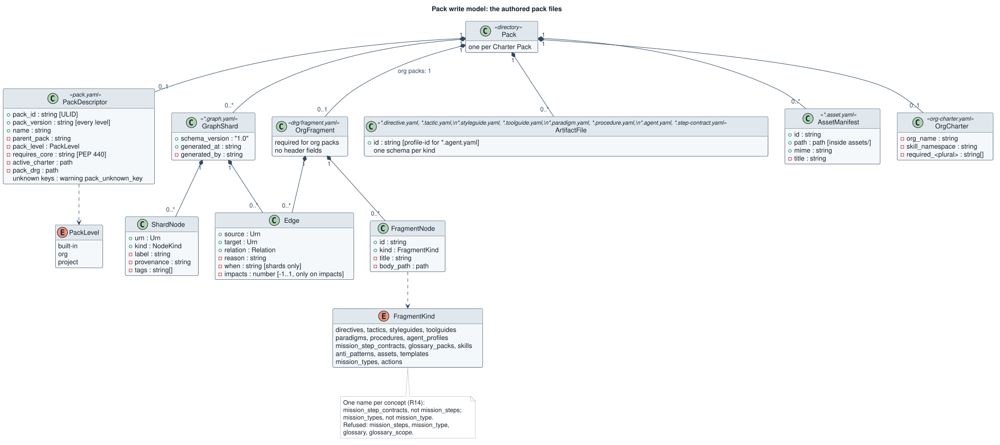

# Descriptors

A **descriptor** is a YAML file that declares one charter component. This page lists each
descriptor kind. The structural authority is the set of JSON Schemas in
[`contracts/packs/schemas/`](https://github.com/spec-kitty/spec-kitty-charter/tree/main/contracts/packs/schemas),
canonical here, first imported from core's models ([ADR-0017](/adr/0017-pack-schemas-imported-as-canonical-json-schema/));
this page explains them and does not restate them. Where this page and a schema disagree about structure, the schema
wins. Core ([`spec-kitty/spec-kitty`](https://github.com/spec-kitty/spec-kitty)) stays the oracle for
governance content, and every deliberate difference is in the
[Divergence register](/conformance/divergence-register/). The concepts behind the files are in
[Logical model](/architecture/logical-model/); entity diagrams are in
[Descriptor schemas](/architecture/descriptor-schemas/), and the authored files and how they
nest are drawn in the pack write model below.
"Required" lists the fields the schema requires; "key fields" adds the ones most descriptors carry.

> **Status:** the schemas exist here and the service's load path validates against them. [What the labels mean](/#status).

## Where descriptors live

The `built-in` root and the other `packs/` paths are paths in core, `spec-kitty/spec-kitty`.

| Pack level | Root | Per-kind directory | Graph |
|---|---|---|---|
| `built-in` | `packs/built-in/` | `<plural>/` (for example `directives/`, `agent_profiles/`) | one `<kind>.graph.yaml` shard per node kind that has built-in nodes, at the pack root |
| `org` | the configured pack path | `<plural>/` | one `drg/fragment.yaml` |
| `project` | `.kittify/charter-packs/` | `directive/`, `tactic/`, `styleguide/`, `procedure/` (singular); every other kind plural | project fragment |

Where each level is configured: `built-in` ships with Spec Kitty (source home moving to
`spec-kitty-open-packs`, core ADR [`2026-08-16-2`](https://github.com/spec-kitty/spec-kitty/blob/main/docs/adr/3.x/2026-08-16-2-open-packs-is-source-of-truth-for-built-in-doctrine.md)) and uses sharded graph files plus a generated
`pack-manifest.yaml`; `org` packs are listed under `charter_packs.org.packs` in
`.kittify/config.yaml` (core's `packs/internal/` is an org pack that never ships to
consumers); the `project` pack sits under `.kittify/charter-packs/`.

The singular project directories for four kinds are a deliberate asymmetry, declared once in
core's `PROJECT_KIND_DIRS`. Built-in step contracts live under
core's `packs/built-in/missions/built_in_step_contracts/`, and `mission_step_contract`, `template`
and `anti_pattern` have no built-in content directory of their own. "Content directory" means
the directory of a kind's layered repository; for example `packs/built-in/templates/` exists
but is not a content directory in this sense. Per-kind facts are in the
[Artifact kinds table](/architecture/logical-model/#artifact-kinds).

## Pack-level descriptors

### `pack.yaml` — pack descriptor

Authored, never machine-rewritten. Identifies the pack and declares its level.

| Field | Meaning |
|---|---|
| `pack_id` | ULID, the pack's stable identity |
| `pack_version` | semantic version of the pack content; required at every level (open question 13; DIV-004) |
| `name` | human handle |
| `parent_pack` | parent pack, or `null` for a root pack |
| `pack_level` | optional; `built-in`, `org` or `project` (core ADR [`2026-10-11-2`](https://github.com/spec-kitty/spec-kitty/blob/main/docs/adr/4.x/2026-10-11-2-a-pack-declares-its-level-in-pack-yaml.md)); a mismatch with where the pack is configured refuses with `pack_level_mismatch`; a missing value is the diagnostic `pack_level_missing` ([`DiagnosticCode`](https://github.com/spec-kitty/spec-kitty-charter/blob/main/contracts/charter/schemas/DiagnosticCode.yaml)) |
| `requires_core` | optional; a PEP 440 range of supported core versions; a malformed value refuses the pack with `pack_unreadable` |
| `active_charter` | org packs: path to the org charter, usually `org-charter.yaml` |
| `pack_drg` | org packs: path to the graph fragment, usually `drg/fragment.yaml` |

**Planned** (provisional, [ADR-0012](/adr/0012-pack-mutability-policy/)): `pack.yaml` also
points to the pack's mutability policy file at the pack root, so a reader finds every
concern file from the main pack file, and a pack that has a policy file declares the minimum
core version that understands it. Older CLIs then refuse the pack instead of ignoring its
locks. Field names are fixed when the schema lands.

An explicit `null` is refused ("must be a string") for `pack_id`, `pack_version`, `name` and
`pack_level`. `parent_pack`, `requires_core`, `active_charter` and `pack_drg` accept `null`, as
well as a string. Only the fields the schema marks optional may be left out. A key the schema does not
declare is tolerated (DIV-005): the pack still loads and the pack listing carries the warning
`pack_unknown_key`, naming the key. Retired core fields such as `accompanies_doctrine_pack`
are unknown keys like any other (DIV-006).

DRG: none directly; it scopes the nodes the pack contributes.

### `pack-manifest.yaml` — generated pack manifest

Machine-written beside `pack.yaml` and never hand-edited. Lists the pack's `constituents`,
each with `id`, `kind`, `path`, `content_hash` and `provenance_path`. Core regenerates it with
`spec-kitty charter pack regenerate-graph`.

### `<kind>.graph.yaml` — built-in graph shard

One shard per node kind that has built-in nodes, at the built-in pack root (`directive.graph.yaml`,
`action.graph.yaml`, `mission_type.graph.yaml`, …).

| Field | Meaning |
|---|---|
| `schema_version` | `"1.0"` |
| `generated_at` | required provenance of the shard |
| `generated_by` | optional here, though core requires it (DIV-009) |
| `nodes[]` | `urn` (`<kind>:<id>`), `kind` (a `NodeKind`), `label` |
| `edges[]` | `source`, `target` (both URNs), `relation`, optional `when`, `reason`; `impacts` (a number from -1 to 1) on, and only on, an `impacts` edge |

Unknown keys refuse the document, with the refusal `drg_schema_error`. So does an endpoint
that is not a URN: there are no bare ids (DIV-007).

### `drg/fragment.yaml` — org graph fragment

The single graph file of an org pack.

| Field | Meaning |
|---|---|
| `nodes[]` | `id`, `kind` (the plural form, for example `directives`), `title`, `body_path` to the descriptor file |
| `edges[]` | `source` and `target` (URNs), `relation`, optional `reason`; `impacts` on an `impacts` edge |

A fragment has no header fields: core overwrites `pack_name`, `source_kind`, `source_ref`,
`layer_index` and `provenance_marker` from the operator's configuration, so a fragment that
carries one is refused as an unknown key (DIV-008). An org pack must ship the fragment, or the load
refuses it with `pack_unreadable`. The `kind` of a fragment node has one name per concept:
the plural of an artifact kind (`mission_step_contracts`, `anti_patterns`, `assets` and so on),
or `mission_types` or `actions`. `mission_steps` and `mission_type` are refused (DIV-011).

Edges in a fragment land in the same merged graph cascade reads.

### Parse failures and the first line of a finding

The adapter reads each file as a YAML event stream before it builds the document. A file that
is not valid YAML is refused with a code that follows the file's kind: a graph shard or
fragment with `drg_schema_error`, `pack.yaml` with `pack_unreadable`. The finding's first line
says what was wrong, but only a graph shard or fragment finding carries the first line in its
detail. A `pack.yaml` finding says only that `pack.yaml` of the pack is not valid YAML. Some
first lines are fixed by the adapter:

- "a mapping key is not a string";
- "the document is nested too deeply" (the cap is 200 nested collections, counted over the
  event stream before the document is composed);
- "the document contains itself" (an anchor that refers to its own collection);
- "a value is not a string, a number, a boolean or null" (a tag or type the schema cannot hold).

Other first lines are still the YAML library's own wording, for example "Non scalar key is
detected but it is not configured to be allowed.", and the raw exception text for tags such as
`!!seq`, `!!set [a]` and `!!int abc`. Treat that wording as unstable and read the file and
place, not the sentence.

A number that is not finite (`.nan`, `.inf`, `1e400`) is refused wherever the schema asks for a
number, and reported as `NaN`, `Infinity` or `-Infinity`, not as written in the file, so `.inf` and `1e400`
both read `Infinity`; a free-form place accepts it. The
`impacts` strength keeps the domain's own text, for example `'impacts' Infinity is outside [-1, 1]`.

### `org-charter.yaml` — org charter policy

What an org pack enforces on every project that registers it.

| Field | Meaning |
|---|---|
| `org_name` | the organization |
| `skill_namespace` | prefix for rendered skills; lowercase ASCII, starts with a letter, at most 32 characters; `spk-`, `spec-kitty-` and `spec-kitty.` are reserved |
| `required_<plural>` | per org-requirable kind, for example `required_directives` and `required_skills`; semantics in [Artifact kinds](/architecture/logical-model/#artifact-kinds) |

### `presets/<name>.yaml` — activation preset

A named set of activations a pack ships. Schema: `activation-preset.schema.yaml`.

| Field | Meaning |
|---|---|
| `name`, `description` | required |
| `activated_<plural>` | per-kind allowlist; absent-key behavior is in [Artifact kinds](/architecture/logical-model/#artifact-kinds) |
| `activated_kinds` | optional kind gate |
| `mission_type_activations` | mission types the preset activates |

The built-in pack ships `default` (no per-kind lists) and `minimal` (curated directives and
tactics for `software-dev`).

## Artifact descriptors

Each artifact descriptor is one file named `<name>.<suffix>`, placed in the kind's directory.
Its `id` becomes the node URN `<kind>:<id>`; its relations to other artifacts live in the
graph (shards or fragment), not in the descriptor, except where noted.

### Directive — `*.directive.yaml`

A binding rule. Schema: `directive.schema.yaml`.

- **Required:** `id`, `schema_version`, `title`, `intent`, `enforcement`.
- **Key fields:** `scope`, `procedures`, `integrity_rules`, `validation_criteria`,
  `explicit_allowances`, `references`.
- **Naming:** `NNN-<slug>.directive.yaml` for numbered built-ins (id `DIRECTIVE_NNN`); ids
  match `^[A-Z][A-Z0-9_-]*$`.
- **DRG:** `directive:<ID>`; typically `requires` or `suggests` tactics.

### Tactic — `*.tactic.yaml`

A reusable technique as ordered steps. Schema: `tactic.schema.yaml`.

- **Required:** `id`, `schema_version`, `name`, `steps`.
- **Key fields:** `purpose`, `failure_modes`, `applies_to_languages`, `references`, `notes`.
- **Naming:** `<kebab-id>.tactic.yaml`; built-ins may sit in topic subdirectories.
- **DRG:** `tactic:<id>`; target of directive and action edges.

### Styleguide — `*.styleguide.yaml`

Conventions for a kind of work. Schema: `styleguide.schema.yaml`.

- **Required:** `id`, `schema_version`, `title`, `scope`, `principles`.
- **Key fields:** `patterns`, `anti_patterns`, `tooling`, `quality_test`,
  `applies_to_languages`, `references`, `structural_lint_config`.
- **DRG:** `styleguide:<id>`.

### Toolguide — `*.toolguide.yaml`

How to use one tool. Schema: `toolguide.schema.yaml`.

- **Required:** `id`, `schema_version`, `tool`, `title`, `guide_path`, `summary`.
- **Key fields:** `commands`, `applies_to_languages`, `last_updated`, `references`.
- `guide_path` points at a Markdown guide beside the descriptor.
- **DRG:** `toolguide:<id>`.

### Paradigm — `*.paradigm.yaml`

A way of thinking about the work. Schema: `paradigm.schema.yaml`.

- **Required:** `schema_version`, `id`, `name`, `summary`.
- **Key fields:** `directive_refs`, `references`.
- **DRG:** `paradigm:<id>`; some built-in paradigm nodes are re-kinded as `anti_pattern`.

### Procedure — `*.procedure.yaml`

A multi-step operating procedure with entry and exit conditions. Schema:
`procedure.schema.yaml`.

- **Required:** `schema_version`, `id`, `name`, `purpose`, `entry_condition`,
  `exit_condition`, `steps`.
- **Key fields:** `anti_patterns`, `applies_to_languages`, `notes`, `references`.
- **DRG:** `procedure:<id>`.

### Agent profile — `*.agent.yaml`

An agent's identity and specialization. Schema: `agent-profile.schema.yaml`. Field names are
kebab-case.

- **Required:** `profile-id`, `name`, `purpose`, `specialization`.
- **Key fields:** `description`, `schema-version`, `roles`, `capabilities`,
  `routing-priority`, `max-concurrent-tasks`, `collaboration`, `mode-defaults`,
  `initialization-declaration`, `specialization-context`, `directive-references`,
  `tactic-references`, `toolguide-references`, `styleguide-references`,
  `self-review-protocol`, `model`, `effort`.
- **DRG:** `agent_profile:<id>`. Lineage is a `specializes_from` edge in the graph, never a
  profile field; `delegates_to` edges declare runtime handoff.

### Mission step contract — `*.step-contract.yaml`

The steps of one action of one mission type.

- **Fields:** `schema_version`, `id`, `action`, `mission`, `steps[]`. Each step has `id`,
  `description` and either a `command` or a `delegates_to` block (`kind` plus `candidates`).
- **DRG:** `mission_step_contract:<id>`, tied to `action:<mission>/<action>`.

### Glossary pack — `*.glossary-pack.yaml`

Terms a pack contributes.

- **Fields:** `id`, `description`, `provenance`, `terms[]` (each with `surface`,
  `definition`, `status`, `confidence`).
- **DRG:** `glossary_pack:<id>`.

### Pack skill — `*.skill.yaml` plus body

A shared, parameterized entry point (core ADR [`2026-09-27-1`](https://github.com/spec-kitty/spec-kitty/blob/main/docs/adr/3.x/2026-09-27-1-pack-skills-share-commands-through-charter-packs.md)). Schema: `skill.schema.yaml`.

- **Required:** `schema_version` (`"1.0"`), `id`, `title`, `description`, `form`.
- **Key fields:** `triggers`, `body_path` (prompt form, for example `<id>.skill.md`),
  `expands_to` (`target` of `builtin:…` or `cli:spec-kitty …`), `parameters[]`,
  `invocation`, `tools`, `version`, `maintainers`, `enhances`, `overrides`.
- **Naming:** id is lowercase ASCII, `[a-z0-9]` segments joined by single `-`, at most 64
  characters. Rendered as `<skill_namespace>-<id>/SKILL.md`.
- **DRG:** `skill:<id>`.

### Asset — `*.asset.yaml` sidecar

Describes one blob. Model: `AssetManifest` (frozen, extra keys forbidden).

- **Fields:** `id`, `mime`, `path` (relative to the pack's `assets/` directory, contained),
  optional `title`.
- **Naming:** `<blob-file-name>.asset.yaml` beside the blob.
- **DRG:** `asset:<id>`.

### Mission type — `missions/mission_types/<id>.yaml`

Declares a mission type (`schema_version`, `id`, `display_name`, and its workflow). Its
actions and governance are graph data: `mission_type:<id>` `requires` its actions and
`scope`s type-wide governance. `mission-type` is an operator token, not an `ArtifactKind`.

### Anti-pattern and template

- **Anti-pattern** has no descriptor file. It is a node re-kinded as `anti_pattern` inside
  another kind's graph shard, the target of `rejects` edges.
- **Template** has no descriptor pattern. Templates are mission-type content resolved
  through the template chain and linked with `instantiates` edges.

## Project-side configuration

These are not pack descriptors but are inputs to resolution:

| File | Holds |
|---|---|
| `.kittify/config.yaml` | `charter_packs.org.packs` (registered org packs), `charter_packs.project.skill_namespace`, and the active charter keys for an unmigrated project |
| `.kittify/charter/charter.yaml` | the charter bundle, including the active charter for a migrated project |
| `.kittify/charter/charter.md` | display companion of the charter |
| `.kittify/skills-manifest.json` | ownership of rendered pack skills |
