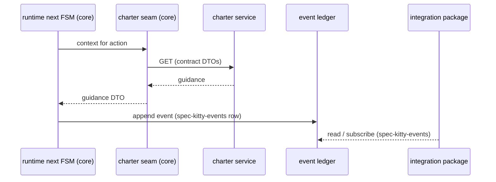

# Events and the ledger

## The model around the charter

The operator's direction of 2026-10-13:

- **Events are created by the runtime's `next` transitions.** The runtime is the producer.
- **Pub, ledger, sub.** Producers append to the event ledger; subscribers read from it.
  Subscribers live in the integration package (event-router).
- **Producers and consumers do not know each other.** They agree only on the contracts in
  `spec-kitty-events`.
- **Ledger rows get a versioned row schema in spec-kitty-events.** Today the rows the core
  writes (for example `kitty-specs/<mission>/status.events.jsonl`) are local Python shapes,
  not package contracts; the decision makes the row itself a versioned contract.
- **The ledger may become on by default,** with a retention period and cleanup policy, since
  the CLI plans to offer ledger-backed services (traceability, dashboards) to integration
  points. That is being considered, not decided.

## Where the charter fits

The charter is **not** a producer in that model. It answers questions; it does not record
what happened. A governed step looks like this:

Rules that follow:

- The charter service never writes to the ledger and never depends on `spec-kitty-events`.
- If a runtime event needs to say which governance applied (for traceability), it carries
  identifiers the charter contract defines (artifact URNs, pack ids and versions), copied
  into a payload that spec-kitty-events defines. The charter contract does not define event
  payloads, and spec-kitty-events does not define charter responses.
- A governance change (an activation, a preset applied) is an event only if the runtime that
  made the change emits it, through spec-kitty-events. Whether it should is an
  [open question](/plans/open-questions/).

## Why this matters for the design

Keeping the charter off the ledger keeps the service a pure, rebuildable read model of files
on disk. It has no event history to migrate, no ordering semantics to honour and no
retention policy of its own. Its state is always derivable from the packs and the active
charter, which is what makes the per-worktree, fingerprint-and-rebuild lifecycle possible.
