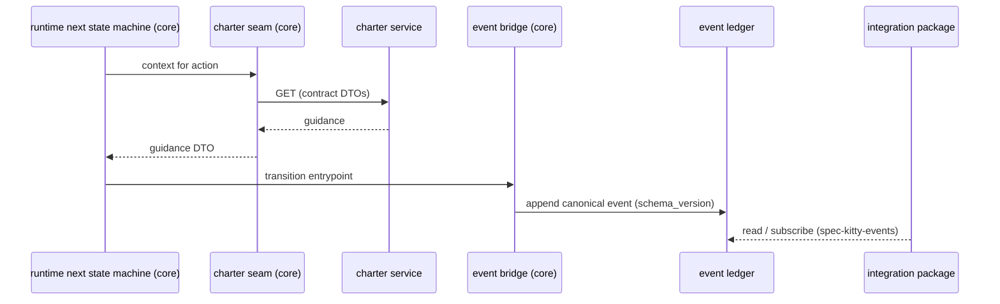

# Events and the ledger

Why the charter service publishes no events, where it meets Spec Kitty's publish, ledger, subscribe model, and what that keeps simple in the design.

> **Status:** decided in core, code not caught up yet. [What the labels mean](/#status).

Core ADR
[`4.x/2026-10-13-2`](https://github.com/spec-kitty/spec-kitty/blob/main/docs/adr/4.x/2026-10-13-2-the-event-ledger-is-the-publication-seam-default-on-with-local-retention.md) (Accepted) makes the ledger the publication seam,
on by default. The operator's clarification of 2026-10-14, recorded in core ADR
[`4.x/2026-10-14-1`](https://github.com/spec-kitty/spec-kitty/pull/6217) (in review in core PR #6217), gives the CLI one canonical event writer.
Today status events are still appended by `specify_cli.status` (`emit_status_transition`)
from several commands, as local rows.

## The model around the charter

- **One canonical event writer.** The core CLI has a single event writer, the event bridge (`EventBridge`).
  It writes only events compatible with the published `spec-kitty-events` contract, at the
  latest version. Every event carries its contract version in the envelope's
  `schema_version` field, so a consumer knows what it receives and can accept one version
  or several. The CLI's internal lifecycle events are being retired in favor of these canonical
  events (operator, 2026-10-14).
- **The runtime calls it.** The runtime state machine calls the event bridge's entrypoints
  when a work package transitions or the Mission state advances. It knows nothing else
  about publication and stays pure domain code; git and filesystem work is done by internal
  consumers of the events.
- **Pub, ledger, sub.** The writer appends to the event ledger; subscribers read from it.
  Subscribers live in the integration package (event-router).
- **Producers and consumers do not know each other.** They agree only on the contracts in
  `spec-kitty-events`.
- **Publication is on by default.** The ledger is the publication seam, read by cursor,
  with no toggle; committed ledgers are never pruned, and local logs get a retention
  policy (core ADR `4.x/2026-10-13-2`).

## Where the charter fits

The charter service is **not** a producer in that model. It answers questions; it does not record
what happened. A governed step looks like this:

Rules that follow:

- The charter service never writes to the ledger, never calls the event bridge and never
  depends on `spec-kitty-events`.
- If a runtime event needs to say which governance applied (for traceability), it carries
  identifiers the charter contract defines (artifact URNs, pack ids and versions), copied
  into a payload that spec-kitty-events defines. The charter contract does not define event
  payloads, and spec-kitty-events does not define charter responses.
- A governance change (an activation, a preset applied) is an event only if the core emits
  it, through its one canonical event writer, as a spec-kitty-events contract event. Whether it should is an
  [open question](/plans/open-questions/).

## Why this matters for the design

Keeping the charter off the ledger keeps the service a pure, rebuildable read model of files
on disk. It has no event history to migrate, no ordering semantics to honor and no
retention policy of its own. Its state is always derivable from the packs and the active
charter, plus the request's mission type and load depth, which is what makes the per-worktree, fingerprint-and-rebuild lifecycle possible.
