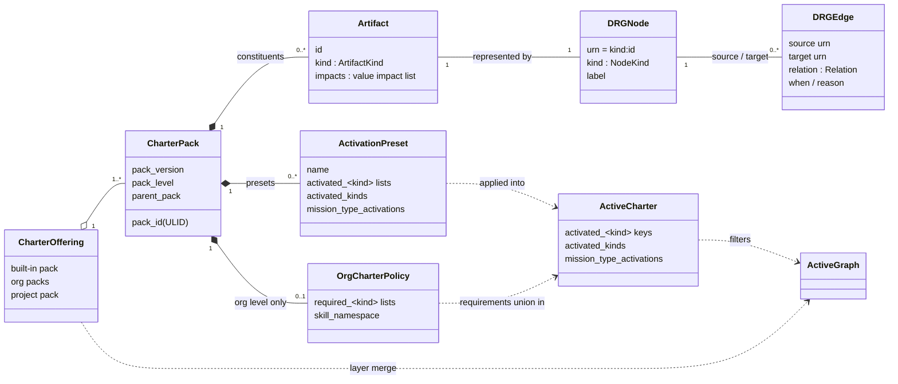

# Logical model

This page translates each concept of the [conceptual model](/context/conceptual-model/) into its
representation: descriptor fields and files, domain types and the service operations that carry
them. Each section starts with **What this means**, a link to the concept it represents, then
gives the representation. The file formats are in [Descriptors](/architecture/descriptors/); what
the domain computes is in [Resolution model](/architecture/resolution-model/). Terms follow the
[Glossary](/glossary/) and [Domain](/context/domain/).

Three labels keep current state and target apart:

- **Current state**: how core (and this service, where built) represents it today.
- **Target (ADR-NNNN)**: a representation an ADR of this repository decided.
- **Candidate, undecided**: a representation proposed but not decided by any ADR. It introduces
  no contract path; a later record decides it.

> **Status:** exists in core, which stays the reference until this repository's contract is the source of record. [What the labels mean](/#status).

## The model at a glance

Read it left to right: a project draws on a **charter offering** made of Charter Packs. Each
pack contributes **artifacts**, which appear as **nodes** of the Charter Reference Graph
(CRG) and are linked by typed **edges**. The pack layers merge into one graph; the project's
**active charter** (plus any org requirements) decides which artifacts are in force. The
result is the **active graph** that every read answers from. The diagram shows the target
placement of `impacts` on the artifact ([ADR-0028](/adr/0028-impacts-is-a-value-list-and-tension-is-a-relationship/));
core today carries a signed `impacts` strength on an edge (see [Relations](#relations)). The
org policy's `required_<kind>` lists are likewise the current-state authoring form; the target
authors a requirement as a preset ([ADR-0031](/adr/0031-requirement-is-authored-as-a-preset/)).

## Charter and active charter

**What this means:** [The charter: offering and active charter](/context/conceptual-model/#the-charter-offering-and-active-charter).

- **charter** — the governance document of a project. Its authoritative form is the
  `charter.yaml` bundle under `.kittify/charter/`; `charter.md` is a display companion, not
  the governance source. The materialized `.kittify/charter/` tree is the **Charter
  Bundle**.
- **Active charter** — what the project has activated: its `activated_<kind>` keys,
  `activated_kinds` and `mission_type_activations`. Current state: core keeps it in the
  activation ledger file `.kittify/charter/activation.yaml` (older projects: `.kittify/config.yaml`
  or `charter.yaml` until migrated). Target ([ADR-0033](/adr/0033-local-active-charter-is-source-of-truth/)):
  that local file is the source of truth and a write-through cache of the service-side copy, it
  names the offering packs by id and version, and on a cold-start divergence local wins, visibly.

The charter has two sides that match core's package split (core ADR [`2026-10-06-2`](https://github.com/spec-kitty/spec-kitty/blob/main/docs/adr/4.x/2026-10-06-2-charter-offering-active-charter-and-activation-presets.md)):
`charter.offering` (what is offered) and `charter.activation` (what is chosen, and the
answers computed from the choice).

## Charter Packs and pack levels

**What this means:** [Packs and derivation](/context/conceptual-model/#packs-and-derivation).

A **Charter Pack** is a distributable bundle of artifacts and their CRG edges, optionally with
**activation presets**. Every pack declares its level in `pack.yaml` (core ADR
`2026-10-11-2`):

The three levels are `built-in` (ships with Spec Kitty; ships the `default` and `minimal`
presets), `org` (each path under `charter_packs.org.packs`; may enforce activations through
`required_<kind>` lists) and `project` (the project's own layer; ships no presets). Where each
level is configured, the shape of its files and its directory layout are tabulated in
[Descriptors](/architecture/descriptors/#where-descriptors-live).

A pack may name a `parent_pack`; a pack without one is a root pack. A pack has a *level*; the
merged graph has *layers*, one per level. The layers merge built-in, then org, then project,
under core ADR [`2026-05-16-1`](https://github.com/spec-kitty/spec-kitty/blob/main/docs/adr/3.x/2026-05-16-1-doctrine-layer-merge-semantics.md) (how the layers merge). Implementations read the configured inputs and never infer a
level from directory presence.

### Mutability levels (integrity)

**What this means:** [Integrity](/context/conceptual-model/#integrity) and
[Removal is not deactivation](/context/conceptual-model/#removal-is-not-deactivation).

The author of the pack that introduces an artifact decides what packs merged after it may do
with it (provisional, [ADR-0012](/adr/0012-pack-mutability-policy/), with removal from
[ADR-0030](/adr/0030-removal-is-distinct-from-deactivation/)):

| Level | A later pack may |
|---|---|
| `open` (default) | override it, enhance it or remove it |
| `extendable` | enhance it or remove it, never override it |
| `locked` | nothing: it is untouched and cannot be removed (refused with `governance_policy_violation`) |

Integrity and requirement are independent levers: a `locked` artifact is not thereby required, and
a required artifact may be `extendable`. Removal is pack-wide, by a derived pack, one artifact at a
time; deactivation is one project's choice ([Activation](#activation)) and is not a mutability
operation ([ADR-0030](/adr/0030-removal-is-distinct-from-deactivation/)).

Each level is a set of allowed operations. The levels are declared in a policy file at the
pack root, which `pack.yaml` references. Ownership follows merge order, not a fixed ladder of
three tiers: the owner is the pack that introduced the artifact, and every pack merged after
it is a later pack. A later pack may tighten a level, never loosen it. This replaces the
consumer-declared `replaceable-builtins.yaml` allowlist, with a migration. The same policy file
holds role locks and role pins ([ADR-0030](/adr/0030-removal-is-distinct-from-deactivation/),
[ADR-0032](/adr/0032-steps-name-roles-and-profile-selection-order/)).

Candidate, undecided: the shape of a removal entry, a role lock and a role pin in the policy
file, and how a removal reaches the write surface.

## Artifact kinds

**What this means:** [Artifacts](/context/conceptual-model/#artifacts) (rules are followed, resources are
used, paradigms are adopted).

An **artifact** is one governance unit with a kind and an id. The kinds are the members of
core's `ArtifactKind` enum (`charter.offering.artifact_kinds`), the single authority for
kind facts. This table is the single home in these docs for per-kind facts; the descriptor pages link
here instead of restating them. The Java domain checks its own kind type against the same
facts; it does not restate them.

| Kind | Operator token | In `CHARTER_KIND_TOKENS` | Activatable | Org-requirable | Selection-overlayable | In force when key absent |
|---|---|---|---|---|---|---|
| `directive` | `directive` | yes | yes | yes | yes | all |
| `tactic` | `tactic` | yes | yes | yes | yes | all |
| `styleguide` | `styleguide` | yes | yes | yes | yes | all |
| `toolguide` | `toolguide` | yes | yes | yes | yes | all |
| `paradigm` | `paradigm` | yes | yes | yes | yes | all |
| `procedure` | `procedure` | yes | yes | yes | yes | all |
| `agent_profile` | `agent-profile` | yes | yes | yes | yes | all |
| `mission_step_contract` | `mission-step-contract` | yes | yes | yes | yes | all |
| `glossary_pack` | `glossary-pack` | yes | yes | yes | no | all |
| `skill` | `skill` | yes | yes | yes | no | required |
| `anti_pattern` | `anti-pattern` | no | yes | no | no | all |
| `asset` | `asset` | no | no | yes | no | all |
| `template` | `template` | no | no | no | no | all |

- **Activatable**: the kind can appear in an `activated_<plural>` list. `template` and `asset`
  resolve specially and are never activated as a live rule.
- **Org-requirable**: an org pack may declare `required_<plural>` for the kind.
- **Selection-overlayable**: an org `required_<plural>` list also unions into the charter's
  `selected_<plural>` field.
- **In force when key absent**: with no activation key, `all` means every available artifact
  of the kind is in force; `required` (only `skill`) means only the org packs' required
  skills are.
- **Operator token**: `ArtifactKind.operator_token`, accepted by `ArtifactKind.from_operator_token`. Every
  artifact kind has one, `anti-pattern`, `asset` and `template` included.
- **In `CHARTER_KIND_TOKENS`**: the hand-written set of tokens the charter activation
  commands accept. It drops `template`, `asset` and `anti_pattern` and adds `mission-type`.
  An anti-pattern is a re-kinded node inside another kind's graph fragment, never a
  standalone file, so it is activatable but not hand-written.
- Current state: `mission-type` is in `CHARTER_KIND_TOKENS` but is not an artifact kind;
  `from_operator_token` raises `MissionTypeNotAnArtifactKind` for it, and it routes to the
  mission-type path. Target: a mission type is activated through the same lever as the kinds
  above, and keeps its own domain model ([Mission types](#mission-types-actions-and-step-contracts)).

## The Charter Reference Graph (CRG)

**What this means:** [Relationships](/context/conceptual-model/#relationships).

The CRG is a typed graph. Every node has a URN `<kind>:<id>`; every edge has a source URN, a
target URN, a relation and optional `when` and `reason` fields; in current state an `impacts` edge also
carries its signed `impacts` strength (see the note under [Relations](#relations)). A graph document carries
`schema_version: "1.0"` and `generated_at`, and refuses unknown keys
(`DRGGraphSchemaError`).

### Node kinds

The CRG's `NodeKind` is wider than `ArtifactKind`. Beyond the artifact kinds it has:

| Node kind | URN example | Role |
|---|---|---|
| `action` | `action:software-dev/plan` | One action of one mission type. Action-scoped context starts here. |
| `mission_type` | `mission_type:software-dev` | A mission type. Its `requires` edges give the action sequence; its `scope` edges carry type-wide governance. |
| `glossary_scope` / `glossary` (retiring in core) | `glossary:<id>` | Glossary scoping and vocabulary targets. Core's `drg/models.py` (lines 60-66) fences them off for deletion; `glossary_pack` survives. |

### Relations

| Relation | Direction and meaning |
|---|---|
| `requires` | Hard dependency. Cascade activation follows it. |
| `suggests` | Soft recommendation. Cascade activation also follows it. |
| `applies` | An action applies a directive or tactic. |
| `scope` | Governance scope: the target is in force within the source's scope (for example a mission type). |
| `vocabulary` | Links to the glossary that supplies a node's terms. |
| `instantiates` | A node instantiates a template. |
| `refines` | Narrows or sharpens the target without replacing it. |
| `specializes_from` | Static lineage between profiles or artifacts. Never used for runtime handoff. |
| `delegates_to` | Runtime handoff from one agent to another. Never inferred from lineage. |
| `enhances` | Field-merge into a target artifact; keeps the action sequence and step inputs and outputs. |
| `overrides` | Full replacement of a target artifact. |
| `replaces` | Supersession; kept for older hand-authored fragments. |
| `supports` | A resource helps check a rule (an asset supports a directive). Target ([conceptual model](/context/conceptual-model/#relationships)); candidate, undecided as a relation name in the schemas. |
| `tension` | Two rules pull against each other. Authored, never derived from value impacts; it may sit beside one structural relationship on the same pair. Target ([ADR-0028](/adr/0028-impacts-is-a-value-list-and-tension-is-a-relationship/)); it replaces `in_tension_with` and the signed `impacts` edge. |
| `impacts` (current state) | Directed and signed: the source artifact helps (positive) or hurts (negative) the target, with a strength from -1 to +1; a negative strength is a tension claim. It replaced `in_tension_with` in core ADR `2026-07-26-3`, and the service reads a legacy `in_tension_with` edge as `impacts` with strength -1. Superseded as a relation by ADR-0028: `impacts` becomes an artifact's per-value list. |
| `reconciles_tension` | Directional, from a reconciling artifact to one side of a tension pair. A pair is resolved only when an active artifact reconciles both sides. Target: the pair is joined by `tension` (ADR-0028); current state: by a negative `impacts`. |
| `rejects` | Directional, from a good artifact to an `anti_pattern` node. |

An edge endpoint is a URN `<kind>:<id>`, in shards and in fragments alike; a local reference
is written as a URN too. A value that is not a URN is refused as `drg_schema_error` by the
schema's URN pattern, and `unresolved_edge_endpoint` is no longer raised (DIV-007). The
schemas are in
[`contracts/packs/schemas/`](https://github.com/spec-kitty/spec-kitty-charter/tree/main/contracts/packs/schemas);
the authored files are drawn in the [pack write model](/architecture/descriptor-schemas/#pack-write-model).

Current state: core still writes `in_tension_with` until its migration lands, and the contract
reserved `impacts` as a relation for 1.0, with core's seam mapping an `in_tension_with` edge to a
negative `impacts` edge (provisional, [ADR-0009](/adr/0009-contract-1-0-reservations-and-additive-contract-sets/), superseded in part by ADR-0028).
Target: [ADR-0028](/adr/0028-impacts-is-a-value-list-and-tension-is-a-relationship/) supersedes that
naming in part; the relation is `tension` and `impacts` is a per-value list on one artifact
(see [Values and value impacts](#values-and-value-impacts)). Candidate, undecided: how the list
and the relationship appear in the pack schemas and the contract.

### Relationships in the domain

In YAML and shards this link is an *edge* (`DrgEdge`); in the domain it is a *relationship*.

In the Java domain a relationship is a first-class value object — `from`, `to`, a
behavior-carrying `RelationType` (directionality and activation propagation derive from the type),
and an optional `rationale` — identified by the unordered `{from, to}` pair, so **at most one
structural relationship exists between two components**. Beside it, at most one `tension`
relationship may exist on the same pair
([ADR-0028](/adr/0028-impacts-is-a-value-list-and-tension-is-a-relationship/) supersedes ADR-0027 in
part); how the domain keys the two is candidate, undecided. Here a
**component** is the `CharterArtifact` node at the `from` or `to` of a relationship — a graph node,
narrower than the glossary's broader "charter component". A charter
component exposes `relationships()`: the relationships for which it is the effective origin (its
`from` matches, or a bidirectional relationship names it as `to`). A repository returns a component
with its relationships already populated; the graph is walked **on demand**, resolving each
neighbor through its own kind's repository rather than loading the whole Charter Reference Graph
(CRG) into memory. `DrgEdge`
is the storage-side serialization object for a relationship, not the domain concept. The identity is
a bounded, conditional unidirectional collapse with a revisit trigger when a symmetric relation is
minted; see
[ADR-0025](/adr/0025-relationships-first-class-and-lazy-repository-walk/) and
[ADR-0027](/adr/0027-drg-relationship-identity-bounded-unidirectional-collapse/).

## Activation

**What this means:** [The two levers](/context/conceptual-model/#the-two-levers) and
[The active charter over time](/context/conceptual-model/#the-active-charter-over-time).

Activation is the act of choosing what is in force. Deactivation below is per project; it is not
removal ([ADR-0030](/adr/0030-removal-is-distinct-from-deactivation/)).

- **Per-kind keys.** `activated_<plural>` is an allowlist when present; when absent, the
  kind's `effective_when_absent` applies.
- **Exclusions.** `deactivated_<plural>` is a deny-list of artifacts the user deactivated. The
  effective set is the allowlist (or the `effective_when_absent` default) minus the deny-list,
  so new built-ins still arrive and a deactivation survives upgrades, presets and the
  interview. Allow and deny state live in one activation ledger file (provisional,
  [ADR-0013](/adr/0013-persistent-deactivation/)); this is core's activation state.
- **`activated_kinds`** gates whole kinds.
- **`mission_type_activations`** lists the mission types the project uses.
- **Org requirements.** Current state: `required_<plural>` lists in an org pack's
  `org-charter.yaml` are in force for every project that registers the pack. Target
  ([ADR-0031](/adr/0031-requirement-is-authored-as-a-preset/)): requirement is authored as a
  preset whose must-have items are the required set, and the service derives the required set
  from it. Either way, required means always active: deactivating a required artifact is refused,
  naming the requiring pack. Its content stays as open as its mutability level allows.
  Candidate, undecided: how a must-have item is marked in a preset file; open questions: whether
  `required_<plural>` keeps being read, and how a governing preset is told from a convenience one.
- **Plan, then commit.** `plan_activation()` validates without writing; `commit_plan()`
  writes only after a successful plan. A failed plan never mutates configuration.
- **Cascade.** Activating with `--cascade` follows `requires` and `suggests` edges, skips
  excluded artifacts and reports them as skipped; `--include-deactivated` takes them back in.
  Deactivating skips artifacts that another active artifact still references.
- **Presets.** A preset (`presets/<name>.yaml` in a pack) is a named set of activations,
  applied with `spec-kitty charter activate --preset <name>` (with `--pack <pack>` for a pack
  other than built-in). Applying a preset over customized lists is refused without
  `--force`. The preset name is not persisted: applying a preset is a one-time selection.

### Register and resolve (candidate, undecided)

The conceptual model needs two service operations beyond today's reads. Both are candidates; their
paths follow the naming of [ADR-0020](/adr/0020-offering-and-activations/) and
[ADR-0026](/adr/0026-write-surface-is-functional-registration/) when a later record decides them, and
no contract path is introduced here.

- **Register.** A project registers its active charter with the service (create), and updates it
  (replace), naming the offering pack ids and versions it builds on. The local file is written
  through to it ([ADR-0033](/adr/0033-local-active-charter-is-source-of-truth/)). The nearest
  existing design is `PUT /activations/{activationId}` in
  [Offering and activation](/architecture/offering-and-activation/).
- **Resolve.** The client passes its activation context (project, mission type, step, work
  context) and receives what applies to that step: directives, profile, prompts. Open: one large
  payload, or references with hypermedia links to the contents. Relates to the action-context read
  ([ADR-0018](/adr/0018-action-context-read-and-seam-access-surface/)) and the effective
  activation (ADR-0020, R9, #103).
- **Outdated notice.** Where the notice that a newer pack version exists appears in an answer is
  left to a later record (ADR-0033 decision 9).

## Agent profiles

**What this means:** [Profiles: specialists who fill roles](/context/conceptual-model/#profiles-specialists-who-fill-roles).

An **agent profile** is an artifact of kind `agent_profile` that gives an agent an identity,
a specialization, collaboration rules and references to directives, tactics, styleguides
and toolguides.

- **Lineage** is a `specializes_from` edge in the CRG, not a field on the profile. A
  per-profile lineage field is refused at load time.
- **Augmentation** by another pack uses `enhances` (field-merge) or `overrides` (full
  replacement).
- **Profile resolution** (current state) takes `(profile_id, action)` and returns the resolved
  profile with lineage and overlays applied, plus compact context. An unresolved profile is an
  error.
- **Profile selection** (target, [ADR-0032](/adr/0032-steps-name-roles-and-profile-selection-order/))
  answers "best profile for role R in context C": role fit (primary before alt-role), then
  specialization (`specializes_from` lineage plus the specificity level, which is
  `routing-priority`), then the pack-declared fallback profile marked as a fallback, then a
  not-found refusal. A derived pack may pin the profile for a role in its pack-root policy file;
  profiles that specialize the pinned one still fit. Tie handling is an open question. Current
  state: core selects by weighted score, with role as one signal, and accepts a profile id as a
  role ([conceptual model, appendix A](/context/conceptual-model/#appendix-a-research-findings)).
- **Roles** (Operator ruling (concept session 2026-10-26), not yet ADR-backed): a role is an `ExecutorRole` value object wrapping the role
  name. Today a profile's `roles:` list gives the primary role by position only.
- **Selection operation** (candidate, undecided): a query on the profiles collection, perhaps
  under `/offering`, following [ADR-0019](/adr/0019-packs-resource-model-and-hypermedia/) and
  [ADR-0020](/adr/0020-offering-and-activations/) naming; domain form
  `findByRoleAndContext(Role, Context)`.
- **Opening statement** (Operator ruling (concept session 2026-10-26), not yet ADR-backed): a computed API field derived from purpose,
  specialization, applicable context and ethos; it is not stored in the profile file.
- Profiles that fail to load are listed in `AgentProfileRepository.skipped_profiles` and
  reported by `spec-kitty doctor charter-packs --json`; a pack with skipped profiles is not
  reported healthy.

## Mission types, actions and step contracts

**What this means:** [Mission types and roles](/context/conceptual-model/#mission-types-and-roles).

A **mission type** (for example `software-dev`, `documentation`, `research`, `plan`) defines a
workflow as a sequence of **actions** (`action:<mission-type>/<action>`). A **mission step
contract** describes the steps of one action and, per step, the kind of artifact the step
delegates to and its candidates. Action-scoped context answers "what governs this action of
this mission type in this project".

- **Steps name roles** (target, [ADR-0032](/adr/0032-steps-name-roles-and-profile-selection-order/)).
  Current state: steps carry an `agent_profile:` field, and some packs pin a profile id per step.
- **Activated and its own concept** (target). A mission type is offered and activated like any
  artifact (today through `mission_type_activations`, not an `ArtifactKind`), and it has its own
  domain model, separate from the charter kinds and from profiles, matching the mission-types
  and profiles slices of [ADR-0006](/adr/0006-onion-vertical-slices-archunit/).
- **Recipe ingredients.** Current state: a pack's `governance-profile.yaml` (core
  `MissionTypeProfile`) lists the artifacts in scope while a mission of the type runs.
- **Folder layout** (candidate, undecided). Today the layout differs between packs
  (`missions/`, `mission-steps/`, `mission_types/`). Candidate target:
  `missions/<type>/mission.yaml`, `missions/<type>/steps/<step>/` and
  `missions/<type>/steps/<step>/template.md`.
- **The `CharterArtifact` home** (target, [ADR-0035](/adr/0035-charter-artifact-interface-lives-in-the-kernel/),
  [#171](https://github.com/spec-kitty/spec-kitty-charter/issues/171)). With separate domain
  models for mission types and profiles, a shared artifact interface lives in `kernel.domain`, the
  only home that can span those slices; otherwise mission types and profiles do not implement it.

## Values and value impacts

**What this means:** [Values and creeds](/context/conceptual-model/#values-and-creeds).

- **Value impact** (target, [ADR-0028](/adr/0028-impacts-is-a-value-list-and-tension-is-a-relationship/)):
  an artifact's `impacts` list, one entry per value with a strength and a required rationale.
  Candidate, undecided: its field shape in the descriptor schemas and the contract.
- **Values, project creed and profile ethos** are concepts now; their representation follows the
  creed contract set (#16, #77) and stays gated by experiment #2538 for the numeric layer.

## Skills, glossary packs, assets and templates

**What this means:** [Rules and resources](/context/conceptual-model/#rules-and-resources):
these are resources, used rather than followed.

- A **pack skill** is a thin, parameterized entry point a team shares through a pack
  (`skill:<id>`). It renders as `<skill_namespace>-<id>/SKILL.md` into each configured
  tool's project skill root. A non-built-in skill needs a `skill_namespace`.
- A **glossary pack** contributes terms to the project's vocabulary.
- An **asset** is a sidecar manifest (`*.asset.yaml`: `id`, `mime`, `path`, optional `title`)
  and the **asset payload** it names: a file under the pack's `assets/`, with `path` relative to
  that directory. The payload (script, document, font, image) is held as its exact bytes. A
  payload may have no sidecar (`built-in/assets/docs_structural_lint.config.yaml`): the pack holds
  every file under `assets/` as an asset file, named by an asset or not. A sidecar whose payload
  does not exist is refused. `mime` is metadata; it does not decide how the payload is read.
- A **template** under a pack's top-level `templates/` is an artifact whose id is its path under
  that directory (`templates/writing/meeting-minutes.md` is
  `template:writing/meeting-minutes.md`), held as its exact bytes, frontmatter included. Mission
  templates (`missions/<mission>/templates/`) are mission-type content that resolves specially;
  they are not modelled yet.
- How a pack file is read, written and compared is its **content form**, declared by its
  rule in `contracts/packs/file-kinds.yaml`, never chosen by its extension: asset payloads and
  templates are `bytes` ([ADR-0040](/adr/0040-content-form-and-payload-kinds/)).

## Deployment

**What this means:** [The active charter over time](/context/conceptual-model/#the-active-charter-over-time)
and [The open-core boundary](/context/conceptual-model/#the-open-core-boundary).

One service, two options ([ADR-0034](/adr/0034-local-and-hosted-deployment-options/)). Local:
the CLI starts the service on loopback, per worktree, as [Service lifecycle](/architecture/service-lifecycle/)
describes. Hosted: the CLI calls a configured endpoint with a standard login token and fails
closed when it is unreachable. Candidate, undecided: configuration keys, the login flow and the
token format. Core ADR `2026-10-03-1` still describes loopback only; the amendment core owes is
recorded in [Open questions](/plans/open-questions/).

## Where to go next

- [Descriptors](/architecture/descriptors/) — every descriptor file, its fields and naming.
- [Descriptor schemas](/architecture/descriptor-schemas/) — entity diagrams of the descriptor
  schemas.
- [Resolution model](/architecture/resolution-model/) — load, merge, activate, answer.
- [API](/api/) — the designed public surface that exposes this model.
