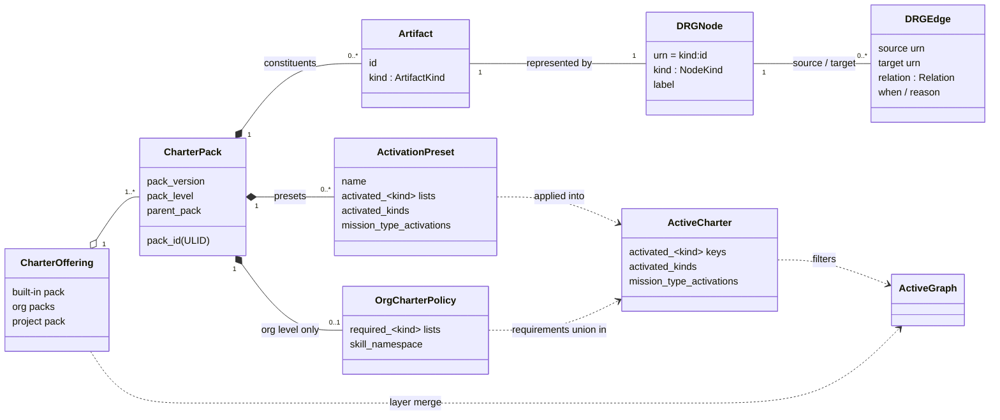

# Logical model

> **State:** this model describes what core's Python charter (`src/charter/` in
> [`spec-kitty/spec-kitty`](https://github.com/spec-kitty/spec-kitty)) implements today. No
> charter code lives in this repository yet. The Java domain and the extracted package must
> reproduce this model; where they diverge, core is the reference until this repository's
> contract becomes the source of record.

This page names the parts of the charter and how they relate. The file formats that carry
them are in [Descriptors](/architecture/descriptors/); what the domain computes from them is
in [Resolution model](/architecture/resolution-model/). Terms follow the
[Glossary](/glossary/) and [Domain](/context/domain/).

## The model at a glance

Read it left to right: a project draws on a **charter offering** made of Charter Packs. Each
pack contributes **artifacts**, which appear as **nodes** of the Doctrine Reference Graph
(DRG) and are linked by typed **edges**. The pack layers merge into one graph; the project's
**active charter** (plus any org requirements) decides which artifacts are in force. The
result is the **active graph** that every read answers from.

## Charter and active charter

- **charter** — the governance document of a project. Its authoritative form is the
  `charter.yaml` bundle under `.kittify/charter/`; `charter.md` is a display companion, not
  the governance source. The materialized `.kittify/charter/` tree is the **Charter
  Bundle**.
- **Active charter** — what the project has activated: its `activated_<kind>` keys,
  `activated_kinds` and `mission_type_activations`. It lives in `.kittify/config.yaml`, or in
  `charter.yaml` for a migrated project.

The charter has two sides that match core's package split (core ADR `2026-10-06-2`):
`charter.offering` (what is offered) and `charter.activation` (what is chosen, and the
answers computed from the choice).

## Charter Packs and pack levels

A **Charter Pack** is a distributable bundle of artifacts and their DRG edges, optionally with
**activation presets**. Every pack declares its level in `pack.yaml` (core ADR
`2026-10-11-2`):

| Pack level | Where it is configured | Shape | Notes |
|---|---|---|---|
| `built-in` | ships with Spec Kitty (`packs/built-in/` in core) | sharded `<kind>.graph.yaml` files plus a generated `pack-manifest.yaml` | Source home moving to `spec-kitty-open-packs` (core ADR `2026-08-16-2`). Ships presets `default` and `minimal`. |
| `org` | each path under `charter_packs.org.packs` in `.kittify/config.yaml` | one `drg/fragment.yaml` plus `org-charter.yaml` | May enforce activations through `required_<kind>` lists. Core's `packs/internal/` is an org pack that never ships to consumers. |
| `project` | `.kittify/charter-packs/` | per-kind directories | The project layer. Ships no presets. |

A pack may name a `parent_pack`; a pack without one is a root pack. A pack has a *level*; the
merged graph has *layers*, one per level. The layers merge built-in, then org, then project,
under core ADR `2026-05-16-1`. Implementations read the configured inputs and never infer a
level from directory presence.

## Artifact kinds

An **artifact** is one governance unit with a kind and an id. The kinds are the members of
core's `ArtifactKind` enum (`charter.offering.artifact_kinds`), the single authority for
kind facts. The Java domain checks its own kind type against the same facts; it does not
restate them.

| Kind | Operator token | Activatable | Org-requirable | Selection-overlayable | In force when key absent |
|---|---|---|---|---|---|
| `directive` | `directive` | yes | yes | yes | all |
| `tactic` | `tactic` | yes | yes | yes | all |
| `styleguide` | `styleguide` | yes | yes | yes | all |
| `toolguide` | `toolguide` | yes | yes | yes | all |
| `paradigm` | `paradigm` | yes | yes | yes | all |
| `procedure` | `procedure` | yes | yes | yes | all |
| `agent_profile` | `agent-profile` | yes | yes | yes | all |
| `mission_step_contract` | `mission-step-contract` | yes | yes | yes | all |
| `glossary_pack` | `glossary-pack` | yes | yes | no | all |
| `skill` | `skill` | yes | yes | no | required |
| `anti_pattern` | (none) | yes | no | no | all |
| `asset` | (none) | no | yes | no | all |
| `template` | (none) | no | no | no | all |

- **Activatable**: the kind can appear in an `activated_<kind>` list. `template` and `asset`
  resolve specially and are never activated as a live rule.
- **Org-requirable**: an org pack may declare `required_<plural>` for the kind.
- **Selection-overlayable**: an org `required_<plural>` list also unions into the charter's
  `selected_<plural>` field.
- **In force when key absent**: with no activation key, `all` means every available artifact
  of the kind is in force; `required` (only `skill`) means only the org packs' required
  skills are.
- `anti_pattern` has no operator token because an anti-pattern is a re-kinded node inside
  another kind's graph fragment, never a standalone file. `mission-type` is an operator token
  but not an artifact kind; it routes to the mission-type path.

## The Doctrine Reference Graph (DRG)

The DRG is a typed graph. Every node has a URN `<kind>:<id>`; every edge has a source URN, a
target URN, a relation and optional `when` and `reason` fields. A graph document carries
`schema_version: "1.0"` and `generated_at`, and refuses unknown keys
(`DRGGraphSchemaError`).

### Node kinds

The DRG's `NodeKind` is wider than `ArtifactKind`. Beyond the artifact kinds it has:

| Node kind | URN example | Role |
|---|---|---|
| `action` | `action:software-dev/plan` | One action of one mission type. Action-scoped context starts here. |
| `mission_type` | `mission_type:software-dev` | A mission type. Its `requires` edges give the action sequence; its `scope` edges carry type-wide governance. |
| `glossary_scope` / `glossary` | `glossary:<id>` | Glossary scoping and vocabulary targets. |

### Relations

| Relation | Direction and meaning |
|---|---|
| `requires` | Hard dependency. Cascade activation follows it. |
| `suggests` | Soft recommendation. Cascade activation also follows it. |
| `applies` | An action applies a directive or tactic. |
| `scope` | Governance scope: the target is in force within the source's scope (for example a mission type). |
| `vocabulary` | Links to the glossary that supplies a node's terms. |
| `instantiates` | A node instantiates a template. |
| `refines` | Narrows or sharpens the target without replacing it. |
| `specializes_from` | Static lineage between profiles or artifacts. Never used for runtime handoff. |
| `delegates_to` | Runtime handoff from one agent to another. Never inferred from lineage. |
| `enhances` | Field-merge into a target artifact; keeps the action sequence and step inputs and outputs. |
| `overrides` | Full replacement of a target artifact. |
| `replaces` | Supersession; kept for older hand-authored fragments. |
| `in_tension_with` | Symmetric, non-transitive: two co-valid artifacts compete on one decision. Stored once, smaller URN as source. |
| `reconciles_tension` | Directional, from a reconciling artifact to one side of a tension pair. A pair is resolved only when an active artifact reconciles both sides. |
| `rejects` | Directional, from a good artifact to an `anti_pattern` node. |

An edge endpoint is either a URN `<kind>:<id>` or a bare id that the same fragment's `nodes:`
block declares. Anything else is refused at merge time as `unresolved_edge_endpoint`.

## Activation

Activation is the act of choosing what is in force.

- **Per-kind keys.** `activated_<plural>` is an allowlist when present; when absent, the
  kind's `effective_when_absent` applies.
- **`activated_kinds`** gates whole kinds.
- **`mission_type_activations`** lists the mission types the project uses.
- **Org requirements.** `required_<plural>` lists in an org pack's `org-charter.yaml` are in
  force for every project that registers the pack.
- **Plan, then commit.** `plan_activation()` validates without writing; `commit_plan()`
  writes only after a successful plan. A failed plan never mutates configuration.
- **Cascade.** Activating with `--cascade` follows `requires` and `suggests` edges.
  Deactivating skips artifacts that another active artifact still references.
- **Presets.** A preset (`presets/<name>.yaml` in a pack) is a named set of activations,
  applied with `spec-kitty charter activate --preset <name>` (with `--pack <pack>` for a pack
  other than built-in). Applying a preset over customized lists is refused without
  `--force`. The preset name is not persisted.

## Agent profiles

An **agent profile** is an artifact of kind `agent_profile` that gives an agent an identity,
a specialization, collaboration rules and references to directives, tactics, styleguides
and toolguides.

- **Lineage** is a `specializes_from` edge in the DRG, not a field on the profile. A
  per-profile lineage field is refused at load time.
- **Augmentation** by another pack uses `enhances` (field-merge) or `overrides` (full
  replacement).
- **Profile resolution** takes `(profile_id, action)` and returns the resolved profile with
  lineage and overlays applied, plus compact context. An unresolved profile is an error.
- Profiles that fail to load are listed in `AgentProfileRepository.skipped_profiles` and
  reported by `spec-kitty doctor charter-packs --json`; a pack with skipped profiles is not
  reported healthy.

## Mission types, actions and step contracts

A **mission type** (for example `software-dev`, `documentation`, `research`, `plan`) defines a
workflow as a sequence of **actions** (`action:<mission-type>/<action>`). A **mission step
contract** describes the steps of one action and, per step, the kind of artifact the step
delegates to and its candidates. Action-scoped context answers "what governs this action of
this mission type in this project".

## Skills, glossary packs, assets and templates

- A **pack skill** is a thin, parameterized entry point a team shares through a pack
  (`skill:<id>`). It renders as `<skill_namespace>-<id>/SKILL.md` into each configured
  tool's project skill root. A non-built-in skill needs a `skill_namespace`.
- A **glossary pack** contributes terms to the project's vocabulary.
- An **asset** is a blob (script, document, image) described by a sidecar manifest.
- A **template** is mission-tier content that resolves specially and has no descriptor file
  pattern.

## Where to go next

- [Descriptors](/architecture/descriptors/) — every descriptor file, its fields and naming.
- [Descriptor schemas](/architecture/descriptor-schemas/) — entity diagrams of the descriptor
  schemas.
- [Resolution model](/architecture/resolution-model/) — load, merge, activate, answer.
- [API](/api/) — the designed public surface that exposes this model.
