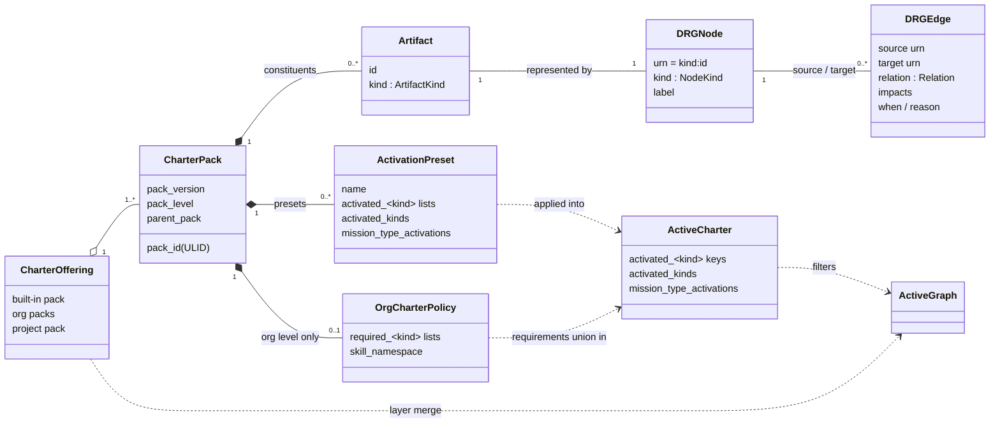

# Logical model

This page names the parts of the charter and how they relate. The file formats that carry
them are in [Descriptors](/architecture/descriptors/); what the domain computes from them is
in [Resolution model](/architecture/resolution-model/). Terms follow the
[Glossary](/glossary/) and [Domain](/context/domain/).

> **Status:** exists in core, which stays the reference until this repository's contract is the source of record. [What the labels mean](/#status).

## The model at a glance

Read it left to right: a project draws on a **charter offering** made of Charter Packs. Each
pack contributes **artifacts**, which appear as **nodes** of the Doctrine Reference Graph
(DRG) and are linked by typed **edges**. The pack layers merge into one graph; the project's
**active charter** (plus any org requirements) decides which artifacts are in force. The
result is the **active graph** that every read answers from.

## Charter and active charter

- **charter** — the governance document of a project. Its authoritative form is the
  `charter.yaml` bundle under `.kittify/charter/`; `charter.md` is a display companion, not
  the governance source. The materialized `.kittify/charter/` tree is the **Charter
  Bundle**.
- **Active charter** — what the project has activated: its `activated_<kind>` keys,
  `activated_kinds` and `mission_type_activations`. It lives in `.kittify/config.yaml`, or in
  `charter.yaml` for a migrated project.

The charter has two sides that match core's package split (core ADR [`2026-10-06-2`](https://github.com/spec-kitty/spec-kitty/blob/main/docs/adr/4.x/2026-10-06-2-charter-offering-active-charter-and-activation-presets.md)):
`charter.offering` (what is offered) and `charter.activation` (what is chosen, and the
answers computed from the choice).

## Charter Packs and pack levels

A **Charter Pack** is a distributable bundle of artifacts and their DRG edges, optionally with
**activation presets**. Every pack declares its level in `pack.yaml` (core ADR
`2026-10-11-2`):

The three levels are `built-in` (ships with Spec Kitty; ships the `default` and `minimal`
presets), `org` (each path under `charter_packs.org.packs`; may enforce activations through
`required_<kind>` lists) and `project` (the project's own layer; ships no presets). Where each
level is configured, the shape of its files and its directory layout are tabulated in
[Descriptors](/architecture/descriptors/#where-descriptors-live).

A pack may name a `parent_pack`; a pack without one is a root pack. A pack has a *level*; the
merged graph has *layers*, one per level. The layers merge built-in, then org, then project,
under core ADR [`2026-05-16-1`](https://github.com/spec-kitty/spec-kitty/blob/main/docs/adr/3.x/2026-05-16-1-doctrine-layer-merge-semantics.md) (how doctrine layers merge). Implementations read the configured inputs and never infer a
level from directory presence.

### Mutability levels

The author of the pack that introduces an artifact decides what packs merged after it may do
with it (provisional, [ADR-0012](/adr/0012-pack-mutability-policy/)):

| Level | A later pack may |
|---|---|
| `open` (default) | override it, enhance it or deactivate it |
| `extendable` | enhance it only |
| `locked` | nothing: it is untouched, cannot be deactivated, and is required |

Each level is a set of allowed operations. The levels are declared in a policy file at the
pack root, which `pack.yaml` references. Ownership follows merge order, not a fixed ladder of
three tiers: the owner is the pack that introduced the artifact, and every pack merged after
it is a later pack. A later pack may tighten a level, never loosen it. This replaces the
consumer-declared `replaceable-builtins.yaml` allowlist, with a migration.

## Artifact kinds

An **artifact** is one governance unit with a kind and an id. The kinds are the members of
core's `ArtifactKind` enum (`charter.offering.artifact_kinds`), the single authority for
kind facts. This table is the single home in these docs for per-kind facts; the descriptor pages link
here instead of restating them. The Java domain checks its own kind type against the same
facts; it does not restate them.

| Kind | Operator token | In `CHARTER_KIND_TOKENS` | Activatable | Org-requirable | Selection-overlayable | In force when key absent |
|---|---|---|---|---|---|---|
| `directive` | `directive` | yes | yes | yes | yes | all |
| `tactic` | `tactic` | yes | yes | yes | yes | all |
| `styleguide` | `styleguide` | yes | yes | yes | yes | all |
| `toolguide` | `toolguide` | yes | yes | yes | yes | all |
| `paradigm` | `paradigm` | yes | yes | yes | yes | all |
| `procedure` | `procedure` | yes | yes | yes | yes | all |
| `agent_profile` | `agent-profile` | yes | yes | yes | yes | all |
| `mission_step_contract` | `mission-step-contract` | yes | yes | yes | yes | all |
| `glossary_pack` | `glossary-pack` | yes | yes | yes | no | all |
| `skill` | `skill` | yes | yes | yes | no | required |
| `anti_pattern` | `anti-pattern` | no | yes | no | no | all |
| `asset` | `asset` | no | no | yes | no | all |
| `template` | `template` | no | no | no | no | all |

- **Activatable**: the kind can appear in an `activated_<plural>` list. `template` and `asset`
  resolve specially and are never activated as a live rule.
- **Org-requirable**: an org pack may declare `required_<plural>` for the kind.
- **Selection-overlayable**: an org `required_<plural>` list also unions into the charter's
  `selected_<plural>` field.
- **In force when key absent**: with no activation key, `all` means every available artifact
  of the kind is in force; `required` (only `skill`) means only the org packs' required
  skills are.
- **Operator token**: `ArtifactKind.operator_token`, accepted by `ArtifactKind.from_operator_token`. Every
  artifact kind has one, `anti-pattern`, `asset` and `template` included.
- **In `CHARTER_KIND_TOKENS`**: the hand-written set of tokens the charter activation
  commands accept. It drops `template`, `asset` and `anti_pattern` and adds `mission-type`.
  An anti-pattern is a re-kinded node inside another kind's graph fragment, never a
  standalone file, so it is activatable but not hand-written.
- `mission-type` is in `CHARTER_KIND_TOKENS` but is not an artifact kind;
  `from_operator_token` raises `MissionTypeNotAnArtifactKind` for it, and it routes to the
  mission-type path.

## The Doctrine Reference Graph (DRG)

The DRG is a typed graph. Every node has a URN `<kind>:<id>`; every edge has a source URN, a
target URN, a relation and optional `when` and `reason` fields; an `impacts` edge also carries its
signed `impacts` strength. A graph document carries
`schema_version: "1.0"` and `generated_at`, and refuses unknown keys
(`DRGGraphSchemaError`).

### Node kinds

The DRG's `NodeKind` is wider than `ArtifactKind`. Beyond the artifact kinds it has:

| Node kind | URN example | Role |
|---|---|---|
| `action` | `action:software-dev/plan` | One action of one mission type. Action-scoped context starts here. |
| `mission_type` | `mission_type:software-dev` | A mission type. Its `requires` edges give the action sequence; its `scope` edges carry type-wide governance. |
| `glossary_scope` / `glossary` (retiring in core) | `glossary:<id>` | Glossary scoping and vocabulary targets. Core's `drg/models.py` (lines 60-66) fences them off for deletion; `glossary_pack` survives. |

### Relations

| Relation | Direction and meaning |
|---|---|
| `requires` | Hard dependency. Cascade activation follows it. |
| `suggests` | Soft recommendation. Cascade activation also follows it. |
| `applies` | An action applies a directive or tactic. |
| `scope` | Governance scope: the target is in force within the source's scope (for example a mission type). |
| `vocabulary` | Links to the glossary that supplies a node's terms. |
| `instantiates` | A node instantiates a template. |
| `refines` | Narrows or sharpens the target without replacing it. |
| `specializes_from` | Static lineage between profiles or artifacts. Never used for runtime handoff. |
| `delegates_to` | Runtime handoff from one agent to another. Never inferred from lineage. |
| `enhances` | Field-merge into a target artifact; keeps the action sequence and step inputs and outputs. |
| `overrides` | Full replacement of a target artifact. |
| `replaces` | Supersession; kept for older hand-authored fragments. |
| `impacts` | Directed and signed: the source artifact helps (positive) or hurts (negative) the target, with a strength from -1 (sabotages) to +1 (reinforces); a negative strength is a tension claim. It replaces `in_tension_with` (core ADR `2026-07-26-3`); the service reads a legacy `in_tension_with` edge as `impacts` with strength -1. |
| `reconciles_tension` | Directional, from a reconciling artifact to one side of a tension pair (two artifacts joined by a negative `impacts`). A pair is resolved only when an active artifact reconciles both sides. |
| `rejects` | Directional, from a good artifact to an `anti_pattern` node. |

An edge endpoint is a URN `<kind>:<id>`, in shards and in fragments alike; a local reference
is written as a URN too. A value that is not a URN is refused as `drg_schema_error` by the
schema's URN pattern, and `unresolved_edge_endpoint` is no longer raised (DIV-007). The
schemas are in
[`contracts/packs/schemas/`](https://github.com/spec-kitty/spec-kitty-charter/tree/main/contracts/packs/schemas);
the authored files are drawn in the [pack write model](/architecture/descriptor-schemas/#pack-write-model).

Core still writes `in_tension_with` until its migration lands. The contract has only `impacts`
from 1.0, and core's seam maps an `in_tension_with` edge to a negative `impacts` edge until then
(provisional, [ADR-0009](/adr/0009-contract-1-0-reservations-and-additive-contract-sets/)).

### Relationships in the domain

In YAML and shards this link is an *edge* (`DrgEdge`); in the domain it is a *relationship*.

In the Java domain a relationship is a first-class value object — `from`, `to`, a
behaviour-carrying `RelationType` (directionality and activation propagation derive from the type),
and an optional `rationale` — identified by the unordered `{from, to}` pair, so **at most one
relationship exists between two components** (a simple graph, not a multigraph). Here a
**component** is the `CharterArtifact` node at the `from` or `to` of a relationship — a graph node,
narrower than the glossary's broader "charter component". A charter
component exposes `relationships()`: the relationships for which it is the effective origin (its
`from` matches, or a bidirectional relationship names it as `to`). A repository returns a component
with its relationships already populated; the graph is walked **on demand**, resolving each
neighbour through its own kind's repository rather than loading the whole Doctrine Reference Graph
(DRG) into memory. `DrgEdge`
is the storage-side serialization object for a relationship, not the domain concept. The identity is
a bounded, conditional unidirectional collapse with a revisit trigger when a symmetric relation is
minted; see
[ADR-0025](/adr/0025-relationships-first-class-and-lazy-repository-walk/) and
[ADR-0027](/adr/0027-drg-relationship-identity-bounded-unidirectional-collapse/).

## Activation

Activation is the act of choosing what is in force.

- **Per-kind keys.** `activated_<plural>` is an allowlist when present; when absent, the
  kind's `effective_when_absent` applies.
- **Exclusions.** `deactivated_<plural>` is a deny-list of artifacts the user deactivated. The
  effective set is the allowlist (or the `effective_when_absent` default) minus the deny-list,
  so new built-ins still arrive and a deactivation survives upgrades, presets and the
  interview. Allow and deny state live in one activation ledger file (provisional,
  [ADR-0013](/adr/0013-persistent-deactivation/)); this is core's activation state.
- **`activated_kinds`** gates whole kinds.
- **`mission_type_activations`** lists the mission types the project uses.
- **Org requirements.** `required_<plural>` lists in an org pack's `org-charter.yaml` are in
  force for every project that registers the pack. Required means always active: deactivating
  a required artifact is refused, naming the org pack. Its content stays as open as its
  mutability level allows.
- **Plan, then commit.** `plan_activation()` validates without writing; `commit_plan()`
  writes only after a successful plan. A failed plan never mutates configuration.
- **Cascade.** Activating with `--cascade` follows `requires` and `suggests` edges, skips
  excluded artifacts and reports them as skipped; `--include-deactivated` takes them back in.
  Deactivating skips artifacts that another active artifact still references.
- **Presets.** A preset (`presets/<name>.yaml` in a pack) is a named set of activations,
  applied with `spec-kitty charter activate --preset <name>` (with `--pack <pack>` for a pack
  other than built-in). Applying a preset over customized lists is refused without
  `--force`. The preset name is not persisted.

## Agent profiles

An **agent profile** is an artifact of kind `agent_profile` that gives an agent an identity,
a specialization, collaboration rules and references to directives, tactics, styleguides
and toolguides.

- **Lineage** is a `specializes_from` edge in the DRG, not a field on the profile. A
  per-profile lineage field is refused at load time.
- **Augmentation** by another pack uses `enhances` (field-merge) or `overrides` (full
  replacement).
- **Profile resolution** takes `(profile_id, action)` and returns the resolved profile with
  lineage and overlays applied, plus compact context. An unresolved profile is an error.
- Profiles that fail to load are listed in `AgentProfileRepository.skipped_profiles` and
  reported by `spec-kitty doctor charter-packs --json`; a pack with skipped profiles is not
  reported healthy.

## Mission types, actions and step contracts

A **mission type** (for example `software-dev`, `documentation`, `research`, `plan`) defines a
workflow as a sequence of **actions** (`action:<mission-type>/<action>`). A **mission step
contract** describes the steps of one action and, per step, the kind of artifact the step
delegates to and its candidates. Action-scoped context answers "what governs this action of
this mission type in this project".

## Skills, glossary packs, assets and templates

- A **pack skill** is a thin, parameterized entry point a team shares through a pack
  (`skill:<id>`). It renders as `<skill_namespace>-<id>/SKILL.md` into each configured
  tool's project skill root. A non-built-in skill needs a `skill_namespace`.
- A **glossary pack** contributes terms to the project's vocabulary.
- An **asset** is a blob (script, document, image) described by a sidecar manifest.
- A **template** is mission-type content that resolves specially and has no descriptor file
  pattern.

## Where to go next

- [Descriptors](/architecture/descriptors/) — every descriptor file, its fields and naming.
- [Descriptor schemas](/architecture/descriptor-schemas/) — entity diagrams of the descriptor
  schemas.
- [Resolution model](/architecture/resolution-model/) — load, merge, activate, answer.
- [API](/api/) — the designed public surface that exposes this model.
