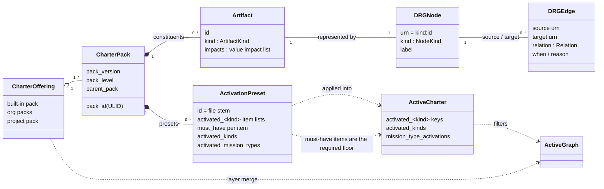

# Logical model

This page translates each concept of the [conceptual model](/context/conceptual-model/) into its
representation: descriptor fields and files, domain types and the service operations that carry
them. Each section starts with **What this means**, a link to the concept it represents, then
gives the representation. The file formats are in [Descriptors](/architecture/descriptors/); what
the domain computes is in [Resolution model](/architecture/resolution-model/). Terms follow the
[Glossary](/glossary/) and [Domain](/context/domain/).

Three labels keep current state and target apart:

- **Current state**: how core (and this service, where built) represents it today.
- **Target (ADR-NNNN)**: a representation an ADR of this repository decided.
- **Candidate, undecided**: a representation proposed but not decided by any ADR. It introduces
  no contract path; a later record decides it.

> **Status:** exists in core, which stays the reference until this repository's contract is the source of record. [What the labels mean](/#status).

## The model at a glance

Read it left to right: a project draws on a **charter offering** made of Charter Packs. Each
pack contributes **artifacts**, which appear as **nodes** of the Charter Reference Graph
(CRG) and are linked by typed **edges**. The pack layers merge into one graph; the project's
**active charter** (plus the required floor of the governing presets) decides which artifacts are in force. The
result is the **active graph** that every read answers from. The diagram shows the target
placement of `impacts` on the artifact ([ADR-0028](/adr/0028-impacts-is-a-value-list-and-tension-is-a-relationship/));
core today carries a signed `impacts` strength on an edge (see [Relations](#relations)). The
org policy's `required_<kind>` lists are core's authoring form; the service authors a requirement as the must-have
items of a preset ([ADR-0031](/adr/0031-requirement-is-authored-as-a-preset/)), and `org-charter.yaml`, which held
those lists, is retired (#431, [Enforce presets on an organization's projects](/guides/enforce-org-presets/)).
The preset fields shown are the sanitized shape this service holds
([ADR-0042](/adr/0042-pack-level-files-sanitized-shapes-and-the-derived-manifest/)); core's
preset files still write `name`, bare strings and `mission_type_activations`.

## Charter and active charter

**What this means:** [The charter: offering and active charter](/context/conceptual-model/#the-charter-offering-and-active-charter).

- **charter** — the governance document of a project. Its authoritative form is the
  `charter.yaml` bundle under `.kittify/charter/`; `charter.md` is a display companion, not
  the governance source. The materialized `.kittify/charter/` tree is the **Charter
  Bundle**.
- **Active charter** — what the project has activated: its `activated_<kind>` keys,
  `activated_kinds` and `mission_type_activations`. Current state: core keeps it in the
  activation ledger file `.kittify/charter/activation.yaml` (older projects: `.kittify/config.yaml`
  or `charter.yaml` until migrated). Target ([ADR-0033](/adr/0033-local-active-charter-is-source-of-truth/)):
  that local file is the source of truth and a write-through cache of the service-side copy, it
  names the offering packs by id and version, and on a cold-start divergence local wins, visibly (ADR-0033 decision 3, the
  ruling that settles the contest between the local file and the service copy).

The charter has two sides that match core's package split (core ADR [`2026-10-06-2`](https://github.com/spec-kitty/spec-kitty/blob/main/docs/adr/4.x/2026-10-06-2-charter-offering-active-charter-and-activation-presets.md)):
`charter.offering` (what is offered) and `charter.activation` (what is chosen, and the
answers computed from the choice).

## Charter Packs and pack levels

**What this means:** [Packs and derivation](/context/conceptual-model/#packs-and-derivation).

A **Charter Pack** is a distributable bundle of artifacts and their CRG edges, optionally with
**activation presets**. Every pack declares its level in `pack.yaml` (core ADR
`2026-10-11-2`):

The three levels are `built-in` (ships with Spec Kitty; ships the `default` and `minimal`
presets), `org` (each path under `charter_packs.org.packs`; may enforce activations through a governing
preset's must-have items and lock artifacts through `policy.yaml`) and `project` (the project's own layer; ships no presets). Where each
level is configured, the shape of its files and its directory layout are tabulated in
[Descriptors](/architecture/descriptors/#where-descriptors-live).

A pack may name a `parent_pack`; a pack without one is a root pack. A pack has a *level*; the
merged graph has *layers*, one per level. The layers merge built-in, then org, then project,
under core ADR [`2026-05-16-1`](https://github.com/spec-kitty/spec-kitty/blob/main/docs/adr/3.x/2026-05-16-1-doctrine-layer-merge-semantics.md) (how the layers merge). Implementations read the configured inputs and never infer a
level from directory presence.

**Composition** (built for one compose;
[ADR-0048](/adr/0048-pack-composition-and-the-named-packs-split/),
[ADR-0053](/adr/0053-operator-rulings-on-the-pack-ecosystem-open-questions/)). A pack declares what it builds on
as `depends_on`, a list of dependency edges, each naming a pack and a PEP 440 range on its version. The
[compose](/glossary/charter/#compose) is the [closure](/glossary/charter/#closure) of `depends_on` rooted at one
level's configured packs, including dependencies at levels nearer built-in. The offering composes every configured
pack. An activation's closure read composes from the activation's `packs` as roots (#360; every configured pack when
`packs` is absent), and the activation writes are checked against that closure alone. The resolver orders the compose with dependencies first and each
level contiguous, in merge order: built-in, then org, then project. The offering serves it whole, or refuses it by
naming the pack, rather than serving part of it.

- **Level direction.** A pack may take a `parent_pack`, and may `depends_on` a pack, only at its own level or one
  nearer built-in. `parent_pack` is an ordering and a cycle edge, as `depends_on` is (operator ruling of 2026-11-06): the
  pack a child extends merges before it, and a `parent_pack` cycle is refused as `pack_dependency_cycle`.
- **Identity.** A pack id and a pack name are unique across a compose without exception. An artifact id is unique
  within a level, except where an `overrides` edge settles it (ADR-0053 d6; rules C14 and C15). Across levels the same id is a
  layer override, and the level that applies wins whole (ADR-0059 decision 3; rules C17 and C18).
- **Sibling conflict.** Two packs at one level that both change or both define the same artifact id, of any kind, are a
  [sibling conflict](/glossary/charter/#sibling-conflict), refused unless an
  [`overrides` edge](/glossary/charter/#overrides-edge) naming a contesting member settles it. A pack that defines an
  artifact and a sibling that enhances it do not conflict (ADR-0048 d9, A14). There is no "last loaded wins": the refusal
  is `pack_sibling_conflict`, and exactly one `overrides` entry settles it (rule C15; an entry naming two different
  siblings leaves it refused). Since PR B the merge puts the named member's version in force (#357, DIV-218); until #358
  any pack of the compose may declare the edge (DIV-219).
- **Qualified reference.** A reference to an artifact of another pack is written `<pack-name>::<urn>`
  ([qualified reference](/glossary/charter/#qualified-reference)). The pack is provenance, not identity: the
  artifact's URN stays bare, and the qualifier is provenance on the edge. A reference is an edge end in a graph
  document; no artifact field carries one ([ADR-0064](/adr/0064-graph-documents-are-the-only-source-of-relationships/)).
  The named pack must be in the *referring* pack's own `depends_on` closure and must hold the artifact. A bare
  reference is the referring pack's own artifact if it holds one, is refused as unqualified if only another pack holds
  it, and has no holder otherwise. A composed read checks every edge end, and following one across packs is part of a
  served read. `listArtifactReferences` shows how one artifact's outgoing edges resolve.
- **Refusals.** A broken compose refuses every composed read with a 500 that names the violating packs in its
  `packs` member. A pack-scoped read of one artifact by id still answers. An unreadable artifact or graph file of a
  configured pack makes the offering refuse `pack_unreadable`. The causes and fixes are one table in
  [Compose packs](/guides/compose-packs/#read-a-refusal).

The offering response carries what a compose resolved: each pack lists its configured `packId`, its
`descriptorPackId` (the descriptor ULID that dependency edges name) and its declared dependencies with the range and
the version that satisfied each. Not built yet: `built-in` becomes a distribution pack with no artifacts of its own,
over a slimmed foundation pack, and stack packs are opt-in. That is the open-packs split, not this model's code. The
pack pin itself carries no resolved facts; an activation's closure read
(`GET /activations/{activationId}/packs`) answers each pack of the closure in the offering's pack shape, with the
same dependency facts (#359, #360).

### Pack-level files

Four files describe a pack as a whole rather than one artifact. This service reads each into the
domain and writes it back in one closed, sanitized shape
([ADR-0042](/adr/0042-pack-level-files-sanitized-shapes-and-the-derived-manifest/), accepted). A
pinned file in another shape is refused, never tolerated, and fixed in the pack.

| File | Schema | How the service holds it |
|---|---|---|
| `pack.yaml` | `pack-descriptor`, closed | The pack's descriptor. An unknown key, a retired one included, makes the pack unreadable (`pack_unreadable`). |
| `presets/<id>.yaml` | `preset`, closed | A `Preset` value in the pack's `presets()` slot, sorted by id. Not an artifact: it has no URN. Its `id` is its file stem. |
| `pack-manifest.yaml` | `pack-manifest`, closed | Beside the aggregate, on the whole-pack load (`LoadedPack.manifest`), because it holds paths and hashes. |
| `README.md` | `pack-document` (a Markdown structure schema) | A `PackDocument` in the pack's `document()` slot (#260, #451), served at `GET /packs/{packId}/doc` as Markdown or JSON: optional frontmatter, an optional title, a preamble and the H2 sections, read and written through the `markdown` content form. A carriage return, a byte order mark or an ambiguous heading is refused, never normalized. |

- **Presets.** A preset holds a description, an optional kind gate (`activated_kinds`) and up to
  ten `activated_<plural>` lists of preset items, `activated_mission_types` included. An item is
  `{id}` or `{id, must_have: true}`. A list holds at least one item, so a kind is switched off only
  by leaving it out of the gate. The preset's required set is derived from the marks, and a preset
  with at least one must-have item is a governing preset.
- **The manifest.** It lists the pack's constituents (`kind`, `id`, `path`, `content_hash`) and
  presets (`id`, `path`, `content_hash`), and carries a `manifest_hash`. The hashes are derived
  fields: a whole-pack write recomputes them from the bytes it writes, the reader takes them as
  written, and the round-trip gate verifies them. Membership is derived, never kept as read
  ([#110](https://github.com/spec-kitty/spec-kitty-charter/issues/110), ADR-0042 amendment of 2026-11-12): one
  constituent per artifact at its own file and one entry per preset, in path order. Every write restamps the manifest
  and generates it where the pack held none, and a registration refuses an uploaded manifest whose lists differ.
- **The fingerprint** covers them after every other file: the presets in path order, then `README.md`, then the
  manifest, then `policy.yaml`, then any retired file. A pack without them keeps its fingerprint.
- **Retired and excluded files.** `pack.md`, `PROVENANCE.md` and `org-charter.yaml` at the pack root are retired:
  refused by name, never read (#451, #431). A file an exclusion names, and Markdown that no rule models (the
  `ignored` fallback of `file-kinds.yaml`), is excluded: not held and not refused; a registration reports it as
  `file_not_held` ([ADR-0073](/adr/0073-real-packs-register-as-they-are/)).

### Mutability levels (integrity)

**What this means:** [Integrity](/context/conceptual-model/#integrity) and
[Removal is not deactivation](/context/conceptual-model/#removal-is-not-deactivation).

The author of the pack that introduces an artifact decides what packs merged after it may do
with it (provisional, [ADR-0012](/adr/0012-pack-mutability-policy/), with removal from
[ADR-0030](/adr/0030-removal-is-distinct-from-deactivation/)):

| Level | A later pack may |
|---|---|
| `open` (default) | override it, enhance it or remove it |
| `extendable` | enhance it or remove it, never override it |
| `locked` | nothing: it is untouched and cannot be removed (refused with `governance_policy_violation`) |

Integrity and requirement are independent levers: a `locked` artifact is not thereby required, and
a required artifact may be `extendable`. Removal is pack-wide, by a derived pack, one artifact at a
time; deactivation is one project's choice ([Activation](#activation)) and is not a mutability
operation ([ADR-0030](/adr/0030-removal-is-distinct-from-deactivation/)).

Each level is a set of allowed operations. The levels are declared in a policy file at the
pack root, which `pack.yaml` references. Ownership follows merge order, not a fixed ladder of
three tiers: the owner is the pack that introduced the artifact, and every pack merged after
it is a later pack. A later pack may tighten a level, never loosen it. This replaces the
consumer-declared `replaceable-builtins.yaml` allowlist, with a migration. The same policy file
holds role locks and role pins ([ADR-0030](/adr/0030-removal-is-distinct-from-deactivation/),
[ADR-0032](/adr/0032-steps-name-roles-and-profile-selection-order/)).

Candidate, undecided: the shape of a removal entry, a role lock and a role pin in the policy
file, and how a removal reaches the write surface.

## Artifact kinds

**What this means:** [Artifacts](/context/conceptual-model/#artifacts) (rules are followed, resources are
used, paradigms are adopted).

An **artifact** is one governance unit with a kind and an id. The kinds are the members of
core's `ArtifactKind` enum (`charter.offering.artifact_kinds`), the single authority for
kind facts. This table is the single home in these docs for per-kind facts; the descriptor pages link
here instead of restating them. The Java domain checks its own kind type against the same
facts; it does not restate them.

| Kind | Operator token | In `CHARTER_KIND_TOKENS` | Activatable | Org-requirable | Selection-overlayable | In force when key absent |
|---|---|---|---|---|---|---|
| `directive` | `directive` | yes | yes | yes | yes | all |
| `tactic` | `tactic` | yes | yes | yes | yes | all |
| `styleguide` | `styleguide` | yes | yes | yes | yes | all |
| `toolguide` | `toolguide` | yes | yes | yes | yes | all |
| `paradigm` | `paradigm` | yes | yes | yes | yes | all |
| `procedure` | `procedure` | yes | yes | yes | yes | all |
| `agent_profile` | `agent-profile` | yes | yes | yes | yes | all |
| `mission_step_contract` | `mission-step-contract` | yes | yes | yes | yes | all |
| `glossary_pack` | `glossary-pack` | yes | yes | yes | no | all |
| `skill` | `skill` | yes | yes | yes | no | required |
| `anti_pattern` | `anti-pattern` | no | yes | no | no | all |
| `asset` | `asset` | no | no | yes | no | all |
| `template` | `template` | no | no | no | no | all |
| `mission_type` (service only, DIV-501) | `mission-type` | yes | yes | no | no | all |
| `step_enhancement` (service only) | `step-enhancement` | no | yes | no | no | none |

- **Activatable**: the kind can appear in an `activated_<plural>` list. `template` and `asset`
  resolve specially and are never activated as a live rule.
- **Org-requirable**: core's column: an org pack may declare `required_<plural>` for the kind in core's
  `org-charter.yaml`. The service retired that file (#431); a must-have item of a governing preset is required instead.
- **Selection-overlayable**: core's column: an org `required_<plural>` list also unions into the charter's
  `selected_<plural>` field.
- **In force when key absent**: core's column. With no activation key, `all` means every
  available artifact of the kind is in force; `required` (only `skill`) means only the org packs'
  required skills are. The service's activation document reads an absent key as none for every
  kind, `skill` included (ADR-0053 d10, [DIV-203](/conformance/divergence-register/)).
- **Operator token**: `ArtifactKind.operator_token`, accepted by `ArtifactKind.from_operator_token`. Every
  artifact kind has one, `anti-pattern`, `asset` and `template` included.
- **In `CHARTER_KIND_TOKENS`**: the hand-written set of tokens the charter activation
  commands accept. It drops `template`, `asset` and `anti_pattern` and adds `mission-type`.
  An anti-pattern is a re-kinded node inside another kind's graph fragment, never a
  standalone file, so it is activatable but not hand-written.
- `mission_type`: in core, `mission-type` is in `CHARTER_KIND_TOKENS` but is not an artifact
  kind; `from_operator_token` raises `MissionTypeNotAnArtifactKind` for it, and it routes to the
  mission-type path. The service makes it an artifact kind
  ([ADR-0044](/adr/0044-mission-types-consolidated-into-one-sanitized-shape/), DIV-501), with its
  own domain model ([Mission types](#mission-types-actions-and-step-contracts)). It is activatable
  because a preset lists it in its own `activated_mission_types` slot, not among its activated
  kinds.
- `step_enhancement`: an add-only enhancement joined to a mission step by an `enhances` edge
  (ADR-0053 decision 22), with guards, emits and prompt fragments for slots the step declares
  ([ADR-0066](/adr/0066-a-step-enhancement-may-contribute-prompt-fragments/)). A preset lists it
  in `activated_step_enhancements`; `none` means the service activates none when the key is absent.
  Core's org charter has no `required_step_enhancements`; in the service a governing preset may mark one must-have. The schema holds
  only prompt fragments so far, and the service does not store the kind yet; the guard and emit
  additions and the store binding are [#428](https://github.com/spec-kitty/spec-kitty-charter/issues/428).

### Accepted kinds and kind changes (epic #142, not built yet)

The rulings of 2026-11-02 are accepted ([ADR-0048](/adr/0048-pack-composition-and-the-named-packs-split/) to [ADR-0052](/adr/0052-procedures-tightened-and-anti-patterns-as-authored-artifacts/)) and change this table once they are built; their open questions are ruled in [ADR-0053](/adr/0053-operator-rulings-on-the-pack-ecosystem-open-questions/). Until then the table above describes the code.

| Change | Record | Operator token |
|---|---|---|
| `glossary_pack` is renamed `glossary`; its artifact is a glossary context (`glossary_context:<id>`) holding terms (`term:<context>/<term>`) | [ADR-0049](/adr/0049-glossary-contexts-and-terms/), ADR-0053 | `glossary` |
| `mission_type` becomes an ordinary activatable kind; `CHARTER_KIND_TOKENS`' special path goes | [ADR-0050](/adr/0050-mission-types-and-lifecycles-as-declared-state-machines/) | `mission-type` |
| `lifecycle`: a reusable state machine, today's work-package lanes. **Stored and checked** (#156): `lifecycles/<id>.lifecycle.yaml`, in force with its pack (not activatable); action points come with the event registry | ADR-0050 | `lifecycle` |
| `guard`: an enforced check on a transition, `implemented_by` an executable asset or a closed `builtin:` id, run to the guard/1 interface, failing closed (replaces the proposed `gate` kind). **Stored and checked** (#156): `guards/<id>.guard.yaml`, in force with its pack (not activatable); not served until its contract set lands | [ADR-0054](/adr/0054-guards-are-enforced-checks-implemented-by-executable-assets/) | `guard` |
| `event_registry`: namespace, type and name per event, for the `emit` check; not activatable | [ADR-0051](/adr/0051-event-registry-a-thin-provider-neutral-consistency-check/) | `event-registry` |
| `anti_pattern` becomes an authored file with a `smell` / `severe` / `breaking` severity and a required bad example, referenced by `rejects` | [ADR-0052](/adr/0052-procedures-tightened-and-anti-patterns-as-authored-artifacts/) | `anti-pattern` |
| `procedure` stays, with a tightened definition (one step, no deliverables, not a rule) | ADR-0052 | `procedure` |

## The Charter Reference Graph (CRG)

**What this means:** [Relationships](/context/conceptual-model/#relationships).

The CRG is a typed graph. Every node has a URN `<kind>:<id>`; every edge has a source URN, a
target URN, a relation and optional `when` and `reason` fields; in current state an `impacts` edge also
carries its signed `impacts` strength (see the note under [Relations](#relations)). A graph document carries
`schema_version: "1.0"` and `generated_at`, and refuses unknown keys
(`DRGGraphSchemaError`).

### Node kinds

The CRG's `NodeKind` is wider than `ArtifactKind`. Beyond the artifact kinds it has `action`;
the `mission_type` node is listed here too, because its edges carry the action sequence. In the
service it is the node of the `mission_type` artifact kind (DIV-501):

| Node kind | URN example | Role |
|---|---|---|
| `action` | `action:software-dev/plan` | One action of one mission type. Action-scoped context starts here. |
| `mission_type` | `mission_type:software-dev` | A mission type, artifact-backed in the service. Its `requires` edges give the action sequence; its `scope` edges carry type-wide governance. |
| `step_enhancement` | `step_enhancement:spdd-specify` | Add-only contributions joined to a step by `enhances`; prompt fragments address slots in the step's prompt (ADR-0066). |
| `glossary_scope` / `glossary` (retiring in core) | `glossary:<id>` | Glossary scoping and vocabulary targets. Core's `drg/models.py` (lines 60-66) fences them off for deletion; `glossary_pack` survives. |

### Relations

| Relation | Direction and meaning |
|---|---|
| `requires` | Hard dependency. Cascade activation follows it. |
| `suggests` | Soft recommendation. Cascade activation also follows it. |
| `applies` | An action applies a directive or tactic. |
| `scope` | Governance scope: the target is in force within the source's scope (for example a mission type). |
| `vocabulary` | Links to the glossary that supplies a node's terms. |
| `instantiates` | A node instantiates a template. |
| `refines` | Narrows or sharpens the target without replacing it. |
| `specializes_from` | Static lineage between profiles or artifacts. Never used for runtime handoff. |
| `delegates_to` | Runtime handoff from one agent to another. Never inferred from lineage. |
| `enhances` | Field-merge into a target artifact; keeps the action sequence and step inputs and outputs. |
| `overrides` | Full replacement of a target artifact. |
| `replaces` | Supersession; kept for older hand-authored fragments. |
| `supports` | A resource helps check a rule (an asset supports a directive). Target ([conceptual model](/context/conceptual-model/#relationships)); candidate, undecided as a relation name in the schemas. |
| `tension` | Two rules pull against each other. Authored, never derived from value impacts; it may sit beside one structural relationship on the same pair. Target ([ADR-0028](/adr/0028-impacts-is-a-value-list-and-tension-is-a-relationship/)); it replaces `in_tension_with` and the signed `impacts` edge. |
| `impacts` (current state) | Directed and signed: the source artifact helps (positive) or hurts (negative) the target, with a strength from -1 to +1 (in core ADR `2026-07-26-3` a negative strength was a tension claim). It replaced `in_tension_with` in core ADR `2026-07-26-3`. Superseded as a relation by ADR-0028: `impacts` becomes an artifact's per-value list, and a tension is never an `impacts` edge: the service holds an `in_tension_with` edge as a tension ([ADR-0045](/adr/0045-tension-beside-the-relationships-and-nodes-keep-every-declared-field/)). |
| `reconciles_tension` | Directional, from a reconciling artifact to one side of a tension pair. A pair is resolved only when an active artifact reconciles both sides. The pair is joined by a tension (ADR-0028); in today's pack files that tension is written `in_tension_with` (ADR-0045). |
| `rejects` | Directional, from a good artifact to an `anti_pattern` node. |
| `implemented_by` | Directional, from a guard to the executable asset that implements it ([ADR-0054](/adr/0054-guards-are-enforced-checks-implemented-by-executable-assets/) decision 3). Derived from the guard's `implemented_by` field (`Guard.derivedRelationships()`), never authored, and read by nothing until the contract set lands (work breakdown item 13): a graph shard or a relationship registration that names it is refused. A built-in guard derives no edge. |

The activation cascade follows `requires`, `suggests`, `refines`, `scope`, `instantiates` and `enhances` forward, each in its declared direction (an enhancer to what it enhances), and qualified `<pack>::` targets; it passes through `specializes_from` without putting the parent in force, and follows no other relation ([ADR-0059](/adr/0059-switch-gate-cascade-edges-and-activation-rulings/) decision 2 and its amendment of 2026-11-06, A4: there is no read-time pull). At read, an enhancer is in force only while a target of its enhancement is, and a step enhancer only while the mission type of its step is (rule E6; [Composition and activation rules](/architecture/composition-and-activation-rules/)). The cascade follows only held steps: a step is held by a pack that defines its mission type and declares it, and by the closure when some pack holds it (rule W20, DIV-242, DIV-243).

An edge endpoint is a URN `<kind>:<id>`, in shards and in fragments alike; a local reference
is written as a URN too. A value that is not a URN is refused as `drg_schema_error` by the
schema's URN pattern, and `unresolved_edge_endpoint` is no longer raised (DIV-007). The
schemas are in
[`contracts/packs/schemas/`](https://github.com/spec-kitty/spec-kitty-charter/tree/main/contracts/packs/schemas);
the authored files are drawn in the [pack write model](/architecture/descriptor-schemas/#pack-write-model).

Current state: core still writes `in_tension_with` until its migration lands, and the contract
reserved `impacts` as a relation for 1.0, with core's seam mapping an `in_tension_with` edge to a
negative `impacts` edge (provisional, [ADR-0009](/adr/0009-contract-1-0-reservations-and-additive-contract-sets/), superseded in part by ADR-0028).
Target: [ADR-0028](/adr/0028-impacts-is-a-value-list-and-tension-is-a-relationship/) supersedes that
naming in part; the relation is `tension` and `impacts` is a per-value list on one artifact
(see [Values and value impacts](#values-and-value-impacts)). The domain representation of the
relationship is proposed by [ADR-0045](/adr/0045-tension-beside-the-relationships-and-nodes-keep-every-declared-field/):
a tension is a domain value held beside the relationships, outside their pair identity, written
`in_tension_with` in today's pack files, and not on the contract. Candidate, undecided: how the list
appears in the pack schemas and the contract, and whether the relationship reaches the contract.

### Relationships in the domain

In YAML and shards this link is an *edge* (`DrgEdge`); in the domain it is a *relationship*.

An edge is authored only in a pack's graph documents: the root `*.graph.yaml` shards, the registered shard
`registered.graph.yaml` among them, and `drg/fragment.yaml`. No artifact field creates one, and
`putPackRelationship` is the only operation that writes one
([ADR-0064](/adr/0064-graph-documents-are-the-only-source-of-relationships/)).

In the Java domain a relationship is a first-class value object — `from`, `to`, a
behavior-carrying `RelationType` (directionality and activation propagation derive from the type),
and an optional `rationale` — identified by the unordered `{from, to}` pair, so **at most one
structural relationship exists between two components**. Beside it, at most one `tension`
relationship may exist on the same pair
([ADR-0028](/adr/0028-impacts-is-a-value-list-and-tension-is-a-relationship/) supersedes ADR-0027 in
part); how the domain keys the two is candidate, undecided. Here a
**component** is the `CharterArtifact` node at the `from` or `to` of a relationship — a graph node,
narrower than the glossary's broader "charter component". A charter
component exposes `derivedRelationships()`: relations derived from its runtime data, never authored,
and empty by default. Only a guard derives one today, `implemented_by` to its in-pack asset. The
authored edges come from the graph documents through the `PackEdgeRepository` port, which
`ArtifactReadService` reads to answer an artifact's references. The on-demand walk of
[ADR-0025](/adr/0025-relationships-first-class-and-lazy-repository-walk/) (`GraphWalk`) is wired to no read: it
sees derived relations only, and its retirement is a follow-up of ADR-0064. `DrgEdge`
is the storage-side serialization object for a relationship, not the domain concept. The identity is
a bounded, conditional unidirectional collapse with a revisit trigger when a symmetric relation is
minted; see
[ADR-0025](/adr/0025-relationships-first-class-and-lazy-repository-walk/) and
[ADR-0027](/adr/0027-drg-relationship-identity-bounded-unidirectional-collapse/).

## Activation

**What this means:** [The two levers](/context/conceptual-model/#the-two-levers) and
[The active charter over time](/context/conceptual-model/#the-active-charter-over-time).

Activation is the act of choosing what is in force. Deactivation below is per project; it is not
removal ([ADR-0030](/adr/0030-removal-is-distinct-from-deactivation/)).

- **Per-kind keys.** `activated_<plural>` is an allowlist when present; when absent, the
  kind's `effective_when_absent` applies.
- **Exclusions.** `deactivated_<plural>` is a deny-list of artifacts the user deactivated. The
  effective set is the allowlist (or the `effective_when_absent` default) minus the deny-list,
  so new built-ins still arrive and a deactivation survives upgrades, presets and the
  interview. Allow and deny state live in one activation ledger file (provisional,
  [ADR-0013](/adr/0013-persistent-deactivation/)); this is core's activation state.
- **`activated_kinds`** gates whole kinds.
- **`mission_type_activations`** lists the mission types the project uses.
- **Org requirements.** In core: `required_<plural>` lists in an org pack's
  `org-charter.yaml` are in force for every project that registers the pack. In the service
  ([ADR-0031](/adr/0031-requirement-is-authored-as-a-preset/)): requirement is authored as a
  preset whose must-have items are the required set, and the service derives the required set
  from it; `org-charter.yaml` is retired and refused by name (#431). Either way, required means always active: deactivating a required artifact is refused,
  naming the requiring pack. Its content stays as open as its mutability level allows.
  In the service ([ADR-0042](/adr/0042-pack-level-files-sanitized-shapes-and-the-derived-manifest/)): a preset item
  is marked `must_have: true`; a preset with any must-have item is a governing preset; a preset carries no
  `required_*` key, and nothing migrates `org-charter.yaml`'s lists (#206 is superseded by its retirement; the
  conversion is in [Enforce presets on an organization's projects](/guides/enforce-org-presets/)). The service's activation
  writes enforce the required set (below); core's activation does not yet.
- **The service's activation document** (built: the register and the per-artifact and preset
  writes, #291, and the closure read, #360; [Offering and activation](/architecture/offering-and-activation/)). One stored
  `ActivationConfig` per opaque `activationId`, under a `revision`, the `sha256:` of its RFC 8785
  canonical bytes, which is also its `ETag`. Each list (`selected.<kind>`, `deactivated.<kind>`,
  `activatedKinds`, `missionTypes`) has three states, absent, `[]` and a list of ids; absent and
  `[]` both mean none and stay distinct on the wire
  ([ADR-0053](/adr/0053-operator-rulings-on-the-pack-ecosystem-open-questions/) d10). An absent
  `packs` means every configured pack. The `depends_on` and `parent_pack` closure of `packs` holds the only packs
  the document can name: an id outside it is refused. The required floor is the must-have items
  of every governing preset in that closure. A create or replace whose deny list names a required
  or locked artifact is refused `409`, unless an active override of a required, not locked artifact satisfies the
  requirement in the document as it will be stored (an enhancement never does; rule W26); a per-artifact or preset
  write refuses `409` only a deny entry it adds, and a deactivate also its named target when that entry is already
  stored
  ([DIV-204](/conformance/divergence-register/), [DIV-205](/conformance/divergence-register/)).
  Since PR B and PR C the service answers four effective reads: the artifact list and the skipped report, the effective
  graph and the effective action context. The graph holds the nodes in force (the artifacts in force, and the held
  steps of the mission types in force), the merged edges among them and the layer overrides of those nodes. The context is
  ADR-0018's walk from a held step over the artifacts in force, with the suggestions the listing gives, an `enhancements`
  member that reads each node's enhancers from its own side, and the skipped report; an unknown mission type or action is
  `404`, before a `304` ([Offering and activation](/architecture/offering-and-activation/#the-graph-and-the-action-context)).
  A template, an asset, a guard and a lifecycle have no activation state, so they are absent from both reads
  ([DIV-240](/conformance/divergence-register/)).
- **Plan, then commit.** `plan_activation()` validates without writing; `commit_plan()`
  writes only after a successful plan. A failed plan never mutates configuration.
- **Cascade.** Activating with `--cascade` follows `requires` and `suggests` edges, skips
  excluded artifacts and reports them as skipped; `--include-deactivated` takes them back in.
  Deactivating skips artifacts that another active artifact still references.
- **Presets.** A preset (`presets/<name>.yaml` in a pack) is a named set of activations,
  applied with `spec-kitty charter activate --preset <name>` (with `--pack <pack>` for a pack
  other than built-in). Applying a preset over customized lists is refused without
  `--force`. The preset name is not persisted: applying a preset is a one-time selection.

### Register and resolve (register built, resolve a candidate)

The conceptual model needs two service operations beyond the pack reads. Register is built under
[ADR-0020](/adr/0020-offering-and-activations/)'s paths. Resolve is a candidate; its path follows the
naming of ADR-0020 and [ADR-0026](/adr/0026-write-surface-is-functional-registration/) when a later
record decides it, and no contract path is introduced here.

- **Register.** A project registers its active charter with the service (create), and updates it
  (replace), naming the offering pack ids and versions it builds on. The local file is written
  through to it ([ADR-0033](/adr/0033-local-active-charter-is-source-of-truth/)). Built since
  2026-11-05 as `PUT /activations/{activationId}` and `POST /activations`
  ([Offering and activation](/architecture/offering-and-activation/)).
- **Resolve.** The client passes its activation context (project, mission type, step, work
  context) and receives what applies to that step: directives, profile, prompts. Open: one large
  payload, or references with hypermedia links to the contents. Relates to the action-context read
  ([ADR-0018](/adr/0018-action-context-read-and-seam-access-surface/)) and the effective
  activation (ADR-0020, R9, #103). The effective action context of one activation, the part of resolve that the
  activation decides, is built since PR C (`getEffectiveActionContext`).
- **Outdated notice.** Where the notice that a newer pack version exists appears in an answer is
  left to a later record (ADR-0033 decision 9).

## Agent profiles

**What this means:** [Profiles: specialists who fill roles](/context/conceptual-model/#profiles-specialists-who-fill-roles).

An **agent profile** is an artifact of kind `agent_profile` that gives an agent an identity,
a specialization, collaboration rules and references to directives, tactics, styleguides
and toolguides.

- **Lineage** is a `specializes_from` edge in the CRG, not a field on the profile. A
  per-profile lineage field is refused at load time.
- **Augmentation** by another pack uses `enhances` (field-merge) or `overrides` (full
  replacement).
- **Profile resolution** (current state) takes `(profile_id, action)` and returns the resolved
  profile with lineage and overlays applied, plus compact context. An unresolved profile is an
  error.
- **Profile selection** (target, [ADR-0032](/adr/0032-steps-name-roles-and-profile-selection-order/))
  answers "best profile for role R in context C": role fit (primary before alt-role), then
  specialization (`specializes_from` lineage plus the specificity level, which is
  `routing-priority`), then the pack-declared fallback profile marked as a fallback, then a
  not-found refusal. A derived pack may pin the profile for a role in its pack-root policy file;
  profiles that specialize the pinned one still fit. Tie handling is an open question (ADR-0032 rules none; no
  service code breaks a tie yet). Current
  state: core selects by weighted score, with role as one signal, and accepts a profile id as a
  role ([conceptual model, appendix A](/context/conceptual-model/#appendix-a-research-findings)).
- **Roles** (Operator ruling (concept session 2026-10-26), not yet ADR-backed): a role is an `ExecutorRole` value object wrapping the role
  name. Today a profile's `roles:` list gives the primary role by position only.
- **Selection operation** (candidate, undecided): a query on the profiles collection, perhaps
  under `/offering`, following [ADR-0019](/adr/0019-packs-resource-model-and-hypermedia/) and
  [ADR-0020](/adr/0020-offering-and-activations/) naming; domain form
  `findByRoleAndContext(Role, Context)`.
- **Opening statement** (Operator ruling (concept session 2026-10-26), not yet ADR-backed): a computed API field derived from purpose,
  specialization, applicable context and ethos; it is not stored in the profile file.
- Profiles that fail to load are listed in `AgentProfileRepository.skipped_profiles` and
  reported by `spec-kitty doctor charter-packs --json`; a pack with skipped profiles is not
  reported healthy.

## Mission types, actions and step contracts

**What this means:** [Mission types and roles](/context/conceptual-model/#mission-types-and-roles).

A **mission type** (for example `software-dev`, `documentation`, `research`, `plan`) defines a
workflow as an ordered list of **mission steps**, plus **on-demand steps** invoked by a command
outside that order. In the graph a step is an **action** (`action:<mission-type>/<step>`). A
**mission step contract** describes the structural sub-steps of one mission step and, per
sub-step, the kind of artifact it delegates to and its candidates. Action-scoped context answers
"what governs this action of this mission type in this project".

The service stores a mission type in one file, `missions/<id>/<id>.mission-type.yaml`, its steps
as sub-items, each step's prompt and guidelines as Markdown companions in `steps/`
([ADR-0044](/adr/0044-mission-types-consolidated-into-one-sanitized-shape/); fields in
[Descriptors](/architecture/descriptors/)). The domain is the `:missions` module
(`ai.speckitty.charter.missions.domain`): `MissionType`, `MissionStep`, `ExpectedInput`,
`ExpectedArtifact` with `ArtifactClass`, `MissionReference`, `PathConventions`, and
`StepDocument` with `StepSection` for a prompt or guidelines. It holds no file paths; the pack
store binds the kind and depends on the module.

- **Steps name roles** ([ADR-0032](/adr/0032-steps-name-roles-and-profile-selection-order/)). A
  step of a mission-type file has a `role`, never a profile. Core's step files still carry an
  `agent_profile:` field; the migration mapped each profile to its primary role.
- **Activated and its own concept.** A mission type is offered and activated like any artifact:
  it is an artifact kind in the service (DIV-501), activated through a preset's
  `activated_mission_types`, and it has its own domain model, separate from the charter kinds and
  from profiles, matching the mission-types and profiles slices of
  [ADR-0006](/adr/0006-onion-vertical-slices-archunit/).
- **Recipe ingredients.** The graph's `scope` edges from the mission type. The type carries no
  `references` field ([ADR-0064](/adr/0064-graph-documents-are-the-only-source-of-relationships/)).
  Core reads the ingredients from `governance-profile.yaml` (`MissionTypeProfile`), a file the service retires
  (DIV-502).
- **Folder layout** (decided, ADR-0044 decision 5). `missions/<type>/<type>.mission-type.yaml`,
  `missions/<type>/steps/<step>.prompt.md`, `missions/<type>/steps/<step>.guidelines.md` and
  `missions/<type>/templates/`. The eight older file families (`mission_types/<t>.yaml`,
  `mission.yaml`, `mission-runtime.yaml`, `governance-profile.yaml`, `expected-artifacts.yaml`,
  action indexes, `mission-steps/**` and `command-templates/*`) are refused by name (DIV-502).
- **The `CharterArtifact` home** (target, [ADR-0035](/adr/0035-charter-artifact-interface-lives-in-the-kernel/),
  [#171](https://github.com/spec-kitty/spec-kitty-charter/issues/171)). With separate domain
  models for mission types and profiles, a shared artifact interface lives in `kernel.domain`, the
  only home that can span those slices; otherwise mission types and profiles do not implement it.

### Mission types as state machines (accepted, not built yet)

[ADR-0050](/adr/0050-mission-types-and-lifecycles-as-declared-state-machines/) (Accepted) reads a mission type as
the **description of a finite-state machine**: which states exist, which transitions connect them, what guards a
transition, and what happens when one is taken. The charter declares the machine; the client (today core's CLI)
runs it, evaluates its guards and sends its events. The charter service runs no machine.

| FSM concept | Today (ADR-0044) | Accepted (ADR-0050; names pending where it marks them proposed) |
|---|---|---|
| State | a `steps[]` item, plus the implicit start and terminal | the same, with a reserved terminal `end` |
| Composite state | a step with a `mission_step_contract` | unchanged |
| Submachine state | none; the work-package lanes are hardcoded in core | a step's `submachine: {lifecycle, per: work_package}`, one instance per work package |
| Transition | implicit: list order, step *i* to *i + 1* | `transitions: [{to, event?, guard?, on_transition?}]` (the key `event`, not `on`: ADR-0050 as amended); absent means "next in the list" |
| Guard | blocking expected input and output artifacts | `guard: [{ref, config?, blocking?}]` naming guard artifacts backed by executable assets ([ADR-0054](/adr/0054-guards-are-enforced-checks-implemented-by-executable-assets/)); blocking artifacts stay the built-in guard |
| Triggering event | external: the runtime's `next` | `event`, a token the client interprets (`next` when absent) |
| Global transitions | `on_demand_steps` | unchanged |
| Actions | none | `on_enter`, `on_exit` (Moore) and `on_transition` (Mealy), each emitting events or, behind trust, running a pack asset |
| Branches and back-edges | not modelled | explicit transitions |
| Parallel regions | not modelled | not modelled; per-work-package lifecycles cover today's parallel work |

**Extension.** Another pack may enhance a step (a step enhancement: an artifact holding the additions, joined to
the step by a CRG `enhances` edge, as profiles are augmented; it adds guards, emits and prompt fragments, text
inserted into slots the step's prompt declares, and never removes, reorders or re-routes, nor edits prompt text outside a slot) or replace a step or a type (`overrides`: whole replacement, with a drift warning).
A reference across packs is written `<pack-name>::<urn>` ([ADR-0053](/adr/0053-operator-rulings-on-the-pack-ecosystem-open-questions/)).

**Theoretical origins.**

- **Finite-state machines and transducers.** States, an input alphabet and a transition function. In a Mealy
  machine output belongs to the transition, in a Moore machine to the state.
  [Finite-state machine](https://en.wikipedia.org/wiki/Finite-state_machine); G. H. Mealy, "A Method for
  Synthesizing Sequential Circuits", *Bell System Technical Journal* 34(5), 1955,
  [doi:10.1002/j.1538-7305.1955.tb03788.x](https://doi.org/10.1002/j.1538-7305.1955.tb03788.x); E. F. Moore,
  "Gedanken-Experiments on Sequential Machines", *Automata Studies*, 1956.
- **Harel statecharts.** Hierarchical states, guards, entry and exit actions, and parallel regions. D. Harel,
  "Statecharts: a visual formalism for complex systems", *Science of Computer Programming* 8(3), 1987,
  [doi:10.1016/0167-6423(87)90035-9](https://doi.org/10.1016/0167-6423(87)90035-9). Standardized as
  [UML state machines](https://www.omg.org/spec/UML/2.5.1/) (OMG UML 2.5.1, clause 14) and
  [W3C SCXML](https://www.w3.org/TR/scxml/) (2015: `<transition event cond target>`, `<onentry>`, `<onexit>`).
- **Workflow nets.** Petri nets applied to workflow: pre- and postconditions as places and tokens. A step's
  expected input and output artifacts are exactly this. W. M. P. van der Aalst, "The application of Petri nets to
  workflow management", *Journal of Circuits, Systems and Computers* 8(1), 1998,
  [doi:10.1142/S0218126698000043](https://doi.org/10.1142/S0218126698000043); the
  [Workflow Patterns](http://www.workflowpatterns.com/) catalog.
- **Design by Contract.** A step's inputs and outputs are its pre- and postconditions. B. Meyer, "Applying Design
  by Contract", *IEEE Computer* 25(10), 1992, [doi:10.1109/2.161279](https://doi.org/10.1109/2.161279).

## Values and value impacts

**What this means:** [Values and creeds](/context/conceptual-model/#values-and-creeds).

- **Value impact** (target, [ADR-0028](/adr/0028-impacts-is-a-value-list-and-tension-is-a-relationship/)):
  an artifact's `impacts` list, one entry per value with a strength and a required rationale.
  Candidate, undecided: its field shape in the descriptor schemas and the contract.
- **Values, project creed and profile ethos** are concepts now; their representation follows the
  creed contract set (#16, #77) and stays gated by experiment #2538 for the numeric layer.

## Skills, glossary packs, assets and templates

**What this means:** [Rules and resources](/context/conceptual-model/#rules-and-resources):
these are resources, used rather than followed.

- A **pack skill** is a thin, parameterized entry point a team shares through a pack
  (`skill:<id>`). It renders as `<skill_namespace>-<id>/SKILL.md` into each configured
  tool's project skill root. In core, a non-built-in skill needs a `skill_namespace`; the service has no
  `skill_namespace`, which lived in the retired `org-charter.yaml` (#431, #381).
- A **glossary pack** contributes terms to the project's vocabulary. Accepted, not built yet
  ([ADR-0049](/adr/0049-glossary-contexts-and-terms/)): the kind becomes `glossary`, whose artifact is a
  **glossary context** (a ubiquitous-language bounded context, close to Contextive's) holding terms addressed as
  `term:<context-id>/<term-id>`. Scope comes from the pack level, only a clash on the same `term:` URN is a
  conflict, and the pack glossary becomes the only authored source of vocabulary; the terminology gates' banned
  lists and Contextive files become projections of it.
- An **asset** is a sidecar manifest (`*.asset.yaml`: `id`, `mime`, `path`, optional `title`, optional
  `executable`) and the **asset payload** it names: a file under the pack's `assets/`, with `path` relative to
  that directory. The payload (script, document, font, image) is held as its exact bytes. A
  payload may have no sidecar (`built-in/assets/docs_structural_lint.config.yaml`): the pack holds
  every file under `assets/` as an asset file, named by an asset or not. A sidecar whose payload
  does not exist is refused, and so is one whose `path` leaves `assets/`, as an escape (#382). `mime` is metadata; it does not decide how the payload is read.
  An asset that runs declares an **executable** block (`runtime`, `min_version?`, `entry`, `args?`;
  [ADR-0054](/adr/0054-guards-are-enforced-checks-implemented-by-executable-assets/) decision 5): `runtime` is a
  token from a closed allowlist (`python`), never a shell or an executable path; `entry` is a payload file of the same pack
  (the asset's own or another's, which the load checks the pack holds) and exactly one argv element, never repeated in
  `args`; no field holds a command string. Only such an asset can
  implement a guard.
- A **guard** (`guards/<id>.guard.yaml`, ADR-0054) is an enforced check a transition names. It is
  `implemented_by` an executable asset of its pack (`asset:<id>`; another pack's, `<pack>::asset:<id>`, is refused
  until the pack dependency closure resolves it) or a closed built-in (`builtin:<id>`, six ids). Its optional
  `config_schema` is checked at load; it carries no severity. A **lifecycle**
  (`lifecycles/<id>.lifecycle.yaml`, ADR-0050 decision 17) declares `initial`, `states` and `transitions`; a
  transition's `from` is one state, a list, or `*` (every non-terminal state other than the target), and its
  `guard` entries `{ref, config?, blocking?}` must name guards that resolve, each `config` fitting its guard's
  `config_schema`. A lifecycle needs a terminal state, every state reachable from `initial`, and no two targets for
  one state and event (an absent event is `next`). Both are in force with their pack and are not activatable. What does not close is left out of
  the pack with a `reference` violation, failing closed.
- A **template** under a pack's top-level `templates/` is an artifact whose id is its path under
  that directory (`templates/writing/meeting-minutes.md` is
  `template:writing/meeting-minutes.md`), held as its exact bytes, frontmatter included. A
  mission template (`missions/<type>/templates/<path>`) is a template too, with the id
  `<type>/<path>`, the id the graph's `template:` URNs already use (ADR-0044 decision 5). An
  expected output of a step names its template with `template_path`.
- How a pack file is read, written and compared is its **content form**, declared by its
  rule in `contracts/packs/file-kinds.yaml`, never chosen by its extension: asset payloads and
  templates are `bytes` ([ADR-0040](/adr/0040-content-form-and-payload-kinds/)).

## Deployment

**What this means:** [The active charter over time](/context/conceptual-model/#the-active-charter-over-time)
and [The open-core boundary](/context/conceptual-model/#the-open-core-boundary).

One service, two options ([ADR-0034](/adr/0034-local-and-hosted-deployment-options/)). Local:
the CLI starts the service on loopback, per worktree, as [Service lifecycle](/architecture/service-lifecycle/)
describes. Hosted: the CLI calls a configured endpoint with a standard login token and fails
closed when it is unreachable. Candidate, undecided: configuration keys, the login flow and the
token format. Core ADR `2026-10-03-1` still describes loopback only; the amendment core owes is
recorded in [Open questions](/plans/open-questions/).

## Where to go next

- [Descriptors](/architecture/descriptors/) — every descriptor file, its fields and naming.
- [Descriptor schemas](/architecture/descriptor-schemas/) — entity diagrams of the descriptor
  schemas.
- [Resolution model](/architecture/resolution-model/) — load, merge, activate, answer.
- [API](/api/) — the designed public surface that exposes this model.
