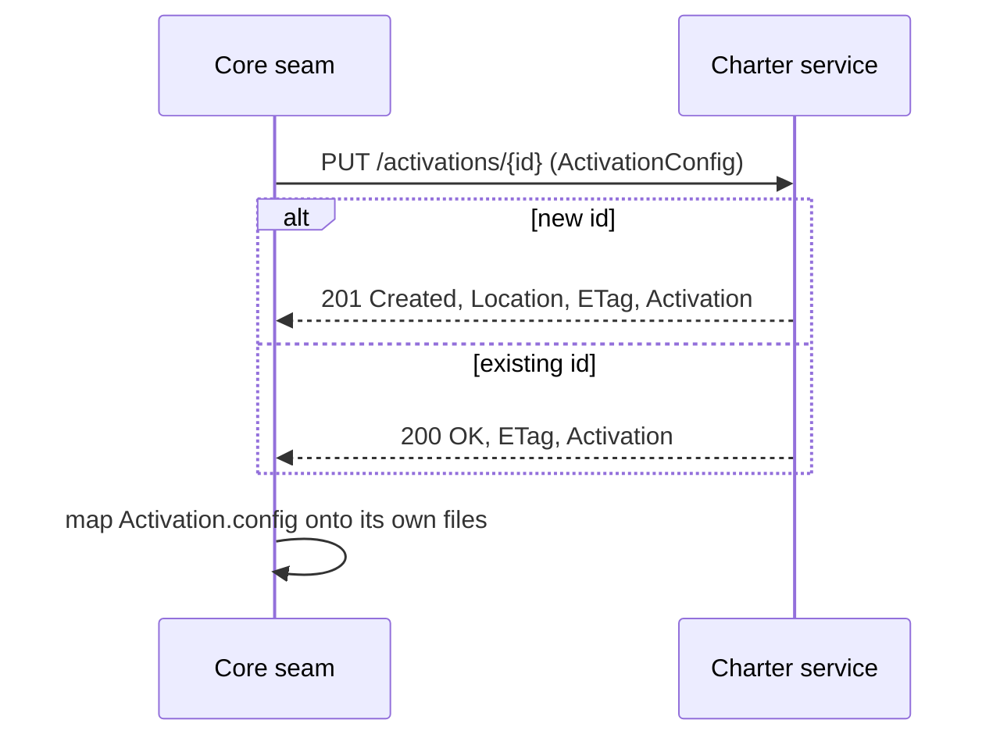
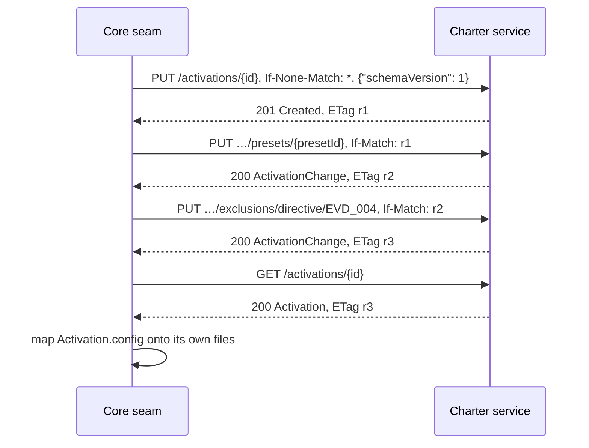
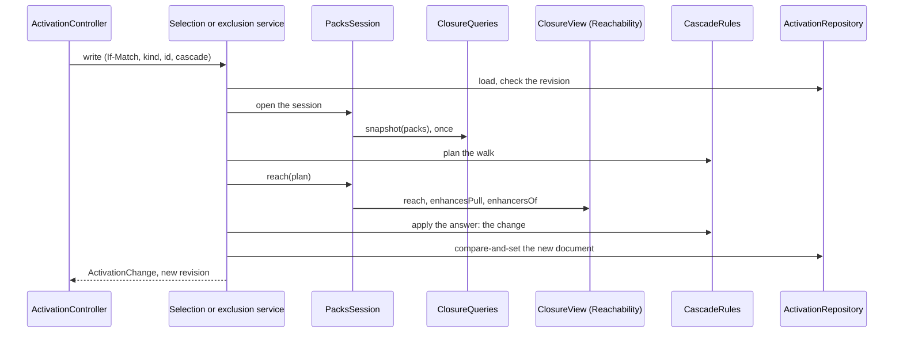
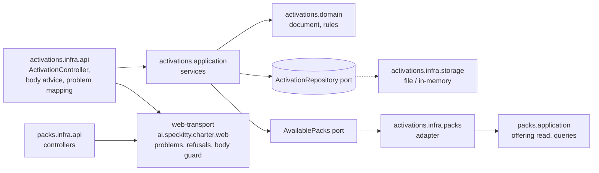

# Offering and activation

The design behind [ADR-0020](/adr/0020-offering-and-activations/). The API has three top-level
resources, one for each concept in the glossary:

- **`/packs`** — the Charter Packs this service knows
  ([Packs resource model](/architecture/packs-resource-model/)).
- **`/offering`** — the Charter offering, the offer side: what can be used, merged from the packs
  in force.
- **`/activations`** — Active charters, the activation side: which of the offering is in force for
  one activation, and the effective charter that follows.

An activation is a document the service stores. Its key, `activationId`, is opaque: the service
knows nothing of projects.

> **Status:** partly built. The activation register (create, read, replace, delete), the closure read and the five
> per-artifact writes (select, unselect, deactivate, re-activate, apply a preset) with their cascade are built
> ([#291](https://github.com/spec-kitty/spec-kitty-charter/issues/291),
> [#360](https://github.com/spec-kitty/spec-kitty-charter/issues/360)). The four effective reads are declared and
> answer `501`; they come with the resolution mission, and so do the read-time `enhances` pull and the layer merge.
> The rest of this page is the design decided by ADR-0020 and
> [ADR-0059](/adr/0059-switch-gate-cascade-edges-and-activation-rulings/). [What the labels mean](/#status).

## The resource tree

```text
/                                              API root
├── info
├── packs …                                    Charter Packs: what exists (ADR-0019)
├── offering                                   the offer side: what can be used
│   ├── artifacts{?kind}                       merged artifacts with policy facts        R2
│   │   └── {kind}/{artifactId}                one artifact, with provenance             R2
│   ├── graph                                  the merged graph                          R3
│   ├── presets                                presets the packs in force offer          R4
│   ├── kinds                                  the kind taxonomy                         R18
│   └── mission-types/{missionType}/actions/{action}                                     R5
│       └── context{?depth}                    the walk (built; moved in a 0.x minor)    R1
└── activations                                the activation side; POST: create, service-minted id
    └── {activationId}                         PUT, GET, DELETE (built)                  R9
        ├── packs                              the closure the document builds on (built)
        ├── selections/{kind}/{artifactId}     PUT select (cascade), DELETE unselect (built)
        ├── exclusions/{kind}/{artifactId}     PUT deactivate (cascade), DELETE re-activate (built)
        ├── presets/{presetId}                 PUT apply a preset (built)
        ├── artifacts{?kind,state}             effective: state, policy, reason          R9
        ├── skipped                            the skipped report                        R9
        ├── graph                              the activation-filtered graph             R9
        └── mission-types/{missionType}/actions/{action}/context{?depth}   effective      R9
```

Every resource under `activations` is declared in the contract (#125). The built ones are `POST /activations`,
`PUT`, `GET` and `DELETE /activations/{activationId}` and `GET …/packs`, which the behavioral `@contract` scenarios in
`contracts/charter/scenarios/activation-register.feature` pin, and the five per-artifact writes (`selections`,
`exclusions`, `presets`), which `activation-selections.feature` and `activation-presets.feature` pin. The four
effective reads (`artifacts`, `skipped`, `graph`, the effective context) still answer `501` (ADR-0020 D8): each
carries `x-reserved`, and one `@contract @reserved` scenario per operation pins its `501`
(`contracts/charter/scenarios/activations.feature`). The R-numbers are the read inventory's
([#94](https://github.com/spec-kitty/spec-kitty-charter/issues/94)).

## Two answers for one action

| | The walk | The effective context |
|---|---|---|
| Path | `/offering/mission-types/{mt}/actions/{a}/context` | `/activations/{id}/mission-types/{mt}/actions/{a}/context` |
| Schema | `ActionContext` | `EffectiveActionContext` |
| Answers | What the offering says governs the action | What applies under one activation: filtered, with exclusions and the skipped report |
| Freshness | `governanceFingerprint` | `governanceFingerprint` and the activation's `revision` (not built yet) |

The two never share a URL or a schema, so a client cannot mistake one for the other (ADR-0018 D1).

## The activation document

```json
{
  "activationId": "4b1f6c1e-6d2a-4bb5-9a1f-1c0f0c8d2e11",
  "revision": "sha256:9c1e…",
  "config": {
    "schemaVersion": 1,
    "packs": [{ "packId": "spec-kitty-internal", "version": "1.2.0" }, { "packId": "event-driven" }],
    "missionTypes": ["software-dev"],
    "selected": {
      "directive": ["EVD_001", "EVD_002", "EVD_003"],
      "tactic": ["domain-event-capture"]
    },
    "deactivated": { "directive": ["EVD_004"] },
    "languages": ["java"]
  },
  "_links": {
    "self": { "href": "/api/v1/activations/4b1f6c1e-6d2a-4bb5-9a1f-1c0f0c8d2e11" }
  }
}
```

The values are illustrative; the schemas are in the contract (`Activation`, and `ActivationConfig`, canonical as
JSON Schema 2020-12 in `contracts/offering/schemas/`). Per-entry provenance, context activations and applied presets
are not part of the document (ADR-0020, amendment of 2026-10-31). The answer carries no `summary` and no
`governanceFingerprint`, so its bytes depend only on the stored document and its strong `ETag` is the quoted
`revision` ([ADR-0059](/adr/0059-switch-gate-cascade-edges-and-activation-rulings/) D5); `summary` moves to the
effective artifact list. `GET` honors `If-None-Match` and answers `304` without a body when it matches.
`config` is the `ActivationConfig`: the whole document a client authors. Core keeps its own file
layout and maps it to and from `config` in one seam module. Everything else is the service's: `revision` (also the
`ETag`) and the links. `_links` holds `self`; the answer carries no write links (`edit`, `select`, `exclude`, …).

**Canonical form.** The service stores ids as the offering's artifact ids, sorted and without
duplicates. An empty deny list is refused, never stored. `revision` is the `sha256:` digest of the RFC 8785
serialization of the canonical `config`. A `PUT` of a fetched `config` answers `200` with the same
`ETag`, for a document the offering has not made stale (ADR-0059 D4): a stale document is served as stored, and
writing it back is refused until the client removes the ids the offering no longer has (`422`) and the deny entries
on artifacts now required or locked (`409`). A write evaluates its preconditions before it judges the document
(RFC 9110 §13.2.2): a stale `If-Match`, or `If-None-Match: *` on a stored id, answers `412` whatever the document
names, and takes no closure snapshot. The body is read first, though, and the strict reader refuses a body it cannot
bind as it reads it: a create or a replace whose body has an unknown member, a `null`, a duplicate key or more than
1 MiB is `422 activation_invalid` even when its precondition would fail. The document is judged against its closure
only after the precondition holds.

**Absent means none** ([ADR-0053](/adr/0053-operator-rulings-on-the-pack-ecosystem-open-questions/) d10). Each list
has three states: absent, `[]` and a list of ids. An absent `selected.<kind>`, `activatedKinds` or `missionTypes`
puts nothing in force, the same as `[]`, `skill` included; the two stay distinct on the wire. An absent `packs` means
every configured pack. Core's per-kind default differs ([DIV-203](/conformance/divergence-register/)).

**Storage.** The file adapter keeps each document at `<config-root>/activations/<encoded id>/activation.json`,
holding exactly the canonical bytes. The encoded id is the id in lower case, a `-`, then a hexadecimal bitmap of
its upper-case letters (`aBc` is `abc-2`), so ids that differ only in case never share a directory on a
case-insensitive file system, and the name decodes back to the id. A write goes to a temporary file beside it, forced to the device, and an atomic
move replaces the target; a lock in the process, striped over a fixed number of locks by the encoded id, serializes each id's
read-compare-write. This is safe
for one process; several processes over one root are out of scope
([#349](https://github.com/spec-kitty/spec-kitty-charter/issues/349)).

## The closure read

`GET /activations/{activationId}/packs` (`listActivationPacks`) answers the packs a document builds on: the
`depends_on` closure rooted at its `packs` (every configured pack when `packs` is absent), in dependency order. Each
item has the offering's pack shape, `OfferingPack`, with the facts of each resolved dependency. A pack outside the
closure is never judged, so an unrelated broken pack does not refuse it; a closure that does not compose is refused
with the offering's `500` codes, naming the pack. Its `ETag` covers the revision and the closure's packs, and it
answers `304` when `If-None-Match` matches. Neither this read nor `GET /activations/{activationId}` sends
`Charter-Source-Fingerprint`.

`/offering` stays the catalog of what is available: it composes every configured pack, whatever an activation names.
A write is checked against the closure alone: an id no pack of the closure holds is refused `422 activation_invalid`,
and a deny entry on a must-have item of a governing preset in the closure, or on an artifact a pack of the closure
locks, is refused `409` ([DIV-204](/conformance/divergence-register/),
[DIV-205](/conformance/divergence-register/)). Locks come from each pack's policy file, at the highest level along the
closure ([ADR-0063](/adr/0063-pack-mutability-policy-file/)). Each write and each closure read takes exactly one
verified snapshot of the closure, so one request never mixes two states of the packs.

## Mode 1: register an existing document

Core already has a document, for example after migrating a project's flat keys.



Refusals, in the order they are judged: first the preconditions, `400` for malformed validators (an `If-None-Match`
other than `*`, or both headers), and `412` for a stale `If-Match` or `If-None-Match: *` on a stored id; then the
document, `422 activation_invalid` (unknown pack, kind or artifact, with `violations`), and `409 artifact_required`
or `artifact_locked` (the document deactivates what a pack requires or locks; `requiredBy` names each pack with the
`parent_pack` chain it is inherited through). A refused precondition takes no closure snapshot, and nothing is stored
on any refusal. A body that does not parse as `ActivationConfig` at all is refused `422` as it arrives, before the
service sees it. Mode 1 is built.

## Mode 2: build, then fetch

Core runs its interview against the service, one per-artifact write at a time. Mode 2 is built.



- Instead of the first `PUT`, a client without an id of its own sends `POST /activations`
  and reads the minted id from `Location`.
- Every sub-resource write needs `If-Match`. Without it the answer is `428`; with a stale one,
  `412`, and the client fetches again before it retries.
- A select cascades over the graph and stops at a deactivated artifact, which the `skipped` report
  names. A deactivation records only the artifact named, never the cascade. [The cascade](#the-cascade) has the
  rules.

## The per-artifact writes

Five operations change one part of a stored document (ADR-0020 D6):

| Operation | Request | What it changes |
|---|---|---|
| `selectActivationArtifact` | `PUT …/selections/{kind}/{artifactId}`, body `cascade`, `includeDeactivated` | Adds the artifact to `selected.<kind>` (or the id to `missionTypes` for kind `mission_type`), with what [the cascade](#the-cascade) reaches; clears the target's own deny entry |
| `unselectActivationArtifact` | `DELETE …/selections/{kind}/{artifactId}` | Removes the artifact from `selected.<kind>` (or `missionTypes`); nothing else, no cascade |
| `deactivateActivationArtifact` | `PUT …/exclusions/{kind}/{artifactId}`, body `cascade` | Adds a deny entry for the named artifact alone and unselects it, with what only it kept |
| `reactivateActivationArtifact` | `DELETE …/exclusions/{kind}/{artifactId}` | Removes the artifact's deny entry (a deny list it empties is dropped); nothing else, no cascade |
| `applyActivationPreset` | `PUT …/presets/{presetId}`, body `force` | Replaces each key the preset lists; see [Presets](#presets) |

An `If-Match` that is not one quoted revision breaks its pattern and is `400`, before anything else is judged. All
five operations declare that `400`. Every other answer comes from one flow (`ActivationWrites`), in this order:

1. The preconditions, before the packs are read: no `If-Match` is `428`, an id nothing is stored under is
   `404 activation_not_found`, and an `If-Match` that does not name the stored revision is `412`.
2. The body, the path's kind and the body's `cascade`, still before the packs are read. A body fault is
   `422 activation_invalid` at its pointer: a member the schema does not declare, a `null`, a value of the wrong
   type, an empty `cascade`, a body that is too large, not JSON or missing. The inbound adapter records the fault while it
   reads the body and the use case refuses it here, so a bad body never comes before `428`, `404` or `412`. A kind the
   operation does not take is `422` with a violation at `/kind` (`mission_type` on the exclusions path included); a
   `cascade` that mixes `all` with kinds is `422` with a violation at `/cascade`, and a token that names no kind a
   document gates is `422` with the violation `unknown_kind` at that item (`/cascade/0`, …). `createActivation` and
   `replaceActivation` are not in this flow: they still refuse a bad document as they read it.
3. One verified view of the closure for the whole request (NFR-007): every walk and the rules check read it.
4. The path id against that closure: an id it does not hold is `404 artifact_not_found`, or
   `404 mission_type_not_found` for a mission type; a preset it does not hold is `404 preset_not_found`. A write
   sees only the closure (FR-010): an artifact or preset held only by a pack outside it is not found.
5. The computed document. A document equal to the stored one is a no-op: `200` with the same revision, an empty
   `applied` and `cleared`, and nothing stored. Any other is judged by the document's rules and stored by a
   compare-and-set at the loaded revision (`412` when another writer came in between). Every id is judged
   (FR-017), but the required or locked floor only on the deny entries the write adds. A deny entry stored before a
   pack upgrade put its artifact on the floor is tolerated, not applied
   ([ADR-0059](/adr/0059-switch-gate-cascade-edges-and-activation-rulings/) D4): a write of another id answers as if
   it were not there, and keeps it. Only a deactivate adds a deny entry, so only `deactivateActivationArtifact`
   declares `409`. `createActivation` and `replaceActivation` judge the whole document they are sent.

   A stale id is not tolerated the same way. While the stored document holds an id the closure no longer holds (a
   pack upgrade removed it), every per-artifact and preset write of the activation is `422 activation_invalid`,
   since every id of the computed document is judged; and an unselect or re-activate of that id is
   `404 artifact_not_found`, since step 4 checks the path id against the closure. No per-artifact write can remove
   it. The client recovers with `replaceActivation`: it fetches the document, drops the stale ids and `PUT`s the
   result with the fetched `ETag` as `If-Match`.

A per-artifact write has no body list for a pointer to index, so a `422` the document's rules raise on the computed
document points at the whole request (`""`), and keeps the codes and the details.

Each write answers an `ActivationChange` with the new revision as its `ETag`. `applied` lists every id the write
added to or removed from `selected`, `deactivated` or `missionTypes`; `cleared` lists the deny entries it removed;
`skipped` is the write-time report of the cascade, never what the read-time `enhances` pull leaves out (the effective
reads report that). A write's path has no `GET`, so the answer carries no `self`: its `up` link names the
activation.

### Presets

`applyActivationPreset` resolves the preset in the activation's own closure; when two packs of the closure hold one
preset id, the last in merge order wins. Each key the preset lists replaces that key of the document
([ADR-0059](/adr/0059-switch-gate-cascade-edges-and-activation-rulings/) D6): each `selected.<kind>` it lists becomes
exactly its members, and `activatedKinds` and `missionTypes` are replaced when it lists them. A key it does not list
is left as it is, and so are `packs` and `languages`, which a preset never names. A preset lists a key when its file
holds at least one member for it, so an empty list counts as not listed: the packs read an absent list and an empty
one alike. A kind a document cannot gate (`template`, `asset`) is left out of `activatedKinds`.

Without `force`, a member the document denies is not selected and its deny entry stays. With `force: true`, the deny
entries of the preset's members are cleared and reported in `cleared`. A preset never adds a deny entry and walks
nothing, so its `skipped` report is empty. A replaced key's dropped ids are in `applied`; a kind is never an entry.

A member the closure no longer holds (a stale preset) is selected as the preset says, and the rules refuse the result
`422 activation_invalid`, with a violation `unknown_artifact` at the whole request whose detail names the artifact,
not the preset. Nothing is stored. A broken preset is a fault of its pack, not a silent skip. The operation's
description documents this refusal, and a scenario of `activation-presets.feature` pins it.

## The cascade

A select or a deactivate with a `cascade` walks the closure's graph from the named artifact
([ADR-0059](/adr/0059-switch-gate-cascade-edges-and-activation-rulings/) D2, as revised on 2026-11-05;
[ADR-0013](/adr/0013-persistent-deactivation/) D2 to D5). `cascade` is the kinds the write may change, or exactly
`["all"]` for every kind; without it the write touches the named artifact alone. A select of kind `mission_type`
never cascades: its `cascade` is checked for its shape and then ignored, and so is `includeDeactivated`.

**What a walk follows.** The five relations `requires`, `suggests`, `refines`, `scope` and `instantiates`, forward,
with no depth limit, and `<pack>::` targets resolved in the closure. Each node is visited once, so a cycle ends and
each artifact on it is selected once. No other relation is followed (D2.5); `enhances` is not one of the five.

**Lineage** (D2.4, [DIV-206](/conformance/divergence-register/)). For a profile the walk reaches, the walk passes up
the whole `specializes_from` chain and follows only `requires` and `scope` from each ancestor; their targets join the
walk as if the profile wrote them. An ancestor passed through is never put in force and never reported, and the
`cascade` scope does not filter it. A denied ancestor stops the pass-through there and is reported.

**Mission types.** No `cascade` scope admits a mission type, `["all"]` included. A walk that reaches one never puts it
in `missionTypes` and never makes it a deactivate candidate: it is reported in `skippedByScope`, and a selected one
stays selected.

**Select.** The target and every artifact the walk reached of a kind in scope join `selected`. The walk stops at
every deny entry of the document except the target's own, which the select clears. What the walk did not select is reported in `skipped`:

| Bucket | What it holds |
|---|---|
| `skippedByScope` | Artifacts the walk reached of a kind outside `cascade` |
| `skippedDeactivated` | Each denied artifact the walk stopped at, with `viaRequires` (it was reached over `requires`) and `requiredBy` (for each way to it, the artifact that put it in the walk; see below) |
| `unreachedBehindDeactivated` | Artifacts that lie only behind a denied artifact: a walk without the stops would reach them, this one did not; whatever the scope |
| `skippedShared` | Empty for a select; see the deactivate below |

**Who is named.** `requiredBy` and `referencedBy` name only an artifact an `ArtifactReference` can name and the
contract means. The service follows each way back from the reported artifact, one predecessor level at a time, past
a template, an asset, a lineage ancestor (to the descendant it was passed from) and an unselected intermediate.
`requiredBy` names the nearest artifact of a kind a document gates that is not an ancestor passed through;
`referencedBy` names the nearest artifact active after the write. Among the nearest, the first in code-point order
is named, so the choice does not depend on the order the walk recorded its ways in.

**`includeDeactivated`** (D2.2, [DIV-207](/conformance/divergence-register/)). The walk stops at no deny entry. The
select clears the deny entries of everything the walk went through, whatever the `cascade` scope: the target, what
it reached and the ancestors it passed. It also clears the deny entries of what the `enhances` pull reaches from what
it selects: both directions of the edge, transitively over `enhances` and nothing else. The pull is bounded by the
document's `activatedKinds`, as the read-time pull is: it reaches only those kinds and does not continue through
another kind. An absent `activatedKinds` means none, as `[]` does, so the pull reaches nothing. A cleared artifact
outside the scope is not selected and stays in `skippedByScope`; a cleared ancestor and a pulled artifact are never
selected either. A pulled artifact that was denied is in `cleared` and in `applied` (removed from `deactivated`); a
pulled artifact that was not denied is in neither, as nothing changes for it.

**Deactivate.** The named artifact gets the only deny entry, and leaves `selected`. A required or locked artifact is
refused first, `409 artifact_required` or `artifact_locked` naming the packs, before any walk, and nothing changes.
With a cascade:

1. The target's own walk follows the five relations and stops nowhere. It does not follow the lineage, while the
   select walk and the shared walk do; see the open question below. The candidates are what it reached that is
   selected and of a kind in scope, less the required or locked floor: a floor artifact is never a candidate.
2. A shared walk starts from the other active artifacts (`selected` and the required or locked floor, less the target
   and the candidates), crosses the five relations with the lineage, and stops at the target and the deny entries.
   A candidate it reaches is shared. So is a candidate an active enhancer references, one hop over `enhances`. A
   shared candidate is active after the write, so the shared walk runs again with it among its starts, until it
   changes nothing (a fixed point on the same closure view).
3. Each shared candidate stays selected and is reported in `skippedShared`. Its `referencedBy` is the nearest
   artifact active after the write back along the shared walk's ways, or else the active enhancer that references
   it. Every other candidate leaves `selected`; none gets a deny entry.
4. A selected floor artifact the target's walk reached stays a start of the shared walk, so it and what only it
   reaches stay selected. It is reported in `skippedShared` only when another active artifact reaches it, with
   `referencedBy` the nearest such artifact. One that no other active artifact reaches is not reported: it was never
   a candidate, and no artifact is named as what keeps itself. The shared walk runs whenever the target's walk
   reached a selected artifact in scope, so it runs for a floor artifact even with no candidate.

A deactivate's `skippedByScope` lists only the out-of-scope artifacts the target reached that are selected; one that
is not selected is left alone and not reported.

**Open question: the deactivate walk and the lineage.** The target's own walk does not pass up the
`specializes_from` chain, while the select walk and the shared walk do. FR-015 names exactly "the five relations",
and the service reads it literally: what only an ancestor of a reached profile requires is not a candidate, so a
cascading deactivate leaves it selected. The asymmetry is deliberate and pinned by a test. It awaits an operator
ruling.

**Not built here.** The `enhances` pull at read time, which puts an enhancer in force with its target and the reverse,
is the effective reads', and they answer `501`. A write never writes an enhancer into `selected`; the two places it
reads `enhances` are the `includeDeactivated` clearing and the deactivate's shared check.

**Who owns what.** `packs` owns the traversal: `Reachability` runs every walk on `GraphWalk` over the closure's edges
(`reach`, `enhancesPull`, `enhancersOf`), and `ClosureView` exposes them. `activations` owns the policy:
`CascadeRules` plans each walk (`ReachPlan`) and reads its answer (`Reach`) as pure functions; it walks nothing
itself. One `ClosureQueries.snapshot` per request gives the verified view every walk and the rules check read.



## Who holds what

| Item | Held by | Notes |
|---|---|---|
| The interview, `answers.yaml`, the charter text and compile | Core | Unchanged |
| The activation document | Core's files until activation routes to the service, then the service | Core keeps its own file layout and maps it to `ActivationConfig` in one seam module. The local file is the source of truth and is written through to the service; on a cold-start divergence local wins, visibly ([ADR-0033](/adr/0033-local-active-charter-is-source-of-truth/), superseding the earlier "service wins") |
| First-load state (`context-state.json`) | Core | Sent as `depth` (ADR-0011 D3) |
| Project-tier content | The service, as a registered pack of level `project` | ADR-0020 D11 |
| `required_*`, `locked`, available artifacts | Derived from the packs | Never stored in the document |

## How each resource maps onto the service

| Resource | Application | Domain or port |
|---|---|---|
| `/offering`, `/offering/artifacts…`, `graph`, `presets`, `kinds`, `mission-types…` | offering queries | `CharterOffering`, `DoctrineGraph` |
| `/offering/…/context` | `ActionContextQuery` (built) | the walk (ADR-0018) |
| `/activations`, `/activations/{id}` and `…/packs` (built) | activation services | the activation document and its write rules; `ActivationRepository` and `AvailablePacks` ports |
| `/activations/{id}/…` writes (built) | `ActivationSelectionService`, `ActivationExclusionService`, `ActivationPresetService` over `ActivationWrites` | `CascadeRules`, `PresetRules`; walks through the `PacksSession` an `AvailablePacks` adapter opens on one `ClosureView` |
| `/activations/{id}/…` effective reads (not built) | effective-set queries | the effective-set algebra over the closure and the document |
| Every resource's problem and refusal bodies, and the JSON body guard | module `web-transport`, package `ai.speckitty.charter.web` (`RefusalHandler`, `ProblemHandler`, `Problems`, `JsonBodyGuard`, `ProblemJson`) | none: a transport ring shared by `packs.infra.api` and `activations.infra.api`, naming no slice |

`activations` is a top-level slice that depends on `packs`. It owns the activation document, its storage, its write
rules and its HTTP adapter; every question about pack content goes through one port, `AvailablePacks`, whose
adapter calls the public application services of `packs`. Links are built in the REST adapter, as for packs. The
adapter also holds the activation set's request-body advice (`ActivationBodyAdvice`) and its problem mapping
(`ActivationProblems`); both render through the shared `web-transport` module, which both slices' inbound adapters
depend on, so the composition root (`deployable`) holds no activation transport.



## Proposed scenarios

These are proposed, not bound. What is bound for the built operations is
`contracts/charter/scenarios/activation-register.feature`, `activation-selections.feature` and
`activation-presets.feature`, and for each reserved operation one 501 pin
(`contracts/charter/scenarios/activations.feature`). The scenarios below stay proposed until the effective reads are
built; the per-artifact writes they use are bound by those files. They describe what a client does, not which endpoint it calls, so
they hold whatever the paths become; the step definitions map each step onto the contract.

```gherkin
Feature: One project can hold a separate active charter per branch
  A mission that changes the charter trials it on its own branch. The other
  missions keep the charter on main until the branch merges. The service
  knows nothing of projects or branches: core picks one activation per branch.

  Background:
    Given the offering holds the built-in pack and the org pack "event-driven"
    And the org pack "event-driven" offers the preset "event-driven"
    And the activation "proj-main" is registered with the built-in directives selected

  Scenario: A governance mission trials a preset without changing main's charter
    Given I retrieve the activation "proj-main"
    When I register its document as the new activation "proj-gov-trial"
    Then the activation "proj-gov-trial" is created
    When I apply the preset "event-driven" to the activation "proj-gov-trial"
    Then the change is accepted
    And the effective active charter of "proj-gov-trial" for implementing a software-dev mission includes the directive "EVD_001"
    And the effective active charter of "proj-main" for implementing a software-dev mission does not include the directive "EVD_001"
    And the activation "proj-main" is unchanged

  Scenario: Merging the branch promotes its charter to main
    Given the activation "proj-gov-trial" has the preset "event-driven" applied
    When I retrieve the activation "proj-gov-trial"
    And I register its document as the activation "proj-main", based on the revision of "proj-main" I hold
    Then the registration is accepted
    And the activation "proj-main" has the same revision as "proj-gov-trial"
    And the effective active charter of "proj-main" for implementing a software-dev mission includes the directive "EVD_001"

  Scenario: Main changed while the branch was open
    Given I hold the revision of "proj-main" from when the branch started
    And another mission deactivated the directive "DIRECTIVE_003" in "proj-main"
    When I register the document of "proj-gov-trial" as the activation "proj-main", based on the revision I hold
    Then the registration is refused because "proj-main" changed since that revision
    And the activation "proj-main" still deactivates the directive "DIRECTIVE_003"

  Scenario: The branch activation is removed after the merge
    When I remove the activation "proj-gov-trial"
    Then the activation "proj-gov-trial" is removed
    When I remove the activation "proj-gov-trial"
    Then the removal is refused because the activation "proj-gov-trial" does not exist
```

```gherkin
Feature: The activation document round-trips, and the pack policy holds

  Scenario: A retrieved document registers unchanged
    Given the activation "a-1" is registered
    When I retrieve the activation "a-1"
    And I register its document as the activation "a-1"
    Then the registration is accepted
    And the revision of "a-1" is unchanged

  Scenario: A required artifact cannot be deactivated
    Given the org pack "internal" requires the directive "NO_FULL_HEAVY_SUITES_IN_MISSION"
    And the activation "a-1" is registered
    When I deactivate the directive "NO_FULL_HEAVY_SUITES_IN_MISSION" in the activation "a-1"
    Then the change is refused because the pack "internal" requires the artifact
    And the activation "a-1" is unchanged

  Scenario: An activation operation that is not built yet says so
    Given the activation "a-1" is registered
    When I retrieve the effective artifacts of the activation "a-1"
    Then the request is refused as not implemented yet
```

The last scenario holds only while the operation is reserved; it is removed when the operation is
built.
