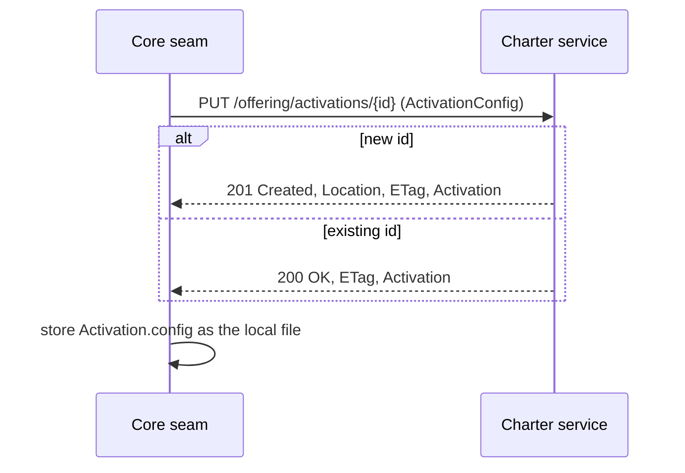
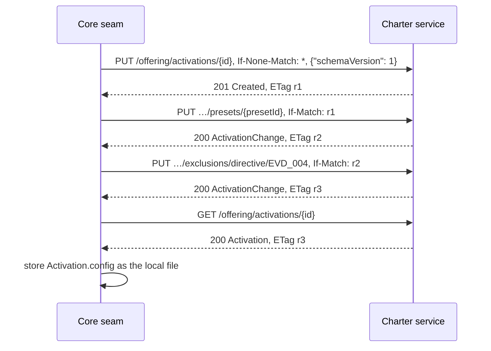

# Offering and activation

The design behind [ADR-0020](/adr/0020-offering-and-activations/). `/packs` is what exists
([Packs resource model](/architecture/packs-resource-model/)); `/offering` is the charter: what
the packs in force offer, merged. An **activation** is a document the service stores that chooses
from that offering. Its key, `activationId`, is opaque: the service knows nothing of projects.

> **Status:** design only, proposed by ADR-0020. Today only the action-context read exists, at
> `/mission-types/{missionType}/actions/{action}/context`; it moves under `/offering` before the
> 1.0 tag. [What the labels mean](/#status).

## The resource tree

```text
/                                              API root
├── info
├── packs …                                    layer 1: what exists (ADR-0019)
└── offering                                   layer 2: the charter, merged
    ├── artifacts{?kind}                       merged artifacts with policy facts        R2
    │   └── {kind}/{artifactId}                one artifact, with provenance             R2
    ├── graph                                  the merged graph                          R3
    ├── presets                                presets the packs in force offer          R4
    ├── kinds                                  the kind taxonomy                         R18
    ├── mission-types/{missionType}/actions/{action}                                     R5
    │   └── context{?depth}                    the walk (built; moved before 1.0)        R1
    └── activations                            POST: create, service-minted id (reserved)
        └── {activationId}                     PUT, GET, DELETE (reserved)               R9
            ├── selections/{kind}/{artifactId} PUT select (cascade), DELETE unselect
            ├── exclusions/{kind}/{artifactId} PUT deactivate, DELETE re-activate
            ├── presets/{presetId}             PUT apply a preset
            ├── artifacts{?kind,state}         effective: state, policy, reason          R9
            ├── skipped                        the skipped report                        R9
            ├── graph                          the activation-filtered graph             R9
            └── mission-types/{missionType}/actions/{action}/context{?depth}   effective  R9
```

Every resource under `activations` is declared in contract 1.0 and answers `501` until it is
built (ADR-0020 D8). The R-numbers are the read inventory's
([#94](https://github.com/spec-kitty/spec-kitty-charter/issues/94)).

## Two answers for one action

| | The walk | The effective context |
|---|---|---|
| Path | `/offering/mission-types/{mt}/actions/{a}/context` | `/offering/activations/{id}/mission-types/{mt}/actions/{a}/context` |
| Schema | `ActionContext` | `EffectiveActionContext` |
| Answers | What the offering says governs the action | What applies under one activation: filtered, with exclusions and the skipped report |
| Freshness | `governanceFingerprint` | `governanceFingerprint` and the activation's `revision` |

The two never share a URL or a schema, so a client cannot mistake one for the other (ADR-0018 D1).

## The activation document

```json
{
  "activationId": "4b1f6c1e-6d2a-4bb5-9a1f-1c0f0c8d2e11",
  "revision": "sha256:9c1e…",
  "config": {
    "schemaVersion": 1,
    "packs": null,
    "missionTypes": ["software-dev"],
    "selected": {
      "directive": ["EVD_001", "EVD_002", "EVD_003"],
      "tactic": ["domain-event-capture"]
    },
    "deactivated": { "directive": ["EVD_004"] },
    "languages": ["java"],
    "appliedPresets": [{ "pack": "event-driven", "preset": "event-driven", "at": "2026-10-20T09:12:00Z" }]
  },
  "summary": { "active": 41, "inactive": 212, "excluded": 1, "required": 1, "locked": 0, "skipped": 2 },
  "_links": {
    "self": { "href": "/api/v1/offering/activations/4b1f6c1e-6d2a-4bb5-9a1f-1c0f0c8d2e11" },
    "offering": { "href": "/api/v1/offering" }
  }
}
```

The values are illustrative and the field list is an outline; the schema issue fixes it.
`config` is the `ActivationConfig`: the whole document a client authors, and the file core
stores. Everything else is the service's: `revision` (also the `ETag`), the derived `summary`
and the links. Write links (`edit`, `select`, `exclude`, …) appear only once the writes are built.

**Canonical form.** The service stores ids as the offering's artifact ids, sorted and without
duplicates, and omits empty deny lists. `revision` is the `sha256:` digest of the RFC 8785
serialization of the canonical `config`. A `PUT` of a fetched `config` answers `200` with the same
`ETag`.

## Mode 1: register an existing document

Core already has a document, for example after migrating a project's flat keys.



Refusals: `422 activation_invalid` (unknown pack, kind or artifact, with `violations`),
`409 artifact_required` or `artifact_locked` (the document deactivates what a pack requires or
locks; nothing is stored), `412` if the client sent a stale `If-Match`.

## Mode 2: build, then fetch

Core runs its interview against the service.



- Instead of the first `PUT`, a client without an id of its own sends `POST /offering/activations`
  and reads the minted id from `Location`.
- Every sub-resource write needs `If-Match`. Without it the answer is `428`; with a stale one,
  `412`, and the client fetches again before it retries.
- A select cascades over the graph and stops at a deactivated artifact, which the `skipped` report
  names. A deactivation records only the artifact named, never the cascade.

## Who holds what

| Item | Held by | Notes |
|---|---|---|
| The interview, `answers.yaml`, the charter text and compile | Core | Unchanged |
| The activation document | The service | Core's file is the last fetched copy; the service wins on divergence |
| First-load state (`context-state.json`) | Core | Sent as `depth` (ADR-0011 D3) |
| Project-tier content | The service, as a registered pack of level `project` | ADR-0020 D11 |
| `required_*`, `locked`, available artifacts | Derived from the packs | Never stored in the document |

## How each resource maps onto the service

| Resource | Application | Domain or port |
|---|---|---|
| `/offering`, `/offering/artifacts…`, `graph`, `presets`, `kinds`, `mission-types…` | offering queries | `CharterOffering`, `DoctrineGraph` |
| `/offering/…/context` | `ActionContextQuery` (built) | the walk (ADR-0018) |
| `/offering/activations…` writes | activation use cases | `ActivationConfig`, cascade, deny list; `ActivationRepository` port |
| `/offering/activations/{id}/…` reads | effective-set queries | the effective-set algebra over the offering and the document |

The `ActivationRepository` port sits in the storage ring with the pack store
([Pack registration and distribution](/architecture/pack-registration-distribution/)). Links are
built in the REST adapter, as for packs.

## Proposed contract scenarios

These are proposed, not bound.

```gherkin
@contract @reserved
Scenario: A reserved activation operation answers 501
  When I PUT an activation document for the id "a-1"
  Then the response status is 501
  And the response is a Problem without a code

Scenario: A fetched document registers unchanged
  Given an activation "a-1" is stored
  When I GET "/offering/activations/a-1"
  And I PUT its config back to the same URL
  Then the response status is 200
  And the ETag is unchanged

Scenario: A stale write is refused
  Given an activation "a-1" at revision r1 was changed to r2
  When I PUT an exclusion with If-Match r1
  Then the response status is 412

Scenario: A required artifact cannot be deactivated
  Given the org pack requires the directive "NO_FULL_HEAVY_SUITES_IN_MISSION"
  When I PUT an exclusion for that directive
  Then the response status is 409
  And the refusal code is "artifact_required"
  And the refusal names the requiring pack
```
