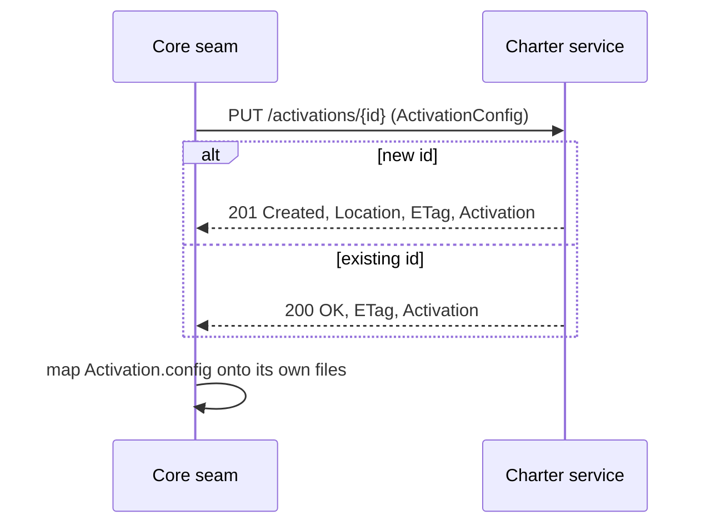
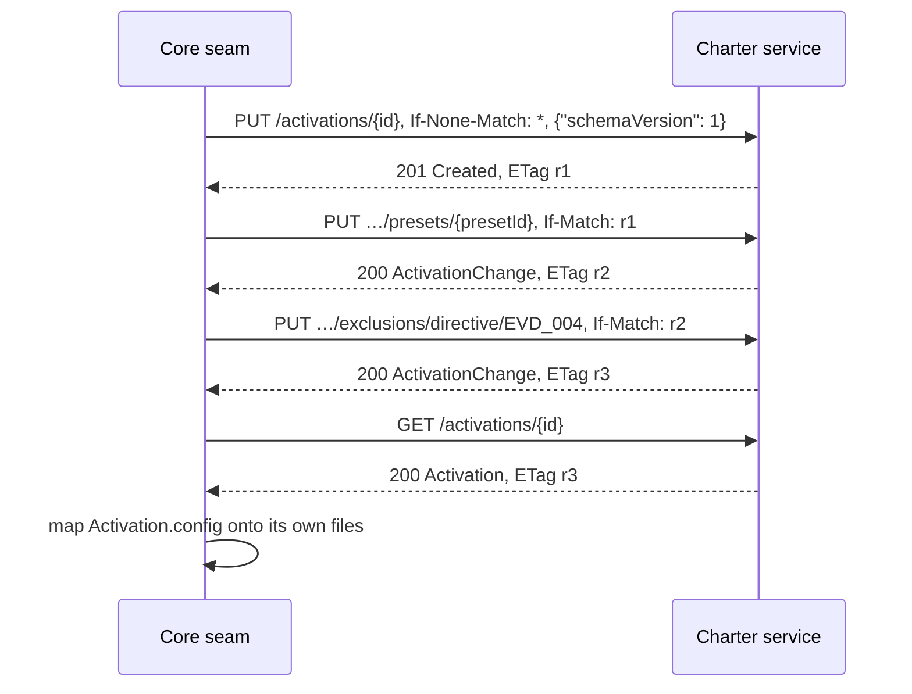
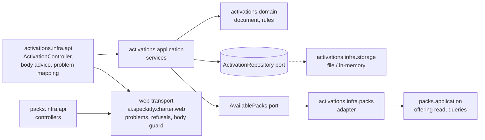

# Offering and activation

The design behind [ADR-0020](/adr/0020-offering-and-activations/). The API has three top-level
resources, one for each concept in the glossary:

- **`/packs`** — the Charter Packs this service knows
  ([Packs resource model](/architecture/packs-resource-model/)).
- **`/offering`** — the Charter offering, the offer side: what can be used, merged from the packs
  in force.
- **`/activations`** — Active charters, the activation side: which of the offering is in force for
  one activation, and the effective charter that follows.

An activation is a document the service stores. Its key, `activationId`, is opaque: the service
knows nothing of projects.

> **Status:** partly built. The activation register (create, read, replace, delete) and the closure read are built
> ([#291](https://github.com/spec-kitty/spec-kitty-charter/issues/291),
> [#360](https://github.com/spec-kitty/spec-kitty-charter/issues/360)). The five per-artifact writes and the four
> effective reads are declared and answer `501`: the writes come with the next pull request of the same mission, the
> effective reads with the resolution mission. The rest of this page is the design decided by ADR-0020 and
> [ADR-0059](/adr/0059-switch-gate-cascade-edges-and-activation-rulings/). [What the labels mean](/#status).

## The resource tree

```text
/                                              API root
├── info
├── packs …                                    Charter Packs: what exists (ADR-0019)
├── offering                                   the offer side: what can be used
│   ├── artifacts{?kind}                       merged artifacts with policy facts        R2
│   │   └── {kind}/{artifactId}                one artifact, with provenance             R2
│   ├── graph                                  the merged graph                          R3
│   ├── presets                                presets the packs in force offer          R4
│   ├── kinds                                  the kind taxonomy                         R18
│   └── mission-types/{missionType}/actions/{action}                                     R5
│       └── context{?depth}                    the walk (built; moved in a 0.x minor)    R1
└── activations                                the activation side; POST: create, service-minted id
    └── {activationId}                         PUT, GET, DELETE (built)                  R9
        ├── packs                              the closure the document builds on (built)
        ├── selections/{kind}/{artifactId}     PUT select (cascade), DELETE unselect
        ├── exclusions/{kind}/{artifactId}     PUT deactivate, DELETE re-activate
        ├── presets/{presetId}                 PUT apply a preset
        ├── artifacts{?kind,state}             effective: state, policy, reason          R9
        ├── skipped                            the skipped report                        R9
        ├── graph                              the activation-filtered graph             R9
        └── mission-types/{missionType}/actions/{action}/context{?depth}   effective      R9
```

Every resource under `activations` is declared in the contract (#125). The built ones are `POST /activations`,
`PUT`, `GET` and `DELETE /activations/{activationId}` and `GET …/packs`; the behavioral `@contract` scenarios in
`contracts/charter/scenarios/activation-register.feature` pin them. The others, the five per-artifact writes
(`selections`, `exclusions`, `presets`) and the four effective reads (`artifacts`, `skipped`, `graph`, the effective
context), still answer `501` (ADR-0020 D8): each carries `x-reserved`, and one `@contract @reserved` scenario per
operation pins its `501` (`contracts/charter/scenarios/activations.feature`). The R-numbers are the read inventory's
([#94](https://github.com/spec-kitty/spec-kitty-charter/issues/94)).

## Two answers for one action

| | The walk | The effective context |
|---|---|---|
| Path | `/offering/mission-types/{mt}/actions/{a}/context` | `/activations/{id}/mission-types/{mt}/actions/{a}/context` |
| Schema | `ActionContext` | `EffectiveActionContext` |
| Answers | What the offering says governs the action | What applies under one activation: filtered, with exclusions and the skipped report |
| Freshness | `governanceFingerprint` | `governanceFingerprint` and the activation's `revision` (not built yet) |

The two never share a URL or a schema, so a client cannot mistake one for the other (ADR-0018 D1).

## The activation document

```json
{
  "activationId": "4b1f6c1e-6d2a-4bb5-9a1f-1c0f0c8d2e11",
  "revision": "sha256:9c1e…",
  "config": {
    "schemaVersion": 1,
    "packs": [{ "packId": "spec-kitty-internal", "version": "1.2.0" }, { "packId": "event-driven" }],
    "missionTypes": ["software-dev"],
    "selected": {
      "directive": ["EVD_001", "EVD_002", "EVD_003"],
      "tactic": ["domain-event-capture"]
    },
    "deactivated": { "directive": ["EVD_004"] },
    "languages": ["java"]
  },
  "_links": {
    "self": { "href": "/api/v1/activations/4b1f6c1e-6d2a-4bb5-9a1f-1c0f0c8d2e11" }
  }
}
```

The values are illustrative; the schemas are in the contract (`Activation`, and `ActivationConfig`, canonical as
JSON Schema 2020-12 in `contracts/offering/schemas/`). Per-entry provenance, context activations and applied presets
are not part of the document (ADR-0020, amendment of 2026-10-31). The answer carries no `summary` and no
`governanceFingerprint`, so its bytes depend only on the stored document and its strong `ETag` is the quoted
`revision` ([ADR-0059](/adr/0059-switch-gate-cascade-edges-and-activation-rulings/) D5); `summary` moves to the
effective artifact list. `GET` honors `If-None-Match` and answers `304` without a body when it matches.
`config` is the `ActivationConfig`: the whole document a client authors. Core keeps its own file
layout and maps it to and from `config` in one seam module. Everything else is the service's: `revision` (also the
`ETag`) and the links. Write links (`edit`, `select`, `exclude`, …) appear only once the writes are built; until then `_links` holds `self`.

**Canonical form.** The service stores ids as the offering's artifact ids, sorted and without
duplicates. An empty deny list is refused, never stored. `revision` is the `sha256:` digest of the RFC 8785
serialization of the canonical `config`. A `PUT` of a fetched `config` answers `200` with the same
`ETag`, for a document the offering has not made stale (ADR-0059 D4): a stale document is served as stored, and
writing it back is refused until the client removes the ids the offering no longer has (`422`) and the deny entries
on artifacts now required or locked (`409`).

**Absent means none** ([ADR-0053](/adr/0053-operator-rulings-on-the-pack-ecosystem-open-questions/) d10). Each list
has three states: absent, `[]` and a list of ids. An absent `selected.<kind>`, `activatedKinds` or `missionTypes`
puts nothing in force, the same as `[]`, `skill` included; the two stay distinct on the wire. An absent `packs` means
every configured pack. Core's per-kind default differs ([DIV-203](/conformance/divergence-register/)).

**Storage.** The file adapter keeps each document at `<config-root>/activations/<activationId>/activation.json`,
holding exactly the canonical bytes. A write goes to a temporary file beside it, forced to the device, and an atomic
move replaces the target; a per-id lock in the process serializes each id's read-compare-write. This is safe
for one process; several processes over one root are out of scope
([#349](https://github.com/spec-kitty/spec-kitty-charter/issues/349)).

## The closure read

`GET /activations/{activationId}/packs` (`listActivationPacks`) answers the packs a document builds on: the
`depends_on` closure rooted at its `packs` (every configured pack when `packs` is absent), in dependency order. Each
item has the offering's pack shape, `OfferingPack`, with the facts of each resolved dependency. A pack outside the
closure is never judged, so an unrelated broken pack does not refuse it; a closure that does not compose is refused
with the offering's `500` codes, naming the pack. Its `ETag` covers the revision and the closure's packs, and it
answers `304` when `If-None-Match` matches. Neither this read nor `GET /activations/{activationId}` sends
`Charter-Source-Fingerprint`.

`/offering` stays the catalog of what is available: it composes every configured pack, whatever an activation names.
A write is checked against the closure alone: an id no pack of the closure holds is refused `422 activation_invalid`,
and a deny entry on a must-have item of a governing preset in the closure, or on an artifact a pack of the closure
locks, is refused `409` ([DIV-204](/conformance/divergence-register/),
[DIV-205](/conformance/divergence-register/)). Locks come from each pack's policy file, at the highest level along the
closure ([ADR-0062](/adr/0062-pack-mutability-policy-file/)). Each write and each closure read takes exactly one
verified snapshot of the closure, so one request never mixes two states of the packs.

## Mode 1: register an existing document

Core already has a document, for example after migrating a project's flat keys.



Refusals: `422 activation_invalid` (unknown pack, kind or artifact, with `violations`),
`409 artifact_required` or `artifact_locked` (the document deactivates what a pack requires or
locks; nothing is stored), `412` if the client sent a stale `If-Match`, `400` for an `If-None-Match` other than `*`.
Mode 1 is built.

## Mode 2: build, then fetch

Core runs its interview against the service. Not built yet: the sub-resource writes below answer `501` until the
next pull request of the activation mission.



- Instead of the first `PUT`, a client without an id of its own sends `POST /activations`
  and reads the minted id from `Location`.
- Every sub-resource write needs `If-Match`. Without it the answer is `428`; with a stale one,
  `412`, and the client fetches again before it retries.
- A select cascades over the graph and stops at a deactivated artifact, which the `skipped` report
  names. A deactivation records only the artifact named, never the cascade.

## Who holds what

| Item | Held by | Notes |
|---|---|---|
| The interview, `answers.yaml`, the charter text and compile | Core | Unchanged |
| The activation document | Core's files until activation routes to the service, then the service | Core keeps its own file layout and maps it to `ActivationConfig` in one seam module. The local file is the source of truth and is written through to the service; on a cold-start divergence local wins, visibly ([ADR-0033](/adr/0033-local-active-charter-is-source-of-truth/), superseding the earlier "service wins") |
| First-load state (`context-state.json`) | Core | Sent as `depth` (ADR-0011 D3) |
| Project-tier content | The service, as a registered pack of level `project` | ADR-0020 D11 |
| `required_*`, `locked`, available artifacts | Derived from the packs | Never stored in the document |

## How each resource maps onto the service

| Resource | Application | Domain or port |
|---|---|---|
| `/offering`, `/offering/artifacts…`, `graph`, `presets`, `kinds`, `mission-types…` | offering queries | `CharterOffering`, `DoctrineGraph` |
| `/offering/…/context` | `ActionContextQuery` (built) | the walk (ADR-0018) |
| `/activations`, `/activations/{id}` and `…/packs` (built) | activation services | the activation document and its write rules; `ActivationRepository` and `AvailablePacks` ports |
| `/activations/{id}/…` writes (not built) | activation use cases | cascade, deny list |
| `/activations/{id}/…` effective reads (not built) | effective-set queries | the effective-set algebra over the closure and the document |
| Every resource's problem and refusal bodies, and the JSON body guard | module `web-transport`, package `ai.speckitty.charter.web` (`RefusalHandler`, `ProblemHandler`, `Problems`, `JsonBodyGuard`, `ProblemJson`) | none: a transport ring shared by `packs.infra.api` and `activations.infra.api`, naming no slice |

`activations` is a top-level slice that depends on `packs`. It owns the activation document, its storage, its write
rules and its HTTP adapter; every question about pack content goes through one port, `AvailablePacks`, whose
adapter calls the public application services of `packs`. Links are built in the REST adapter, as for packs. The
adapter also holds the activation set's request-body advice (`ActivationBodyAdvice`) and its problem mapping
(`ActivationProblems`); both render through the shared `web-transport` module, which both slices' inbound adapters
depend on, so the composition root (`deployable`) holds no activation transport.



## Proposed scenarios

These are proposed, not bound. What is bound for the built operations is
`contracts/charter/scenarios/activation-register.feature`, and for each reserved operation one 501 pin
(`contracts/charter/scenarios/activations.feature`). The scenarios below stay proposed until the per-artifact writes
and the effective reads are built. They describe what a client does, not which endpoint it calls, so
they hold whatever the paths become; the step definitions map each step onto the contract.

```gherkin
Feature: One project can hold a separate active charter per branch
  A mission that changes the charter trials it on its own branch. The other
  missions keep the charter on main until the branch merges. The service
  knows nothing of projects or branches: core picks one activation per branch.

  Background:
    Given the offering holds the built-in pack and the org pack "event-driven"
    And the org pack "event-driven" offers the preset "event-driven"
    And the activation "proj-main" is registered with the built-in directives selected

  Scenario: A governance mission trials a preset without changing main's charter
    Given I retrieve the activation "proj-main"
    When I register its document as the new activation "proj-gov-trial"
    Then the activation "proj-gov-trial" is created
    When I apply the preset "event-driven" to the activation "proj-gov-trial"
    Then the change is accepted
    And the effective active charter of "proj-gov-trial" for implementing a software-dev mission includes the directive "EVD_001"
    And the effective active charter of "proj-main" for implementing a software-dev mission does not include the directive "EVD_001"
    And the activation "proj-main" is unchanged

  Scenario: Merging the branch promotes its charter to main
    Given the activation "proj-gov-trial" has the preset "event-driven" applied
    When I retrieve the activation "proj-gov-trial"
    And I register its document as the activation "proj-main", based on the revision of "proj-main" I hold
    Then the registration is accepted
    And the activation "proj-main" has the same revision as "proj-gov-trial"
    And the effective active charter of "proj-main" for implementing a software-dev mission includes the directive "EVD_001"

  Scenario: Main changed while the branch was open
    Given I hold the revision of "proj-main" from when the branch started
    And another mission deactivated the directive "DIRECTIVE_003" in "proj-main"
    When I register the document of "proj-gov-trial" as the activation "proj-main", based on the revision I hold
    Then the registration is refused because "proj-main" changed since that revision
    And the activation "proj-main" still deactivates the directive "DIRECTIVE_003"

  Scenario: The branch activation is removed after the merge
    When I remove the activation "proj-gov-trial"
    Then the activation "proj-gov-trial" is removed
    When I remove the activation "proj-gov-trial"
    Then the removal is refused because the activation "proj-gov-trial" does not exist
```

```gherkin
Feature: The activation document round-trips, and the pack policy holds

  Scenario: A retrieved document registers unchanged
    Given the activation "a-1" is registered
    When I retrieve the activation "a-1"
    And I register its document as the activation "a-1"
    Then the registration is accepted
    And the revision of "a-1" is unchanged

  Scenario: A required artifact cannot be deactivated
    Given the org pack "internal" requires the directive "NO_FULL_HEAVY_SUITES_IN_MISSION"
    And the activation "a-1" is registered
    When I deactivate the directive "NO_FULL_HEAVY_SUITES_IN_MISSION" in the activation "a-1"
    Then the change is refused because the pack "internal" requires the artifact
    And the activation "a-1" is unchanged

  Scenario: An activation operation that is not built yet says so
    Given the activation "a-1" is registered
    When I retrieve the effective artifacts of the activation "a-1"
    Then the request is refused as not implemented yet
```

The last scenario holds only while the operation is reserved; it is removed when the operation is
built.
