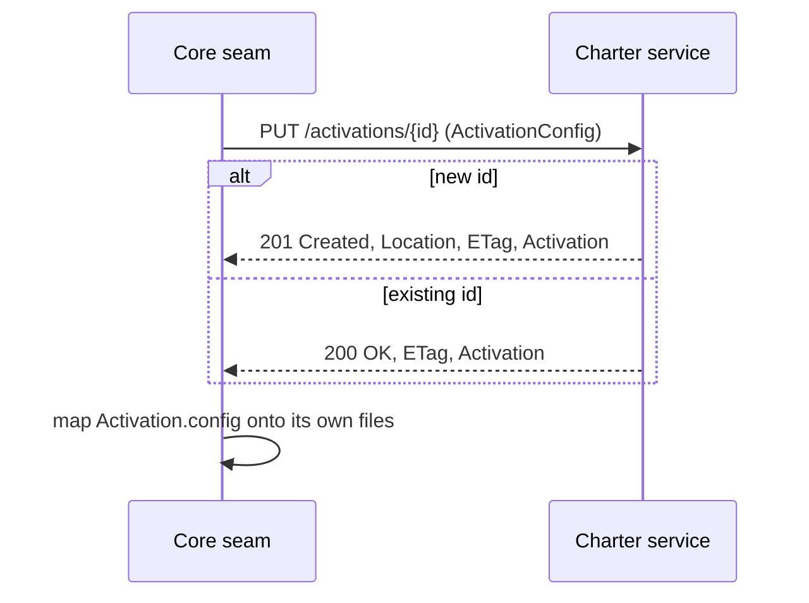
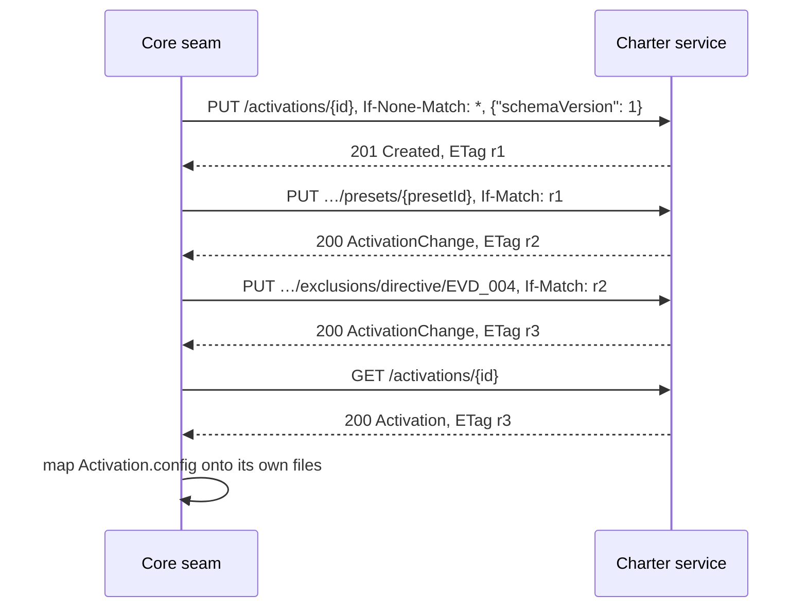

# Offering and activation

The design behind [ADR-0020](/adr/0020-offering-and-activations/). The API has three top-level
resources, one for each concept in the glossary:

- **`/packs`** — the Charter Packs this service knows
  ([Packs resource model](/architecture/packs-resource-model/)).
- **`/offering`** — the Charter offering, the offer side: what can be used, merged from the packs
  in force.
- **`/activations`** — Active charters, the activation side: which of the offering is in force for
  one activation, and the effective charter that follows.

An activation is a document the service stores. Its key, `activationId`, is opaque: the service
knows nothing of projects.

> **Status:** design only, decided (provisional) by ADR-0020. The action-context read is not
> served on `main` — PR #139 removed it; today the contract serves `GET /info` and the tactic
> reads. The read returns as `GET /offering/mission-types/{missionType}/actions/{action}/context`
> under [#126](https://github.com/spec-kitty/spec-kitty-charter/issues/126)
> ([ADR-0020](/adr/0020-offering-and-activations/) D1). [What the labels mean](/#status).

## The resource tree

```text
/                                              API root
├── info
├── packs …                                    Charter Packs: what exists (ADR-0019)
├── offering                                   the offer side: what can be used
│   ├── artifacts{?kind}                       merged artifacts with policy facts        R2
│   │   └── {kind}/{artifactId}                one artifact, with provenance             R2
│   ├── graph                                  the merged graph                          R3
│   ├── presets                                presets the packs in force offer          R4
│   ├── kinds                                  the kind taxonomy                         R18
│   └── mission-types/{missionType}/actions/{action}                                     R5
│       └── context{?depth}                    the walk (built; moved in a 0.x minor)    R1
└── activations                                the activation side; POST: create, service-minted id
    └── {activationId}                         PUT, GET, DELETE                          R9
        ├── selections/{kind}/{artifactId}     PUT select (cascade), DELETE unselect
        ├── exclusions/{kind}/{artifactId}     PUT deactivate, DELETE re-activate
        ├── presets/{presetId}                 PUT apply a preset
        ├── artifacts{?kind,state}             effective: state, policy, reason          R9
        ├── skipped                            the skipped report                        R9
        ├── graph                              the activation-filtered graph             R9
        └── mission-types/{missionType}/actions/{action}/context{?depth}   effective      R9
```

Every resource under `activations` is declared in the contract (#125) and answers `501` until it
is built (ADR-0020 D8): each operation carries `x-reserved`, and one `@contract @reserved` scenario per operation
pins its `501` (`contracts/charter/scenarios/activations.feature`). The R-numbers are the read inventory's
([#94](https://github.com/spec-kitty/spec-kitty-charter/issues/94)).

## Two answers for one action

| | The walk | The effective context |
|---|---|---|
| Path | `/offering/mission-types/{mt}/actions/{a}/context` | `/activations/{id}/mission-types/{mt}/actions/{a}/context` |
| Schema | `ActionContext` | `EffectiveActionContext` |
| Answers | What the offering says governs the action | What applies under one activation: filtered, with exclusions and the skipped report |
| Freshness | `governanceFingerprint` | `governanceFingerprint` and the activation's `revision` |

The two never share a URL or a schema, so a client cannot mistake one for the other (ADR-0018 D1).

## The activation document

```json
{
  "activationId": "4b1f6c1e-6d2a-4bb5-9a1f-1c0f0c8d2e11",
  "revision": "sha256:9c1e…",
  "config": {
    "schemaVersion": 1,
    "packs": [{ "packId": "spec-kitty-internal", "version": "1.2.0" }, { "packId": "event-driven" }],
    "missionTypes": ["software-dev"],
    "selected": {
      "directive": ["EVD_001", "EVD_002", "EVD_003"],
      "tactic": ["domain-event-capture"]
    },
    "deactivated": { "directive": ["EVD_004"] },
    "languages": ["java"]
  },
  "governanceFingerprint": "sha256:51aa…",
  "summary": { "active": 41, "inactive": 212, "excluded": 1, "required": 1, "locked": 0, "skipped": 2 },
  "_links": {
    "self": { "href": "/api/v1/activations/4b1f6c1e-6d2a-4bb5-9a1f-1c0f0c8d2e11" }
  }
}
```

The values are illustrative; the schemas are in the contract (`Activation`, and `ActivationConfig`, canonical as
JSON Schema 2020-12 in `contracts/offering/schemas/`). Per-entry provenance, context activations and applied presets
are not part of the document (ADR-0020, amendment of 2026-10-31). `summary` is computed for that fingerprint, so an answer is byte-stable for one revision and one fingerprint.
`config` is the `ActivationConfig`: the whole document a client authors. Core keeps its own file
layout and maps it to and from `config` in one seam module. Everything else is the service's: `revision` (also the `ETag`), the derived `summary`
and the links. Write links (`edit`, `select`, `exclude`, …) appear only once the writes are built; until then `_links` holds `self`.

**Canonical form.** The service stores ids as the offering's artifact ids, sorted and without
duplicates, and omits empty deny lists. `revision` is the `sha256:` digest of the RFC 8785
serialization of the canonical `config`. A `PUT` of a fetched `config` answers `200` with the same
`ETag`.

## Mode 1: register an existing document

Core already has a document, for example after migrating a project's flat keys.



Refusals: `422 activation_invalid` (unknown pack, kind or artifact, with `violations`),
`409 artifact_required` or `artifact_locked` (the document deactivates what a pack requires or
locks; nothing is stored), `412` if the client sent a stale `If-Match`.

## Mode 2: build, then fetch

Core runs its interview against the service.



- Instead of the first `PUT`, a client without an id of its own sends `POST /activations`
  and reads the minted id from `Location`.
- Every sub-resource write needs `If-Match`. Without it the answer is `428`; with a stale one,
  `412`, and the client fetches again before it retries.
- A select cascades over the graph and stops at a deactivated artifact, which the `skipped` report
  names. A deactivation records only the artifact named, never the cascade.

## Who holds what

| Item | Held by | Notes |
|---|---|---|
| The interview, `answers.yaml`, the charter text and compile | Core | Unchanged |
| The activation document | Core's files until activation routes to the service, then the service | Core keeps its own file layout and maps it to `ActivationConfig` in one seam module. The local file is the source of truth and is written through to the service; on a cold-start divergence local wins, visibly ([ADR-0033](/adr/0033-local-active-charter-is-source-of-truth/), superseding the earlier "service wins") |
| First-load state (`context-state.json`) | Core | Sent as `depth` (ADR-0011 D3) |
| Project-tier content | The service, as a registered pack of level `project` | ADR-0020 D11 |
| `required_*`, `locked`, available artifacts | Derived from the packs | Never stored in the document |

## How each resource maps onto the service

| Resource | Application | Domain or port |
|---|---|---|
| `/offering`, `/offering/artifacts…`, `graph`, `presets`, `kinds`, `mission-types…` | offering queries | `CharterOffering`, `DoctrineGraph` |
| `/offering/…/context` | `ActionContextQuery` (built) | the walk (ADR-0018) |
| `/activations…` writes | activation use cases | `ActivationConfig`, cascade, deny list; `ActivationRepository` port |
| `/activations/{id}/…` reads | effective-set queries | the effective-set algebra over the offering and the document |

The `ActivationRepository` port sits in the storage ring with the pack store
([Pack registration and distribution](/architecture/pack-registration-distribution/)). Links are
built in the REST adapter, as for packs.

## Proposed scenarios

These are proposed, not bound: they stay proposed until the operations are built. What is bound today is one 501 pin
per reserved operation (`contracts/charter/scenarios/activations.feature`). They describe what a client does, not which endpoint it calls, so
they hold whatever the paths become; the step definitions map each step onto the contract.

```gherkin
Feature: One project can hold a separate active charter per branch
  A mission that changes the charter trials it on its own branch. The other
  missions keep the charter on main until the branch merges. The service
  knows nothing of projects or branches: core picks one activation per branch.

  Background:
    Given the offering holds the built-in pack and the org pack "event-driven"
    And the org pack "event-driven" offers the preset "event-driven"
    And the activation "proj-main" is registered with the built-in directives selected

  Scenario: A governance mission trials a preset without changing main's charter
    Given I retrieve the activation "proj-main"
    When I register its document as the new activation "proj-gov-trial"
    Then the activation "proj-gov-trial" is created
    When I apply the preset "event-driven" to the activation "proj-gov-trial"
    Then the change is accepted
    And the effective active charter of "proj-gov-trial" for implementing a software-dev mission includes the directive "EVD_001"
    And the effective active charter of "proj-main" for implementing a software-dev mission does not include the directive "EVD_001"
    And the activation "proj-main" is unchanged

  Scenario: Merging the branch promotes its charter to main
    Given the activation "proj-gov-trial" has the preset "event-driven" applied
    When I retrieve the activation "proj-gov-trial"
    And I register its document as the activation "proj-main", based on the revision of "proj-main" I hold
    Then the registration is accepted
    And the activation "proj-main" has the same revision as "proj-gov-trial"
    And the effective active charter of "proj-main" for implementing a software-dev mission includes the directive "EVD_001"

  Scenario: Main changed while the branch was open
    Given I hold the revision of "proj-main" from when the branch started
    And another mission deactivated the directive "DIRECTIVE_003" in "proj-main"
    When I register the document of "proj-gov-trial" as the activation "proj-main", based on the revision I hold
    Then the registration is refused because "proj-main" changed since that revision
    And the activation "proj-main" still deactivates the directive "DIRECTIVE_003"

  Scenario: The branch activation is removed after the merge
    When I remove the activation "proj-gov-trial"
    Then the activation "proj-gov-trial" is removed
    When I remove the activation "proj-gov-trial"
    Then the removal is refused because the activation "proj-gov-trial" does not exist
```

```gherkin
Feature: The activation document round-trips, and the pack policy holds

  Scenario: A retrieved document registers unchanged
    Given the activation "a-1" is registered
    When I retrieve the activation "a-1"
    And I register its document as the activation "a-1"
    Then the registration is accepted
    And the revision of "a-1" is unchanged

  Scenario: A required artifact cannot be deactivated
    Given the org pack "internal" requires the directive "NO_FULL_HEAVY_SUITES_IN_MISSION"
    And the activation "a-1" is registered
    When I deactivate the directive "NO_FULL_HEAVY_SUITES_IN_MISSION" in the activation "a-1"
    Then the change is refused because the pack "internal" requires the artifact
    And the activation "a-1" is unchanged

  Scenario: An activation operation that is not built yet says so
    When I register an activation document as the activation "a-1"
    Then the request is refused as not implemented yet
```

The last scenario holds only while the operation is reserved; it is removed when the operation is
built.
