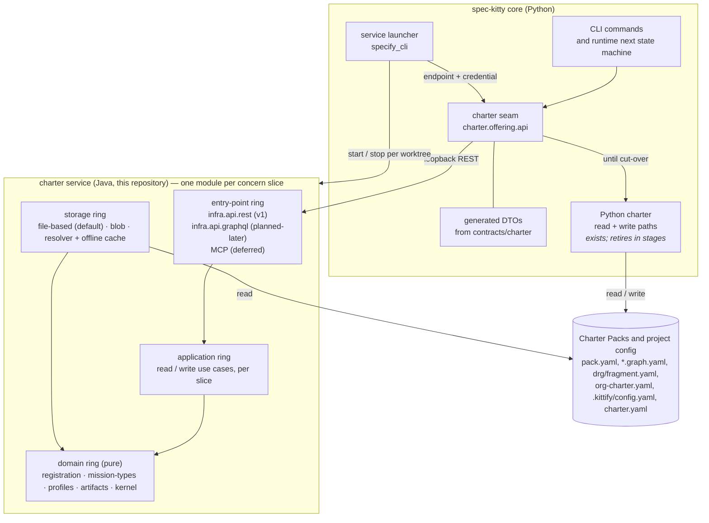

# Overview

The containers of the charter service and the main flows between them: the Python seam in core, the Java service, its adapters and the pack inputs. Read this first, then the page for the part you are building. The state of `charter.offering.api` in core today is described in [Problem](/context/problem/).

> **Status:** design only; nothing in the diagram exists in this repository yet. [What the labels mean](/#status).

## Containers

The diagram draws the seam in core; where the Python charter ends up is [open question 2](/plans/open-questions/).

The service is organized top-level by **vertical concern slice**, with the onion rings
(entry-point infra → application → domain ← storage infra) as packages within each slice
([ADR-0006](/adr/0006-onion-vertical-slices-archunit/)); [Hexagonal service](/architecture/hexagonal-service/)
has the module list and [Pack registration and distribution](/architecture/pack-registration-distribution/)
is the worked example.

## Main flows

**A governed read (Java authoritative stage).** A CLI command or the `next` state machine
asks the seam for action-scoped context, passing the mission type and the load depth. The
seam holds an endpoint and a credential the launcher gave it, calls `GET /api/v1/...` on the
worktree's service, and receives a response
that deserializes into the generated DTO. The service answers from a warm active graph it
built from source fingerprints. If the service is stale or unreachable, the seam falls back
to the Python implementation **loudly**: the fallback is visible in diagnostics and
telemetry and never silently picks a second answer.

**A read shadow.** Before Java is authoritative, Python answers and the Java answer is
compared out of band against the same inputs. Differences are reported, not served.

**A write (late stages).** Python holds the single write lock until a write operation
migrates. A migrated operation runs in the Java write application only through a handoff the
seam grants. After any write made outside the service, the service rebuilds its active graph
before it answers again.

## What the seam owns, and what it does not

- The seam is code under `src/charter/` in core (where it sits is
  [open question 2](/plans/open-questions/)). Its only service-facing code is a transport client.
- It does **not** start, stop or locate the service. Launch and lifecycle live in
  `specify_cli`, which hands the seam an endpoint and a credential, so `charter` gains no
  outbound edge to `specify_cli` and core's enforced import chain
  (`kernel <- charter <- {glossary, runtime, mission_runtime} <- specify_cli`) stays intact.
- No caller bypasses it. REST, GraphQL and MCP may never implement charter resolution
  independently; each is an entry-point adapter into the same application use cases. In v1 only
  REST ships; GraphQL is planned-later and MCP is deferred
  ([ADR-0007](/adr/0007-rest-hateoas-contract-of-record/)).
