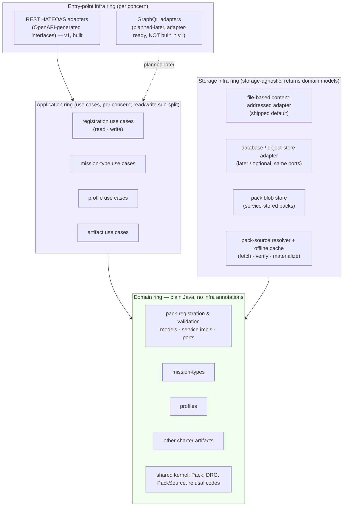
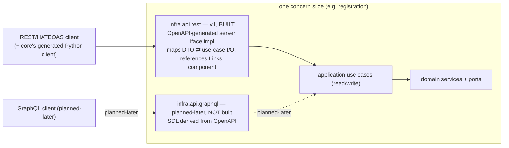
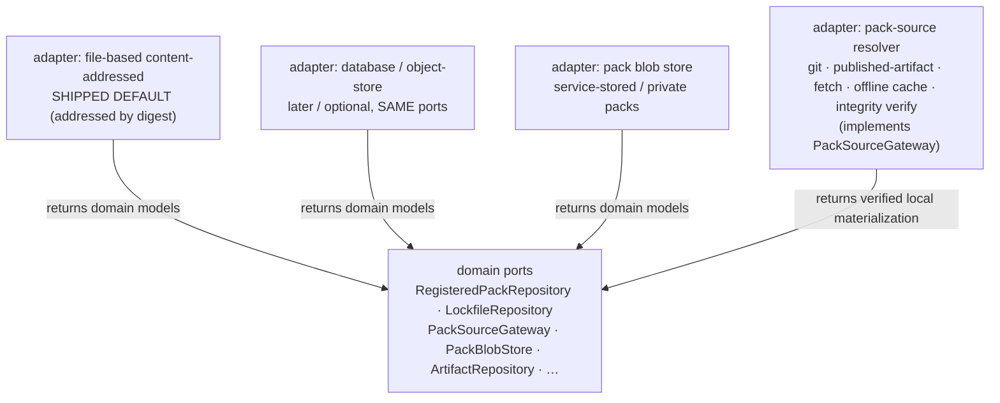
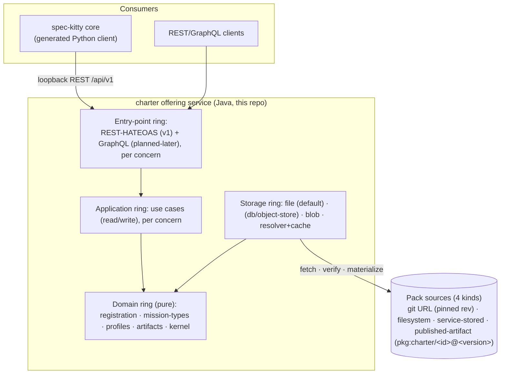

# Pack registration and distribution

The target design of the charter service's pack **registration, storage, verification and distribution** capability: the onion and vertical-slice layering, the domain model, the four source kinds, the trust and lockfile model, the storage ports, and the API surface. It names the structure, the boundaries, and the enforceable invariants.

> **Status:** design only; no code exists in this repository yet, and the module and type names are the agreed design, not shipped artifacts. [What the labels mean](/#status).

This page is the **canonical design**. It realizes [ADR-0005](/adr/0005-service-registers-and-distributes-packs/) (the service registers and distributes packs; built-in is its first catfooding consumer), [ADR-0006](/adr/0006-onion-vertical-slices-archunit/) (onion layering cut by vertical concern slices, enforced by ArchUnit) and [ADR-0007](/adr/0007-rest-hateoas-contract-of-record/) (REST-HATEOAS is the v1 contract of record; GraphQL planned-later, MCP deferred). It builds on [ADR-0001](/adr/0001-java-service-with-openapi-contract/), [ADR-0002](/adr/0002-contract-source-of-record/) and [ADR-0004](/adr/0004-public-api-returns-generated-dtos/), and settles the trade-offs as decisions — it does not re-open them. "Ledger decision N" below cites the resolved decision of that number in those ADRs.

---

## 1. The two structural axes

The architecture is organized on two orthogonal axes (ledger decision 1):

- **Onion layers (dependency direction, inward only).** `entry-point infra → application → domain ← storage infra`. The domain is the innermost ring and depends on nothing outward; both infra rings depend inward on the domain.
- **Vertical concern slices (subdomain partition), top-level.** Each slice owns a cohesive piece of the charter offering and cuts through every layer. The slices are **pack registration & validation**, **mission types**, **profiles**, and **other charter artifacts**, over a cross-cutting **shared kernel** slice that carries the pack-and-DRG primitives every slice reads.

**Read/write is a sub-split inside each slice's application ring**, not a top-level module boundary (ledger decision 1 — this supersedes the horizontal read/write top-level shape in [Hexagonal service](/architecture/hexagonal-service/) and [Overview](/architecture/overview/)). The two axes compose: a slice holds both its read and its write use-case orchestration as packages within its application ring.



Dependency rule, in one line: **arrows only point toward the domain.** The entry-point ring knows the application ring; the application ring and the storage ring know the domain ring; the domain ring knows only itself, the shared kernel, and the JDK.

---

## 2. Package / module structure

**One Gradle module per concern slice; layers are packages within the module** (ledger decision 6). ArchUnit — not module boundaries — enforces the layering *inside* each slice (§6); the slice is the module boundary. Package naming: `be.sddevelopment.charter.<concern>.<layer>`.

```text
be.sddevelopment.charter
├── kernel                         # Gradle module: shared domain kernel (cross-slice primitives)
│   └── domain                     #   Pack, PackId, PackLevel, PackVersion, DrgNode, DrgEdge,
│                                  #   Urn, ArtifactKind, RefusalCode, PackSource (value type)
│                                  #   (no infra — the kernel is pure)
│
├── registration                   # Gradle module: pack registration & validation
│   ├── domain                     #   models, repository ports, service interfaces + impls (plain Java)
│   ├── application                #   use-case orchestration — read and write sub-packages
│   │   ├── read                   #     distribute / resolve / list / verify reads
│   │   └── write                  #     register / revoke / re-pin writes (+ port & transaction wiring)
│   └── infra
│       ├── api.rest               #   REST HATEOAS controllers over registration use cases (v1)
│       ├── api.graphql            #   GraphQL resolvers (planned-later; package reserved, not built in v1)
│       └── storage                #   file + (db) + blob + resolver adapters implementing ports
│
├── missiontypes                   # Gradle module: mission types
│   ├── domain · application{read,write}
│   └── infra { api.rest · (api.graphql) · storage }
│
├── profiles                       # Gradle module: agent profiles
│   ├── domain · application{read,write}
│   └── infra { api.rest · (api.graphql) · storage }
│
├── artifacts                      # Gradle module: other charter artifacts (directives, tactics,
│   ├── domain · application{read,write}   #   styleguides, toolguides, paradigms, procedures, step
│   └── infra { api.rest · (api.graphql) · storage }   #   contracts, glossary packs, skills, assets, templates)
│
└── bootstrap                      # Gradle module: Spring Boot wiring, config, loopback binding,
                                   # credential checks (the only module that knows every slice;
                                   # composition root; owns the ArchUnit gate)
```

- **Hybrid domain-service placement** (ledger decision 5): pure domain services hold domain logic and live in `*.domain` (plain Java, no annotations); the application ring handles read/write use-case orchestration plus port and transaction wiring.
- **No infra annotations in any `*.domain` package** — hard rule, ArchUnit-enforced (§6).
- `kernel.domain` holds the shared vocabulary of the logical model (`Pack`, `DrgNode/Edge`, `Urn`, `ArtifactKind`, refusal codes) so slices agree on one `Pack`/`DRG` shape rather than each minting their own.
- `*.infra.api.rest` is the v1 surface; `*.infra.api.graphql` is a reserved package for the planned-later adapter — kept adapter-ready over the same use cases, not implemented in v1 (§4).
- `*.infra.storage` holds the storage port implementations (§5). The **pack-source resolver** (fetch, cache, integrity verify) is a storage-ring concern: the domain never sees a URL, only a `PackSource` value and a verified local materialization.

---

## 3. Domain model sketch per concern

Plain-Java POJOs (records / sealed types), repository **ports** (interfaces), and **service interfaces + implementations** (hybrid placement, decision 5). No annotations. Names and responsibilities only.

### 3.0 Shared kernel (`kernel.domain`)

- `Pack` — a registered pack: `PackId` (a ULID), `PackVersion`, `PackLevel {built_in, org, project}`, `parentPack`, declared `PackSource`, `PackManifest`.
- `PackSource` — **sealed, four kinds** (ledger decision 7): `GitSource {url, ref, rev(pinned sha), subdir?}`, `FilesystemSource {path}`, `StoredSource {storedRef}` (uploaded/service-held), `PublishedArtifactSource {purl}` — a **purl-style locator `pkg:charter/<id>@<version>`** (ledger decision 17) for a versioned package pulled from a registry. `rev`/`version` is the trust anchor, never a floating ref. `bundled` is a *resolve-time materialization outcome*, not a registration kind.
- `PackManifest` — generated manifest: per-constituent `{id, kind, path, contentHash, provenancePath}`; the file-level integrity primitive (reuse the open-packs `content_hash`; do not reinvent).
- `DrgNode`, `DrgEdge`, `Urn (<kind>:<id>)`, `ArtifactKind`, `NodeKind`, `Relation`.
- `RefusalCode` — canonical diagnostics as domain values (`PACK_LEVEL_MISMATCH`, `PACK_LEVEL_MISSING`, `UNRESOLVED_EDGE_ENDPOINT`, `SOURCE_CONFLICT`, `INTEGRITY_FAILURE`, `PACK_ENGINE_INCOMPATIBLE`, `SOURCE_UNREACHABLE`, …). Part of the contract ([Contract and DTOs](/architecture/contract-and-dtos/)), surfaced as `Problem`.

### 3.1 Pack registration & validation (`registration.domain`) — the heart of this design

Entities / value objects:

- `RegisteredPack` (aggregate root) — a `Pack` + its `RegistrationStatus`, `TrustTier {built_in_high, open_high, allowlisted, private}`, `ConsentState`, lockfile linkage.
- **Two-tier lockfile** (ledger decision 11): `ConfigLockfile` with one `LockfileEntry {packId, PackSource(with rev), snapshot_sha256}` per registered pack — the single reproducibility fact and the committed pin (ADR-0005 §3). Per-constituent `content_hash` stays in each pack's `PackManifest` for file-level verify. Reuse the `spec-kitty-snapshot-sha256` recipe verbatim.
- `IntegrityReport`, `CompatRange` (`requires_core`, engine-compat — decision default), `SourceConflict`.

Service interfaces + implementations (domain-owned, plain Java):

- `PackRegistrationService` — `register(PackSource, TrustContext) : RegisteredPack`; validates descriptor, assigns/honors `PackId`, fails closed on pack-id or constituent-slug collision (`SOURCE_CONFLICT`). The **constituent-slug namespace is global** (ledger decision 15): a slug that collides across packs is refused, not shadowed per-pack (reversible to per-pack if too strict).
- `PackResolver` — `resolve(PackId|PackSource) : ResolvedPack` (materialized local dir + manifest); **fetch → materialize → verify → hand downstream**. Verifies against the lockfile; **gates `requires_core` at resolve time** (`PACK_ENGINE_INCOMPATIBLE`, engine-compat default); fails closed and legible when uncached + unreachable (`SOURCE_UNREACHABLE`). It is a **domain service invoked internally by register/distribute — never a REST resource** (ledger decision 16; §4).
- `PackDistributionService` — `distribute(PackId, requesterTier) : DistributionResponse` (the one canonical read/pull surface every tier shares; ADR-0005 §2). `requesterTier` is **derived from the authenticated identity, never client-set** (ledger decision 14); tier selects behavior as a parameter, not a branch.
- `IntegrityVerifier`, `TrustPolicy` (explicit allowlist gate for allowlisted/private git — **mixed per-entry granularity: host-, org- or exact-repo-scoped**, exact-repo = least privilege, ledger decision 18; built-in/open bypass as high-trust — ledger decision 10), `SupplyChainPolicy`.

Repository ports (domain-owned, impl in storage ring):

- `RegisteredPackRepository` — `save/find/list` RegisteredPacks (returns domain models).
- `LockfileRepository` — read/write the committed config lockfile.
- `PackSourceGateway` (port) — "give me a verified local materialization of this `PackSource`"; the **only** seam that knows git/network/registry/cache. Domain depends on the port; the resolver adapter in the storage ring implements it.
- `PackBlobStore` (port) — store/retrieve service-held (`StoredSource`) pack bytes.

> **Resolver / merge boundary** (ADR-0005 §10, DIRECTIVE_001/031): the resolver (fetch/materialize/verify/store) is a *different concern* from merge/activation. This slice ends at "verified local materialization + manifest"; merge/activation is the artifacts/kernel read side (§3.4). The loader never sees a URL.

### 3.2 Mission types (`missiontypes.domain`)

- `MissionType {id}`, `Action (action:<missionType>/<action>)`, `MissionStepContract {step → delegated kind + candidates}`.
- `MissionTypeService` — list/describe; `ActionSequenceService` (from `requires` edges).
- Ports: `MissionTypeRepository`.

### 3.3 Profiles (`profiles.domain`)

- `AgentProfile {id, specialization, collaboration, references}`, `ResolvedProfile`, `ProfileLineage (specializes_from)`, overlay semantics (`enhances` field-merge / `overrides` replace).
- `ProfileResolutionService` — `resolve(profileId, action) : ResolvedProfile` (lineage + overlays + compact context); unresolved = error; `skipped_profiles` reported.
- Ports: `AgentProfileRepository` (exposes `skippedProfiles`).

### 3.4 Other charter artifacts (`artifacts.domain`)

- `Artifact {id, kind : ArtifactKind}` across the kinds table (directive, tactic, styleguide, toolguide, paradigm, procedure, glossary_pack, skill, anti_pattern, asset, template, mission_step_contract).
- `ActiveGraph`, `LayerMerge`, `Activation {activated_<kind>, activated_kinds, mission_type_activations}`, `OrgCharterPolicy {required_<kind>}`.
- `ArtifactService`, `GraphQueryService`, `ActivationService` (plan → commit).
- Ports: `ArtifactRepository`, `ActiveGraphRepository`.

> This slice reproduces the [Resolution model](/architecture/resolution-model/) pipeline (load → merge → activate → answer) and inherits its fail-loud rules. It is adjacent to, not part of, registration: registration *delivers verified packs*; artifacts *merge and answer from them*.

---

## 4. The API surface

Both API versions are **entry-point infra adapters over the same application use cases** — never a second implementation of domain logic (the [Overview](/architecture/overview/) invariant: "REST and MCP may never implement charter resolution independently"; extended to GraphQL). The strategy is fixed by ADR-0007 / ledger decisions 2, 3, 4, 13.



- **REST-HATEOAS is the v1 sole contract of record** (ledger decision 13, ADR-0007 §1). It is the surface core generates its Python client from, the DTO source, and the conformance corpus. Controllers *implement generated server interfaces* so a contract/code divergence fails the build. It conforms to [Contract and DTOs](/architecture/contract-and-dtos/) — one `openapi.yaml` under `contracts/charter/`, split files, closed response schemas, `Problem`/`PageInfo` vocabulary, `servers: /api/v1`.
- **HATEOAS via a reusable `Links` schema component** (ledger decision 3, ADR-0007 §4, preserving ADR-0004). A single `Links` component is referenced from each response schema; response DTOs stay **closed** (`additionalProperties: false`). A `RegisteredPack` links to its `distribute`, `verify` and `source` relations through that component — hypermedia without opening the DTOs.
- **OpenAPI is the single source of record; GraphQL is derived from it** (ledger decision 2, ADR-0007 §2, preserving ADR-0002). GraphQL SDL is generated/derived from the OpenAPI contract, so the two surfaces cannot drift into two sources of truth.
- **GraphQL is planned-later, not built in v1** (ledger decision 13, ADR-0007 §3). The use-case layer is kept **adapter-ready** (the `infra.api.graphql` package is reserved) so a GraphQL adapter drops in over the identical use cases without domain change. Domain-operation parity holds by construction whenever it lands.
- **MCP is deferred** (ledger decision 4, ADR-0007 §5). The planned `adapter-in-mcp` is not built; it remains a later third entry-point adapter over the same use cases — structurally a non-event.
- **Resolution is a read-only projection, not a public action resource** (ledger decision 16, ADR-0007 §7). There is **no** `POST /packs/{id}/resolutions` verb. Resolution happens internally during register/distribute (`PackResolver` is a domain service, §3.1); its integrity/engine-compat/cache/reachability outcomes surface as the **result of the distribute action** (a success payload or a `Problem` carrying `PACK_ENGINE_INCOMPATIBLE` / `INTEGRITY_FAILURE` / `SOURCE_UNREACHABLE`). Resolution *state* is read-only — `GET /packs/{id}/resolution`, or embedded in the pack resource and reached via its `Links` component — never a client-triggered operation.
- **The requester tier is derived from the authenticated identity, never client-set** (ledger decision 14, ADR-0007 §8). No request body or query parameter carries the tier; the adapter derives it from the authenticated principal (authentication and authorization are a separate downstream concern).
- **The application use cases are the shared contract-neutral seam.** DTO/GraphQL-type ↔ use-case-I/O mapping lives *only* in the adapters (`..infra.api..`). A transport type never crosses into the application or domain ring (three-models-kept-apart rule, [Hexagonal service](/architecture/hexagonal-service/); ArchUnit-pinned, §6).

---

## 5. Storage port abstraction

The storage ring is **storage-solution-agnostic**: the domain declares ports; implementations plug in behind them and **return plain domain models**, never storage-shaped DTOs (ledger decision 12; the [Hexagonal service](/architecture/hexagonal-service/) "three models kept apart" rule; ADR-0005 §4).



- **File-based content-addressed is the shipped default** (ledger decision 12). Addressing by digest dovetails with the `content_hash`/`snapshot_sha256` integrity model (§3.1) and dedupes identical constituents. "Reads only configured inputs, never directory presence" (the [Resolution model](/architecture/resolution-model/) invariant) is preserved — a git source resolves to a local dir *before* any repository sees it.
- **Database / object-store** is a drop-in sibling implementing the same ports; selecting file-vs-DB is composition-root configuration, added later **without touching the domain, the application ring, inbound adapters or the core seam**.
- **Service-stored packs** (`StoredSource`, for consumer/private/uploaded packs) land in `PackBlobStore`.
- **Pack-source resolver + offline cache** implements `PackSourceGateway`: the *only* component that knows git, the published-artifact registry, network and cache. It materializes → verifies against the lockfile → hands a local dir + manifest inward. A populated/offline cache resolves with no network; it fails closed when uncached + unreachable, and when a source is not on the allowlist (ledger decision 10).

> **Deferred storage policy** (operator-owned, set at storage-design time — flagged, not resolved here): the **private-pack tenancy/privacy boundary** (baseline: ownership/visibility enforced at the storage port and API, never by directory presence) and the **retention/GC policy** (baseline: retain anything a lockfile pins, GC the rest). Both are recorded as deferred Decision Moments in ADR-0005.

---

## 6. ArchUnit rule set (enforceable invariants)

Named, testable rules that make the two axes a gate, not a habit (ledger decision 6, ADR-0006 §5). The `bootstrap` module (or a dedicated `architecture-tests` module) owns them; they are the acceptance gate for the implementation mission.

| Rule | Statement | Fails when |
|---|---|---|
| `DOMAIN_IS_PURE` | classes in `..domain..` depend only on `java..`, `..kernel.domain..`, and their own slice's `..domain..` | a domain class imports Spring, Jakarta, Jackson/YAML, HTTP, GraphQL, JDBC, or any `..infra..`/`..application..` |
| `NO_INFRA_ANNOTATIONS_IN_DOMAIN` | no class/field/method in `..domain..` is annotated with an infra annotation (`org.springframework..`, `jakarta..`, `com.fasterxml.jackson..`, `jakarta.persistence..`, GraphQL annotations) | an annotation from those packages appears in a domain package |
| `ONION_DEPENDS_INWARD` | `..infra..` → `{..application.., ..domain..}`; `..application..` → `..domain..`; `..domain..` → nothing outward | any outward or skip-forward dependency (e.g. domain → infra, application → infra) |
| `ENTRYPOINT_OVER_APPLICATION` | `..infra.api.rest..` and `..infra.api.graphql..` may depend on `..application..` (+ generated API types / GraphQL runtime) but **not** on `..infra.storage..` | a REST/GraphQL adapter reaches a storage adapter directly |
| `STORAGE_RETURNS_DOMAIN` | public methods of storage-adapter port implementations return only `..domain..`/`..kernel.domain..` types (or JDK) | a storage adapter returns a transport DTO or a persistence/document entity |
| `PORTS_LIVE_IN_DOMAIN` | repository/gateway interfaces reside in `..domain..`; their implementations in `..infra.storage..` | a port interface is declared in an infra package |
| `SLICES_DO_NOT_CROSS` | a slice's `..domain..` depends on no *other* slice's packages except `..kernel..` | `registration.domain` imports `profiles.domain` directly (must go through kernel) |
| `TRANSPORT_STAYS_IN_ADAPTER` | generated OpenAPI DTOs / GraphQL types are referenced only in `..infra.api..` | a DTO/GraphQL type leaks into application or domain |
| `RESOLVER_OWNS_NETWORK` | only `..infra.storage..` (resolver adapter) references git/HTTP/registry/cache client libraries | domain or application imports a git/network client |
| `GENERATED_API_NOT_IN_DOMAIN` | `..domain..` imports nothing from the generated `charter-api` package | domain references a generated server interface/DTO (domain's kind type is conformance-checked, not imported) |

---

## 7. How the pack sourcing & distribution decisions land in this structure

ADR-0005's decisions map onto the structure (ledger decisions 7–12 + engine-compat default):

| Decision | Home in this architecture |
|---|---|
| Service owns registration/distribution via OpenAPI (dec. 8, ADR-0005 §1) | `registration` slice; REST adapter implements the OpenAPI contract |
| Four source kinds (dec. 7, 17) | `PackSource` sealed type in `kernel.domain` — git, filesystem, service-stored, published-artifact (purl `pkg:charter/<id>@<version>`) |
| One canonical path; built-in is first catfooding consumer (dec. 8) | `PackDistributionService` + `PackResolver` — tier is a parameter, not a branch |
| Staged built-in migration + bundle into distribution (dec. 9) | resolver-behind-loader → integrity+lockfile → fetch-at-release → de-vendor; installed distribution bundles built-in for cold/offline installs |
| Trust = explicit allowlist on a fail-closed floor (dec. 10, 18) | `TrustPolicy` (mixed per-entry allowlist: host / org / exact-repo) + `SupplyChainPolicy` + `IntegrityVerifier`; built-in/open high-trust; signing a reserved higher tier |
| Two-tier lockfile (dec. 11) | `ConfigLockfile {source, rev, snapshot_sha256}` + per-constituent `content_hash` in `PackManifest` |
| File-based content-addressed storage behind a port (dec. 12) | `*.infra.storage` adapters behind `RegisteredPackRepository`/`LockfileRepository`/`PackBlobStore`/`PackSourceGateway` |
| Engine-compat `requires_core` at resolve time (default) | `CompatRange` on the registration/source descriptor + lockfile entry; `PackResolver` refuses with `PACK_ENGINE_INCOMPATIBLE` |
| Resolver / merge boundary (ADR-0005 §10) | `registration` (resolve) vs `artifacts` (merge/activate); `PackSourceGateway` is the single translation layer |
| Resolution surface = read-only projection (dec. 16) | no `POST …/resolutions`; outcomes on the distribute result + `GET …/resolution`; `PackResolver` is a domain service, not a resource |
| Requester tier from auth (dec. 14) | derived from the authenticated principal in the adapter; never a client-set field |
| Global constituent-slug namespace (dec. 15) | `PackRegistrationService` refuses a slug colliding across packs (`SOURCE_CONFLICT`); reversible to per-pack |
| Core is a generated client (ADR-0004) | REST adapter + generated Python client; no second resolver in core |

---

## 8. Smallest-useful C4-ish container view



---

## 9. Relationship to the existing architecture docs

The locked decisions settle the shape; where an existing doc described a different one, this design **supersedes** it (the operator resolved each as a Decision Moment):

1. **Top-level module shape.** [Hexagonal service](/architecture/hexagonal-service/) and [Overview](/architecture/overview/) previously organized modules by read/write side (`charter-read-app`, `charter-write-app`, `adapter-in-rest`, `adapter-in-write`). This design partitions top-level by **vertical concern slice**, with read/write a sub-split inside each slice's application ring (ledger decision 1). Those pages are updated to this shape.
2. **MCP adapter.** Earlier docs planned `adapter-in-mcp`; it is **deferred** — reserved as a later third entry-point adapter, not built in v1 (ledger decision 4).
3. **GraphQL and the single-contract principle.** OpenAPI remains the single source of record; GraphQL is **derived from it** and planned-later, so ADR-0002 is preserved (ledger decision 2).
4. **HATEOAS and closed DTOs.** Hypermedia is carried by a reusable `Links` component referenced from closed response schemas, so ADR-0004's `additionalProperties: false` guarantee is preserved (ledger decision 3).
5. **Domain-service placement.** Pure domain services live in the domain ring; the application ring holds read/write orchestration and port/transaction wiring (hybrid — ledger decision 5).

---

## 10. Entry criteria for the eventual implementation mission

- OpenAPI contract skeleton for the `registration` concern authored under `contracts/charter/`: paths, closed schemas referencing the `Links` component, `Problem`/`PageInfo` reuse, the `PackSource` four-kind discriminator, the `requires_core` compat field on the registration/source descriptor, and the `PACK_ENGINE_INCOMPATIBLE` refusal code.
- The two-tier lockfile shape authored: `ConfigLockfile {source, rev, snapshot_sha256}` + the `PackManifest` `content_hash`, reusing the `spec-kitty-snapshot-sha256` recipe.
- The ArchUnit rule set (§6) agreed as the acceptance gate.
- BDD scenarios for registration/distribution/resolve-refusal outcomes authored to the [Behavior and acceptance scenarios](/architecture/behavior-and-scenarios/) bar, with `src/test/resources` fixtures provisioned (no vendored production trees).
- The two deferred storage-policy items (tenancy/privacy boundary; retention/GC) resolved by the operator at storage-design time before the storage adapters are built.
</content>
