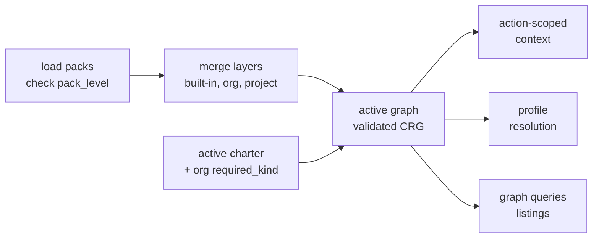

# Resolution model

What the charter domain computes from its inputs: layer merge, activation, cascade, action-scoped context and profile resolution, and the fail-loud rules it keeps.

> **Status:** exists in core, and partly built in the service. Since PR B of the layer-merge mission (2026-11-08) the
> service merges the layers of an activation's closure and resolves what is in force over the merge; the two effective
> reads that serve it, the artifact list and the skipped report, answer. The effective graph and the effective action
> context are PR C and still answer `501`. The Java domain must reproduce core fixture for fixture before it answers in production; a wrong core behavior is fixed in Python first, with a fixture. Mutability levels, persistent exclusions and the `impacts` relation are provisional decisions of 2026-10-19, not yet built in core; since 2026-10-26 the relation is `tension` and `impacts` is a per-value list ([ADR-0028](/adr/0028-impacts-is-a-value-list-and-tension-is-a-relationship/)), removal is distinct from deactivation ([ADR-0030](/adr/0030-removal-is-distinct-from-deactivation/)) and requirement is authored as a preset ([ADR-0031](/adr/0031-requirement-is-authored-as-a-preset/)). [What the labels mean](/#status).

## Inputs

The service reads only configured inputs, never directory presence:

| Input | Where | Notes |
|---|---|---|
| Built-in pack | the pack root the CLI resolves for `built-in` | sharded `*.graph.yaml` plus a generated `pack-manifest.yaml`; `pack_level: built-in` |
| Org packs | each directory under `charter_packs.org.packs` in `.kittify/config.yaml` | `pack.yaml` (`pack_level: org`), `org-charter.yaml`, one `drg/fragment.yaml` |
| Project pack | `.kittify/charter-packs/` | `pack_level: project` |
| Active charter | `.kittify/config.yaml`, or `charter.yaml` for a migrated project | `activated_<kind>` keys, `activated_kinds` and `mission_type_activations`. In the service: the stored activation document, whose `packs` are the compose roots ([Offering and activation](/architecture/offering-and-activation/)) |
| Mission type | the request (`--mission-type` in the CLI) or the mission's `meta.json` | keys the action grain: action nodes are `action:<mission-type>/<action>` |
| `depth` | the request | the number of `suggests` hops of the action-context walk, 0 to 2, default 2; the seam maps a first load to 2, a recorded load to 1 and the public bundle read to 0 |

The retired `doctrine.org.packs` key and the `.kittify/doctrine/` root are not read: core's
charter-pack cutover removes every read-side fallback after a one-time upgrade migration
(core ADR [`2026-10-06-2`](https://github.com/spec-kitty/spec-kitty/blob/main/docs/adr/4.x/2026-10-06-2-charter-offering-active-charter-and-activation-presets.md) §7). The Java service starts on the cut-over vocabulary.

## Pipeline

1. **Load.** Each pack's `pack.yaml` is read and its `pack_level` checked against where it
   is configured (core ADR [`2026-10-11-2`](https://github.com/spec-kitty/spec-kitty/blob/main/docs/adr/4.x/2026-10-11-2-a-pack-declares-its-level-in-pack-yaml.md), a pack declares its level). A mismatch refuses with
   `pack_level_mismatch`. A missing level does not stop the load: it is the diagnostic
   `pack_level_missing`, and [`DiagnosticCode`](https://github.com/spec-kitty/spec-kitty-charter/blob/main/contracts/charter/schemas/DiagnosticCode.yaml) in the contract states when it applies.
2. **Merge.** The three layers merge into one graph under core ADR [`2026-05-16-1`](https://github.com/spec-kitty/spec-kitty/blob/main/docs/adr/3.x/2026-05-16-1-doctrine-layer-merge-semantics.md) (how the layers merge). Edge
   endpoints are URNs `<kind>:<id>` everywhere, so there is no endpoint resolution step and
   `unresolved_edge_endpoint` is no longer raised (DIV-007); a value that is not a URN never
   gets this far, because the load refuses it as `drg_schema_error`. Edges from an org pack's `drg/fragment.yaml`
   land in the same graph that cascade reads; they are not kept on a separate,
   diagnostic-only path (a defect the charter-resolution program fixed). Each artifact's
   mutability level is checked against what later packs do to it: a change the level does not
   allow is a refusal ([ADR-0012](/adr/0012-pack-mutability-policy/)): the registration writes raise
   `governance_policy_violation` (#293), and the merge refuses a layer override the level forbids as
   `500 pack_unreadable` (DIV-217). When org packs declare the same URN, the
   later-declared pack wins for every URN and every restated edge (core `59d190a7`, #87).
   *2026-11-05: across levels the artifact from the level that applies takes the place of the other one whole; no
   field merge ([ADR-0059](/adr/0059-switch-gate-cascade-edges-and-activation-rulings/) decision 3).*

   > **Built, with one gap:** for sibling packs at one level,
   > [ADR-0048](/adr/0048-pack-composition-and-the-named-packs-split/) decision 9 is built: two siblings that both
   > change or both define the same artifact, of any kind, are refused with `pack_sibling_conflict` unless an
   > `overrides` entry naming a contesting member settles it, so siblings leave no "last loaded wins". A definer and an
   > enhancer of one artifact do not conflict. Since PR B the merge applies the settled choice
   > ([#357](https://github.com/spec-kitty/spec-kitty-charter/issues/357)): the named member's version is the one in
   > force at that level (DIV-218). The compose leaves out of its refusal a step contest that no entry settles, and the
   > merge refuses it at read with `pack_sibling_conflict`. Until #358 any pack of the compose may declare the entry,
   > and a settlement is not gated by level (DIV-219). Every composition refusal is in the table of
   > [Compose packs](/guides/compose-packs/#read-a-refusal); the split's remaining moves are the open-packs work, not
   > this page's pipeline.
   **Compose roots** (built, #360). The offering composes every configured pack. An activation
   composes the `depends_on` and `parent_pack` closure of its `packs` (every configured pack when `packs` is absent),
   and that closure is what its writes are checked against and what its closure read answers.
   The per-artifact writes (select, unselect, deactivate, re-activate, apply a preset) are served
   over that closure, and a select or a deactivate with a `cascade` walks it; the rules are in
   [The cascade](/architecture/offering-and-activation/#the-cascade). The closure's layers are merged for the
   effective reads and for the write cascade ([The layer merge](#the-layer-merge)); `/offering` composes and never
   merges.
3. **Activate.** In core, a per-kind activation key that is absent means what the kind's
   `effective_when_absent` says (`all` for most kinds; `required` for `skill`). In the service's
   activation document an absent key means none, `skill` included
   ([DIV-203](/conformance/divergence-register/)), and the required floor is the must-have items of
   the governing presets in the activation's closure ([DIV-205](/conformance/divergence-register/)). A present key
   is an allowlist. A `deactivated_<kind>` deny-list is subtracted from either
   ([ADR-0013](/adr/0013-persistent-deactivation/)). Org `required_<kind>` lists apply where
   the kind is org-requirable, and union into the charter's `selected_<kind>` list where it is
   selection-overlayable.
4. **Answer.** Action-scoped context, profile resolution with `specializes_from` lineage and
   `enhances` / `overrides` applied, graph queries and listings. Profile selection for a role
   follows the order of [ADR-0032](/adr/0032-steps-name-roles-and-profile-selection-order/):
   role fit, specialization, declared fallback, then a not-found refusal.

### The action-context walk

`getActionContext` answers the offering's walk, never a filtered one. Five breadth-first steps,
each artifact listed once by the first step that reaches it:

1. `scope` from the action node, one hop;
2. `requires` from the scoped artifacts, transitively;
3. `suggests` from the scoped artifacts, up to `depth` hops;
4. `requires` of the suggested artifacts, transitively (the one registered difference in the
   walk, DIV-110);
5. `vocabulary`, one hop from everything the first four steps list.

Each entry says which relation listed it (`relation`), its parent (`via`) and its distance from
the action (`hops`). Following `via` always reaches the action in exactly `hops` edges. `depth`
counts suggests hops only; `hops` is the full path length. The mission-type node is not walked.
The walk goes through a node the graph does not declare: edges are facts, so the declared
artifacts behind it are listed with `via` set to that node, and the node itself has a null label.
What applies in one project (activation, exclusions, selection roots) is a later operation, R9
(#103). The rules and the reasons are in
[ADR-0018](/adr/0018-action-context-read-and-seam-access-surface/); the differences from core are
in the [divergence register](/conformance/divergence-register/).

## The layer merge

An activation reads its closure through a merge of the layers (built in PR B; FR-009 to FR-012, rules C15 and C17 to
C21). `LayerMerge` in `packs` is pure: it reads a composed closure and the facts the verified read already holds, and
answers a `MergedClosure`. `ClosureView.merged()` builds it once per read, on first use, and the `AvailablePacks` port
carries it to `activations` as a value (C-002). `/offering` composes and never merges (FR-023).

1. **Per level** (C15, #357). The packs of one level that hold an id contest it. A contest that exactly one descriptor
   `overrides` entry settles puts the named member's version in force at that level; an unsettled one is refused
   `pack_sibling_conflict` (DIV-218). A step of a mission type shares its mission type's settlement. Two copies of one
   preset at one level are parent and child, and the child holds it (C29, C34).
2. **Across levels** (C17, C18). In merge order (built-in, org, project) the level that applies wins, and its artifact
   replaces the others whole: nothing of a losing version is read (DIV-216). A graph document's node counts as holding
   its URN, so an org graph that only declares a built-in step's node replaces that step (DIV-220).
3. **Edges** (C19, C20). An edge from a losing version is dropped with it; an edge to the overridden id, bare or
   `<pack>::`-written, resolves to the winner.
4. **The gate** (C21). An override is allowed only when the overridden artifact is `open`, judged along the closure
   without the winning pack. Otherwise the merge refuses `500 pack_unreadable` (DIV-217). A settled contest is not
   level-gated until [#358](https://github.com/spec-kitty/spec-kitty-charter/issues/358) (DIV-219).

Every winner carries its `packId`, `level` and mutability level. The merge also keeps one `LayerOverride` record
(artifact, winner, loser) per losing version, in merge order; a settled sibling loser has none, and the winner's
provenance shows it. It carries the `applies_to_languages` of each winner, one winner per preset id, and the required
floor as the union of the must-have items of every governing copy of a preset id, restricted to what the closure holds
(C31, A1, [DIV-205](/conformance/divergence-register/)). The writes' floor (`ClosureView.floor()`) still reads the
winning copies only. A winning mission type does not take the unique steps of its losers, so a built-in step survives
under a project mission type of the same id; PR C confirms this with the architecture owner.

The write cascade walks the merged edges, so it never follows an edge a losing version declared (rule E20, DIV-230).
A write over a closure whose merge refuses therefore answers `500` as a read does. The compose facts of each pack are
kept between reads by `CompositionFactsCache`, which follows the invariants of #416 and still reads each pack's
revision on every call (DIV-236).

## What is in force

The effective reads answer what an activation puts in force, and why the rest is not (PR B; FR-013 to FR-017). The
input is the merged closure and the activation document: `selected`, `deactivated`, `languages` and the version pins.
`InForceResolution` in `packs` decides, because every stratum walks edges (C-002); `activations` turns its answer into
the list, the report and the summary. It is a pure function. "In force" is `state=active` (operator ruling Q1).

The set is solved in four strata, each a fixed point over the one below (research R13; rules E2 to E7):

1. **Candidates.** The selected artifacts of the merged closure within the language filter, minus the deny entries,
   plus every locked artifact. A required artifact is a candidate only when it is selected.
2. **Overrides.** Transitive from the top: in `F -> E -> T` only `F` stays, and `F` satisfies a requirement on `E` and
   `T`. A target that is not `open` stays, and the pair is reported as `overrideNotApplied` (DIV-221). A cycle of
   overrides that the candidates or the floor reach is refused `500 pack_unreadable` (DIV-222).
3. **The requirement.** A required artifact is satisfied by itself in force or by an artifact in force that overrides
   it, never by an enhancement; otherwise it is put in force, whatever the language filter says (DIV-225, DIV-226). This
   repeats until no required artifact is unsatisfied on the final set.
4. **Enhancers and bindings.** A least fixed point: an enhancer is in force only when its support chain reaches an
   artifact that enhances nothing and is in force, and a step contract only while its mission type is (DIV-224). A
   required or locked artifact this removes stays out and is reported `requiredNotInForce`.

An overrider that stratum 4 removes loses its overrides, and the strata run again without it, until no overrider is
newly removed. If an overrider is removed while its overrides apply and is in force once they are withdrawn, the
answer has no stable value and the read refuses `500 pack_unreadable` (rule E7, DIV-223).

Each artifact then gets one state and one reason, the first row of the precedence of rule E9: a bound artifact whose
mission type is out, then an enhancer with no target in force, then `locked`, `required` or `selected` when in force;
`language_filtered`, `deactivated`, `not_selected`, and `overridden` for a selected artifact an override hides. An
artifact that is not selected stays `not_selected` even when an override hides it, and a required one then carries
`satisfiedBy`. There is no `kind_default` or `kind_not_activated` (DIV-229). The language filter applies at read only
(DIV-227).

Two reads serve it, and both answer from one verified read of the closure (E19), retried up to three times on
`stale_input`:

- `listEffectiveArtifacts` lists every winning artifact of an activatable kind with its state, reason, `required`,
  policy, `packId`, `level`, `satisfiedBy` and `suggestion`, filtered by `kind` and `state` and paged by a keyset
  cursor; `summary` counts the whole set.
- `getActivationSkippedReport` lists each artifact not in force once, in the bucket of its first deciding rule
  (DIV-228). `skippedByScope`, `unreachedBehindDeactivated` and `skippedShared` are the cascade's and stay empty.

The reports of what is not applied are `denyNotApplied` (a deny entry a lock or the floor overrides), `overrideNotApplied`,
`requiredNotInForce`, `requiredNotHeld` (a must-have item no pack holds) and `pinNotHeld`. A write reports the same
reads' verdict as `warnings` (DIV-237). A suggestion is only a `not_selected` artifact a `suggests` edge of an active
artifact reaches (DIV-235). The two effective reads that PR C builds, the graph and the action context, use the same
in-force set. [Offering and activation](/architecture/offering-and-activation/#the-effective-reads) has the
request and response behavior, the tags and the refusals.

## Writes

Activation is a **plan, then commit**: planning validates and never mutates; committing
writes only after the plan succeeds. The service's per-artifact writes keep that shape: each
computes the whole new document from one view of the closure, judges it, and stores it by one
compare-and-set ([The per-artifact writes](/architecture/offering-and-activation/#the-per-artifact-writes)).
In core, applying a preset over customized lists is refused without `--force`, and the
applied preset name is not persisted. The service applies a preset over any list: its
`force` clears the deny entries of the preset's members
([Presets](/architecture/offering-and-activation/#presets)). Three YAML write paths
exist in core today, and each is a separate operation to migrate
([Strangler transition](/architecture/strangler-transition/)):

- activation commit (`commit_plan`, which picks `.kittify/config.yaml` or `charter.yaml`);
- the charter document save (`charter_yaml_io`, preserving authored sections);
- compile (`write_compiled_charter`, refreshing only the derived `catalog` and `metadata`
  sections).

A fourth, non-YAML write exists: the context read itself records first-load state in
`.kittify/charter/context-state.json` (`--mark-loaded`), and its answer differs between a
first load and a later one. That state stays in core's seam, and the service takes a
`depth` integer request parameter that counts `suggests` hops (0 to 2), echoed in the response
([ADR-0011](/adr/0011-seam-runtime-fail-closed-daemon-and-freshness/) and
[ADR-0018](/adr/0018-action-context-read-and-seam-access-surface/), provisional).

## Rules the domain inherits

- **Derive, do not restate.** Kind vocabulary, plurals and per-kind facts come from one
  authority. Core's single authority is the `ArtifactKind` enum. The contract publishes the
  kind table as data (a fixture or a schema extension); the Java domain's own kind type is
  checked against it by a conformance test, not imported from generated code, because the
  domain imports no generated types.
- **Fail loud.** A dropped artifact, an unresolved edge, an unresolved profile or a stale
  input is a named refusal or a visible diagnostic, never a quiet empty answer. This is the
  lesson of the charter-resolution program (core `docs/plans/charter-resolution/`).
- **One answer.** While two implementations exist, a difference between them is a defect in
  one of them, found by the shadow comparison or the conformance corpus.
