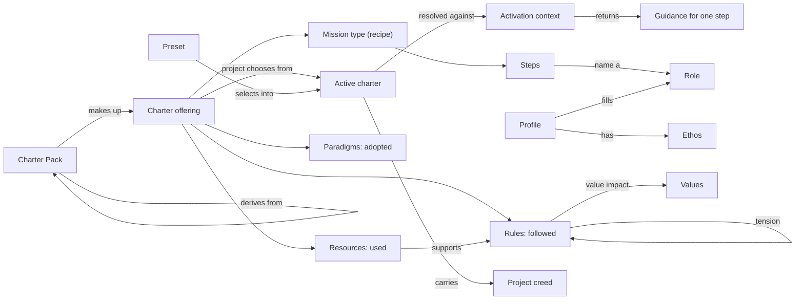

# Conceptual model

This page says what the charter's concepts **mean**. It names no fields, files or endpoints; the
[logical model](/architecture/logical-model/) says how each concept is represented. The rulings
come from the concept sessions with the operator (2026-10-26). Where a rule changed an earlier
decision, it links the record that holds the change.

## Guiding principles

- **Adoption without losing autonomy.** The charter offers good practice to choose from. It never
  takes away a person's own choices and preferences.
- **Simple, orthogonal models; richness from combination.** Each lever is small and independent;
  useful behavior comes from combining them.
- **Open-core boundary.** The charter declares and honours governance in one project. Policing
  across repositories is out of scope (see [The open-core boundary](#the-open-core-boundary)).

## The charter: offering and active charter

The [charter](/glossary/charter/#charter) has two halves.

- The **[charter offering](/glossary/charter/#charter-offering)** is the buffet: everything a
  project *could* adopt. It is made of packs.
- The **[active charter](/glossary/charter/#active-charter)** is the plate: what one project
  actually chose.

The offering is not a set of rules a project must follow; it is a foundation to build on. The
active charter is not a copy of the offering; it is a selection from it.

## Packs and derivation

A **[Charter Pack](/glossary/charter/#charter-pack)** is a unit of the offering: a set of
artifacts, presets, mission types and profiles shipped together.

A **[derived pack](/glossary/charter/#derived-pack)** (for example an organization's pack) builds
on a broader pack (for example the built-in pack) and customizes it for its context. A derived pack
may do four things to the pack it builds on:

- **Add** new artifacts.
- **Change** existing artifacts, within their [integrity](#integrity) rules.
- **Suggest a selection**, through presets.
- **Remove** an artifact, for every project that uses the derived pack
  ([removal](#removal-is-not-deactivation), ADR [0030](/adr/0030-removal-is-distinct-from-deactivation/)).

Removal is one artifact at a time and expected to be rare. There is no filter-based hiding such as
"everything Python". Example: "We Hate Snakes LLC" removes each Python-related built-in artifact by
name.

**Direction: split the built-in pack.** Instead of heavy removal, the built-in pack is split into
several packs, and built-in keeps only a minimal offering. Other packs are chosen when a project is
set up, and the command line points users to the open-packs offering. This is a direction, not yet
done (epic #145).

## The two levers

Requirement and integrity are independent. Each answers one question; neither implies the other.
For example, a required artifact may still be extendable. Removal is not a lever: it is something a
derived pack may do (see [Removal is not deactivation](#removal-is-not-deactivation)).

### Requirement

**[Requirement](/glossary/charter/#requirement-charter-lever)** is "you must take the salad". It
prevents a project from leaving an artifact off its plate, and it is the primary way a rule is
enforced.

- **Authored as a preset.** An org writes a preset; its must-have items are the required set. The
  service derives the required set from the preset: one idea, written one way
  (ADR [0031](/adr/0031-requirement-is-authored-as-a-preset/)).
- **Honoured locally.** In open-core, a project's attempt to deactivate a required artifact is
  refused. Only propagating requirements across repositories is out of scope.
- **Prohibition is requirement phrased inversely.** There is no separate prohibition mechanism.
  "Avoid desserts before the main course" is a required directive whose integrity is locked.

A **[preset](/glossary/charter/#activation-preset)** has two jobs:

- **Governor:** an org states what must be on the plate.
- **Convenience:** an author says "don't want to customize? take our sane defaults."

For the convenience job, applying a preset is a one-time selection into the active charter. It is
not a standing rule that keeps rewriting the plate. A governing preset keeps holding: its must-have
items stay required.

### Integrity

**[Integrity](/glossary/charter/#integrity-level)** says how much an artifact may be altered after
it is introduced: open, extendable or locked.

- Without integrity, a requirement is meaningless: a required test-driven pack whose tactics were
  rewritten to write no tests still counts as "required".
- **Open** allows a derived pack to override, enhance (add to) or remove the artifact.
- **Extendable** allows a derived pack to enhance or remove it, not override it.
- **Locked** allows nothing.
- The **artifact's author** sets it. Anyone further down may **tighten** it, never loosen it.

## Removal is not deactivation

- **[Removal](/glossary/charter/#removal)** is a pack-wide act by a derived pack: the artifact is
  gone for every project using that pack. Open and extendable artifacts may be removed; removing a
  locked artifact is refused. Only locked is fully protected.
- **[Deactivation](/glossary/charter/#deactivation)** is one project's choice to leave an artifact
  off its plate. It changes nothing for other projects.

ADR [0030](/adr/0030-removal-is-distinct-from-deactivation/) records this split.

## Artifacts

### Rules and resources

The offering holds two families of artifacts
([rules and resources](/glossary/charter/#rules-and-resources)):

- **Rules are followed**: [directives](/glossary/charter/#directive),
  [tactics](/glossary/charter/#tactic), [styleguides](/glossary/charter/#styleguide) and similar.
- **Resources are used**: templates, assets, skills.

A resource can make a rule **checkable**. A companion asset (say, a dessert detector) lets the
agent verify its own compliance with a rule deterministically. The resource **supports** the rule
(see [Relationships](#relationships)).

### Paradigms: adopted

A **[paradigm](/glossary/charter/#paradigm)** is a named school of practice with a worldview:
domain-driven design, behavior-driven development, trunk-based development.

- It has no rules of its own. It explains **why** a set of guidance belongs together.
- It is **adopted**, neither followed nor used. Adopting it brings in the guidance it points at:
  directives, tactics, styleguides, procedures. A paradigm brings in rules and the resources that
  support them, procedures included.
- It states its **[principles](/glossary/charter/#paradigm-principles)**: a short list of core
  ideas, in the style of Kent Beck's [Test Desiderata](https://testdesiderata.com/).
- **The [paradigm test](/glossary/charter/#paradigm-test)**: a school of practice with a worldview
  that ties several practices together and explains why. A single convention or workflow fails it.
  Git Flow is a branching convention, not a paradigm; trunk-based development qualifies.
- Shipped misfits are reclassified in a later pass (see [Open questions](#open-questions)).
- A paradigm is not an exclusion rule. Trade-offs between paradigms are expressed through values
  and tension (see [Values and creeds](#values-and-creeds)).

### Procedures: playbooks below the mission

A **[procedure](/glossary/charter/#procedure)** is a playbook: a bounded, step-by-step way to handle
one situation, with entry and exit conditions.

- It is **used** inside a step. Nothing runs or tracks it.
- It is smaller than a mission type: no state, deliverables, gates or role slots.
- **Procedure vs tactic.** A tactic is one technique; a procedure is an episode that combines
  techniques. In a recipe, "blanch an egg" is a step in a procedure; "blanching" is a tactic.
- **A rule-shaped procedure is a directive.** A procedure that only states a rule moves to
  directives (two shipped ones about red-main discipline do).
- A procedure may name the **operator** role to mark where the Human in Charge is asked for input
  or action (see [Profiles](#profiles-specialists-who-fill-roles)).

## Relationships

- **[Supports](/glossary/charter/#supports-supports-crg-relation)**: a resource helps check a rule
  (an asset supports a directive). It is distinct from *suggests*, which is a soft recommendation.
- **[Tension](/glossary/charter/#tension-tension-crg-relation)**: two rules pull against each
  other. Tension is an authored relationship between two artifacts, never derived from their value
  impacts. Two rules may require each other **and** be in tension; tension may sit beside one
  structural relationship on the same pair. It replaces the earlier relationship name, and the
  word for an artifact's per-value list is now **value impact**
  (ADR [0028](/adr/0028-impacts-is-a-value-list-and-tension-is-a-relationship/)).

## Mission types and roles

A **[mission type](/glossary/charter/#mission-type)** is the recipe of the work. Once a mission type
is on the plate, Missions of that type can be run.

- **[Mission steps](/glossary/charter/#mission-step)** say how to make the dish. A
  **[step contract](/glossary/charter/#step-contract)** is the detailed version of a step. A
  **[step template](/glossary/charter/#step-template)** is the prompt fed to the agent when that
  step runs.
- **Steps name roles, never profiles.** The earlier mix of roles and profiles in steps is dropped
  (ADR [0032](/adr/0032-steps-name-roles-and-profile-selection-order/)). Roles are the only link
  between mission types and profiles.
- **Both an activated artifact and its own concept.** A mission type is offered and activated
  through the same lever as any other artifact: shipped in a pack, activated by a project. It is
  also its own concept, with its own domain model, separate from the charter kinds and from
  profiles. It refers to other artifacts by role or by id, never by embedding them.
- **[Recipe ingredients](/glossary/charter/#recipe-ingredients).** A mission type names the guidance
  it calls for, by id. That guidance is added to the plate while a mission of that type runs.
  **Activating the mission type is the consent** to those additions. A mission type does not name
  profiles.

A **[role](/glossary/governance/#role)** is a kind of work a step asks for (planner, implementer,
reviewer, operator). Roles are **extensible by packs**, not a closed vocabulary owned by Spec Kitty.
Roles follow the same rules as artifacts: a derived pack may remove or lock them. Mission types,
profiles and the roles they name become known when their pack is registered.

## Profiles: specialists who fill roles

A **profile** is a named specialist: its roles, purpose, specialization and how it collaborates.
Like a mission type, it is its own concept, loosely coupled to the rest by role and by id.

- **[Primary role](/glossary/governance/#primary-role) and
  [alt-roles](/glossary/governance/#alt-role).** A profile has one primary role and optional
  alternatives: Python Pedro implements (primary) and can also review (alt).
- **Declared context.** A profile declares the context it fits, for example a language. The most
  generic profile for a role declares no context.
- **Specialization.** A profile may be a more specialized version of another.

### Selection order

[Profile selection](/glossary/governance/#profile-selection) picks the most appropriate available
profile for the role a step names, given the context of the work
(ADR [0032](/adr/0032-steps-name-roles-and-profile-selection-order/)):

1. **Role fit first.** A profile whose primary role matches beats one that fills the role as an
   alt-role.
2. **Then specialization.** The most specialized profile that fits the context wins, judged by its
   specialization lineage and its specificity level. A profile's specificity level is its declared
   ranking among profiles that fit equally well (today's routing priority). An implementer in a Java
   project gets Jenny; in a Python project, Pedro.
3. **No fit: fallback.** When no profile fits, the service returns the
   **[fallback profile](/glossary/governance/#fallback-profile)**, marked as a fallback so the
   client can tell it from a real match.
   - A pack **declares** its fallback profile. Built-in ships a role-neutral, **locked** one. A
     derived pack may declare a more specific fallback (an org baseline); it cannot remove the
     built-in one.
   - The service hard-codes only the rule, never fallback content.
   - The fallback profile supersedes the earlier catch-all role of the generic agent profile.
4. **No fallback: not found.** If no fallback is available in the context, the request is refused
   with a clear message: no profile matched, and no fallback profile was found for the applicable
   context. Because built-in's fallback is locked, this signals a misconfiguration. The client may
   still choose to run without a profile.
5. **[Ties](/glossary/governance/#profile-tie): no hidden tie-break.** Whether the service returns
   all equal candidates or picks one at random with a warning is an
   [open question](#open-questions).

### Role pin

A derived pack may **[pin](/glossary/governance/#role-pin)** the profile that fills a role. Every
step that names that role gets the pinned profile, whatever the mission type. Profiles that
specialize the pinned one also fit, so an org can refine it further, for example into reviewers for
different parts of its structure. A pin restricts the candidates to the pinned profile and its
specializations, and it is applied before the selection order runs. Journey 08 reads it this way;
ADR [0032](/adr/0032-steps-name-roles-and-profile-selection-order/) does not say, and records this
reading as an open question. Example: an org that wants every review done by a human pins the
reviewer role to a locked human-reviewer profile; no step changes.

### The operator

**[Operator](/glossary/governance/#operator-role)** is a role like any other. A profile can be
marked as performed by a human. In a procedure, the operator role marks where to ask the Human in
Charge; in a mission step it could have a human implement or review a work package (sensible, not
yet needed).

### Ethos and the opening statement

- A profile's **[ethos](/glossary/governance/#ethos)** is its self-story: prose about what the
  profile is about and what it values. It is not a list of weights. Agents are good at embodying a
  role, and a backstory helps.
- A profile's **opening statement** is derived from its purpose, specialization, applicable context
  and ethos. It is computed, not stored, so clients do not notice when pack contents are
  restructured.

## Values and creeds

The concepts below are part of the model now. The numeric layer (interaction matrix, ripple
arithmetic, ranking) stays gated by experiment #2538. This builds on the foundational values and
creed design (epic #77).

- **[Values](/glossary/charter/#value-charter)** are a defined set. A base set ships (AMMERSE by
  default), and packs may extend it in a half-open way. A fully configurable set is a possible later
  extension.
- A rule's **[value impact](/glossary/charter/#value-impact)** says what adopting it costs or gains
  on each value: a strength with a rationale. A strength is never shown without its rationale, and
  the rationale wins when they disagree
  (ADR [0028](/adr/0028-impacts-is-a-value-list-and-tension-is-a-relationship/)).
- The **[project creed](/glossary/governance/#creed-project)** is the project's own voice: prose
  that tells agents the intent, plus value weights with rationales for heuristics. It is registered
  with the project's active charter.
- **Profile ethos vs project creed.** Similar, but distinct: the profile has an ethos, the project
  has a creed.
- **Never auto-decide.** Values make trade-offs visible; the agent surfaces them instead of
  resolving them silently.

## The active charter over time

- **One active charter per project.** There is no separate charter per mission run. "For this
  mission, also include X" is done by the client: it temporarily adds X to the active charter it
  registered, or passes X in its activation context.
- **[Activation context](/glossary/charter/#activation-context)** is what the client is doing right
  now: project, mission run of a type, step, "working on a Python implementation".
- **Resolution.** The service resolves the active charter against the activation context and
  returns what applies to that step: directives, profile, prompts and the rest
  ([governance resolution](/glossary/governance/#governance-resolution)).
- **Pack versions.** The active charter names the packs it builds on, by id and version.
- **[Upgrades](/glossary/governance/#upgrade-pack-version) are opt-in per project**
  (ADR [0033](/adr/0033-local-active-charter-is-source-of-truth/)):
  - A new pack version reaches the service on request and is verified before it is accepted. A
    failed verification is refused and the old version keeps serving.
  - The service holds several versions of a pack side by side. A project moves when it re-registers
    or updates its active charter; **that update is the acknowledgement**.
  - An upgrade never rewrites a project's active charter. Newly required or locked items apply when
    the charter is next read; items that no longer exist are reported as skipped, never dropped
    silently; deactivations persist.
  - A project on an outdated version gets a notice with every response that a newer version exists.
- **Local source of truth.** The project's own copy of its active charter is the source of truth
  and acts as a [write-through](/glossary/governance/#write-through-active-charter) cache: a change
  to it is sent to the service. The service's copy is what resolution answers from. On a cold start
  the local copy is checked against the service's copy, or used to register it. **When they
  disagree, local wins, visibly**: the command line shows the difference and warns before it
  re-registers. The hosted side never changes a project's charter on its own; an admin proposes, and
  the project's update is the acknowledgement.
- **[Local](/glossary/governance/#local-deployment) and
  [hosted](/glossary/governance/#hosted-deployment) deployment**
  (ADR [0034](/adr/0034-local-and-hosted-deployment-options/)). One service, two options.
  - **Local:** the command line starts a service on the developer's machine and connects to it; it
    keeps working offline.
  - **Hosted:** the command line is configured with a remote address and a standard login token;
    when the host is unreachable it fails closed with a clear error.
  - A core client calling a self-hosted charter service is a generic client for an open-source
    service, not a return of the hosted surfaces removed from core.

## The open-core boundary

- **Open-core:** the service, the local option, and self-hosting for one team with any standard
  login provider. Requirements, integrity and removal are honoured in each project.
- **Commercial (the commercial part of the [Brain Kitty](/glossary/product-lines/#brain-kitty) line):** managed hosting, multiple
  tenants, the cross-project "who is out of date" admin view, and org reporting.
- **Out of scope for open-core:** policing across repositories ("every repository in our org has X,
  Y and Z active"). That belongs to org CI or code scans.

## Open questions

- **Ties in profile selection:** return every equal candidate, or pick one at random with a warning
  (ADR [0032](/adr/0032-steps-name-roles-and-profile-selection-order/)).
- **Compatibility with existing required lists:** whether, how long and how the service keeps
  reading requirements written in the older form, and how a pack with both is treated
  (ADR [0031](/adr/0031-requirement-is-authored-as-a-preset/)).
- **Governing vs convenience preset:** how a preset that governs is told from one that only offers
  defaults: a marker on the preset, on each item, or the presence of any must-have item
  (ADR [0031](/adr/0031-requirement-is-authored-as-a-preset/)).
- **Empty active charter:** whether it means each kind at its default or only what is required;
  deferred to the built-in split, epic #145
  (ADR [0033](/adr/0033-local-active-charter-is-source-of-truth/)).
- **Paradigm misfits:** which shipped paradigms fail the paradigm test, and where they go instead;
  deferred to a reclassification pass in the open-packs repository (Git Flow, and others to check).
- **Paradigms with no references:** whether a paradigm that points at no guidance is valid as pure
  orientation, now that its principles carry the core ideas.
- **Resolution payload:** whether resolution returns one large payload or references with links to
  the contents (a representation question, recorded in the logical model).

## How this is represented

The [logical model](/architecture/logical-model/) translates each concept above into its
representation: descriptor fields and files, domain types, and the service operations that carry
them. Where a representation is not backed by an ADR, it is marked there as a candidate, undecided.

## Appendix A: research findings

Current packs and core compared with the model (open-packs and core, 2026-10-26).

- **Mission-type governance profile is live.** Every pack that ships a mission type has a
  `governance-profile.yaml` (core `MissionTypeProfile`). Its meaning, "while a mission of this type
  runs, these artifacts are in scope", is the recipe-ingredients concept. It is not a preset, which
  is a one-time project-wide write. Built-in's are empty; only QA fills them, including
  `selected_agent_profiles`, which the model drops.
- **Mission-type layout differs** in all three packs that ship one (built-in, qa, cave-kitty).
- **Steps name profiles, not roles**: an `agent_profile:` field, null in built-in except
  researcher-robbie; QA pins a profile id on every step.
- **Profiles**: a `roles:` list whose first entry is the primary role by position only; context in
  `specialization-context`; no specificity field, the nearest being `routing-priority` (10–100);
  lineage only for five language implementers, all to implementer-ivan.
- **Core selection is a weighted score**: role is a 10% signal, lineage is not ranked, ties yield
  one winner, and a profile id is accepted as a role. It diverges from the model's selection order
  on most points.
- **Roles are open in code** (a `Role` string subclass), but packs cannot declare roles.
- **Two generic implementers**: `generic-agent` (no context) and `implementer-ivan` (six
  languages).
- **Mission type is not an artifact kind in core** (`MissionTypeNotAnArtifactKind`); in the model it
  is activatable like the others.

## Appendix B: concepts and glossary terms

| Concept | Glossary term |
| --- | --- |
| Charter | [charter](/glossary/charter/#charter) |
| Charter offering | [Charter offering](/glossary/charter/#charter-offering) |
| Active charter | [Active charter](/glossary/charter/#active-charter) |
| Pack | [Charter Pack](/glossary/charter/#charter-pack) |
| Derived pack | [Derived pack](/glossary/charter/#derived-pack) |
| Requirement (incl. prohibition) | [Requirement (charter lever)](/glossary/charter/#requirement-charter-lever) |
| Preset | [Activation preset](/glossary/charter/#activation-preset) |
| Integrity | [Integrity level](/glossary/charter/#integrity-level) |
| Removal | [Removal](/glossary/charter/#removal) |
| Deactivation | [Deactivation](/glossary/charter/#deactivation) |
| Rules and resources | [Rules and resources](/glossary/charter/#rules-and-resources) |
| Paradigm | [Paradigm](/glossary/charter/#paradigm) |
| Paradigm principles | [Paradigm principles](/glossary/charter/#paradigm-principles) |
| Paradigm test | [Paradigm test](/glossary/charter/#paradigm-test) |
| Procedure | [Procedure](/glossary/charter/#procedure) |
| Supports | [Supports](/glossary/charter/#supports-supports-crg-relation) |
| Tension | [Tension](/glossary/charter/#tension-tension-crg-relation) |
| Mission type | [Mission type](/glossary/charter/#mission-type) |
| Mission step | [Mission step](/glossary/charter/#mission-step) |
| Step contract | [Step contract](/glossary/charter/#step-contract) |
| Step template | [Step template](/glossary/charter/#step-template) |
| Recipe ingredients | [Recipe ingredients](/glossary/charter/#recipe-ingredients) |
| Role | [Role](/glossary/governance/#role) |
| Primary role | [Primary role](/glossary/governance/#primary-role) |
| Alt-role | [Alt-role](/glossary/governance/#alt-role) |
| Profile selection | [Profile selection](/glossary/governance/#profile-selection) |
| Profile tie | [Profile tie](/glossary/governance/#profile-tie) |
| Fallback profile | [Fallback profile](/glossary/governance/#fallback-profile) |
| Role pin | [Role pin](/glossary/governance/#role-pin) |
| Operator | [Operator (role)](/glossary/governance/#operator-role) |
| Ethos | [Ethos](/glossary/governance/#ethos) |
| Value | [Value (charter)](/glossary/charter/#value-charter) |
| Value impact | [Value impact](/glossary/charter/#value-impact) |
| Project creed | [Creed (project)](/glossary/governance/#creed-project) |
| Activation context | [Activation Context](/glossary/charter/#activation-context) |
| Resolution | [Governance Resolution](/glossary/governance/#governance-resolution) |
| Upgrade | [Upgrade (pack version)](/glossary/governance/#upgrade-pack-version) |
| Write-through active charter | [Write-through active charter](/glossary/governance/#write-through-active-charter) |
| Local deployment | [Local deployment](/glossary/governance/#local-deployment) |
| Hosted deployment | [Hosted deployment](/glossary/governance/#hosted-deployment) |
| Brain Kitty | [Brain Kitty](/glossary/product-lines/#brain-kitty) |
| Profile | [Profile](/glossary/governance/#profile) |
| Opening statement | [Opening statement](/glossary/governance/#opening-statement) |
| Prohibition | covered by Requirement (charter lever); no entry of its own |
