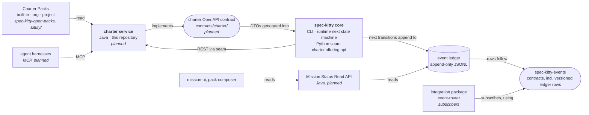

# System context

The charter sits between pack content and the runtime that acts on it. It does not talk to
consumers of the event ledger at all.

## The edges

| From | To | Contract | Notes |
|---|---|---|---|
| Charter service | Charter Packs on disk | The pack schemas (`pack.yaml`, `org-charter.yaml`, DRG fragments, artifact YAML) | Read-only during the read stages. Writes stay in Python until each write operation migrates. |
| Core CLI and runtime | Charter service | **The charter OpenAPI contract** | CLI callers go through the Python seam `charter.offering.api`, which calls the service over loopback REST. They never bypass the seam. |
| Agent harnesses | Charter service | The same contract, over MCP | Planned. Must not ship before its authorization decision (core ADR `2026-10-03-1`). |
| Runtime | Event ledger | **spec-kitty-events** | The runtime's `next` transitions append events. The charter service appends none. |
| Integration package | Event ledger | **spec-kitty-events** | Subscribers. They know the contracts, not the producers. |
| UIs | Mission Status Read API | The Mission Status Read API's OpenAPI contract | Pull, read-only. |

## Two contract homes, on purpose

There are two families of contracts and they must not mix:

- **The charter contract** (this repository, `contracts/charter/`, pending ADR-0002)
  describes the request and response shapes of governance reads and, later, writes. Charter
  DTOs come only from there.
- **spec-kitty-events** describes what is appended to the ledger: the event envelope, typed
  payloads and, by the operator's decision of 2026-10-13, a versioned schema for the ledger
  row itself.

Charter DTOs never go into spec-kitty-events, and event shapes never go into the charter
contract. If a governance change ever needs to be published as an event (for example an
activation), that event is defined in spec-kitty-events and emitted by the runtime that made
the change, not by the charter service. See [Events and the ledger](/architecture/events-and-ledger/).

## Neighbors in detail

- **spec-kitty (core).** Owns the CLI, the runtime and its `next` state machine, the
  event ledger and the Python seam. Owns the GA gate this extraction is part of.
- **spec-kitty-open-packs.** Designated source home of the built-in and internal pack
  content, to be vendored into core at release (core #3504, not built yet). Its CI registers only packs that declare
  `pack_level: org`.
- **spec-kitty-events.** The event contract package. Producers and consumers depend on it,
  not on each other.
- **event-router (integration package).** The subscriber side of publish, ledger, subscribe, named in
  the operator's direction of 2026-10-13. Outside the scope of this repository.
- **doc-kitty.** The docs toolkit whose convention this `docs/` tree follows.
