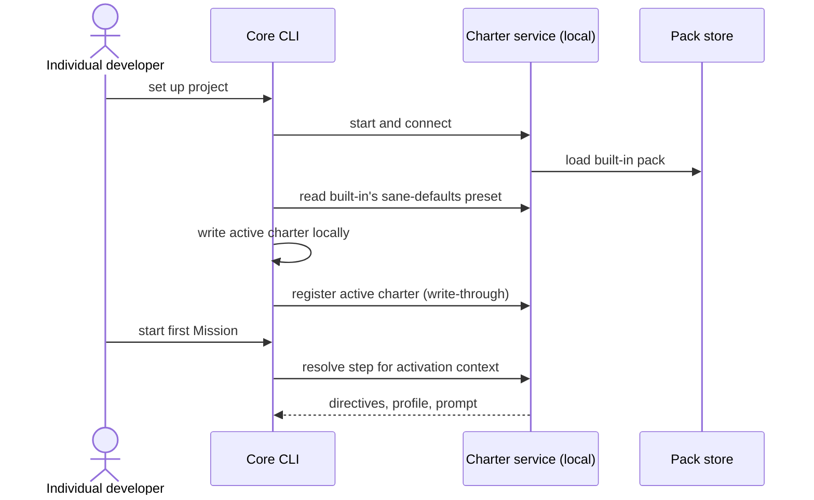

# Journey 01: Get started with sane defaults

## Persona and goal

An [individual developer](/context/audience/individual-developer/) installs Spec Kitty in a new
repository. They do not want to read the offering first. They want good defaults in force and a
first Mission running.

## Concepts used

- [Charter offering and active charter](/context/conceptual-model/#the-charter-offering-and-active-charter)
- [Packs and derivation](/context/conceptual-model/#packs-and-derivation): the minimal built-in pack
- [Requirement](/context/conceptual-model/#requirement): the preset in its convenience job
- [Mission types and roles](/context/conceptual-model/#mission-types-and-roles)
- [The active charter over time](/context/conceptual-model/#the-active-charter-over-time): local source of truth,
  local deployment

## Steps

1. The developer runs the setup command in the repository.
2. The command line starts a local charter service on the developer's machine
   (local deployment) and connects to it.
3. The built-in pack is already registered with the service. The command line points the developer
   to the open-packs offering for more.
4. The command line applies built-in's sane-defaults preset. This is a one-time selection: the
   preset's items are written into the project's active charter, which is a local file.
5. The local active charter, naming the built-in pack by id and version, is registered with the
   service (write-through).
6. The developer starts a first Mission of a mission type the preset selected.
7. For each step, the command line asks the service to resolve the active charter against the
   activation context and passes what comes back (directives, profile, prompt) to the agent.

## Diagram

## Service operations

| Operation | Status | Source |
| --- | --- | --- |
| Read what the service says about itself | exists | `contracts/charter/paths/info.yaml` |
| Read the built-in pack's artifacts (directives, tactics and the other doctrine kinds) | exists | `contracts/charter/paths/packs_packId_*.yaml` |
| Start the service locally from the command line | envisioned | ADR-0034 |
| List and read a pack's presets | missing | — |
| Register the project's active charter | envisioned | ADR-0020, ADR-0033 |
| Apply a preset to an active charter | envisioned | ADR-0020 |
| Resolve a step against an activation context | envisioned | ADR-0020 (action context read), ADR-0018 |

## Today

- `spec-kitty init` seeds the project's mission-type activations from the built-in pack's
  `default` preset and fails closed when that preset is missing
  (`src/specify_cli/cli/commands/init.py`, `provision_default_mission_type_activations`).
- `spec-kitty charter activate --preset <name>` applies a preset
  (`src/charter/activation/preset_application.py`); activation lives in
  `.kittify/charter/activation.yaml` (`src/charter/activation/activation_ledger.py`).
- The prompt for a step is built in-process (`src/runtime/next/prompt_builder.py`); there is no
  service.

Gaps against the conceptual model:

- The built-in pack is not minimal yet; splitting it is a direction (epic #145), so "minimal
  built-in" is a target, not today's behavior.
- The command line does not point to open-packs at setup.
- Whether an empty active charter means "every kind at its default" or "only what is required" is
  an open question (ADR-0033); this journey avoids it by always applying the preset.

## Scenarios

[Journey 01 contract scenarios](https://github.com/spec-kitty/spec-kitty-charter/blob/main/contracts/charter/scenarios/journeys/journey-01-getting-started.feature)
