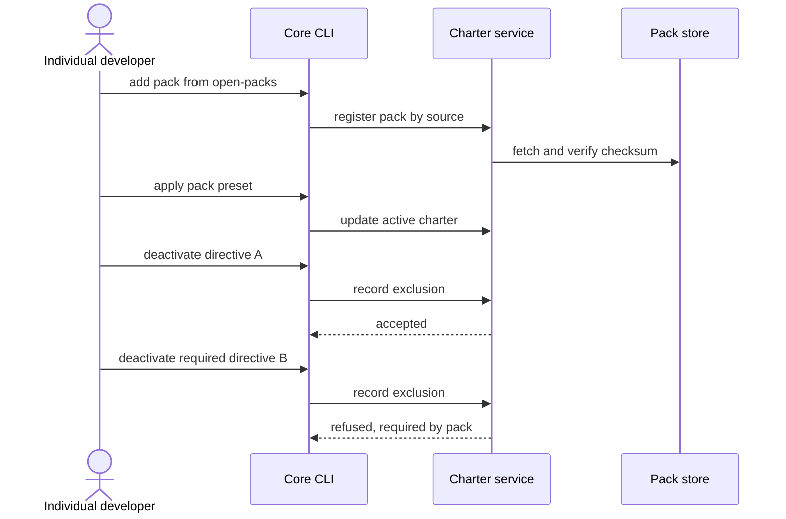

# Journey 02: Adopt a pack and leave one directive out

## Persona and goal

An [individual developer](/context/audience/individual-developer/) wants a pack from the
open-packs offering, say a test-driven pack. They agree with most of it but not with one
directive, and want that one off their plate without forking the pack.

## Concepts used

- [Packs and derivation](/context/conceptual-model/#packs-and-derivation)
- [Removal is not deactivation](/context/conceptual-model/#removal-is-not-deactivation): deactivation is the project's
  own choice
- [Requirement](/context/conceptual-model/#requirement): a required artifact cannot be deactivated
- [Integrity](/context/conceptual-model/#integrity)
- [The active charter over time](/context/conceptual-model/#the-active-charter-over-time): pack ids and versions

## Steps

1. The developer picks a pack from open-packs and asks the command line to add it.
2. The pack is registered with the service by source, verified against its checksum.
3. The developer selects the pack's artifacts, directly or by applying the pack's preset. The
   active charter now names the pack by id and version.
4. The developer deactivates one directive. The deactivation is recorded in the local active
   charter, written through to the service, and persists.
5. The developer tries to deactivate a second directive that the pack's preset marks as must-have.
   The request is refused with a message naming the requiring pack. Nothing is recorded.
6. Later reads of the active charter show the first directive as excluded and the required one as
   active.

## Diagram

## Service operations

| Operation | Status | Source |
| --- | --- | --- |
| Register a pack by source, with checksum verification | envisioned | ADR-0005, ADR-0019 |
| Read the pack's directives | exists | `contracts/charter/paths/packs_packId_directives.yaml` |
| Apply a preset to an active charter | envisioned | ADR-0020 |
| Deactivate an artifact in an active charter | envisioned | ADR-0020, ADR-0013 |
| Refuse deactivation of a required artifact | envisioned | ADR-0031, ADR-0012 |
| List the active charter's artifacts with their state | envisioned | ADR-0020 |

## Today

- `spec-kitty charter deactivate <kind> <id>`
  (`src/specify_cli/cli/commands/charter/deactivate.py`) records the exclusion in
  `.kittify/charter/activation.yaml`; an org-required id is refused with
  `RequiredArtifactDeactivationError` and nothing is recorded
  (`src/charter/activation/activation_engine.py`).
- Packs come in through org-pack configuration and `spec-kitty charter pack vendor`
  (`src/specify_cli/cli/commands/charter/pack_vendor.py`), not through a service registration.

Gaps against the conceptual model:

- Core reads requirement from `required_*` lists; the model authors it as a preset
  (ADR-0031). Whether and how long the older form is read is an open question.
- The active charter does not yet record pack versions per pack, which upgrades rely on.
- Core's refusal names only the `required` policy; a refusal for a locked artifact is anticipated
  in the code but not built.

## Scenarios

[Journey 02 contract scenarios](https://github.com/spec-kitty/spec-kitty-charter/blob/main/contracts/charter/scenarios/journeys/journey-02-adopt-a-pack.feature)
