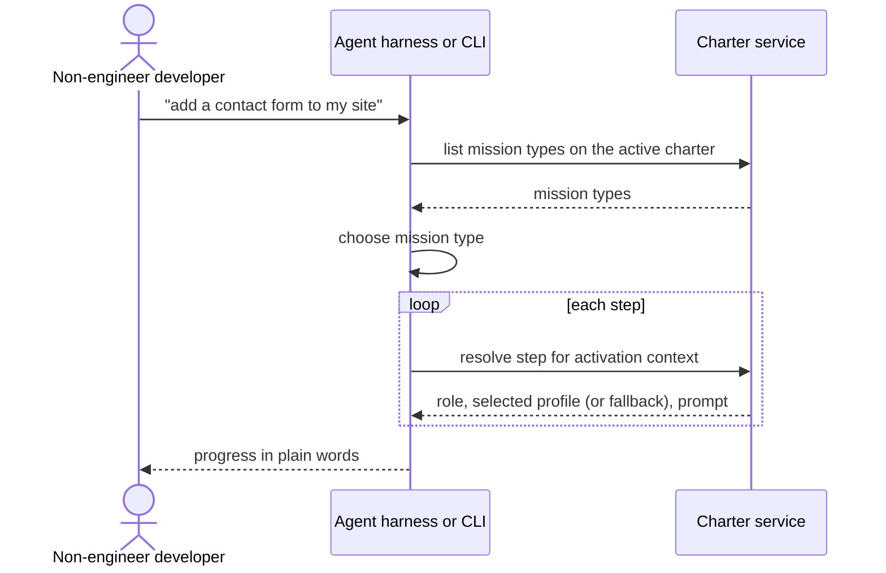

# Journey 03: Ask in plain language, get the right recipe

## Persona and goal

A [non-engineer developer](/context/audience/non-engineer-developer/) types a request such as
"add a contact form to my site". They do not know which mission type, role or profile to pick and
should not need to. They want good practice applied for them.

## Concepts used

- [Mission types and roles](/context/conceptual-model/#mission-types-and-roles): the recipe, and steps that name roles
- [Profiles: specialists who fill roles](/context/conceptual-model/#profiles-specialists-who-fill-roles)
- [Selection order](/context/conceptual-model/#selection-order)
- [The active charter over time](/context/conceptual-model/#the-active-charter-over-time): activation context and
  resolution

## Steps

1. The person types a plain-language request into their agent harness or the command line.
2. The client matches the request to a mission type that is on the project's active charter.
   Choosing the mission type is the client's job; the service only offers the mission types on the
   plate.
3. The client starts a Mission of that type.
4. For each step, the client sends the activation context (project, mission type, step, and what
   the work is about, for example a Python web project) to the service.
5. The service picks a profile for the role the step names: role fit, then specialization, then
   the declared fallback (marked as a fallback), or a clear not-found refusal.
6. The client hands the agent the resolved prompt and profile, and explains in plain words what
   is happening.

## Diagram

## Service operations

| Operation | Status | Source |
| --- | --- | --- |
| List the mission types on an active charter | envisioned | ADR-0020 |
| Resolve a step against an activation context | envisioned | ADR-0020, ADR-0018 |
| Select a profile for a role, with fallback and not-found | missing | ADR-0032 (decision, no operation) |
| Match a plain-language request to a mission type | missing | — (client concern) |

## Today

- `spec-kitty dispatch "<request>"` routes a request to a profile and action and lists
  alternatives with a confidence (`src/specify_cli/cli/commands/dispatch.py`); with an empty
  charter it falls back to `generic-agent` with a warning.
- Mission steps resolve their profile in-process (`src/runtime/next/prompt_builder.py`, through
  `src/charter/activation/mission_type_profiles.py`), partly from a work package's
  `agent_profile` frontmatter.

Gaps against the conceptual model:

- Core's dispatch picks a profile and an action together; the model has steps naming roles and
  the service selecting the profile by role fit and specialization (ADR-0032).
- Core's `generic-agent` fallback is hard-coded in the client; the model has a pack-declared,
  locked fallback that the service returns marked as a fallback.
- Tie handling is an open question (ADR-0032); dispatch today shows alternatives with confidences,
  which is closer to "return all candidates".

## Scenarios

[Journey 03 contract scenarios](https://github.com/spec-kitty/spec-kitty-charter/blob/main/contracts/charter/scenarios/journeys/journey-03-plain-language-request.feature)
