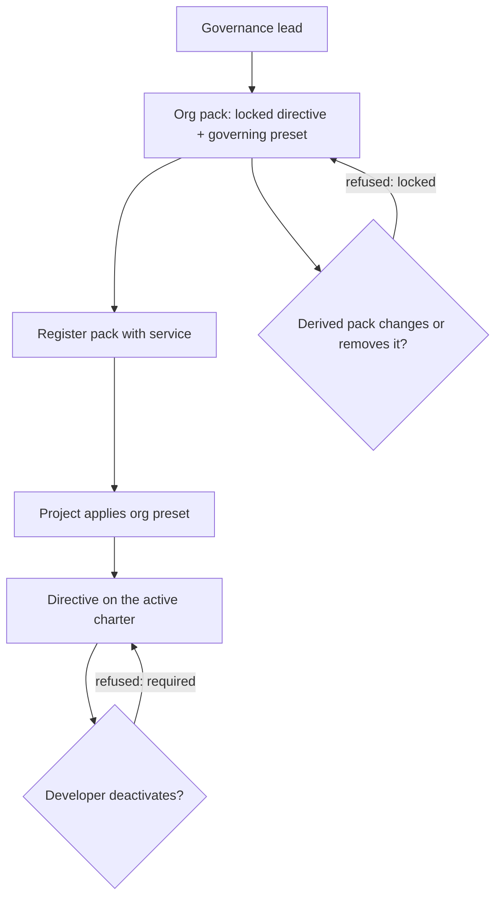

# Journey 04: Set an organization's house rules

## Persona and goal

A [governance lead](/context/audience/governance-lead/) wants every project in the organization
to follow a small set of house rules. One directive must be on every plate and must not be
weakened by anyone downstream.

## Concepts used

- [Packs and derivation](/context/conceptual-model/#packs-and-derivation): the org pack is a derived pack
- [Requirement](/context/conceptual-model/#requirement): a preset in its governor job
- [Integrity](/context/conceptual-model/#integrity): locked, tightened never loosened
- [Removal is not deactivation](/context/conceptual-model/#removal-is-not-deactivation)
- [The open-core boundary](/context/conceptual-model/#the-open-core-boundary)

## Steps

1. The governance lead creates an org pack derived from the built-in pack.
2. They add the house directive and set its integrity to locked.
3. They write a governing preset whose must-have items include the directive. The service derives
   the required set from it.
4. They publish the org pack; it is registered with the service.
5. A project adopts the org pack and applies its preset. The directive is on the plate.
6. A developer tries to deactivate the directive: refused, required by the org pack.
7. A further derived pack tries to change or remove the directive: refused, the directive is
   locked.

## Diagram

## Service operations

| Operation | Status | Source |
| --- | --- | --- |
| Register an org pack | envisioned | ADR-0005, ADR-0019 |
| Register one artifact into a pack (five kinds) | exists | `contracts/charter/paths/packs_packId_*.yaml`; ADR-0026 |
| Set an artifact's integrity level when registering it | envisioned | ADR-0026, ADR-0012 |
| Derive the required set from a governing preset | missing | ADR-0031 (decision, no operation) |
| Apply a preset to an active charter | envisioned | ADR-0020 |
| Refuse deactivation of a required artifact | envisioned | ADR-0031 |
| Refuse change or removal of a locked artifact | missing | ADR-0012, ADR-0030 |

## Today

- `spec-kitty charter org init` and `charter org validate` scaffold and check an org pack
  (`src/specify_cli/cli/commands/charter/org.py`); the org pack is loaded through
  `.kittify/config.yaml` (`charter_packs.org.packs`).
- Requirement is authored as `required_<plural>` lists in `org-charter.yaml`; a deactivation of
  an org-required id is refused (`src/charter/activation/activation_engine.py`).

Gaps against the conceptual model:

- Requirement is authored as lists, not as a preset (ADR-0031). How a governing preset is told
  from a convenience preset is an open question.
- Locked integrity is not enforced against a derived pack's change or removal in core.
- Checking that every repository in the org uses the org pack is out of scope for open-core; it
  belongs to org CI or code scans. The cross-project admin view is commercial (Brain Kitty).

## Scenarios

[Journey 04 contract scenarios](https://github.com/spec-kitty/spec-kitty-charter/blob/main/contracts/charter/scenarios/journeys/journey-04-org-house-rules.feature)
