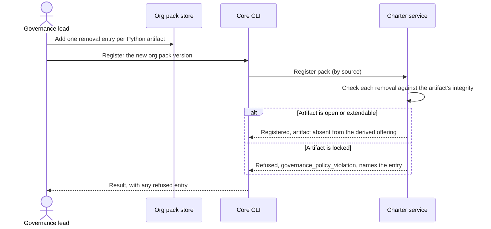

# Journey 05: Remove the Python artifacts from our org pack

## Persona and goal

A governance lead at "We Hate Snakes LLC". The company writes no Python, and it does not want any
of its projects offered Python guidance. The lead wants the Python-related built-in artifacts gone
for every project that uses the company's org pack, not switched off one project at a time.

## Concepts used

- [Packs and derivation](/context/conceptual-model/#packs-and-derivation): the org pack is a derived pack built on
  built-in.
- [Removal is not deactivation](/context/conceptual-model/#removal-is-not-deactivation): removal is pack-wide;
  deactivation is one project's choice.
- [Integrity](/context/conceptual-model/#integrity): open, extendable and locked; only locked is protected from removal.
- [Mission types and roles](/context/conceptual-model/#mission-types-and-roles): roles follow the same rules, so a
  Python-only role or profile can be removed too.
- [The active charter over time](/context/conceptual-model/#the-active-charter-over-time): what a project sees after
  the pack changes.

## Steps

1. The lead lists the built-in artifacts that are about Python, by name. There is no filter such as
   "everything Python": each artifact is named one at a time.
2. For each one, the lead adds a removal entry to the org pack's configuration (the pack-root
   policy file).
3. The lead registers the new version of the org pack with the charter service.
4. The service checks every removal against the integrity of the artifact it names:
   - an **open** or **extendable** artifact is removed from the offering;
   - a **locked** artifact is refused with `governance_policy_violation`, and the registration
     says which entry was refused.
5. The lead drops the refused entry (or keeps the artifact and leaves it off individual plates by
   deactivation, which is a project's choice, not the org's).
6. Projects that use the org pack no longer see the removed artifacts in their offering. A project
   whose active charter named one of them gets it reported as skipped, never dropped silently.

## Diagram

## Service operations

| Operation | Status | Source |
| --- | --- | --- |
| Register a pack version by source | envisioned | ADR [0005](/adr/0005-service-registers-and-distributes-packs/), ADR [0019](/adr/0019-packs-resource-model-and-hypermedia/) |
| Read a pack's artifacts, by kind (to find the Python ones) | exists | `contracts/charter/paths/packs_packId_*.yaml`; for five kinds |
| Declare a removal in a derived pack | missing | ADR [0030](/adr/0030-removal-is-distinct-from-deactivation/) decision 7; shape left to a later record |
| Refuse removal of a locked artifact | missing | ADR [0030](/adr/0030-removal-is-distinct-from-deactivation/) decision 3 |
| Report a removed artifact as skipped in an active charter | missing | ADR [0033](/adr/0033-local-active-charter-is-source-of-truth/) |

## Today

- Core has no removal. An org pack can add artifacts, override or enhance built-in ones
  (`enhances` / `overrides` relations in `src/charter/offering/drg/models.py`) and declare
  `required_<plural>` lists (`src/charter/activation/org_charter.py`), but it cannot take a
  built-in artifact out of the offering.
- The nearest thing is per-project deactivation: `spec-kitty charter deactivate` writes a
  `deactivated_<plural>` exclusion into `.kittify/charter/activation.yaml`
  (`src/charter/activation/activation_ledger.py`). Each project would have to do this itself, which
  is exactly what this journey avoids.
- Core does not carry `locked` as an integrity level, so it cannot refuse a removal on integrity
  grounds.
- **Gap:** removal, its policy-file entry, and the locked refusal all exist only in the model. The
  direction of splitting built-in into smaller packs (epic #145) would make most of this journey
  unnecessary: a company that writes no Python would simply not choose the Python pack.

## Scenarios

[Journey 05 contract scenarios](https://github.com/spec-kitty/spec-kitty-charter/blob/main/contracts/charter/scenarios/journeys/journey-05-remove-python.feature)
