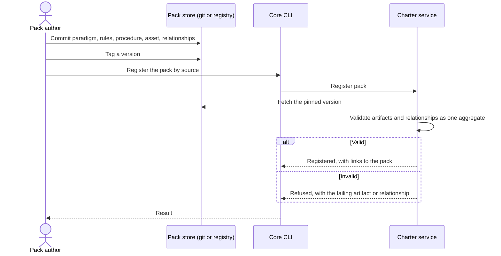

# Journey 06: Publish a pack with a paradigm and a checkable rule

## Persona and goal

A pack author wants to share a school of practice, say behavior-driven development, as a Charter
Pack other projects can adopt. The pack holds a paradigm with its principles, the rules that put it
into practice, a procedure for one recurring situation, and a companion asset that lets an agent
check one of the rules for itself.

## Concepts used

- [Packs and derivation](/context/conceptual-model/#packs-and-derivation): the unit the author publishes.
- [Paradigms: adopted](/context/conceptual-model/#paradigms-adopted): a worldview with principles; it points at
  guidance and has no rules of its own.
- [Rules and resources](/context/conceptual-model/#rules-and-resources): rules are followed; resources are used.
- [Procedures: playbooks below the mission](/context/conceptual-model/#procedures-playbooks-below-the-mission).
- [Relationships](/context/conceptual-model/#relationships): *supports* links the asset to the rule; *tension* may link
  two rules.
- [Integrity](/context/conceptual-model/#integrity): the author sets each artifact's level.
- [Values and creeds](/context/conceptual-model/#values-and-creeds): each rule may state its value impact.

## Steps

1. The author checks the paradigm against the paradigm test: a school of practice with a worldview
   that ties several practices together and explains why. A single convention would fail it and
   belongs in a directive or styleguide instead.
2. The author writes the paradigm: its name, a short list of principles, and references to the
   guidance it brings in.
3. The author writes the rules: directives, tactics, a styleguide. Each rule may carry a value
   impact (strength and rationale per value). Two rules that pull against each other get an
   authored *tension* relationship.
4. The author writes a procedure for one situation ("turn a bug report into a failing scenario"),
   with entry and exit conditions. If it only states a rule, it is a directive instead.
5. The author adds a companion asset, for example a script that checks every scenario has a
   `Given`, and links it to the rule it makes checkable with a *supports* relationship.
6. The author sets an integrity level on each artifact: open, extendable or locked.
7. The author publishes the pack at a versioned source (a git commit, or a published package
   `pkg:charter/<id>@<version>`) and registers it with the charter service.
8. The service validates the whole pack: every relationship endpoint resolves, every artifact
   matches its kind's schema. A failure refuses the registration; nothing is half-registered.
9. Projects can now find the pack in the offering and adopt it (see Journey 02).

## Diagram

## Service operations

| Operation | Status | Source |
| --- | --- | --- |
| Register a pack by source | envisioned | ADR [0005](/adr/0005-service-registers-and-distributes-packs/), ADR [0019](/adr/0019-packs-resource-model-and-hypermedia/); `POST /packs` |
| Register one artifact into a pack (paradigms, directives, tactics, styleguides, toolguides) | exists | `contracts/charter/paths/packs_packId_*.yaml` (`POST`, and `PUT` by id); ADR [0026](/adr/0026-write-surface-is-functional-registration/) |
| Register a relationship | exists | `contracts/charter/paths/packs_packId_relationships.yaml` (`PUT`); ADR [0026](/adr/0026-write-surface-is-functional-registration/) |
| Read a pack's paradigms, directives, tactics, styleguides, toolguides | exists | `contracts/charter/paths/packs_packId_*.yaml` |
| Read a pack's relationships | exists | `contracts/charter/paths/packs_packId_relationships.yaml` |
| Read a pack's procedures | missing | — |
| Read a pack's assets (resources) | missing | — |
| Read a paradigm's principles | missing | — |
| Read the *supports* relationship | missing | not in the relationship vocabulary yet |

## Today

- Pack sources are authored in the `spec-kitty-open-packs` repository and pinned into core:
  `spec-kitty charter pack vendor` bumps the pin
  (`src/specify_cli/cli/commands/charter/pack_vendor.py`), and `charter pack validate`,
  `charter pack assemble` and `charter pack regenerate-graph` check and rebuild a pack
  (`src/specify_cli/cli/commands/charter/pack_tooling.py`). Assets are listed with
  `charter pack asset list` (`pack_asset.py`). Nothing is registered with a service; core reads
  the pack files directly.
- A paradigm in core has a name, a summary, `directive_refs` and `references`
  (`src/charter/offering/paradigms/models.py`). It has **no principles field**.
- Core's relationship vocabulary (`Relation` in `src/charter/offering/drg/models.py`) has
  `requires`, `suggests`, `in_tension_with` and others, but **no `supports`**. A companion asset
  cannot yet be linked to the rule it checks.
- Core has no integrity level `locked`; the author cannot protect an artifact against removal.
- **Gaps:** principles, *supports*, integrity levels and registration through the service are in
  the model and ADRs only.

## Scenarios

[Journey 06 contract scenarios](https://github.com/spec-kitty/spec-kitty-charter/blob/main/contracts/charter/scenarios/journeys/journey-06-publish-a-pack.feature)
