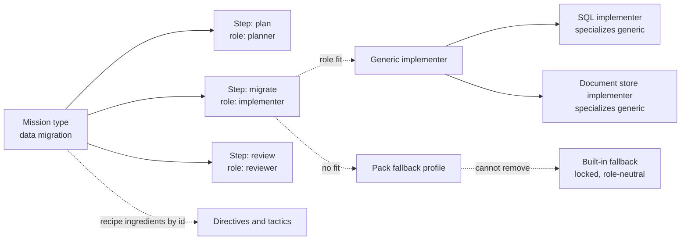

# Journey 07: Add a mission type with roles and specialist profiles

## Persona and goal

A pack author wants to offer a new kind of work, say a "data migration" mission type. Its steps
need a planner, an implementer and a reviewer. The author also ships two specialist implementers
(one for SQL, one for a document store) and a fallback for anything they do not fit.

## Concepts used

- [Mission types and roles](/context/conceptual-model/#mission-types-and-roles): steps name roles, never profiles;
  recipe ingredients are named by id.
- [Profiles: specialists who fill roles](/context/conceptual-model/#profiles-specialists-who-fill-roles): primary
  role, alt-roles, declared context, specialization.
- [Selection order](/context/conceptual-model/#selection-order): role fit, then specialization, then fallback, then
  not found.
- [The operator](/context/conceptual-model/#the-operator): a role a human can perform.
- [Integrity](/context/conceptual-model/#integrity): the author may lock a role or a profile.

## Steps

1. The author writes the mission type: its steps, each with a step contract and a step template
   (the prompt). Each step names the **role** it asks for: `planner`, `implementer`, `reviewer`.
   No step names a profile.
2. The author lists the mission type's recipe ingredients by id: the directives and tactics added
   to the plate while a mission of this type runs. Activating the mission type is the consent to
   them.
3. If a step needs a role that is not yet known (say `data-steward`), the author declares it in the
   pack. Roles are extensible by packs and become known when the pack is registered.
4. The author writes the specialist profiles. Each has one primary role (`implementer`), optional
   alt-roles (`reviewer`), a declared context (SQL, or the document store), and a specialization
   link to the generic implementer it refines.
5. The author declares a fallback profile for the pack. It cannot replace or remove built-in's
   role-neutral, locked fallback; it only gives a more specific one.
6. The author sets integrity on the mission type, its roles and its profiles, and registers the
   pack (see Journey 06).
7. A project activates the mission type like any other artifact. When a mission of that type runs,
   each step's role is filled by profile selection (see Journey 08).

## Diagram

## Service operations

| Operation | Status | Source |
| --- | --- | --- |
| Register a pack that contains a mission type and profiles | envisioned | ADR [0005](/adr/0005-service-registers-and-distributes-packs/), ADR [0019](/adr/0019-packs-resource-model-and-hypermedia/); `POST /packs` |
| Read the offering's mission types and their actions | envisioned | ADR [0020](/adr/0020-offering-and-activations/); `/offering` |
| Read a pack's mission types | missing | — |
| Read a pack's profiles | missing | — |
| Read the roles a pack declares | missing | ADR [0032](/adr/0032-steps-name-roles-and-profile-selection-order/) decision 2 |
| Declare a pack's fallback profile | missing | ADR [0032](/adr/0032-steps-name-roles-and-profile-selection-order/) decision 3 |
| Lock or pin a role in the pack-root policy file | missing | ADR [0030](/adr/0030-removal-is-distinct-from-deactivation/) decision 5 |

## Today

- Mission types live in `src/charter/offering/missions/` (`mission_type_repository.py`,
  `models.py`) and are listed with `spec-kitty charter mission-type list`
  (`src/specify_cli/cli/commands/charter/mission_type.py`). The built-in resolver knows four
  (`software-dev`, `documentation`, `research`, `plan`) and refuses an unknown type unless the
  project charter overrides it (`src/charter/activation/mission_type_profiles.py`).
- A mission step names a **profile**, not a role: `MissionStep.agent_profile` "also serves as the
  step's advisory recommended-role offer" (`src/charter/offering/missions/models.py`). This is the
  mix of roles and profiles that ADR-0032 drops.
- Roles are already open: `Role` is a half-open value object, so a custom role needs no code
  change (`src/charter/offering/agent_profiles/profile.py`). Specialization is the
  `specializes_from` relationship, and `routing-priority` is on the profile.
- Core has no fallback profile: profile matching returns nothing when no candidate fits
  (`find_best_match` in `src/charter/offering/agent_profiles/repository.py`).
- **Gaps:** steps naming roles, declared fallbacks, role locks and pins, and reading mission types
  and profiles through the service.

## Scenarios

[Journey 07 contract scenarios](https://github.com/spec-kitty/spec-kitty-charter/blob/main/contracts/charter/scenarios/journeys/journey-07-add-a-mission-type.feature)
