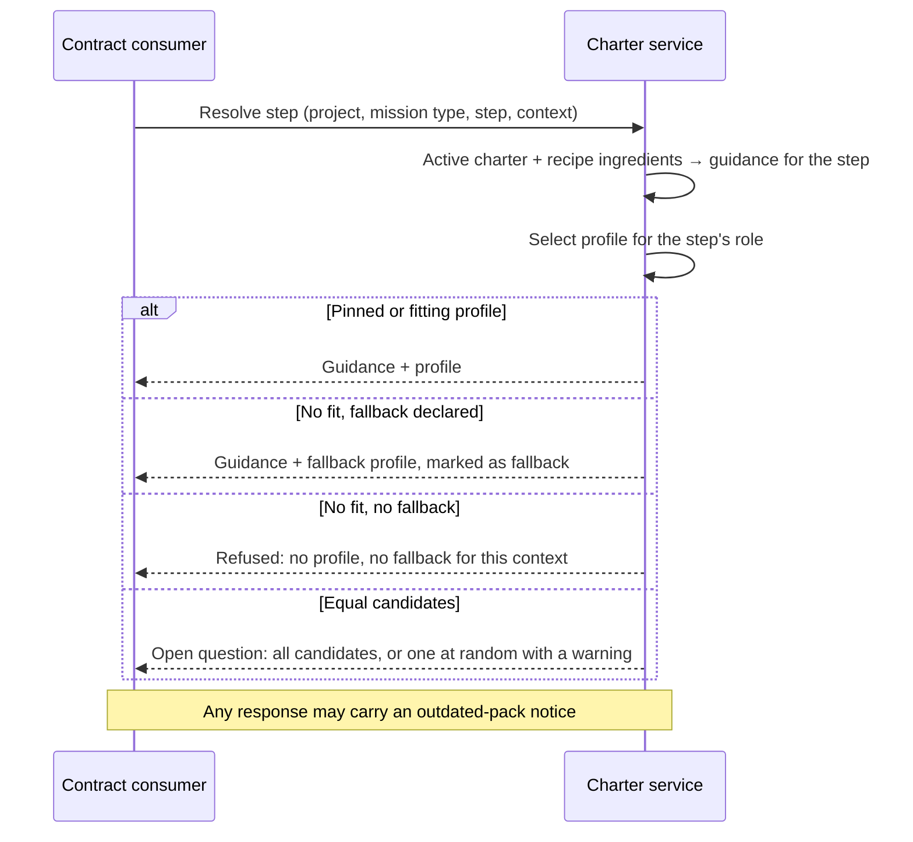

# Journey 08: Resolve one step against an activation context

## Persona and goal

A contract consumer: a client of the charter service, such as core's runtime or another agent
harness. It is about to run one step of a mission and wants to know what applies: the directives,
the prompt, and the profile that fills the step's role.

## Concepts used

- [The active charter over time](/context/conceptual-model/#the-active-charter-over-time): one active charter per
  project; the activation context; resolution.
- [Mission types and roles](/context/conceptual-model/#mission-types-and-roles): the step names a role.
- [Selection order](/context/conceptual-model/#selection-order): role fit, specialization, fallback, not found, ties.
- [Role pin](/context/conceptual-model/#role-pin): a derived pack may fix the profile for a role.
- [Open questions](/context/conceptual-model/#open-questions): ties, and the shape of the resolution payload.

## Steps

1. The client has registered the project's active charter with the service (see Journey 10 for the
   write-through). There is one active charter per project, not one per mission.
2. The client builds an **activation context**: the project, the mission type, the step, and what
   the work is about ("a Python implementation"). Anything it wants added just for this mission
   (recipe ingredients aside) it passes here or adds to the active charter for the time being.
3. The client asks the service to resolve the step against that context.
4. The service applies the active charter, adds the mission type's recipe ingredients, and returns
   what applies to the step: directives, tactics, the step template and the rest.
5. For the role the step names, the service selects a profile:
   1. **Role pin.** If a derived pack pins the role, the pinned profile and its specializations are
      the only candidates.
   2. **Role fit.** A profile with that role as its primary role beats one with it as an alt-role.
   3. **Specialization.** Among those, the most specialized one that fits the context wins, by
      specialization lineage and `routing-priority`. In a Python project the implementer is the
      Python specialist; in a Java project, the Java one.
   4. **Fallback.** If none fits, the service returns the declared fallback profile, marked as a
      fallback so the client can tell it from a real match.
   5. **Not found.** If no fallback is available in the context, the service refuses with a clear
      message: no profile matched and no fallback was found. Since built-in's fallback is locked,
      this means a misconfiguration. The client may still run the step without a profile.
   6. **Tie.** If two profiles are equally fit, there is no hidden tie-break. Whether the service
      returns all of them or picks one at random with a warning is an **open question**.
6. If a pack the active charter names has a newer version, the response carries a notice that the
   project is outdated (see Journey 09).
7. The client runs the step with the result. The opening statement of the profile is computed from
   its purpose, specialization, context and ethos, so the client never depends on how the pack
   stores them.

## Diagram

## Service operations

| Operation | Status | Source |
| --- | --- | --- |
| Register or update the project's active charter | envisioned | ADR [0020](/adr/0020-offering-and-activations/), ADR [0033](/adr/0033-local-active-charter-is-source-of-truth/); `PUT /activations/{activationId}` |
| Read the action context for a mission type's action | envisioned | ADR [0020](/adr/0020-offering-and-activations/), ADR [0018](/adr/0018-action-context-read-and-seam-access-surface/); `GET /offering/mission-types/{missionType}/actions/{action}/context` |
| Resolve a step against the active charter and an activation context (effective context) | envisioned | ADR [0018](/adr/0018-action-context-read-and-seam-access-surface/) (R9 effective-context operation); no path yet |
| Select the profile for a role, with fallback and not-found | missing | ADR [0032](/adr/0032-steps-name-roles-and-profile-selection-order/) decision 7; query shape left to a later record |
| Return equal candidates on a tie | missing | ADR [0032](/adr/0032-steps-name-roles-and-profile-selection-order/); open question |
| Outdated-pack notice on a response | missing | ADR [0033](/adr/0033-local-active-charter-is-source-of-truth/) |
| Read single artifacts by pack and id | exists | `contracts/charter/paths/packs_packId_*_*Id.yaml` |

## Today

- Core resolves in-process. `runtime.next.prompt_builder` builds the step prompt and asks
  `resolve_mission_type_context` (`src/charter/activation/mission_type_profiles.py`) for the
  mission type's governance; the governance context for an action comes from
  `spec-kitty charter context --action <name>`
  (`src/specify_cli/cli/commands/charter/context.py`).
- The profile comes from the work package's `agent_profile` frontmatter, forwarded by
  `_build_wp_prompt` in `src/runtime/next/prompt_builder.py`, or from a mission step's
  `agent_profile`. It is named, not selected for a role.
- Where core does select, `find_best_match` (`src/charter/offering/agent_profiles/repository.py`)
  filters by role and scores language, framework, file patterns, keywords and `routing-priority`.
  It does not rank primary role above alt-role first, and on a tie Python's `max` silently keeps
  the first candidate: a hidden tie-break the model rules out.
- When nothing fits, `find_best_match` returns nothing. There is no fallback profile and no
  not-found refusal.
- There are no role pins and no outdated-pack notice.
- **Gaps:** selection by role with the four-step order, fallback, not-found, the tie rule, pins and
  the outdated notice; and the resolution operation itself on the service.

## Scenarios

[Journey 08 contract scenarios](https://github.com/spec-kitty/spec-kitty-charter/blob/main/contracts/charter/scenarios/journeys/journey-08-resolve-a-step.feature)
