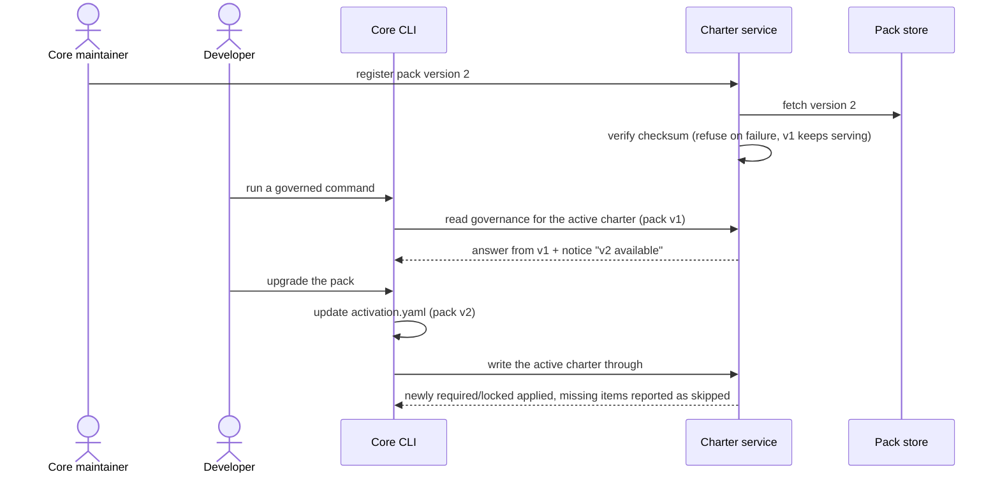

# Journey 09: Upgrade a project to a new pack version

## Persona and goal

A **core maintainer** registers a new version of a pack with the charter service. An **individual
developer** whose project uses that pack wants to move to the new version when it suits them, see
what changes, and keep the choices they already made.

## Concepts used

- [Charter Pack and derived pack](/context/conceptual-model/#packs-and-derivation)
- [The active charter over time](/context/conceptual-model/#the-active-charter-over-time): pack
  versions, opt-in upgrades, the outdated notice, the local source of truth
- [Requirement](/context/conceptual-model/#requirement) and
  [integrity](/context/conceptual-model/#integrity): newly required or locked items apply on the
  upgrade
- [Removal is not deactivation](/context/conceptual-model/#removal-is-not-deactivation):
  deactivations persist across an upgrade

## Steps

1. The maintainer publishes a new version of a pack (for example a tagged open-packs release).
2. The maintainer asks the service to register that version. The service verifies it against the
   pack's checksum. A failed check is refused and the old version keeps serving.
3. The service now holds both versions side by side. No project's active charter changes.
4. The developer runs any command that reads governance. The answer carries a notice: a newer
   version of the pack is available.
5. The developer asks the command line to upgrade. It updates the pack version named in the local
   active charter (`activation.yaml`) and writes the change through to the service. That update is
   the acknowledgement.
6. The service answers from the new version. Newly required or locked items apply; items that no
   longer exist are reported as skipped, never dropped silently; the developer's deactivations
   persist.
7. The notice stops. Other projects that did not update stay on the old version and keep seeing it.

## Diagram

## Service operations

| Operation | Status | Source |
| --- | --- | --- |
| Register a pack (version) with the service | envisioned | ADR-0019, `POST /packs`; ADR-0005 |
| Verify a pack version against its checksum, refuse on failure | envisioned | ADR-0005, ADR-0033 |
| Hold several versions of one pack side by side | envisioned | ADR-0033 |
| Read a pack's artifacts (tactics, directives, styleguides, paradigms, toolguides, relationships) | exists | `contracts/charter/paths/packs_packId_*.yaml` |
| Register or update a project's active charter, naming pack ids and versions | envisioned | ADR-0020, `PUT /activations/{activationId}`; ADR-0033 |
| Report skipped items when an upgraded charter names artifacts that no longer exist | missing | ADR-0033 (behavior only) |
| Add an "outdated pack" notice to every activation answer | missing | ADR-0033 (where it appears is left to a later record) |

## Today

- Core takes packs from a pinned open-packs commit, not from a service. The pins are
  `packs/built-in.source.yaml` and `packs/internal.source.yaml`, modelled in
  `src/charter/offering/packs/pack_pin.py` (checked by tree digest and `snapshot_sha256`).
  A maintainer bumps a pin with `spec-kitty charter pack vendor`
  (`src/specify_cli/cli/commands/charter/pack_vendor.py`) and every checkout runs
  `make sync-packs` to fetch it (`src/charter/offering/packs/pack_fetch.py`).
- The active charter lives in `.kittify/charter/activation.yaml`
  (`src/charter/activation/activation_ledger.py`). It does not name pack versions.
- Gaps against the conceptual model:
  - The pin is per checkout of core, not per project: every project on one core version gets the
    same pack version, so there is no per-project opt-in and no acknowledgement.
  - Only one version of a pack is present at a time.
  - There is no outdated notice and no skipped-item report on an upgrade.
  - There is no write-through to a service.

## Scenarios

[Journey 09 contract scenarios](https://github.com/spec-kitty/spec-kitty-charter/blob/main/contracts/charter/scenarios/journeys/journey-09-upgrade-packs.feature)
