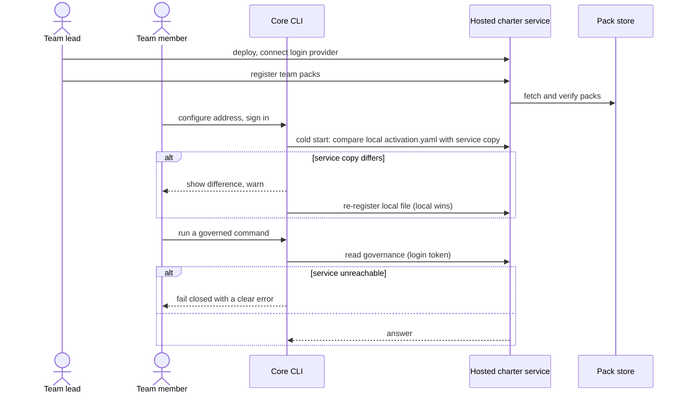

# Journey 10: Host the charter service centrally for a team

## Persona and goal

A **team lead** (governance lead) wants one charter service for the whole team, with one set of
pack versions, instead of each member running a local service. Members must keep control of their
own project's active charter.

## Concepts used

- [Local and hosted deployment](/context/conceptual-model/#the-active-charter-over-time)
- [Write-through active charter, local wins visibly](/context/conceptual-model/#the-active-charter-over-time)
- [The open-core boundary](/context/conceptual-model/#the-open-core-boundary)
- [The charter: offering and active charter](/context/conceptual-model/#the-charter-offering-and-active-charter)

## Steps

1. The team lead chooses between the two options. **Local**: the command line starts a service on
   each developer's machine and works offline. **Hosted**: one service runs on a server the team
   controls. The team lead picks hosted.
2. The team lead deploys the open-source service and connects it to the team's standard login
   provider.
3. The team lead registers the packs the team uses with the hosted service.
4. Each member configures the command line with the service's address and signs in, which gives
   the command line a standard login token.
5. On a cold start the command line checks the project's local `activation.yaml` against the
   service's copy, or registers it if the service has none.
6. If the two disagree, local wins, visibly: the command line shows the difference and warns before
   it re-registers the local file. The hosted side never changes a project's charter on its own;
   an admin may propose a change, and the project's update is the acknowledgement.
7. From then on each change to `activation.yaml` is written through to the service, and governed
   commands read their answers from it.
8. When the service is unreachable, the command line fails closed with a clear error. It does not
   fall back to a cached or local answer.

Open-core boundary: self-hosting for one team is open-core; managed hosting, multiple tenants, the
cross-project out-of-date view and org reporting are commercial ([Brain Kitty](/glossary/product-lines/#brain-kitty)).

## Diagram

## Service operations

| Operation | Status | Source |
| --- | --- | --- |
| Report service identity and contract version | exists | `contracts/charter/paths/info.yaml` |
| Read pack artifacts | exists | `contracts/charter/paths/packs_packId_*.yaml` |
| Accept a standard login (bearer) token with read and write scopes | envisioned | ADR-0020 D12, ADR-0034 |
| Answer an activation the token may not see as not found | envisioned | ADR-0020 D12 |
| Register packs with the hosted service | envisioned | ADR-0019, `POST /packs` |
| Register an active charter, or read the service's copy for the cold-start check | envisioned | ADR-0020, `POST /activations`, `GET /activations/{activationId}`; ADR-0033 |
| Write a changed active charter through | envisioned | ADR-0020, `PUT /activations/{activationId}`; ADR-0033 |
| Admin proposes a change to a project's charter | missing | ADR-0033 (behavior only) |
| Local deployment profile (CLI-started service, loopback) | envisioned | ADR-0011, ADR-0020 D12, ADR-0034 |

## Today

- Core does not call a charter service yet. Governance is read in process from the Python offering
  (`src/charter/offering/`, fronted by `src/charter/offering/api.py`) and the active charter in
  `.kittify/charter/activation.yaml` (`src/charter/activation/activation_ledger.py`).
- Core's seam ADR, `docs/adr/4.x/2026-10-03-1-charter-read-write-service-strangler.md`, still
  describes only a CLI-started, loopback, per-worktree daemon. ADR-0034 records the amendment core
  owes; until core makes it, the two disagree.
- Core removed its own hosted surfaces in spec-kitty#6164. A core client for a self-hosted charter
  service is a generic client for an open-source service, not a return of those (ADR-0034).
- Gaps against the conceptual model: no remote address setting, no login, no cold-start comparison
  and no write-through exist in core.

## Scenarios

[Journey 10 contract scenarios](https://github.com/spec-kitty/spec-kitty-charter/blob/main/contracts/charter/scenarios/journeys/journey-10-host-centrally.feature)
