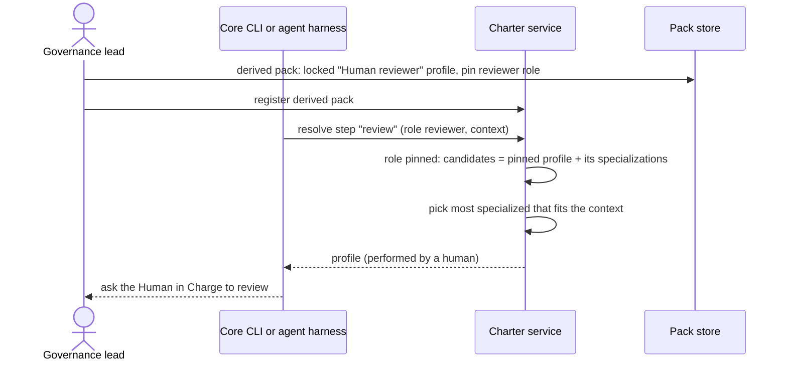

# Journey 11: Have every review done by a human

## Persona and goal

The governance lead at **"Suspicious Services Inc."** does not trust agents to approve work. Every
review, in every mission type, must be done by a human. No mission type should need to change, and
teams should still be able to add more specific human reviewers.

## Concepts used

- [Mission types and roles](/context/conceptual-model/#mission-types-and-roles): steps name roles,
  never profiles
- [Profiles](/context/conceptual-model/#profiles-specialists-who-fill-roles) and the
  [selection order](/context/conceptual-model/#selection-order)
- [Role pin](/context/conceptual-model/#role-pin)
- [The operator](/context/conceptual-model/#the-operator)
- [Integrity](/context/conceptual-model/#integrity)
- [Packs and derivation](/context/conceptual-model/#packs-and-derivation)

## Steps

1. The governance lead creates a derived pack on top of the packs the organization uses.
2. In it they add a profile, "Human reviewer", marked as performed by a human, with the operator
   role. Its integrity is **locked**, so no project can alter it.
3. In the pack-root policy file they **pin** the reviewer role to that profile.
4. They register the derived pack with the service, and projects add it to their active charters.
5. When a mission step asks for the reviewer role, the service returns the pinned profile, whatever
   the mission type. No step changes.
6. A team that wants a more specific human reviewer (for example for payment code) adds a profile
   that specializes "Human reviewer". Specializations of the pinned profile still fit, so the
   selection order picks it where its context fits; elsewhere the pinned profile serves.
7. The client sees that the selected profile is performed by a human and asks the Human in Charge
   to do the review.

## Diagram

## Service operations

| Operation | Status | Source |
| --- | --- | --- |
| Register a derived pack with profiles and a pack-root policy file | envisioned | ADR-0019, `POST /packs`; ADR-0030 |
| Declare a role pin and a role lock in the policy file | envisioned | ADR-0030, ADR-0032 (shape left to a later record) |
| Mark a profile as performed by a human | missing | ADR-0032 (behavior only) |
| Select a profile for a step's role, honouring a pin and its specializations | missing | ADR-0032 (query shape left to a later record) |
| Refuse an alteration of a locked profile | envisioned | ADR-0012, ADR-0030 |

## Today

- Core has a `Role` value with a fixed set of well-known roles, including `reviewer`, but no
  `operator` constant (`src/charter/offering/agent_profiles/profile.py`). Profiles carry
  `routing-priority` there.
- Profile lineage is a `specializes_from` relationship in the pack graph, resolved by
  `AgentProfileRepository` (`src/charter/offering/agent_profiles/repository.py`); profiles are
  looked up by id in `src/charter/activation/profile_resolution.py`.
- Request-to-profile dispatch is `src/specify_cli/invocation/router.py`.
- Gaps against the conceptual model:
  - Shipped mission steps name profiles, not roles (ADR-0032 context), so a role pin has nothing to
    act on.
  - There is no role pin, no role lock and no marker for a human-performed profile.

## Open points

These are flagged, not resolved:

- The pinned profile has the operator role, while the pin is on the reviewer role. Whether the
  pinned profile must also declare reviewer (as an alt-role) is not stated in ADR-0032.
- Whether a profile that is **locked** may be specialized by another profile. The conceptual model
  says specializations of a pinned profile still fit, and integrity says a locked artifact may not
  be altered; a specialization is a separate profile, but no record says so explicitly.

## Scenarios

[Journey 11 contract scenarios](https://github.com/spec-kitty/spec-kitty-charter/blob/main/contracts/charter/scenarios/journeys/journey-11-human-reviews.feature)
