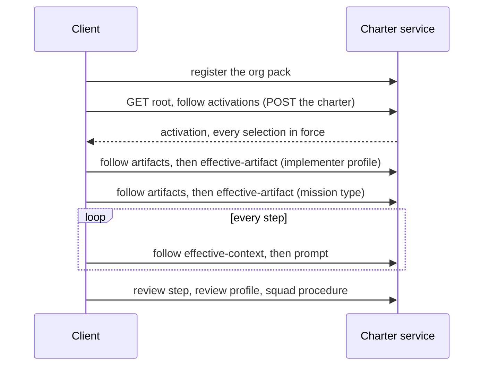

# Journey 12: Walk a whole mission under one activation

## Persona and goal

A **contract consumer**, the client of a team that runs a software-dev mission, needs everything the
mission asks of it before the first step: the project's charter in force over the packs the team
uses, the implementer profile's governance, the mission's steps in order, and, for every step, the
governance and the prompt to act on. At the review it needs a review profile and the squad
procedure that profile requires. The client knows only the API root and follows links.

This journey comes from the usability run of 2026-11-14, a manual walk against the open-packs pin
(`scripts/usability/`). The operator ruled that the walk is proven per pull request over charter's
own example packs, with an activation written for them, and not as a nightly over open-packs
content (#572; ADR-0070).

## Concepts used

- [Packs and derivation](/context/conceptual-model/#packs-and-derivation): an org pack that
  depends on the built-in pack
- [Mission types and roles](/context/conceptual-model/#mission-types-and-roles): steps in sequence
  and on demand, a step that names a role
- [Profiles](/context/conceptual-model/#profiles-specialists-who-fill-roles): the governance a
  profile requires

## Steps

1. The org registers its pack beside the configured built-in pack.
2. The client creates an activation from the root. Every selection is in force and nothing is
   refused.
3. It reads the implementer profile under the activation: each governance item says how it applies,
   and the conventions styleguide of the profile's language is required.
4. It reads the mission type: its steps, in sequence and on demand, in the order the pack declares.
5. For every step it reads the action context, which links each item in force to its read, and the
   prompt, which lists every slot it declares, filled or empty.
6. At the review step it reads the step's role, the review profile, and the squad procedure that
   profile requires, all in force.

## Diagram

## Service operations

| Operation | Status | Source |
| --- | --- | --- |
| Register a pack from a filesystem source | in the contract | `registerPackFromSource` (`POST /packs`) |
| Create an activation from the root | in the contract | `createActivation` |
| Read an artifact and an agent profile under an activation | in the contract | `getEffectiveArtifact`, `getEffectiveAgentProfile` |
| Read a mission type and a step under an activation | in the contract | `getEffectiveMissionType`, `getEffectiveMissionStep` |
| Read a step's action context and prompt | in the contract | `getEffectiveActionContext`, `getEffectiveStepPrompt` |
| Select the review profile from the step's role | missing | slice G (#538, #42) |

## Today

- Charter's example `built-in` pack declares an action node for 5 of software-dev's 13 steps, so the
  other 8 have no action context or prompt. Slice F (#537) adds the missing nodes; until then the
  scenario that walks every step is `@WIP`.
- No operation turns a step's role into a profile, so the client names the review profile.
- The squad procedure names no cast: which profiles form a squad stays the client's choice.

## Scenarios

[Journey 12 contract scenarios](https://github.com/spec-kitty/spec-kitty-charter/blob/main/contracts/charter/scenarios/journeys/journey-12-a-mission-walk-under-one-activation.feature)
