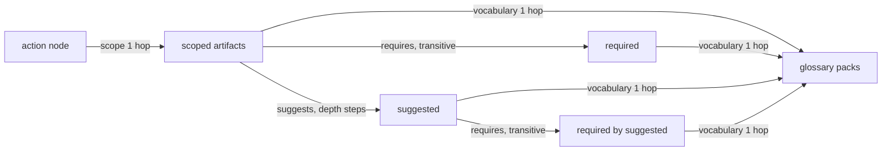

# Implementation Plan: Action-context read and the reserved 1.0 surface

**Branch**: `feat/action-context-reserved-surface` | **Date**: 2026-10-19 | **Spec**: [spec.md](spec.md)
**Input**: Mission specification from `kitty-specs/action-context-reserved-surface-01M5AFEK/spec.md`

**Planning questions.** The planning interrogation was minimized under the runner brief (an
autonomous run). The design calls are D1 to D14 in [research.md](research.md) §3, each with its
rationale and the alternatives it rejected. They are provisional and listed for operator
confirmation in the PR handover.

## Summary

The action-context read becomes the charter's full answer to "what the offering says governs this
action". It is the offering's walk for good. What applies in one project is a separate operation
of the activation set (#103). The read walks:

- scope from the action node;
- `requires`, transitively;
- `suggests`, to `depth` steps from the scoped artifacts;
- the `requires` of what was suggested;
- `vocabulary`.

Core's code is evidence of intent, not a spec. Where it contradicts its own stated intent, the
charter follows the intent (DIV-110).

Each walk is breadth-first. Each entry carries `relation`, `via` and `hops`, and the answer
carries the offering's `diagnostics`. `depth` is redefined as `suggests` hops, from 0 to 2,
default 2.

The reserved 1.0 surface is fixed before the tag:

- `ServiceInfo.serviceVersion`;
- a source fingerprint that covers `config.yaml` and `charter.yaml`;
- a required per-worktree bearer token: startup is refused without one, and 401 and 403 are
  answered, with a Host allowlist and refusal of browser requests;
- `POST /packs/refresh` (operator ruling);
- `stale_input` raised for real by every operation, with a single verified fingerprint header
  on each 200;
- real or reserved scenarios for every refusal code.

The decisions go into a new ADR-0018, amendments to ADR-0009, ADR-0011 and ADR-0016, a
divergence register page, the contract CHANGELOG and the docs. The plan-point adversarial
squad's findings and their dispositions are in [research.md](research.md) §8.



## Technical Context

**Language/Version**: Java 25 (toolchain and `--release`); Kotlin DSL for the build
**Primary Dependencies**: Spring Boot 4.1 (webmvc), openapi-generator (spring, `interfaceOnly`), Cucumber-JVM, ArchUnit, JUnit, AssertJ; vacuum and oasdiff for the contract checks. **No dependency is added, upgraded or removed**, so DIRECTIVE_051's supply-chain controls have nothing to examine. Recorded here as a checked result, not a default.
**Storage**: N/A (file-based packs and the project's `.kittify/config.yaml` and `charter.yaml`, read only)
**Testing**: Scenarios first. Contract scenarios in `contracts/charter/scenarios/` change and are seen failing before the service changes; then JUnit unit tests for the walk, the fingerprint composite, the token filter and the stale check, plus the ArchUnit gate. `verifyAll` with `-PopenPacksDir`.
**Target Platform**: Linux CI (`ubuntu-24.04`), Temurin 25
**Project Type**: Multi-module Gradle service with the OpenAPI contract, plus the docsite
**Performance Goals**: The walk visits each node at most once per relation walk (NFR-003). A read of the open-packs `software-dev/plan` action stays within the scenario suite's existing time budget (no new timeout).
**Constraints**:
- C-001: runner B's files are untouched.
- C-002: activation data is not added to existing responses.
- C-003: pure read model.
- Token comparison is constant-time, and the token is never logged (NFR-004).
**Scale/Scope**:
- 3 operations become 4.
- About 10 contract files change.
- About 8 main classes change or are added.
- About 15 scenarios are added or changed.
- 1 new ADR, 3 amended ADRs, 1 new docs page.

## Charter Check

| Charter rule | How this plan meets it |
|---|---|
| Divergence from the oracle must not go wrong | Every deliberate difference is registered (research §5, DIV-101 to DIV-110, DIV-104 withdrawn) with a named corpus case for #9. Core's code is evidence of intent; its bugs are not replicated |
| No incompatible contract change reaches core | No tag exists, so 1.0 is still being shaped (`ReleaseGate` NoBaseline). Every closed-schema change lands before the tag (C-005). Later capabilities are new operations (ADR-0009 D4). |
| Adversarial squad at the plan point and before merge | A squad on spec and plan before tasks; a pre-PR squad at closeout |
| A call made without review is logged | The provisional calls D1 to D14 are listed for operator review in the PR handover |
| `verifyAll` on Java 25, strict verification | No new dependency; CI unchanged |
| Java style gate | New code follows palantir format, Checkstyle, NullAway and Javadoc |
| Docs checks | `check_docs.py all`, markdownlint, cspell on every docs change |
| BDD, scenarios first, test first, no fake green | Each WP starts with its scenario red. The one reserved pin is tagged `@reserved` and documented as a declaration pin, never as behavior. |
| DDD in core's vocabulary | Walk, relation, scope, `requires`, `suggests`, `vocabulary` and depth keep core's names. `hops` is defined in the spec's Domain Language. |

## Project Structure

### Documentation (this mission)

```text
kitty-specs/action-context-reserved-surface-01M5AFEK/
├── spec.md
├── plan.md
├── research.md
├── data-model.md
├── quickstart.md
├── contracts/contract-delta.md
├── checklists/requirements.md
└── tasks/
```

### Source Code (repository root)

```text
contracts/charter/
├── openapi.yaml                       # + components.securitySchemes, security, /packs/refresh
├── paths/                             # context description; info and new packs_refresh.yaml
├── parameters/Depth.yaml              # suggests hops, 0..2, default 2
├── schemas/                           # ActionContext, GuidanceEntry (+hops), ServiceInfo (+serviceVersion), CharterRefusalCode text
├── responses/                         # + Unauthorized.yaml, Forbidden.yaml
├── headers/                           # fingerprint inputs text
├── examples/                          # updated ActionContext and ServiceInfo
├── scenarios/                         # action_context, service, errors, + security.feature, README @reserved rule
└── CHANGELOG.md
service/
├── adapter-in-rest/                   # ContextController, PacksController (+refresh), CharterHeaders, + WorktreeGuard, ServiceVersion
├── adapter-out-yaml/                  # + ProjectConfigSources (new class; pack classes untouched)
├── charter-read-app/                  # ActionContextQuery walk, GuidanceEntry.hops, stale check, ServiceInfo(+version)
├── charter-domain/                    # DoctrineGraph adjacency index (if needed)
└── charter-service/                   # CharterProperties (+projectConfigDir, worktreeToken), CharterWiring, test steps
docs/
├── adr/0018-…md                       # new; ADR-0009, 0011, 0016 amended
├── api/service-contract.md, conformance/divergence-register.md (new)
└── architecture/ resolution-model, service-lifecycle, contract-and-dtos
```

**Structure Decision**: the existing multi-module layout. No new module.

## Complexity Tracking

| Deviation | Why needed | Simpler alternative rejected because |
|---|---|---|
| A test seam at the `PackSources` port to change a file during a read | `stale_input` needs a real change between two digests in one request | Planting the refusal directly would be fake green |
| `openapi.yaml` holds `components` and `security` (`contract-and-dtos.md:104` says it holds only info, servers, tags and paths) | OAS puts `securitySchemes` under `components`, and root `security` must be in the document root | Per-operation `security` duplicates the requirement on every path and still needs `components` |

## Implementation Concern Map

> **Note**: Implementation concerns are NOT work packages and are NOT executable units.

### IC-01: Action-context walk

- **Purpose**: the full read (D1 to D4, D13).
  - walks: scope from the action only, then breadth-first `requires`, `suggests` and
    `vocabulary`;
  - provenance and dedup;
  - `depth`;
  - `diagnostics`;
  - a compat fixture showing that raising the request maximum is compatible.
- **Relevant requirements**: FR-002, FR-003, FR-004, FR-005, FR-006, FR-018, NFR-003, NFR-005
- **Affected surfaces**:
  - contract: `Depth.yaml`, `ActionContext.yaml`, `GuidanceEntry.yaml`, the context path, the
    example, `action_context.feature`, `contracts/compat/fixtures/compatible-depth-max-raised/`;
  - service: `ActionContextQuery`, `GuidanceEntry` (read-app), `ContextController`,
    `DoctrineGraph`.
- **Sequencing/depends-on**: none
- **Risks**:
  - Scenarios to rewrite, not delete:
    - `action_context.feature:207` promises "a request that asks for depth 1 keeps its answer".
    - `:226` pins `depth=2` → 400.
    - `:81-170` walk the mission-type node.
  - The provisional tag stays only for the divergences that remain.

### IC-07: Walk evidence against core

- **Purpose**: SC-001's recorded evidence run.
  - A script runs core's `resolve_context` over open-packs at the pinned commit, for every
    action at depths 0, 1 and 2.
  - It compares the result with the service's walk.
  - It classifies every difference against the register.
- **Relevant requirements**: FR-008
- **Affected surfaces**: `kitty-specs/action-context-reserved-surface-01M5AFEK/evidence/`. The
  script and its output are mission evidence, not a gate.
- **Sequencing/depends-on**: IC-01
- **Risks**:
  - Core's CLI is not the walk (research §2). The script calls core's library and labels its
    output as the bare walk.

### IC-02: Service identity and fingerprint inputs

- **Purpose**: `serviceVersion` (D7) and the config-aware fingerprint (D8).
- **Relevant requirements**: FR-009, FR-010
- **Affected surfaces**:
  - contract: `ServiceInfo.yaml`, `CharterSourceFingerprint.yaml`, the example, `service.feature`;
  - build: `gradle.properties`, `adapter-in-rest/build.gradle.kts`;
  - service: `ServiceVersion`, `InfoController`, read-app `ServiceInfo`, a new `ProjectConfigSources`, `CharterProperties`, `CharterWiring`.
- **Sequencing/depends-on**: IC-01 (shared CHANGELOG; serial lane)
- **Risks**:
  - `gradle.properties` `version` is read by no task today. Check that the jar names and the docsite do not change unexpectedly.

### IC-03: Refusal scenarios and stale detection

- **Purpose**: D11:
  - a real `pack_unreadable` scenario;
  - `stale_input` raised by every operation, also on a load that fails while its inputs change;
  - exactly one verified fingerprint header on each 200, and none on a refusal;
  - the `governance_policy_violation` pin with its enforcing unit test;
  - the ArchUnit rule that no test seam lives in main.
- **Relevant requirements**: FR-014, FR-015, FR-016, FR-019
- **Affected surfaces**:
  - `ActionContextQuery`, `PackListingQuery`, `ServiceInfoQuery`, the controllers;
  - `errors.feature`, `service.feature`;
  - `ScenarioPacks` and the test seam;
  - `scenarios/README.md`, the `CharterRefusalCode.yaml` text, `OfferingUnreadable.yaml` text.
- **Sequencing/depends-on**: IC-02
- **Risks**:
  - The header fingerprint must be the verified one, not the filter's earlier digest.
  - Keep the four sentences `ContractDescriptionsTest` pins.

### IC-04: Worktree token and browser refusal

- **Purpose**: D9:
  - a guard filter at the highest precedence: Host allowlist, `Origin`/`Sec-Fetch-*` refusal,
    bearer token, 401 before 404;
  - startup refused without a token or with one taken from argv or system properties;
  - a redacted token holder and a hashed constant-time compare.
- **Relevant requirements**: FR-011, NFR-004
- **Affected surfaces**:
  - contract: `openapi.yaml` (components, security), new `responses/Unauthorized.yaml` and `responses/Forbidden.yaml`, every path's responses;
  - test resources: the copy list in `charter-service/build.gradle.kts`;
  - lint fixtures, if the rules need them;
  - service: a new `WorktreeGuard` filter, `CharterHeaders` ordering, `CharterProperties`, and the steps (request headers, suite token);
  - a new `security.feature`.
- **Sequencing/depends-on**: IC-03
- **Risks**:
  - The order of the filters: 401 and 403 must carry the version and worktree headers but not the fingerprint.
  - Every existing scenario must send the token once the suite configures one.

### IC-05: Refresh operation

- **Purpose**: D10. Refresh with the two-digest check, 500 refusals declared, and a 400 for a
  non-empty body.
- **Relevant requirements**: FR-012
- **Affected surfaces**:
  - contract: `openapi.yaml`, new `paths/packs_refresh.yaml`, `service.feature`;
  - service: `InfoController` (or a new controller), `CharterSteps` POST support, `ContractConformance` method parameter.
- **Sequencing/depends-on**: IC-04
- **Risks**:
  - The lint rule comment "operations are reads". The rule itself passes, because 200 is the only success.

### IC-06: Decision records and docs

- **Purpose**: record D1 to D14. Bring every parallel authority into line (research §4).
- **Relevant requirements**: FR-001, FR-007, FR-008, FR-013, FR-017, NFR-002
- **Affected surfaces**:
  - new ADR-0018; ADR-0009, ADR-0011 and ADR-0016 amendments; the ADR index;
  - `docs/api/service-contract.md`, the new `docs/conformance/divergence-register.md`;
  - `resolution-model.md`, `service-lifecycle.md`, `contract-and-dtos.md`, `open-questions.md`, `roadmap.md`;
  - the contract CHANGELOG `### Provisional` section.
- **Sequencing/depends-on**: IC-05 (the docs describe what landed)
- **Risks**:
  - ADR numbering against runner B.
  - The ADRs say "a later record supersedes rather than edits", so the amendments are added under a dated "Amendment" heading that names ADR-0018.
