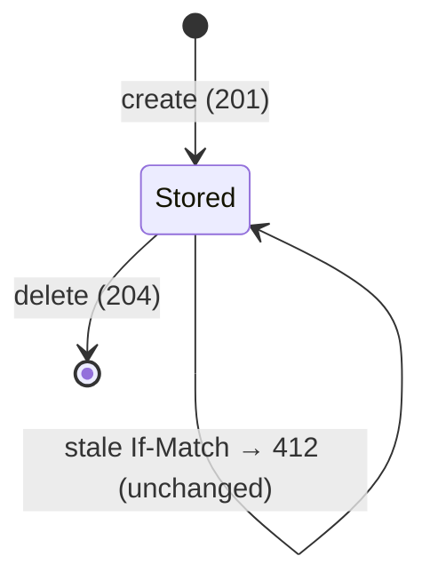

# Data Model: Activation register and activated-pack closure

## Activation slice (owned here)

### ActivationId (value object)

- An opaque id that is either minted by the service or chosen by the client (ADR-0020 D3).
- Grammar: the contract's `activationId` pattern.

### ActivationDocument (aggregate root; the `ActivationConfig` shape)

| Field | Type | Rules |
|---|---|---|
| schemaVersion | int | must be the supported version |
| packs | absent \| non-empty list of PackRef | absent means every configured pack; each `packId` once; order kept as written (merge order) |
| activatedKinds | absent \| set of kind | absent and `[]` both mean none (ADR-0053 d10); distinct on the wire |
| missionTypes | absent \| set of id | as above |
| languages | absent \| set of token | absent means no language filter |
| selected | map kind → absent \| set of id | as above, per kind |
| deactivated | map kind → non-empty set of id | an incoming empty list is a `422`; a list a reactivate empties is dropped |

**Invariants**

- **Canonical form.**
  - Allow lists are sorted and deduplicated (`packs` keeps its written order), and ids are stored as declared ids.
  - A deny list is never empty. `[]` is kept on every allow list.
- **Validation is closure-scoped.** Every id names an artifact held in the document's closure.
- **The floor is never denied.** No deny entry is written for a required or locked artifact. A stored one is tolerated
  but not applied.
- **No `null` anywhere.** The document is at most 1 MiB.

**Revision:** `sha256:` + hex(sha256(JCS(canonical document))).

### PackRef (value object; contract `PackPin`)

- `packId`, plus an optional `version`, which must equal the held version.

### Activation (stored record)

- `id`, `document`, `revision`. The answer envelope adds `_links` and nothing that depends on the offering
  (ADR-0059 D5).

### ActivationChange (result of a per-artifact or preset write)

- `revision`: the new revision.
- `applied`: `ArtifactReference` entries `{kind, artifactId}`, every id the write added to or removed from
  `selected`, `deactivated` or `missionTypes` (the contract's rule). A kind is never an entry, and a no-op has none. The contract has no
  provenance member; the `enhances` reason belongs to the effective reads (ADR-0059 D2.2).
- `cleared`: the deny entries removed, as `ArtifactReference` entries.
- `skipped`: the skipped report.

### SkippedReport

- `skippedByScope`.
- `skippedDeactivated`, each entry with `viaRequires` and `requiredBy`, which is empty for `enhances`.
- `unreachedBehindDeactivated`.
- `skippedShared`, each entry with the active artifact that still reaches it.

### State transitions (document level)

Each transition is a compare-and-set on the revision, under the per-id lock.

## Packs slice (extended)

| Element | Change |
|---|---|
| `PackCompositionResolver` | `resolveRooted(available, roots)`; public `compositionClosure` (depends_on and parent_pack; renamed from `closureOf`, whose private `depends_on`-only form stays as `dependsOnClosure`) |
| `PackCompositionFacts` | gains `edges: List<(source urn, relation, target ref)>` as written in graph documents |
| Closure facts (rooted compose) | per pack, in the offering's shape (`OfferingPack`: `packId`, `descriptorPackId`, level, name, version, `dependsOn: [ResolvedDependency]`), in dependency order |
| `PolicyFile` / `PerPackPolicy` (new) | `kind_defaults: Map<NodeKind, MutabilityLevel>`, `artifacts: Map<Urn, MutabilityLevel>`, keyed by pack; `levelIn(closure, urn)` returns the highest level along the closure and the pack that set it, shared with the registration write gate |
| `PackDescriptor` | gains optional `mutabilityPolicy` (pack-relative path) |
| `ClosureQueries` (application) | one verified read → the closure snapshot: closure facts, held URNs per kind, `requiredIn`, lock levels, presets |
| `Reachability` (application, PR B) | `reach(snapshot, starts, relations, stop, lineage)` on `GraphWalk` over typed edges; `enhances` is one of the relations a caller may ask for (ADR-0059 amendment R4: no `enhancersOf` and no pull) |

## Kernel

- `ArtifactKind.InForceWhenAbsent` collapses to "none" (ADR-0053 d10).
