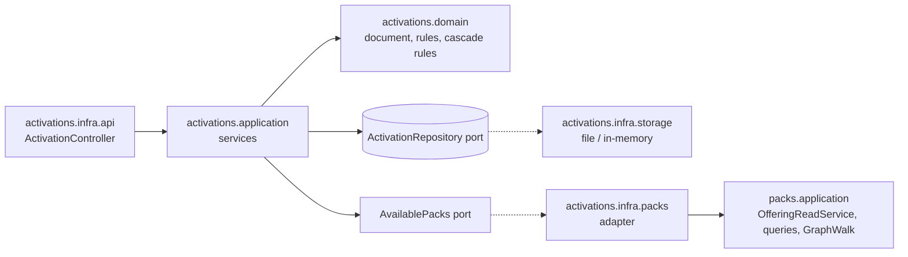

# Research: Activation register and activated-pack closure

Phase 0 findings. Each entry: Decision, Rationale, Alternatives considered. Code references are on branch
`issue-360-activated-closure`; `P/` is `service/packs/src/main/java/ai/speckitty/charter/packs/`.

## R1. Slice placement and the boundary with packs

- **Decision:** `activations` is a top-level slice that depends on `packs` (planning decision 2026-11-05). It owns
  only the activation document, its storage, its write rules and its HTTP adapter. Every question about pack content
  goes through one application-ring port, `AvailablePacks`. Its adapter, in `activations.infra.packs`, calls `packs`'
  public application services:
  - the rooted compose;
  - `holds` and `holderOf`;
  - the lock query;
  - the required floor;
  - preset lookup;
  - the edge helpers.
- **Rationale:** the operator ruled that activations reference packs and delegate content retrieval, with no shadow
  implementation (2026-11-05). One port keeps the domain testable with a fake, and the adapter is the only place that
  sees `packs`.
- **Alternatives considered:** activations inside `packs` (rejected by the operator); `packs` depending on activations,
  like `missions` (rejected: activations need packs, not the reverse).



## R2. Rooting the compose (#360)

- **Decision:** `PackCompositionResolver` gains `resolveRooted(available, roots)`. It runs the existing checks over
  the closure of the roots, where the closure follows `depends_on` and `parent_pack` through a public `compositionClosure` (renamed from `closureOf`),
  today private at `PackCompositionResolver.java:441`. `OfferingReadService.composed(roots)` reuses the fact reads at
  `OfferingReadService.java:173-199`, and `/offering` calls it with every configured pack, so its answer and its
  refusals do not change.
- **Rationale:** sibling contests and reference checks apply to what is composed (FR-011 of the pack-composition
  mission). One resolver serves both the offering and activations.
- **Alternatives considered:** resolve everything, then filter (rejected: an unrelated broken pack would refuse every
  activation); a separate closure walker in activations (rejected: shadow logic).
- **Open point:** version pins (`PackPin.version`). The catalog holds one version per pack id. A pin that differs from
  the held version is refused `422 activation_invalid` on write. Serving side-by-side versions (ADR-0033 D7) is out of
  scope.

## R3. Canonical form and the revision

- **Decision:** the canonical serialisation is RFC 8785 (JCS) over the document's JSON tree. The revision is
  `sha256:` followed by the lowercase hex of the UTF-8 bytes (ADR-0020 D4). An in-house canonicaliser walks
  Jackson's `JsonNode`: it sorts keys by UTF-16 code units, serialises numbers per ECMAScript (the document has no
  numbers besides `schemaVersion`, an integer), and escapes strings minimally.
- **Rationale:** about 80 lines of code; adds no dependency (DIRECTIVE_051); deterministic across JVM and native
  image.
- **Alternatives considered:** the `erdtman/java-json-canonicalization` library (rejected: a new supply-chain entry
  for little code). Reusing `PackRevision` (rejected: it is domain-tagged for packs, `PackRevision.java:43`).

## R4. File storage safety

- **Decision:** the activation's directory is `<config-root>/activations/<encoded id>/`, a reversible, case-safe
  encoding of the id (post-PR-A squad, WP17), holding `activation.json`. The file adapter writes `activation.json.tmp-<uuid>` in the activation's directory, fsyncs it, then
  moves it with `Files.move(..., ATOMIC_MOVE, REPLACE_EXISTING)` and fsyncs the directory where the OS allows. A
  per-id lock serialises compare-and-set per id (striped and bounded since WP17). Delete removes the file, then
  the directory. Stray temp files are ignored and cleaned up on the next write.
- **Rationale:** NFR-004 and NFR-005; a second process stays out of scope (#349, planning decision).
- **Alternatives considered:** an OS file lock now (rejected, planning decision); a single-file store holding all
  activations (rejected: contention, and ADR-0038's directory per domain).

## R5. The required floor and locks

- **Decision:** the floor is the must-have items (`Preset.required()`, `Preset.requiredMissionTypes()`) of every
  governing preset in the activation's closure. This is the operator's default assumption, logged as an open review
  item. Locks come from each pack's mutability policy file, read by `packs` (new, ADR-0063) into the existing
  `MutabilityPolicySource`. A later pack may raise an artifact's level but never lower it (ADR-0012 D3), so the
  effective level is the maximum along the closure. Refusals:
  - denying a required artifact answers `409 artifact_required` with `requiredBy` naming the pack;
  - denying a locked artifact answers `409 artifact_locked`;
  - a stored deny entry on either is kept but not applied (ADR-0013 D2).
- **Rationale:** ADR-0031 and ADR-0042 (requirement is a preset). ADR-0012 D2 (the policy file, ruled 2026-11-05).
- **Alternatives considered:** only applied presets bind (rejected: needs applied-preset memory, which ADR-0020 left
  out); locks deferred (rejected by the operator).

## R6. The policy-file format (ADR-0063)

- **Decision:** an optional descriptor key `mutability_policy: <pack-relative path>`, naming the policy file; the
  descriptor schema constrains the path to `policy.yaml` for now, and ADR-0063 records the choice. The file is validated by a
  closed `policy.schema.json`:

  ```yaml
  schema_version: 1
  kind_defaults:            # kind token -> open | extendable | locked
    directive: extendable
  artifacts:                # urn -> level
    directive:DIRECTIVE_001: locked
  ```

  Role locks and pins (ADR-0030) are reserved and absent. If the descriptor names a file that is missing or
  unreadable, the pack is unreadable (`pack_unreadable`). A pack without a policy file is all `open`. The whole-pack
  write surface and the derived manifest carry the file as a pack-level file (ADR-0042).
- **Rationale:** the operator chose this format (2026-11-05). It keeps one concern per file.
- **Open-packs follow-up:** no pack ships a policy file today (ADR-0030 Risks), so nothing breaks. A changelog note
  tells open-packs the key exists.

## R7. Graph edges for the cascade (PR B)

- **Finding:** graph-document edges (`enhances`, `overrides`, `specializes_from`) are read only inside
  `DomainRepositoryService.compositionFacts` (`P/infra/storage/DomainRepositoryService.java:314-344`). There they are
  flattened to targets, so no reverse lookup or ancestry is possible. `CompositeComponentResolver` dispatches only five
  kinds (`P/application/CompositeComponentResolver.java:193-216`).
- **Decision:** `PackCompositionFacts` carries typed edges `(source, relation, target)` as written. Pure domain
  helpers over a closure walk them:
  - forward, filtered by relation set (follows `<pack>::` through `holderOf`);
  - reverse, for `enhances`;
  - ancestors, over `specializes_from`.
  The component relationships (`requires` and `suggests` from typed references, `ArtifactEdges.build`) and the
  registered shard edges (`PackWriteStore.registeredRelationships`) join the same edge set. One walk then sees every
  relation of every graph-authored kind.
- **Rationale:** the cascade must reach profiles and procedures, and must pull enhancers. `GraphWalk` remains the
  single traversal; activations supply only the rules (relation set, scope, stop-at-deny).
- **Alternatives considered:** extending `CompositeComponentResolver` to every kind (rejected for this mission: it
  resolves full components, while the cascade needs only edges and ids).

## R8. Absent means none

- **Decision:** the kernel's `ArtifactKind.InForceWhenAbsent` changes to a single meaning, none (ADR-0053 d10, ruled
  for the service now). Every user of it is updated, and the contract descriptions of `ActivationConfig` are reworded.
  A divergence-register entry covers the time until core's named-packs split.
- **Rationale:** discovery decision 2026-11-05.
- **Alternatives considered:** keep the per-kind default until the split (rejected by the operator).

## R9. The reserved-operation machinery

- **Finding:** building an operation means removing its `x-reserved` marker and its `@reserved` pin in
  `activations.feature`, and lowering the count in `ReservedOperationCoverageTest` (13 → 9 after PR A, → 5 after the per-artifact writes, → 4 after
  PR B). The `ReservedOperationInterceptor` keeps serving the effective reads.

## Squad dispositions (post-plan, 2026-11-05)

Cast: `architect-alphonso`, whose verdict was SOUND-WITH-FIXES; `reviewer-renata`, NOT-READY; `researcher-robbie`,
GAPS-FOUND.

Every finding has exactly one disposition:

- **accepted**: the finding is valid and the artifact changed. The location of the change is given.
- **changed**: the concern was resolved another way.
- **deferred**: the finding is valid but deferred, with a reason.

| # | Finding | Disposition | Where |
|---|---|---|---|
| R1 | FR-003 428 on an unconditional replace contradicts ADR-0020 D6 | accepted | spec FR-003, US1 AS4; plan IC-06 |
| R2 | `via` is not a contract field | accepted (dropped; provenance is effective-read work per ADR-0059 D2.2) | spec FR-012/013, US3; data-model |
| R3 | stale-id flag has no home and breaks the strong ETag | accepted (read half moves to the effective reads) | spec FR-017, Edge Cases |
| R4 | empty deny list is a 422 | accepted | spec FR-006, US1 AS7 |
| R5 | path unknown id is 404; `includeDeactivated`, `mission_type` and the `["all", kind]` mix are missing | accepted | spec FR-010–013, US3 AS3/7/8 |
| R6 | absent-means-none contract text drift; ADR-0050 | accepted / changed (ADR-0050 move out of scope, assumption) | plan IC-06 contract A; spec Assumptions |
| R7 | durability not provable on the in-memory adapter | accepted | spec NFR-005; plan IC-06 |
| R8 | FR-022/023 have no scenarios | accepted | spec US1 AS6, US6 |
| R9 | BDD wiring: coverage scan and binding pin | accepted | plan IC-06, IC-09 |
| R10 | reserved count | accepted (13 → 9 → 4) | plan IC-06, IC-09 |
| R11 | vacuous US3 AS4 and missing no-op cases | accepted | spec US3 AS5, US4 AS4, US5 AS2 |
| R12 | both validators sent; `<pack>::` outside the closure | accepted | spec Edge Cases |
| R13 | `skippedShared` active set inconsistent | accepted (selected + floor) | spec Assumptions; plan IC-08 |
| R14 | `summary` home and 304 left unsettled; ADR-0059 not on the base | accepted | plan IC-06 contract A; spec C-004 |
| B1 | ADR-0059 revised 2026-11-05 contradicts the 13:15 decisions | accepted (later operator rulings supersede) | spec Context, FR-013/014, US3/US4; plan IC-08 |
| B2 | `dependsOn` must reuse the offering shape | accepted (items are `OfferingPack`) | spec FR-009; plan IC-03/06 |
| B3 | #360's acceptance points at the offering | accepted (issue comment at PR A) | spec Assumptions; plan IC-10 |
| B4 | the plan rebuilds If-Match and the body guard | accepted (moved and shared) | plan IC-01 |
| B5 | `MutabilityPolicySource` is global; the write gate; ADR-0012 D4/D5 | accepted (`PerPackPolicy`, shared function, ADR-0063 cites D4/D5) / deferred (built-in policy file and migration: no pack ships one; follow-up issue) | plan IC-03 |
| B6 | open-PR collisions | accepted | plan "Rebase order" and the IC notes |
| B7 | `ReservedRefusalCodesTest`, raised flags, #125 build notes | accepted | plan IC-06, IC-09 |
| B8 | doc list incomplete; DIV numbering | accepted | plan IC-10; spec C-006 |
| B9 | skill's REQUIRED default disappears | accepted (divergence entry) | spec C-006 |
| A1 | domain must not reach the application port | accepted (`ClosureSnapshot` value) | plan Structure Decision, IC-05 |
| A2 | N composes per request | accepted (one verified snapshot) | spec NFR-007; plan IC-03 |
| A3 | rooted compose still reads every pack | accepted | plan IC-02; spec US2 AS2 |
| A4 | reserved-operation machinery cannot be split per method | accepted | plan IC-01 |
| A5 | traversal split-brain risk | accepted (`reach` in packs only) | plan IC-07/08 |
| A6 | per-pack policy and a shared resolution | accepted | plan IC-03 |
| A7 | shared transport home | accepted | plan IC-01 |
| A8 | thin mirrors; kinds from `ArtifactKind.activatable()` | accepted | plan IC-05 (no new kind list) |
| A9 | cross-slice adapter rule undocumented | accepted | plan IC-04 |
| A10–12 | notes (offering unchanged, wiring feasible, PR split coherent) | accepted (no change) | — |
| B1b | The 13:15 discovery decisions (`DM-01M6NXERTNKMWK4MTDTX48358B` write-time `enhances`, `DM-01M6NXKAHRQNR4RK14FFJN2TVM` lineage over every relation) are superseded by ADR-0059 D2.2/D2.4 as revised 2026-11-05 | changed (decision records kept as history; the spec, plan and WPs follow ADR-0059) | spec Context; tasks.md header; WP12 Risks |

## Squad dispositions (post-PR B, 2026-11-06)

Two lenses (correctness against the rulings; tests, contract and architecture) on WP11–WP14, then an independent
re-review of the fixes. Folded on lane-m (369063b..ac1faa9 and the re-review follow-ups) and in the docs.

| # | Finding | Disposition | Where |
|---|---|---|---|
| F1 | A stale deny entry on a now-required artifact made every later write `409` | changed: per-artifact and preset writes judge the floor only on the deny entries they add; create and replace judge the whole document | `DocumentRules.checkWrite`; DIV-204 |
| F2 | A floor artifact became a cascading-deactivate candidate | changed: the floor is never a candidate | `CascadeRules` |
| F3 | A template or asset predecessor answered `500`; `referencedBy` could name an ancestor or an inactive intermediate | changed: back-walk to the nearest nameable or active artifact, code-point tie-break | `Predecessors` |
| F4 | `includeDeactivated` left out-of-scope deny entries it walked through | changed: it clears what the walk went through, whatever the scope; an out-of-scope artifact is cleared, not selected. **Fixers' reading of the contract text, not stated in FR-013 or ADR-0059: operator to confirm** | contract `SelectionRequest`; DIV-207 |
| F5 | The write-time `enhances` pull ignored `activatedKinds` | changed: bounded by `activatedKinds` (absent means none). Spec US3 AS3 does not state that precondition | `CascadeRules.pullKinds`; DIV-207 |
| F6 | A bad body answered `422` before `428`/`404`/`412` | changed: body faults deferred to the `422` step on the five writes; `415` still comes first | `DeferredBody` |
| F7 | `400`, `409` and the stale-preset `422` undeclared | changed: `400` on five operations, `409` on deactivate only, the `422` documented | contract paths |
| F8 | A mission type is never in a cascade's scope | kept: javadoc and docs corrected, pinned by a test | `CascadeRules` |
| F9 | A deactivate's own walk does not follow lineage, a select's does | kept per FR-015's literal "five relations": **open question for the operator** | `CascadeRules.planDeactivate` |
| F10 | Test gaps: lineage-blind fake graph, NFR-006 timing, NFR-004 select race, native hints for response types | changed: all four added; CI runs `:activations:timingBudgets` report-only | tests; `service.yml` |
| R1 | Scalar coercion and duplicate members let wrong bodies commit | changed (re-review follow-up) | `ActivationBodyAdvice` |
| R2 | A floor member with no active referrer named itself in `referencedBy` | changed: left out of `skippedShared` | `CascadeRules` |
| R3 | Constructors without ancestry could yield an empty `requiredBy` | changed: removed | `Reach`, `ReachResult` |

## Open review items (logged, not silent)

1. The required floor is closure-scoped (R5), an assumed default flagged to the operator on 2026-11-05.
2. A version pin that differs from the held version is refused rather than served side by side (R2).
3. ADR-0059 open questions 1 and 4 (do reserved `501` pins count toward the gate; edges of an overridden artifact)
   remain unruled. This mission's NFR-002 keeps every built operation on a behavioural scenario, and no layer merge is
   built here.
4. A preset "lists" a key when its file holds at least one member for it; a key with an empty list counts as not
   listed (the packs `Preset` record cannot tell an absent key from an empty one). Assumed default, applied in FR-016
   and WP14.
5. A deactivate's own cascade does not follow lineage (F9), while a select's does: FR-015 read literally. Awaiting
   the operator.
6. `includeDeactivated` clears out-of-scope deny entries it walks through (F4), and the write-time pull is bounded by
   `activatedKinds` (F5). Both follow the contract text; neither is spelled out in ADR-0059. Awaiting confirmation.
7. A document a pack upgrade made stale is a dead end for the per-artifact writes. While it stores an id the closure
   no longer holds, every per-artifact and preset write is `422` (every id of the computed document is judged), and
   an unselect or re-activate of that id is `404 artifact_not_found` (`requireHeld` checks the path id against the
   closure). Only a full `replaceActivation` recovers it. Documented in the five write descriptions and in
   `offering-and-activation.md`; whether a per-artifact write should tolerate a stale id, or an unselect and a
   re-activate remove one, awaits the operator.
