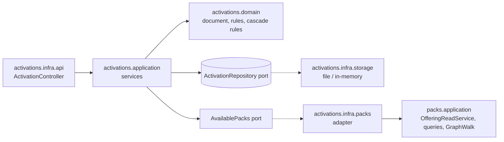

# Research: Activation register and activated-pack closure

Phase 0 findings. Each entry: Decision, Rationale, Alternatives considered. Code references are on branch
`issue-360-activated-closure`; `P/` is `service/packs/src/main/java/ai/speckitty/charter/packs/`.

## R1. Slice placement and the boundary with packs

- **Decision:** `activations` is a top-level slice that depends on `packs` (planning decision 2026-11-05). It owns
  only the activation document, its storage, its write rules and its HTTP adapter. Every question about pack content
  goes through one application-ring port, `AvailablePacks`. Its adapter, in `activations.infra.packs`, calls `packs`'
  public application services:
  - the rooted compose;
  - `holds` and `holderOf`;
  - the lock query;
  - the required floor;
  - preset lookup;
  - the edge helpers.
- **Rationale:** the operator ruled that activations reference packs and delegate content retrieval, with no shadow
  implementation (2026-11-05). One port keeps the domain testable with a fake, and the adapter is the only place that
  sees `packs`.
- **Alternatives considered:** activations inside `packs` (rejected by the operator); `packs` depending on activations,
  like `missions` (rejected: activations need packs, not the reverse).



## R2. Rooting the compose (#360)

- **Decision:** `PackCompositionResolver` gains `resolveRooted(available, roots)`. It runs the existing checks over
  the closure of the roots, where the closure follows `depends_on` and `parent_pack` through a public `closureOf`,
  today private at `PackCompositionResolver.java:441`. `OfferingReadService.composed(roots)` reuses the fact reads at
  `OfferingReadService.java:173-199`, and `/offering` calls it with every configured pack, so its answer and its
  refusals do not change.
- **Rationale:** sibling contests and reference checks apply to what is composed (FR-011 of the pack-composition
  mission). One resolver serves both the offering and activations.
- **Alternatives considered:** resolve everything, then filter (rejected: an unrelated broken pack would refuse every
  activation); a separate closure walker in activations (rejected: shadow logic).
- **Open point:** version pins (`PackPin.version`). The catalog holds one version per pack id. A pin that differs from
  the held version is refused `422 activation_invalid` on write. Serving side-by-side versions (ADR-0033 D7) is out of
  scope.

## R3. Canonical form and the revision

- **Decision:** the canonical serialisation is RFC 8785 (JCS) over the document's JSON tree. The revision is
  `sha256:` followed by the lowercase hex of the UTF-8 bytes (ADR-0020 D4). An in-house canonicaliser walks
  Jackson's `JsonNode`: it sorts keys by UTF-16 code units, serialises numbers per ECMAScript (the document has no
  numbers besides `schemaVersion`, an integer), and escapes strings minimally.
- **Rationale:** about 80 lines of code; adds no dependency (DIRECTIVE_051); deterministic across JVM and native
  image.
- **Alternatives considered:** the `erdtman/java-json-canonicalization` library (rejected: a new supply-chain entry
  for little code). Reusing `PackRevision` (rejected: it is domain-tagged for packs, `PackRevision.java:43`).

## R4. File storage safety

- **Decision:** the file adapter writes `activation.json.tmp-<uuid>` in the activation's directory, fsyncs it, then
  moves it with `Files.move(..., ATOMIC_MOVE, REPLACE_EXISTING)` and fsyncs the directory where the OS allows. A
  `ConcurrentHashMap<ActivationId, ReentrantLock>` serialises compare-and-set per id. Delete removes the file, then
  the directory. Stray temp files are ignored and cleaned up on the next write.
- **Rationale:** NFR-004 and NFR-005; a second process stays out of scope (#349, planning decision).
- **Alternatives considered:** an OS file lock now (rejected, planning decision); a single-file store holding all
  activations (rejected: contention, and ADR-0038's directory per domain).

## R5. The required floor and locks

- **Decision:** the floor is the must-have items (`Preset.required()`, `Preset.requiredMissionTypes()`) of every
  governing preset in the activation's closure. This is the operator's default assumption, logged as an open review
  item. Locks come from each pack's mutability policy file, read by `packs` (new, ADR-0061) into the existing
  `MutabilityPolicySource`. A later pack may raise an artifact's level but never lower it (ADR-0012 D3), so the
  effective level is the maximum along the closure. Refusals:
  - denying a required artifact answers `409 artifact_required` with `requiredBy` naming the pack;
  - denying a locked artifact answers `409 artifact_locked`;
  - a stored deny entry on either is kept but not applied (ADR-0013 D2).
- **Rationale:** ADR-0031 and ADR-0042 (requirement is a preset). ADR-0012 D2 (the policy file, ruled 2026-11-05).
- **Alternatives considered:** only applied presets bind (rejected: needs applied-preset memory, which ADR-0020 left
  out); locks deferred (rejected by the operator).

## R6. The policy-file format (ADR-0061)

- **Decision:** an optional descriptor key `mutability_policy: <pack-relative path>`. The file is validated by a
  closed `policy.schema.json`:

  ```yaml
  schema_version: 1
  kind_defaults:            # kind token -> open | extendable | locked
    directive: extendable
  artifacts:                # urn -> level
    directive:DIRECTIVE_001: locked
  ```

  Role locks and pins (ADR-0030) are reserved and absent. If the descriptor names a file that is missing or
  unreadable, the pack is unreadable (`pack_unreadable`). A pack without a policy file is all `open`. The whole-pack
  write surface and the derived manifest carry the file as a pack-level file (ADR-0042).
- **Rationale:** the operator chose this format (2026-11-05). It keeps one concern per file.
- **Open-packs follow-up:** no pack ships a policy file today (ADR-0030 Risks), so nothing breaks. A changelog note
  tells open-packs the key exists.

## R7. Graph edges for the cascade (PR B)

- **Finding:** graph-document edges (`enhances`, `overrides`, `specializes_from`) are read only inside
  `DomainRepositoryService.compositionFacts` (`P/infra/storage/DomainRepositoryService.java:314-344`). There they are
  flattened to targets, so no reverse lookup or ancestry is possible. `CompositeComponentResolver` dispatches only five
  kinds (`P/application/CompositeComponentResolver.java:193-216`).
- **Decision:** `PackCompositionFacts` carries typed edges `(source, relation, target)` as written. Pure domain
  helpers over a closure walk them:
  - forward, filtered by relation set (follows `<pack>::` through `holderOf`);
  - reverse, for `enhances`;
  - ancestors, over `specializes_from`.
  The component relationships (`requires` and `suggests` from typed references, `ArtifactEdges.build`) and the
  registered shard edges (`PackWriteStore.registeredRelationships`) join the same edge set. One walk then sees every
  relation of every graph-authored kind.
- **Rationale:** the cascade must reach profiles and procedures, and must pull enhancers. `GraphWalk` remains the
  single traversal; activations supply only the rules (relation set, scope, stop-at-deny).
- **Alternatives considered:** extending `CompositeComponentResolver` to every kind (rejected for this mission: it
  resolves full components, while the cascade needs only edges and ids).

## R8. Absent means none

- **Decision:** the kernel's `ArtifactKind.InForceWhenAbsent` changes to a single meaning, none (ADR-0053 d10, ruled
  for the service now). Every user of it is updated, and the contract descriptions of `ActivationConfig` are reworded.
  A divergence-register entry covers the time until core's named-packs split.
- **Rationale:** discovery decision 2026-11-05.
- **Alternatives considered:** keep the per-kind default until the split (rejected by the operator).

## R9. The reserved-operation machinery

- **Finding:** building an operation means removing its `x-reserved` marker and its `@reserved` pin in
  `activations.feature`, and lowering the count in `ReservedOperationCoverageTest` (13 → 8 after PR A, → 4 after
  PR B). The `ReservedOperationInterceptor` keeps serving the effective reads.

## Open review items (logged, not silent)

1. The required floor is closure-scoped (R5), an assumed default flagged to the operator on 2026-11-05.
2. A version pin that differs from the held version is refused rather than served side by side (R2).
3. ADR-0059 open questions 1 and 4 (do reserved `501` pins count toward the gate; edges of an overridden artifact)
   remain unruled. This mission's NFR-002 keeps every built operation on a behavioural scenario, and no layer merge is
   built here.
