# Implementation Plan: Step enhancements and prompt fragments in the charter service

**Branch**: `issue-424-428-adr-0066-service-alignment` (rebased on `main` 391ed51b) | **Date**: 2026-11-09 | **Spec**: [spec.md](spec.md)
**Input**: Mission specification from `kitty-specs/adr-0066-step-enhancement-service-alignment-01M6ZRYK/spec.md`, the
Phase A brief [research/grounding.md](research/grounding.md) with the operator's rulings of 2026-11-09 (D1–D22), and
the squad reports under [research/squad/](research/squad/).

**Note**: This template is filled in by the `/spec-kitty.plan` command. See `packs/built-in/missions/mission-steps/software-dev/plan/prompt.md` for the execution workflow.

The planner will not begin until all planning questions have been answered—capture those answers in this document before progressing to later phases.

**Planning questions.** The operator ruled D1–D12 and D19–D21 on 2026-11-09; [research.md](research.md) records each
as Decision / Rationale / Alternatives. D13, D14 and D23 were ruled on 2026-11-09 as OD-1 (B), OD-2 (A) and OD-12.

**Plan-point squad (2026-11-09).** Three lenses reviewed this plan
([contract](research/plan-squad/contract.md) C-01..C-15, [architecture](research/plan-squad/architecture.md) A1..A13,
[tests](research/plan-squad/tests.md) T-01..T-21). Every one of the 49 findings has a disposition in
[research/plan-squad/dispositions.md](research/plan-squad/dispositions.md): 36 folded into this plan and its companion
artifacts after a check against the code at `92026b5d`, 13 merged into the operator items below, none rejected and none
dropped. The items that needed the operator were ruled on 2026-11-09; the rulings, and each item's options as the
record, are in [Operator decisions (plan point, 2026-11-09): ruled](#operator-decisions-plan-point-2026-11-09-ruled). Earlier drafts named N1–N3; N1 is now OD-3 there, N2
sits under OD-2 (D14) and N3 is OD-5.

## Split into two missions (operator ruling, 2026-11-09)

The operator ruled on 2026-11-09 to split this mission into two, one per phase. The rulings table in
[Operator decisions (plan point, 2026-11-09): ruled](#operator-decisions-plan-point-2026-11-09-ruled) stays intact and
binds both missions.

- **Phase 1, this mission** (work packages WP01–WP06; closes #428, refers to #424): IC-01, IC-02, IC-03, IC-04 and the
  phase-1 parts of IC-08: the ADR-0053 open question 2 annotation (D7), the guard/emit shape annotation (D6, #434),
  the OD-3 (a) load-moment note, the schema pages and the rules page's load rules. It edits no PR C-owned file
  (C-004).
- **Phase 2, the phase-2 mission** (tracked in #438, created by the run lead on its own branch; closes #424):
  IC-05, IC-06, IC-07 and the phase-2 parts of IC-08: the ADR-0066 decision 8 (OD-1) and decision 7 (OD-2)
  annotations, the conceptual-model integrity note (OD-2), the rules page's compose rules and effective step prompt,
  the operation and status lists (C-11), the glossary term and the phase-2 changelog. It is blocked until PR C of
  `layer-merge-and-effective-reads-01M6R0J6` (WP27–WP29, #429, the OD-6 E6 amendment, the OD-9 shared predicate)
  merges **and** this mission merges. It re-plans after PR C merges, using as input the IC-05, IC-06 and IC-07
  sections below (kept as the record), the IC-08 phase-2 bullets, the rulings table, and the parked work packages
  WP07–WP11 and contract draft held with the phase-2 mission's material.

The moved IC headings below are marked "(moved to the phase-2 mission)". Their text is kept unchanged as the record of
what was planned; it does not bind this mission's work packages.

## Summary

ADR-0066 lets a step enhancement add Markdown prompt fragments into named, empty slots of the step prompt it
enhances. #425 landed the contracts (schemas, file kinds, four reserved refusal codes). The service still drops a step
enhancement in three ways (validated by the inspector, skipped by the store, refused as unmodelled by a whole-pack
registration), never defines its URN for the merge, runs none of the ADR-0066 checks, and has no read of the prompt a
step really gets. The two missions together close #424 and #428; this mission (phase 1) closes #428 and does the
first two bullets, and the phase-2 mission does the last two:

- **Held (before PR C).** A `StepEnhancement` entity and its `KindBinding`, appended to `KindBindings.ALL` so no
  existing fingerprint moves (NFR-001); each `*.prompt-fragment.md` held as its companion and written back at its path
  (ADR-0036). The URN joins `defined` through the binding, so it wins or loses the layer merge and is selectable
  directly and through presets (FR-001..003).
- **Checked at load (before PR C).** The enhancement and fragment rules (`prompt_fragment_invalid`, FR-004..006) and
  the base-prompt slot rules (`prompt_slot_malformed` always; `prompt_slot_not_empty` behind the descriptor-version
  gate, a warning for an unversioned descriptor, FR-007). Three of the four reserved codes become raised (FR-011), in
  the sense OD-3 rules.
- **Checked at compose (after PR C; the phase-2 mission).** `prompt_slot_missing` when the prompt in force does not declare a named slot,
  the enhancement's target step resolved across the `depends_on` closure, and the target's integrity (adr-0066-phase-2-compose-checks-and-effective-prompt-01M70271#FR-001, adr-0066-phase-2-compose-checks-and-effective-prompt-01M70271#FR-002;
  D13/D14 ruled 2026-11-09 as OD-1 (B) and OD-2 (A)).
- **Served (after PR C; the phase-2 mission).** A new built operation `getEffectiveStepPrompt`,
  `GET /activations/{activationId}/mission-types/{missionType}/actions/{action}/prompt` (`### Added`, D5): the prompt in
  force rendered from the held document with equal meaning, every declared slot listed, each with its active fragments
  in the ADR-0066 decision 5 order and their provenance (adr-0066-phase-2-compose-checks-and-effective-prompt-01M70271#FR-003). It reuses WP27's action walk and PR C's
  `NodeReference` (D2).

The guard and emit additions are recorded as fields, not edges, and are not built (D6, #434). The layout
`missions/<type>/enhancements/` is kept and annotated on ADR-0053 open question 2 (D7). No new ADR is written.

## Technical Context

**Language/Version**: Java 25 (Temurin), toolchain provisioned by CI (`org.gradle.java.installations.auto-download=false`);
Gradle 9.8.1 wrapper with Kotlin DSL convention plugins in `build-logic/`.
**Primary Dependencies**: the existing stack only, from `gradle/libs.versions.toml`: Spring Boot 4.1.1 (webmvc,
validation), the generated `charter-api` interfaces and DTOs (openapi-generator `spring`, `interfaceOnly`, `useTags`,
`skipDefaultInterface`), Jackson 3, snakeyaml-engine 3.2, networknt JSON Schema, re2j 1.8 for pattern matching, the
in-house `MarkdownCodec` (`packs.infra.storage.markdown`). **No dependency is added** (see
[Supply chain](#supply-chain-directive_051)).
**Storage**: the file-backed pack store: one directory per configured pack (`<config-root>/packs/<packId>/`, ADR-0038),
read through `PackFileSet`, `WholePackStore` and `DomainRepositoryService`; writes through `PackCommitStore`. Step
enhancements live at `missions/<type>/enhancements/<id>.step-enhancement.yaml` with companions beside them (C-006).
Activations unchanged.
**Testing**:

- `@contract` Cucumber-JVM 8.0.4 scenarios under `contracts/charter/scenarios/`, written red first and bound through
  `CharterContractSuite` (JUnit Platform suite, `UndefinedStepGuard`), with the existing step vocabulary
  (`scenarios/README.md`): fixture packs authored inline per rule.
- JUnit Jupiter 6.1.3 unit tests with AssertJ, per rule, on temp-dir packs (`FileSystemPackInspectorTest`,
  `WholePackStoreTest`, `MissionTypeBindingTest`, `DomainRepositoryServiceTest`, `LayerMergeTest`); one corpus test per
  kind round trip, as `GuardAndLifecycleYamlTest` does for guards.
- ArchUnit 1.5.1: `HexagonalArchitectureTest`, `ReservedRefusalCodesTest`; trace gates `OperationCoverageTest`,
  `ReservedOperationCoverageTest`.
- The adr-0066-phase-2-compose-checks-and-effective-prompt-01M70271#NFR-002 operation-count gate in `:activations:test`, modelled on `EffectiveReadOperationBudgetTest` *(phase-2 mission, #438)*.
- `:packs:openPacksRoundTrip` (in `check`) and `:packs:wholePackRoundTrip` (tag `whole-pack`, required through
  `CI gate / gate`), both with `-PopenPacksDir`.

**Target Platform**: the charter service (JVM jar and GraalVM native image, loopback daemon per worktree, container
profile of ADR-0041); Linux and macOS hosts.
**Project Type**: single multi-module Gradle service (`service/{kernel,missions,packs,activations,web-transport,deployable,…}`),
with the contract in `contracts/`.
**Performance Goals** *(phase-2 mission, #438)*: none in this mission; its quantitative goals are NFR-001 and NFR-002 under
Constraints. The two bullets below are the record of what the phase-2 mission measures.

- adr-0066-phase-2-compose-checks-and-effective-prompt-01M70271#NFR-001: the prompt read's body **and ETag** are identical across 100 repeated reads and across every permutation of
  the closure's configured pack order (≥ 3 packs). Order is a total order on (level, the pack's descriptor `name`,
  enhancement id) by code point, never activation, configured or iteration order. The answer carries `packName`, so
  a client can check the order (C-04). Nothing is excluded from the comparison: if the fingerprint depends on the
  configured order, that is a defect to fix, not a field to skip (T-09).
- adr-0066-phase-2-compose-checks-and-effective-prompt-01M70271#NFR-002: the prompt read's work is at most linear in the number of step enhancements in the closure. It is counted,
  never timed, through named hooks, at two sizes (1,000 and 2,000 valid enhancements). The counts asserted are one
  compose, one in-force resolution, one canonical render, one slot parse of the prompt in force, the digest counts
  of the effective-read gate, cold and warm, and enhancement visits that grow by at most the delta between the two
  sizes. The per-slot sort (O(k log k) in the fragments of one slot) is excluded from the visit count, and the test
  says why (T-10).

**Constraints**:

- NFR-001: packs without step enhancements keep a byte-identical source fingerprint (0 digest changes across every
  pack at the pin that holds no `enhancements/` directory: at `22c14b2` all five, built-in, `cave-kitty`,
  `event-driven`, `internal` and `qa`); the binding is
  appended, never inserted. **Baseline (T-04):** the `digestOfPack` values of those packs are captured on WP01's base
  commit at `openPacksRef=22c14b2d`, **before** IC-01 adds the binding (WP01 T001). They are pinned as
  constants in an `open-packs`-tagged test, as `PackFileSetTest:100-109` pins a value captured earlier. A positive
  control shows that a fixture pack with one enhancement changes its digest, and that editing only a fragment's bytes
  changes the fingerprint and the new read's ETag.
- NFR-002: the packs at `openPacksRef=22c14b2d` load with 0 new refusals; the five built-in `spdd:reasons-block` slots
  hold text under an unversioned `pack.yaml`, so they yield warnings only (verified: 10 markers, 5 prompts, no
  `schema_version` in any pinned `pack.yaml`).
- C-001 contract versioning with dated fragments; C-003 graph-only relationships; C-004 the PR C boundary.
- Checkstyle limits (CC ≤ 15, NPath ≤ 1000, ≤ 60 lines, nested-if depth ≤ 1), no new suppressions, no disabled tests.
- Native-image friendly: no reflection-driven discovery; the binding is registered in the static `KindBindings.ALL`.

**Scale/Scope** (this mission): one new kind binding; three load rule families; one new member on the registration
result (OD-7); changes in `kernel` (the slot grammar `kernel.markdown.PromptSlots` and `SlotId`, A1), `packs`,
`deployable` (tests), contracts and docs. `missions` and `activations` are unchanged. No new Gradle module. The new
operation and its four closed schemas, the compose rule family and the `activations` changes are the phase-2
mission's (#438).

## Charter Check

*GATE: Must pass before Phase 0 research. Re-check after Phase 1 design.*

| Charter rule (`.kittify/charter/charter.md`) | How the plan meets it | Result |
|---|---|---|
| Never diverge from the charter's own model | ADR-0066 d1–d9, ADR-0053 d22, ADR-0064 are the model. The target stays an edge (C-003); the layout and id rules are the operator's (D7, D8). Judged against the charter's model and packs, not core (epic #186). | Pass |
| Never break the OpenAPI contract | 0.x line, no released baseline: every edit lands with a dated fragment: `### Changed` (raised codes, the amended `raised` definition, selection 404→200), `### Breaking` (content refused that loaded before; the registration result's new `diagnostics` member) (C-001, ADR-0022). `### Added` (new read) and the compose refusal are the phase-2 mission's (#438). | Pass |
| Round trip without loss of meaning | Enhancements and fragments become held and written back (C-002); orphans are refused, never dropped (D11). Packs without them keep their digest (NFR-001). | Pass |
| No unverified dependency | None added. | Pass |
| How work lands: mission, PR, adversarial squad at plan and pre-merge | This is a governed mission. The plan-point squad (contract, architecture and test lenses) has run and every finding is dispositioned. A squad runs again before merge, then the operator approves. | Pass |
| A call made without review is logged | Every open question was ruled by the operator on 2026-11-09 (OD-1..OD-12, D4b; [ruled table](#operator-decisions-plan-point-2026-11-09-ruled)); none was decided by the plan. Each of the 49 squad findings is dispositioned in [dispositions.md](research/plan-squad/dispositions.md). | Pass |
| Gates before merge: `verifyAll` on Java 25 | Each concern names the gates it touches and how they stay green honestly ([gate map](#gates-and-how-each-stays-green)). `verifyAll` runs once at closeout. | Pass |
| `:packs:wholePackRoundTrip` required | Binding `step-enhancement` enters `modelledKinds`; built-in has none, so `expected-red.yaml` gains `empty_kinds: step-enhancement` (#428, D20), with the reason text ruled 2026-11-09 (OD-11) naming where the kind round-trips. | Pass |
| Docs checks (`check_docs.py`, markdownlint-cli2, cspell) | IC-08 runs them on the ADR annotations, rules page, schema pages and changelog. | Pass |
| BDD / specification by example | Scenarios first for every contract behaviour change (C-007): selection, presets, registration acceptance and refusals, the read-side `pack_unreadable`, the registration `diagnostics`. The compose refusal and the new read are the phase-2 mission's (#438). | Pass |
| Test first, no fake green | Every refusal has a failing fixture and a passing twin that differ only in the fault (SC-002). Each "nothing changed" gate has a positive control (T-04, T-11, T-17; T-18 is the phase-2 mission's). Expectation edits are the approved set D19, plus the addendum OD-10, ruled 2026-11-09 (rows 1–8 approved as a set; rows 9, 10 and 11 approved separately the same day; rows 1–4 and 6–11 are this mission's, row 5 the phase-2 mission's). No assertion edit outside D19 and OD-10; the A8 fixture setup in `FileSystemPackInspectorTest` is setup, not an assertion edit, and WP04 stops if any other assertion must change. | Pass |
| DDD vocabulary | Domain Language of the spec: step enhancement, prompt fragment, slot, prompt in force, effective prompt; data-model.md. | Pass |
| C4 | [Component view](#component-view-c4-level-3) (its read-side components are the phase-2 mission's). | Pass |
| Designing during the rewrite | No core change, no core ordering. `org-charter.yaml` (#431) is not touched; if a concern meets it, it cites #431 and escalates. | Pass |
| Supply-chain safety (DIRECTIVE_051) | [Supply chain](#supply-chain-directive_051). | Pass |

No violations. Re-checked after Phase 1 design: unchanged.

## Project Structure

### Documentation (this mission)

```text
kitty-specs/adr-0066-step-enhancement-service-alignment-01M6ZRYK/
├── spec.md
├── plan.md              # This file
├── research.md          # Decision records D5–D12, D19–D21, D13/D14 resolved as OD-1/OD-2 (evidence in research/grounding.md)
├── data-model.md        # StepEnhancement, PromptFragment, Slot, SlotId (EffectiveStepPrompt: phase-2 record)
├── quickstart.md        # Reproducing the flows locally
├── contracts/
│   ├── README.md        # Phase 1: CharterRefusalCode changes, registration diagnostics, fragments
│   └── registration-diagnostics.fragment.yaml   # the prompt-read draft moved to the phase-2 mission
├── research/            # Phase A brief and squad reports (inputs)
├── decisions/           # Decision moments (D13, D14; ruled 2026-11-09 as OD-1, OD-2)
├── tasks.md             # Work packages WP01–WP06 and the closeout
└── tasks/               # WP01–WP06 prompts
```

### Source Code (repository root)

```text
service/
├── kernel/   markdown: PromptSlots (new, pure), beside MarkdownLines and MarkdownScanner: the slot grammar over
│                      canonical prompt text: markers, ids, pairing, nesting, emptiness. A parse answers the declared
│                      slots in order, or typed faults. SlotId (new value). Every ring may name the kernel (A1).
├── missions/ unchanged (StepDocument unchanged).
├── packs/    domain:  StepEnhancement (new, implements CharterArtifact): id, prompt-fragment entries {slot, path};
│                      PromptFragment (value: body text); StepEnhancementRules (new, pure): FR-004/005/006 and R-OVR per pack over
│                      the enhancements, their companions and the pack's graph edges; PackFindingCode +
│                      PROMPT_SLOT_MALFORMED, PROMPT_SLOT_NOT_EMPTY (blocking), PROMPT_SLOT_NOT_EMPTY_UNVERSIONED
│                      (warning → Diagnostic.Code.PROMPT_SLOT_NOT_EMPTY), PROMPT_FRAGMENT_INVALID; PackPolicy calls
│                      the rules and answers each fault's wire token (validate mode and load, A3). Phase 2 (#438):
│                      the slot-declared check, a pure function over the merged slot facts (IC-06, A7).
│             application: phase 2 (#438): EffectivePromptQuery over ClosureView + WP27's ActionContextWalk; port
│                      PromptText with kernel types only, e.g. Optional<String> promptInForce(Urn missionType,
│                      PackIdentifier winner, String step) (A1)
│             infra.storage: StepEnhancementBinding, StepEnhancementDso, StepEnhancementYaml (new); KindBindings
│                      (append; deferred-companion branch deleted); PackFileSet, FileSystemPackInspector (deferred
│                      branch deleted, checks wired); WholePackStore (modelled; unmodelled enhancement-directory
│                      fragments reclassified, A9; reads the graphs before the assembly, E-1);
│                      DomainRepositoryService.assembly in a form that takes the graph read, called by
│                      WholePackStore.load and by assemble (the step-enhancement rules, WP04, E-1; the slot check
│                      with the descriptor, warnings kept apart from violations, A4; IC-03, WP05); YamlFormats.
│                      Phase 2 (#438):
│                      compositionFacts (slot facts, IC-06, A7); PromptTextAdapter
│             application (packs): PackRegistrationService carries the staged load's warnings (OD-7, WP05)
├── activations/ phase 2 (#438) only: EffectivePromptService, PacksSession.prompt(...), EffectiveStepPrompt,
│                      EffectivePromptSlot, EffectivePromptFragment, ClosureViewSession mapping,
│                      ActivationController.getEffectiveStepPrompt, EffectivePromptMapper. Unchanged here.
├── web-transport/ RefusalHandler: one entry, putPackRelationship answers prompt_fragment_invalid as 422 (R-REL,
│                      WP04); the load codes keep their 500
│             application (packs): RelationshipRegistrationService refuses the R-REL edges before commit (WP04)
└── deployable/ tests: ReservedRefusalCodesTest javadoc, OFF_WIRE, offWireRules and the :189-194 assertion
               (OD-3 (a), OD-10 rows 8–9; the NamesEveryCode probe is not edited, E-2);
               HexagonalArchitectureTest unchanged; step glue only if a new step is unavoidable
contracts/charter/  CharterRefusalCode (raised flags, the amended raised definition, descriptions); DiagnosticCode
                    (description); PackRegistration (diagnostics member, OD-7); examples; scenarios
                    step-enhancements.feature, prompt-fragment-refusals.feature, prompt-slots.feature (new);
                    changes/ fragments. Phase 2 (#438): the prompt path, EffectiveStepPrompt, EffectivePromptSlot,
                    EffectivePromptFragment, SlotId schemas, effective-step-prompt.feature, openapi.yaml,
                    schemas/_index.yaml
contracts/packs/    schemas/step-enhancement.schema.json (description only: rules, D11 companion naming, guards and
                    emits deferred to #434); file-kinds.yaml comment
service/packs/src/test/resources/whole-pack/expected-red.yaml (empty_kinds: step-enhancement, #428)
docs/adr/0053-*.md (dated annotation, OQ2), docs/adr/0066-*.md (dated annotation: guard/emit shape, #434);
docs/architecture/{composition-and-activation-rules,pack-schemas/step-enhancement,pack-schemas/prompt-fragment}.md;
contracts/charter/scenarios/errors.feature (raised-code table and its prose, C-01, OD-10 rows 6–7); docs/changelog/ page
Phase 2 (#438): docs/development/hypermedia-hateoas.md (C-05); docs/api/service-contract.md,
docs/development/{http-status-codes,rest-resource-conventions}.md and contracts/charter/headers/{EffectiveETag,
CharterSourceFingerprint}.yaml (operation lists, C-11)
```

**Structure Decision:**

- **The slot grammar is a pure kernel parser, `kernel.markdown.PromptSlots` (A1).** It reads only prompt text and
  names no code. In `missions.domain` it would break `PACKS_DOMAIN_IS_PURE`
  (`HexagonalArchitectureTest.java:160-165`), `sliceDomainDoesNotCross` (:552-573) and `APPLICATION_IS_EDGE`
  (:258-262), because `packs.domain`, `packs.application` and `activations.domain` all use it. The kernel already
  holds the shared Markdown line rules (`MarkdownLines`, `MarkdownScanner`).
- **One parse input everywhere: the canonical text (A5).** `Companions.read` parses Markdown before any binding sees
  it (`Companions.java:286-305`), so no raw-text seam exists on load. Load (in `DomainRepositoryService.assembly`),
  validate mode (after its parse) and the read (`PromptTextAdapter`) therefore all run `PromptSlots` on
  `MarkdownCodec.write(document)`. That text has the source's meaning (ADR-0036) and is exactly what the read serves,
  so the three agree by construction. It includes the frontmatter `MissionTypeBinding.markdownOf` writes for a
  prompt's detailed description (:341-347). A corpus test shows that canonicalisation loses no marker: the raw file and
  the canonical text declare the same slots, in the same order, with the same emptiness (T-05). Because the canonical
  text is the input, a CR, a BOM or any other `MarkdownCodec` refusal is reported before the slot grammar runs (T-08).
- **Codes are chosen in one place, and load faults are violations, not throws (A3, C-02; build-to default of OD-3).**
  `PackPolicy` stays the single owner of pack rule codes and names the `RefusalCode` constants. Each prompt fault is
  a `PackElementViolation` at its file, whose `kind` is the wire token, recorded at one seat that both the
  registration and every composing read reach: `DomainRepositoryService.assembly` given the pack's graph read
  (erratum E-1). Nothing calls `PackFindingCode.refusal()` outside `PackFinding`, as
  `ReservedRefusalCodesTest.offWireRules` (:106-131) requires, and `WholePackStore.load` never throws for a prompt
  fault. The wire effect, the order of violations and the meaning of `raised` (OD-3 (a)) are stated once, in
  [contracts/README.md](contracts/README.md#how-a-load-fault-reaches-the-wire-canonical).
- **Warnings travel apart from violations (A4).** The unversioned `prompt_slot_not_empty` is a warning on a separate
  list (on `LoadedPack` and the composition facts). A warning is never a violation, so built-in at the pin never
  becomes `pack_unreadable` (NFR-002). Its wire surface, ruled by OD-7 (2026-11-09), is the registration
  result's new `diagnostics` member, delivered by WP05.
- **Slot facts are composition facts (A7)** *(phase-2 mission, #438; record only)*. `DomainRepositoryService.compositionFacts`, where `infra.storage` may name
  `missions.domain`, computes for each pack `declaredSlots: Map<action URN, List<SlotId>>` from each step prompt (the
  canonical text) and `filledSlots: Map<step_enhancement URN, (target, Set<SlotId>)>` from the single `enhances` edge.
  The compose check (IC-06) is then pure over the merged facts in `packs.domain`, linear in enhancements, and the
  same for both D13 branches.
- **The enhancement rules are per pack** (`StepEnhancementRules`, `packs.domain`): the edge, the directory, the stem
  and the companions are all facts of one pack. Only target resolution and the slot-declared check cross packs, and
  they run at compose (IC-06).
- **Ordering and the walk stay in `packs`** *(phase-2 mission, #438)* (C-002 of the layer-merge mission, `HexagonalArchitectureTest`):
  `activations` receives values through `PacksSession` and `activations.infra.packs` only.

## Complexity Tracking

| Departure | Why needed | Simpler alternative rejected because |
|---|---|---|
| `prompt_slot_not_empty` gets two finding codes (blocking, and an unversioned warning twin) | `PackFindingCode` severities are fixed per code; the ADR-0066 version gate makes one condition blocking or a warning by descriptor version | A severity computed per finding would break `PackFindingCode`'s fixed-severity contract and `VocabularyEqualityTest`'s projection |
| A `PromptText` port in `packs.application`, kernel-typed *(phase-2 mission, #438)* | The canonical Markdown render lives in `packs.infra.storage.markdown`, and the read needs the prompt text from the application ring. The port names no `StepDocument` or `MissionType` (`APPLICATION_IS_EDGE`); its adapter in `infra.storage` reads the `MissionType` (A1) | Rendering in `activations` would make it name a packs infra type, which `HexagonalArchitectureTest` refuses |

## Implementation Concern Map

The concerns are in dependency order. **Before PR C**: IC-01 to IC-04 may run on the mission branch while PR C is open,
off every PR C-owned file (WP27: `ActionContextWalk`, `GraphWalk`, `GraphProjection`; WP28: `EffectiveGraph*`,
`LayerOverride`, `EffectiveActionContext`, the graph and context paths, `effective-graph-and-context.feature`,
`EffectiveGraphSteps`; WP29: `ArtifactPolicyRefused`, `activation-deny-satisfied.feature`, `logical-model.md`). **After
PR C merges** (C-004, D2): IC-05 to IC-07, which moved to the phase-2 mission (see
[Split into two missions](#split-into-two-missions-operator-ruling-2026-11-09)). IC-08 spans both. Each IC's
**Blocked by** line names the operator items it waited on; every one was ruled on 2026-11-09 (see
[the ruled table](#operator-decisions-plan-point-2026-11-09-ruled)), so no phase-1 concern is blocked by an operator item.

**Overlap with PR C (A10).** PR C has not been raised yet: `git diff HEAD...origin/issue-10-layer-merge-effective-reads
-- service contracts` is empty at `92026b5d`.

- **Files both sides edit before PR C:**
  - `contracts/charter/schemas/CharterRefusalCode.yaml`: IC-02, IC-03 and IC-04 here; WP28 (`action_not_found`) and
    WP29 (the `artifact_required` text) in PR C.
  - `service/deployable/src/test/java/ai/speckitty/charter/deployable/ReservedRefusalCodesTest.java`: IC-02, IC-03 and
    IC-04 here; WP28 in PR C.

  These take separate hunks and are reconciled at the rebase.
- **Files edited after PR C (merge-hot, no ownership clash):**
  - `ClosureView.java`, `EdgeIndex.java` (WP27);
  - `PacksSession`, `ClosureViewSession`, `ActivationController`, `ActivationControllerTest` (WP28);
  - `openapi.yaml`, `schemas/_index.yaml`;
  - the rules page's E15/E16 rows;
  - `divergence-register.md` (DIV-238).
- **Owned by PR C by ruling, not by its file list:** `InForceResolution` and `ClosureView.bindingsOf`, for the
  step-enhancer binding (D2; OD-6).
- **Signatures IC-05 to IC-07 assume from PR C.** The plan records them so that a drift fails at the rebase rather
  than in implementation, and the tasks phase pins each in a compile-only test written after PR C:
  - WP27's enhancer lookup for `action:M/s` (E12, both directions);
  - WP27's merged-closure name checks for a mission type and an action (`mission_type_not_found`, `action_not_found`);
  - PR C's `NodeReference` schema and value.

### IC-01 (before PR C) — The step enhancement is held, round-trips and composes

- **Purpose:** the store holds every step enhancement and its fragment companions, writes them back by meaning, and
  makes the URN part of the compose (FR-001, FR-002, FR-003; #428 item 1; [REN] A1, A2, B1).
- **What changes:**
  - `StepEnhancement` (`packs.domain`, implements `kernel.domain.CharterArtifact`): id, `promptFragments` entries,
    each a slot id and a companion path, plus the companion bodies. No target field (C-003). The entity accepts an
    empty entry list, so the absent-key shape reaches the D12 rule (IC-02) instead of breaching the constructor, which
    `collect` would record as a `domain` violation named by the id, not the file (`DomainRepositoryService.java:761-763`;
    third analysis, A10).
  - `StepEnhancementBinding` (`infra.storage`), appended last to `KindBindings.ALL`; `idIsFileStem()` true;
    `placedAtItsFileName()` false (the type directory is not derivable from the id; the whole-pack write uses the
    held `PackLayout` place); `companionStructures()` = `{prompt-fragment}`. Its format joins `YamlFormats`.
    **`fileName` is overridden to refuse (A12).** The default (`KindBinding.java:138-140`), used by
    `PackLayout.pathOf` and `FilesystemPackStore.java:1127`, would put `<id>.step-enhancement.yaml` at the pack root,
    a path `file-kinds.yaml` does not classify. The place cannot be derived without the edge. A test shows that a
    canonical layout cannot write one.
  - The deferred-companion branch is deleted at its three sites (`KindBindings` `DEFERRED_COMPANION_STRUCTURES` and
    `isDeferredCompanionStructure`; `PackFileSet.markdownHolder`; `FileSystemPackInspector`'s Markdown loop), not left
    as dead code.
  - `WholePackStore.load` models the enhancement through its place and its companions through `companionFiles`. IC-01
    raises **no** prompt code (T-15). A `*.prompt-fragment.md` that no entry names stays where the store already puts
    it: outside `companionFiles` and listed as `unmodelled` (`WholePackStore.java:212,623-675`). `loadStaged` already
    refuses it (:244-248), so a write never drops it silently. IC-02 reclassifies it under `prompt_fragment_invalid`
    (A9). The frontmatter refusal (`checkCompanion`) also moves to IC-02.
  - **No rule or load edit to `DomainRepositoryService` (A8);** its one WP01 edit is the A2-harness write overload (below). `assembly` iterates `KindBindings.all()` (:700-702) and
    `compositionFacts` adds every artifact whose kind is `authoredInGraphs()` (:399-401), which `STEP_ENHANCEMENT`
    is (`NodeKind.java:61-63`). So the URN joins `defined` from the binding alone. `declaredWithoutFile` is not edited.
    WP01's new `StepEnhancementCompositionTest` proves the URN is in `defined` (`DomainRepositoryServiceTest` is
    WP05's and is not touched by WP01; third analysis, A14).
  - `expected-red.yaml` gains `empty_kinds: step-enhancement`, issue #428, in the binding's own commit, because
    `WholePackExpectation:392` turns an entry for an unmodelled kind into STALE_BASELINE (D20). Its reason text is
    the squad's proposed text, ruled 2026-11-09 (OD-11).
  - **The binding's spellings (fourth analysis, A7).** `StepEnhancementBinding` overrides `fileToken()` and
    `schemaName()` to answer `step-enhancement`. The defaults (`KindBinding.java:108-120`) answer `kind().token()`,
    `step_enhancement`, which breaks the stem suffix of `FileStems.mismatch` (`FileStems.java:44`, `"." + fileToken()
    + ".yaml"`), `KindBindings.bySchema` and the listing. Since OD-10 row 10 skips this binding in the two
    `fileName()` loops, WP01 adds **new positive assertions** (no edit) in `KindBindingsTest`, as it does for the
    mission type's own binding (:73-74): both spellings are `step-enhancement`, and `KindBindings.bySchema(
    "step-enhancement")` holds the binding.
  - **Test scaffolding learns the kind:**
    - `GeneratedPackTree.Kind` gains `STEP_ENHANCEMENT`, inserted **before** `ASSET`, which stays last on purpose
      (`GeneratedPackTree.java:119-120`: `randomKind(false)` drops the last kind, :507-510). Its plant writes
      `missions/<t>/enhancements/<id>.step-enhancement.yaml`, its fragment companion and an invalid twin, and **no**
      `enhances` edge: one generated tree holds no base pack for a qualified target, and the digest oracle reads files,
      not edges (fourth analysis, A10). Without it, `PackFileSetExactnessTest`'s `Kind.valueOf(omitted.name())` (:138) throws once the
      binding is appended (T-02). This is a scaffold extension, not an assertion edit.
    - `DomainRoundTrip.writtenByKindAndId` (:337-360) looks in subdirectories only for kinds that are
      `placedAtItsFileName()`, and `writeAll` creates every artifact at `kind.fileName(id)`, which the step
      enhancement refuses. By the A2-harness ruling, `writeAll` writes the kinds not placed by id at the place their
      file was read from in the source pack, through a place-aware write (`FilesystemPackStore`, with one
      `DomainRepositoryService.saveArtifact(pack, artifact, place)` overload), and `writtenByKindAndId` pairs those
      kinds in subdirectories too. A fixture-level `DomainRoundTrip` test over an enhancing pack runs in IC-01, so the
      mask cannot first surface at #435 (T-13).
  - **Fixtures conform to the full rule set from IC-01 onward (T-12).** They use the two-pack shape of the `spdd`
    pack: a base pack whose step prompt declares the slot empty, and an enhancing pack that holds no mission type, only
    `missions/<t>/enhancements/…`, and `depends_on` the base. Every enhancement has exactly one `enhances` edge, a
    stem equal to its id, and a named companion. So no later IC (IC-02, IC-03, IC-06) edits an earlier scenario's
    expected outcome.
  - **The edge target is pack-qualified in every phase-1 fixture (third analysis, A6):**
    `<base name>::action:software-dev/plan` (e.g. `base::action:software-dev/plan`), with `depends_on` the base. A
    bare `action:software-dev/plan` is refused `pack_reference_unqualified` by
    `PackCompositionResolver.checkReferences` (`PackCompositionResolver.java:442-477`, the bare branch :463-475) only
    when the base's graph declares the action node (`declaredWithoutFile`; erratum E-11), so the fixtures declare it. The
    bare form appears only in WP03's unit twin, where the rule itself accepts both forms.
- **Relevant requirements:** FR-001, FR-002, FR-003, NFR-001, C-002, C-006; SC-003, SC-006.
- **Affected surfaces:** `service/packs/src/main/java/ai/speckitty/charter/packs/domain/StepEnhancement.java` (new);
  `…/packs/infra/storage/{StepEnhancementBinding,StepEnhancementDso,StepEnhancementYaml}.java` (new);
  `…/infra/storage/{KindBindings,PackFileSet,FileSystemPackInspector,WholePackStore,YamlFormats}.java`;
  A2-harness listed edits `…/infra/storage/{FilesystemPackStore,DomainRepositoryService}.java` and the new test
  `PlacedWriteTest`;
  `service/kernel/src/main/java/ai/speckitty/charter/kernel/domain/ArtifactKind.java` (javadoc "#428" only);
  `service/packs/src/test/resources/whole-pack/expected-red.yaml`; test scaffolding `GeneratedPackTree`,
  `DomainRoundTrip`; scenario `contracts/charter/scenarios/step-enhancements.feature` (new).
- **Sequencing/depends-on:** none. Red first:
  - the selection scenario: `PUT …/selections/step_enhancement/spdd-plan` answers 404 today. Its positive control is
    a tactic selection in the same fixture that answers `200`, which shows the 404 comes from the kind and not from a
    broken fixture (T-11);
  - a registration scenario: the enhancing pack, refused today as `422` "unmodelled", is accepted (US1 AS1);
  - a preset scenario in `activation-presets.feature`: `activated_step_enhancements` ids are kept, not stale (US2 AS2);
  - a sibling scenario: two packs at one level define one id and are refused with `pack_sibling_conflict`. Its
    positive twin has two sibling enhancers with different ids that compose (US2 AS3);
  - unit tests on temp-dir packs.
- **Same-id handling (A11).** Fragments come only from the **winning copy** of each `step_enhancement` URN. A same-id
  enhancement at a higher level replaces the lower one by layer override (ADR-0048 d10), and a descriptor `overrides`
  entry can settle a sibling contest so that one sibling wins quietly (C15, `LayerMerge.java:319-337`). One test
  covers a cross-level replacement and one a settled sibling. Step enhancements are not excluded from layer override.
- **Round trip by meaning (T-03).** `StepEnhancementDso` carries each companion's body, so the comparators
  `WholePackStoreTest.meaning` (:121-140) and `WholePackOpenPacksRoundTripTest.meaning` (:84-100) compare fragment
  bodies through `binding.dsoOf(artifact)`. A mutant test uses the same fixture with one written fragment altered
  and one dropped, and shows that the round-trip assertion then fails (`acceptance-criteria-non-vacuity`).
- **Risks:**
  - The step enhancer's binding to its mission type (E6) was ruled 2026-11-09 (OD-6): PR C owns the amendment. Under E6
    as built, no step enhancement is ever in
    force (`InForceResolution.java:333-336`, `enhancerOut`), and the earlier fallback ("one hunk in `missionTypeOf`")
    is withdrawn: it adds a binding, but `enhancerOut` still prunes, and `missionTypeOf(CharterArtifact)` cannot see
    the edge. IC-01 does not need it, because selection and holding do not depend on being in force.
  - `ActivationFileCodec.versionOneKind` now accepts `step_enhancement` in a v1 document ([REN] C5); review note only
    (D4e).
- **Gates:**
  - `KindBindingsTest:198-210` flips (deferred branch → companion of the bound kind, D19).
  - **OD-10 rows 1–3 (D19 addendum, approved 2026-11-09):** `KindBindingsTest:64` (`hasSize(14)` → 15) and the display name and comment at
    :85-90; `FileSystemPackInspectorTest:380-401` ("no store holds the enhancement yaml or its fragment yet (#424)";
    read per A7: the yaml is listed under `STEP_ENHANCEMENT` by `listing().byKind()`, the fragment is held as its
    companion, which `byKind()` never lists).
  - **OD-10 row 10 (operator ruling A5, 2026-11-09):** `KindBindingsTest:141-150` and `:172-185` call `fileName()` on
    every binding; they skip the bindings whose files are not placed by id alone (only `step_enhancement` today), with
    a positive control that the step enhancement's `fileName` refuses rather than writing at the pack root.
  - `PackFileSetExactnessTest` covers the new kind through `GeneratedPackTree`. Appending protects the digest
    **order**, not the coverage.
  - `PackFileSetTest` and the NFR-001 baseline test (constants captured before IC-01, with a positive control).
  - `:packs:wholePackRoundTrip` reports `EMPTY_MODELLED_KIND step-enhancement` until the `empty_kinds` entry lands in
    the same change. The round trip is proven in a new `StepEnhancementYamlTest` (corpus-style), `WholePackStoreTest`
    and the fixture-level `DomainRoundTrip` test.
  - `HexagonalArchitectureTest` (entity in domain, DSO and binding in `infra.storage`).
  - `NoArtifactFieldMintsAnEdgeTest` walks every bound entity, so it gates C-003 (no target field) once the kind is
    bound.
- **Blocked by:** nothing. OD-10 (the assertion edits) and OD-11 (the `empty_kinds` reason) were ruled 2026-11-09.
- **Wire changes claimed (the WP01 `### Changed` fragment):** only what this concern changes on the wire: selecting a
  held `step_enhancement` answers `200` instead of `404`; preset ids are no longer reported stale; a registration of an
  enhancing pack is accepted. A selected step enhancement is still reported not in force until PR C's E6 amendment
  lands (OD-6); what `listEffectiveArtifacts`, `getActivationSkippedReport` and `ActivationChange.dropped` show for it
  then is delivered, with its scenarios, by PR C and the phase-2 mission.

### IC-02 (before PR C) — Enhancement and fragment load checks

- **Purpose:** refuse a malformed enhancement or fragment with `prompt_fragment_invalid`, naming the file, in validate
  mode, at load and at registration, and refuse on the relationship write an edge that would break a held
  enhancement's edge rules (FR-004, FR-005, FR-006; ADR-0066 d3, d7, d8; #428 items 2–4; operator ruling R-REL).
- **The rules** (`StepEnhancementRules`, pure, per pack):
  1. Fragment body non-blank, no frontmatter (structure schema + `checkCompanion`), no slot marker of any id
     (`PromptSlots` over the fragment's canonical text `MarkdownCodec.write(document)`, A5) — FR-004.
  2. Each slot id occurs at most once per enhancement; each entry's companion exists beside the file; each companion
     is named by exactly one entry across the pack's enhancements of that directory; no orphan — FR-005, D11. A slot
     id that breaks `<ns>:<name>` is not a rule fault: the schema's `slot` pattern refuses it first (a schema
     violation, as `prompt_fragments: []` is), so the file gets no semantic rule (precedence 1–2 below).
  3. Exactly one `enhances` edge from `step_enhancement:<id>` in the pack's graph documents, its target an
     `action:<type>/<step>` (bare or `<pack>::`-qualified) — D9; **no `overrides` edge from
     `step_enhancement:<id>` at all, whatever its target (R-OVR, ruled 2026-11-09: an enhancement only adds, which
     prevents the E7 instability PR C flagged for an enhancement that overrides its own mission type)**; the `<type>`
     directory equals the edge's `<type>` (checked against, never read instead of, the edge, C-003); the id is
     unique in the pack across type directories (D8; the second file in path order is refused and, at load, withheld
     from `Pack.Builder`, operator ruling A2); at least one fragment entry (D12) — FR-006. An id that differs from its
     file stem is **not** a rule fault: the binding's `idIsFileStem()` is true, so the store's stem rule refuses it as
     a schema violation first (`FilesystemPackStore.readKind`, :686-690; `FileSystemPackInspector.misnamedArtifact`,
     :470-479), as the slot grammar and `[]` are (operator ruling A1). A file that reaches the rules has id = stem, so
     D8's "stem repeated" and "id repeated" are one condition.

     **Rule interactions (fourth analysis, A2).** The edge rules key on `step_enhancement:<id>`, so the files of one
     id share their edges and cannot be told apart. The edge rules are therefore judged once per id, at its first file
     in path order; a `STEM_REPEATED` file gets no other identity or edge fault. When an id's `enhances` count is not
     1 (`EDGE_COUNT`), its target and directory rules are skipped; R-OVR is judged independently. So a pack with two
     same-id files and one `enhances` edge to the first file's step answers exactly one fault (`STEM_REPEATED` at the
     second file), and an enhancement with two `enhances` edges answers `EDGE_COUNT` alone.

     **Path order (fourth analysis, A5)** is one comparator, `PackPolicy.comparePaths` (`PackPolicy.java:989-999`,
     package-visible in `packs.domain`, segment by segment, by code point; the comparator `PackPolicy.PRECEDENCE`
     :100-102 and `artifactRules` :312 already use). `StepEnhancementRules` sorts its input by it, whatever order the
     caller passes, for `STEM_REPEATED`, `COMPANION_SHARED` and its own answer. The store's listing sorts by `String`,
     where `'-'` sorts below `'/'`: for `missions/plan/` and `missions/plan-x/` the two orders disagree, and WP03 pins
     the `plan-x/` file as the second with a twin. Within one directory the two orders agree, so `COMPANION_SHARED`
     still names the file the store's `named by two artifacts` refusal names.
- **Where:**
  - Validate mode, through `PackPolicy`. `FileSystemPackInspector` FULL gives the parsed enhancement, the fragment's
    canonical text after its parse (A5) and the pack's raw graphs.
  - Load: `DomainRepositoryService.assembly`, in a form that also takes the pack's graph read (erratum E-1). It runs
    the rules after the existing assembly and records each fault, through `PackPolicy`, as a `PackElementViolation`
    at its file with `kind = prompt_fragment_invalid`. `WholePackStore.load` reads the graphs **before** the assembly
    and calls that form; `DomainRepositoryService.assemble` reads the graphs and calls it too, so `readable`, and
    every composing read, sees the same faults. Nothing is thrown, and nothing calls `PackFindingCode.refusal()`
    outside `PackFinding`. Both edits are WP04's (listed edits on `DomainRepositoryService`, owned by WP05, and on
    `WholePackStore`, owned by WP01). Before it calls the three-argument form, the graph-taking form runs the rules on
    facts built from the read's DSOs and the graph read, and hands the three-argument form a judged copy of the
    `PackRead` record: the store's `companion` violations of step-enhancement files remapped (A3, below) and the
    `STEM_REPEATED` files dropped from the step-enhancement elements (A2), so `collect` (:736-765, `builder.artifact`
    at :759) never adds the second same-id enhancement. The contracts README's canonical section states it once.
  - Registration, through `loadStaged`, which calls `WholePackStore.load`. The wire effect is the canonical section of
    [contracts/README.md](contracts/README.md#how-a-load-fault-reaches-the-wire-canonical).
  - **Validate mode's carrier (fourth analysis, A3).** Validate-mode findings come only from
    `PackPolicy.judge(PackContents)` (`PackPolicy.java:162-188`), and `PackContents` (`PackContents.java:25-34`, a
    9-component record built by `FileSystemPackInspector.inspect`, :170-185) has no channel for the facts. WP04 adds a
    `StepEnhancementFacts` component (filled in FULL scope, empty in `LOAD_PATH` scope) and WP05 a slot-parse
    component; each keeps the 9-argument constructor (empty facts), and WP05 also keeps WP04's, so the test call sites
    (`Judged`, `PackPolicyOrderTest`, `PackPolicyRulesTest`, `PackPolicyTest`, `PackValidationTest`,
    `FileSystemPackInspectorTest`, …) compile unedited. `PackContents.java` is owned by no WP: a listed edit of WP04 and
    WP05 (tasks.md hot-files table).
  - **The D8 rule and `DUPLICATE_ARTIFACT_ID` in validate mode (fourth analysis, A9).** Both would land on the same
    second file and `PRECEDENCE` cannot order them meaningfully (same group, same path). The mechanism:
    `PackPolicy.artifactRules` (:310-327) raises no `DUPLICATE_ARTIFACT_ID` for kind `step_enhancement`, whose
    `STEM_REPEATED` speaks for it, so validate mode answers exactly one finding per same-id file, as load does. A test
    pins the code and the count; `DUPLICATE_ARTIFACT_ID` still fires for every other kind (positive control).
  - **Relationship write (operator ruling R-REL, 2026-11-09).** `RelationshipRegistrationService.registerRelationship`
    (`RelationshipRegistrationService.java:88-119`) checks today that `from` resolves (:96), no self-loop (:102-108),
    the target (:110) and the policy (:111), then commits the merged shard `registered.graph.yaml`
    (`RelationshipShard.SHARD_PATH`, `RelationshipShard.java:45`) through `writeStore.commit` (:115-116), whose impact
    check composes closures but runs none of the load rules. After WP04 such a write could answer `2xx` and leave
    every composing read of the pack answering `500 pack_unreadable`. WP04 adds, after the self-loop check and before
    the commit, a refusal `CharterRefusal(RefusalCode.PROMPT_FRAGMENT_INVALID, …)` (`422` on this operation) naming the
    enhancement and the rule when a held step enhancement (a `from` or `to` of `NodeKind.STEP_ENHANCEMENT` in
    `current.artifacts()`) would break its edge rules:
    1. the relationship is `overrides` and its `from` is a held step enhancement (R-OVR);
    2. it is `enhances` from a held step enhancement and the shard (`writeStore.registeredRelationships(pack)`) does
       not already hold an equal `enhances` relationship with that `from` (an idempotent re-put is accepted): the held
       enhancement already has its one `enhances` edge, since the pack loaded, so any new one is a second edge (and a
       non-`action:` target is refused by the same rule);
    3. its upsert would replace, in the shard, the `enhances` edge of a held step enhancement (`Relationship.equals` is
       the unordered `{from, to}` pair, `Relationship.java:197-205`, and `RelationshipMerge.upsert` drops an equal
       entry), which would leave the enhancement with no `enhances` edge.

    The check reads only `current`, `relationship` and the shard, so the constructor (seven call sites in tests) is
    unchanged. It lands after the raise commit (T-15: the code is already `raised: true`). The contract side:
    `prompt_fragment_invalid` gains `operations: {putPackRelationship: {status: 422}}` in `CharterRefusalCode.yaml`,
    `RefusalHandler`'s per-operation table gains the same entry (`ReadConsistencySteps` holds the two equal), and the
    `422` response of `contracts/charter/paths/packs_packId_relationships.yaml` names the code. Pinned by a scenario in
    `prompt-fragment-refusals.feature` (the `overrides` PUT and a second `enhances` PUT from a held enhancement →
    `422`, `/code` `prompt_fragment_invalid`, the pack's ETag unchanged; twin: the same `overrides` PUT from a tactic
    of the pack succeeds) and by `RelationshipRegistrationServiceTest` cases for each of the three conditions with
    twins, and a line in the `### Breaking` fragment. **C-004 checked:** `RelationshipRegistrationService.java` is
    WP12's (lane `lane-j`) and `packs_packId_relationships.yaml` WP11's of `layer-merge-and-effective-reads-01M6R0J6`,
    both PR A; `RelationshipRegistrationServiceTest.java` and `RefusalHandler.java` are in no lane of that mission; none
    is in the write scope of WP27–WP29 (PR C). A `DELETE` of the shard's only `enhances` edge
    (`RelationshipRemovalService`) is outside the ruling and stays a known gap, recorded for the phase-2 mission
    (#438).
- **Faults of the companion itself go under `prompt_fragment_invalid` (C-02, T-03, T-08).** A `prompt-fragment`
  companion can fail in several ways:
  - `MarkdownCodec` refuses it (a CR, a BOM);
  - it breaks the closed structure schema (`contracts/packs/schemas/prompt-fragment.schema.json`): blank, or a key the
    parsed model may not carry. An H1 is **allowed**: the schema has an optional non-blank `title`, and "A non-blank
    H1" is one of its `anyOf` alternatives (fourth analysis, A6);
  - it carries frontmatter (`checkCompanion`);
  - an entry names it and it is missing (generic `Companions.resolve`).

  Each is reported under kind `prompt_fragment_invalid`, not the generic `companion` kind, so the author sees one
  code for one file kind. The generic companion rule still runs first. **Seat (third analysis, A3):** the binding
  cannot map it, because `FilesystemPackStore.withCompanions` hard-codes the kind `"companion"` (:813) and
  `KindBinding` has no hook for it. The graph-taking `assembly` remaps, by file, each read violation of kind
  `companion` on a `*.step-enhancement.yaml` (same file, reason and position); validate mode maps the inspector's own
  companion read of a `prompt-fragment` file. `FilesystemPackStore.java` and `KindBinding.java` stay unedited. The
  pointer differs by moment: the store records the fault at the **enhancement yaml** (reason `<companion>: <why>`),
  the inspector at the **fragment**; data-model.md "Where each enhancement or fragment fault points" lists each.
- **Orphans (A9, D11).** In `loadStaged`, an `unmodelled` file matching
  `*/missions/*/enhancements/*.prompt-fragment.md` is reclassified under `prompt_fragment_invalid` instead of
  `unmodelled`. Validate mode has no unmodelled list: there the orphan is `COMPANION_ORPHAN` from the facts, which
  the inspector fills with every fragment it read. At load the facts carry no orphan set (the `PackRead` lists no
  unnamed file), so the rule never fires there (third analysis, A9). **Reading of D11's "at load":** an orphan is
  refused at the registration's staged load and in validate mode. On a composing read it is not held, like every
  unmodelled file. The whole-pack round trip is untouched.
- **Companions of a refused enhancement are no orphans (third analysis, A4).** A companion fault drops the
  enhancement from `read.elements`, so `companionFiles` (`WholePackStore.java:623-645`) no longer models any of its
  companions and they fall into `unmodelled`. The reclassification therefore skips every fragment in an
  `enhancements/` directory that holds a step-enhancement file carrying a read violation or withheld by A2: such a
  fragment stays an `unmodelled` entry, as every file of a refused artifact does (the refused yaml is one too). The
  facts apply the same rule in validate mode (no `COMPANION_ORPHAN` in a directory with an enhancement file the
  inspector could not parse).
- **Precedence, pinned by a test each (T-08):**
  1. D12 has two shapes:
     - `prompt_fragments: []` already fails the schema's `minItems` (`PromptFragmentContractsTest:111-119`). It answers
       the schema path (`artifact_schema_error` in validate mode, a schema violation at load), not
       `prompt_fragment_invalid`. **This is accepted and documented** in the schema description and FR-006's test
       note. Changing the schema would be a contract change.
     - An absent `prompt_fragments` key is schema-valid (:53-55), and the D12 rule refuses it with
       `prompt_fragment_invalid`.

     Both shapes are tested. The slot-id grammar has the same two-sided shape (FR-005): an entry whose `slot` breaks
     `<ns>:<name>` answers the schema path (the schema's `slot` pattern), while a repeated slot, a missing companion
     and an orphan answer `prompt_fragment_invalid`. Both sides are pinned, in WP03 (the rules raise no fault for a
     grammar breach, which never reaches them) and WP04 (scenario and load test).
  2. A file that breaks its schema, or whose id differs from its file stem (A1), is not parsed into an entity, so no
     semantic rule runs on it. Only the schema violation is reported.
  3. A fragment that both breaks `MarkdownCodec` and holds a marker answers the codec's fault only (canonical text
     first, A5).
  4. On a read, the single `pack_unreadable` names the **first** violation (`readable`, :599-608) in **assembly
     order** (erratum E-3; the order is spelled out in the contracts README's canonical section). WP03 sorts its own
     faults by (pack-relative path, `StepEnhancementFault` order); WP04 appends them last in the assembly. No WP
     re-sorts `Pack.violations()` and `Pack.java` is unchanged. WP04 owns the test: two rule faults in two files name
     the same file on every read, and a binding-level fault beside a rule fault names the binding-level one.
  5. Companion twins: two enhancements naming one companion; one enhancement naming the same path in two entries; a
     companion named but missing; an orphan beside a valid pair. Each answers `prompt_fragment_invalid` at its file,
     and the registration lists all of them at once.
- **Relevant requirements:** FR-004, FR-005, FR-006, FR-011 (one code), C-003, C-007; SC-002.
- **Affected surfaces:** `…/packs/domain/{StepEnhancementRules,PackPolicy,PackFindingCode,PackContents}.java`;
  `…/packs/application/RelationshipRegistrationService.java` and its test (R-REL);
  `service/web-transport/…/web/RefusalHandler.java` (R-REL's `422`); `contracts/charter/paths/packs_packId_relationships.yaml`
  (the `422` description, R-REL); `…/packs/domain/PackFindingTest.java` (OD-10 row 11);
  `…/infra/storage/{FileSystemPackInspector,WholePackStore,DomainRepositoryService}.java`
  (`DomainRepositoryService`: the `assembly` form with the graph read, its judged `PackRead` copy (A2, A3) and
  `assemble`'s graph read only, E-1; `StepEnhancementBinding` is not edited by IC-02, A3);
  `contracts/packs/schemas/step-enhancement.schema.json` (description: the rules, "one companion per entry, any stem
  matching the pattern", `[]` refused by the schema, guards/emits deferred to #434);
  `contracts/charter/schemas/CharterRefusalCode.yaml` (`prompt_fragment_invalid` raised per OD-3 (a), broadened
  description, D10); scenario `prompt-fragment-refusals.feature` (new; registration refusals per rule family, each
  beside its passing twin, asserting `Then the field at "/violations/0/code" is "prompt_fragment_invalid"`,
  `Then the field at "/violations/0/pointer" is "…"` (the pointer per data-model.md's pointer table) and
  `holds exactly <n> item(s)` on a multi-fault fixture whose four faulty enhancements stay held, T-07, E-5; the
  duplicate id (A2), a non-step target and an absent `prompt_fragments` key, each beside its twin (third analysis
  A12); an id that differs from its stem answering a schema violation (A1);
  the slot-id grammar breach answering a schema violation; an enhancement that is the source of an `overrides` edge
  (R-OVR) beside its twin with only the `enhances` edge; the read-side `500 pack_unreadable` beside a `200` twin, the
  faulty pack's fault an **edge** fault, so the scenario fails unless the composing read runs the edge rules, E-1).
  `step-enhancements.feature` (WP01) holds no refusal.
- **Sequencing/depends-on:** IC-01.
- **Risks:**
  - The generic duplicate-id rule (`DUPLICATE_ARTIFACT_ID` in validate mode, the `Pack` builder's breach at load)
    could answer instead of the D8 stem rule. At load the second file is withheld before `collect` (A2); in validate
    mode `artifactRules` raises no `DUPLICATE_ARTIFACT_ID` for `step_enhancement` (A9, under "Where"). A test pins the
    code, so the author sees `prompt_fragment_invalid`.
  - A marker quoted in a fenced code block counts as a marker (ADR-0066 d7: "a slot marker, of any slot id"); a test
    pins it so a later exemption is a visible decision.
- **Gates:**
  - `ReservedRefusalCodesTest`: `prompt_fragment_invalid`'s YAML flag flips to raised in the same commit as the code
    that names it (T-15); the test reads the flags, so no list in it is edited (E-2).
  - `checkRefusalExamples` and contract lint.
  - `PromptFragmentContractsTest:262-283` stays green with no edit: it asserts `contains` only, and the reworded
    descriptions keep those tokens.
  - `PromptFragmentContractsTest:53-55` keeps its assertion ("an enhancement without fragments stays valid", true at
    the schema level). The D12 rule test carries a cross-reference comment instead of an edit (T-21).
  - **OD-10 row 4 (approved 2026-11-09):** `FileSystemPackInspectorTest:403-417`. Validate mode answers `prompt_fragment_invalid` for the
    frontmatter fragment and the blank one, and the blank orphan is refused at the staged load. A twin test pins
    that choice.
  - **A8 (ruled 2026-11-09):** the `SPDD_ENHANCEMENT` fixtures (`FileSystemPackInspectorTest:371-417`) hold no graph
    document. Neither test calls `PackPolicy.judge`, so no `EDGE_COUNT` could reach their assertions (erratum E-10);
    the setup keeps the fixtures valid under the new rules. WP04 adds a graph document with the single
    `enhances` edge to both tests' setup, and changes no assertion beyond rows 3–4. If any other assertion must still
    change, WP04 stops and asks the operator.
  - **OD-10 row 11 (A1, ruled 2026-11-09):** `PackFindingTest`'s `LOAD_PATH_BLOCKING` (:17-24) gains
    `PROMPT_FRAGMENT_INVALID` in the commit that adds the code.
  - `ReadConsistencySteps` (the `operations` map equals `RefusalHandler`'s table) with R-REL's entry.
  - A `### Breaking` fragment (content that validated before is refused, including an enhancement with an `overrides`
    edge, R-OVR; and a relationship write that answered `2xx` and now answers `422 prompt_fragment_invalid`, R-REL).
- **Blocked by:** nothing; OD-3 (a) (the mechanism and the meaning of "raised"), OD-10 row 4, R-OVR and A8 were
  ruled 2026-11-09.

### IC-03 (before PR C) — Base-prompt slot grammar and load checks, behind the descriptor-version gate

- **Purpose:** a step prompt declares well-formed, unique, unnested slots that hold nothing (FR-007; ADR-0066 d2, d8
  and the Follow-ups' version gate).
- **The parser** `kernel.markdown.PromptSlots` (A1), run on the canonical text (A5):
  - A marker candidate is an HTML comment whose trimmed content ends in `:start` or `:end`.
  - Its id must match `^[a-z][a-z0-9-]*:[a-z][a-z0-9-]*$`.
  - A start precedes its end, each id is declared once, no start opens inside an open slot, and only whitespace lies
    between a pair.

  It answers the declared slots in order, or typed faults (`MALFORMED`, `NOT_EMPTY`). Other comments, such as
  `<!-- decision_id: <id> -->` in the pinned built-in prompts, are not candidates.
- **Edge-case table (T-05).** A parameterized "refused / accepted neighbour" test, in the style of
  `MarkdownCodecTest.refusalsWithNeighbours`, states the answer of each row:

  | Input | Answer |
  |---|---|
  | `<!--a:b:start-->` (no spaces) | candidate, valid |
  | `<!--   a:b:start   -->` | candidate, valid |
  | `<!-- A:b:start -->` | candidate, bad id → `MALFORMED` |
  | `<!-- note: see x:start -->` | candidate (it ends in `:start`), bad id → `MALFORMED` |
  | a comment spanning lines, `<!--\na:b:start\n-->` | candidate (trimmed content), valid |
  | two markers on one line (inline empty slot) | valid, empty |
  | a marker inside an HTML block | candidate |
  | a marker in inline code or in a fenced block, in a base prompt and in a fragment | candidate ("any marker counts", d7) |
  | a marker-shaped comment in a prompt's frontmatter value | candidate (the frontmatter is part of the canonical text) |
  | an end with no start; an end before its start | `MALFORMED` |
  | `<!-- decision_id: x -->` | not a candidate |
  | a slot holding only a tab, LF, or nothing | empty |
  | a slot holding NBSP U+00A0 or zero-width space U+200B | **not** empty: "whitespace" is the explicit set ASCII space U+0020, tab U+0009 and LF U+000A, never `Character.isWhitespace` (CR cannot reach the parser, A5) |
  | a non-ASCII or non-BMP character between the markers | not empty |

  Rows that the canonical render changes (a column-0 `## ` inside a comment is split across sections by
  `MarkdownCodec`, A5) get a row pinning the parse of the canonical text. A corpus property test over the five pinned
  built-in prompts and every fixture prompt checks that `PromptSlots(raw)` equals
  `PromptSlots(MarkdownCodec.write(parse(raw)))` in ids, order and emptiness. A mutant that breaks the agreement makes
  it fail.
- **The gate:** the descriptor version is `PackDescriptor.schemaVersion()` (`service/kernel/.../PackDescriptor.java`,
  an `Optional<String>`, empty for a legacy descriptor), carried through a store write since commit `2ced50b7`
  ("keep a pack descriptor's schema_version through a store write"). `"1.0"` makes a non-empty slot
  `PROMPT_SLOT_NOT_EMPTY` (blocking → `prompt_slot_not_empty`); empty makes it `PROMPT_SLOT_NOT_EMPTY_UNVERSIONED`
  (warning → `Diagnostic.Code.PROMPT_SLOT_NOT_EMPTY`). `MALFORMED` is blocking whatever the version.
- **Where (A4, A5):**
  - **Load:** in `DomainRepositoryService.assembly` (:684), which already holds `read.descriptor()`, in the form WP04
    gave the graph read, so both load paths run it (E-1). For each step prompt of each `MissionType` it parses the
    canonical text. Its faults land before the step-enhancement rule faults (assembly order, E-3). A blocking fault becomes a `PackElementViolation` at
    the prompt file with `kind` equal to its wire token (OD-3 (a), ruled 2026-11-09). The unversioned warning goes on the **separate
    warnings list**, never on the violations. `KindBinding.toEntity(PackIdentifier, D)` gets no descriptor
    (`KindBinding.java:166`), so the check does not run in the binding.
  - **The warnings list's seat (third analysis, A8):** `assembly` returns `Pack.Builder` and `Pack.java` is frozen
    (E-3), so WP05 adds a `List<PackFinding> warnings` out-parameter to the graph-taking form, filled as `places` is.
    `WholePackStore.load` passes a list and puts it on a new `LoadedPack` field (`WholePackStore.java:88-94`; the
    existing shorter constructors keep their arity with an empty list), `loadStaged` carries it to
    `WholePackWriteStore.Contents` (`WholePackWriteStore.java:32`); `assemble` passes a list it discards.
  - **The parse input at the load seat (third analysis, A11):** the prompt's `MarkdownDocument` held in the mission
    type DSO, `MissionTypeDso.Step.prompt()` of each step and on-demand step of `read.elements(MissionTypeBinding.INSTANCE)`
    (filled by `MissionTypeBinding.withCompanions`, :139-147), written with `MarkdownCodec.write`. Not the
    `StepDocument` of the built `MissionType` re-rendered through `markdownOf(StepDocument)` (:341-349), a second
    rendering through the domain. The violation names the prompt companion's pack-relative path,
    resolved from the mission type file and `promptPath()`.
  - **Validate mode:** `FileSystemPackInspector` runs the same check after its parse.
  - **Registration:** through `loadStaged`, as IC-02 does.
- **Relevant requirements:** FR-007, FR-011 (two codes and the diagnostic), NFR-002.
- **Affected surfaces:** `service/kernel/src/main/java/ai/speckitty/charter/kernel/markdown/{PromptSlots,SlotId}.java`
  (new); `…/packs/infra/storage/{DomainRepositoryService,FileSystemPackInspector,WholePackStore}.java`;
  `…/packs/domain/{PackPolicy,PackFindingCode,PackContents}.java` (`PackContents` gains the slot parses for validate
  mode, the 9-argument and WP04's constructors kept, A3); `…/packs/domain/PackFindingTest.java` (OD-10 row 11);
  `CharterRefusalCode.yaml` (two codes raised per OD-3 (a));
  `contracts/charter/schemas/PackRegistration.yaml` and its example (the `diagnostics` member, OD-7);
  `PackRegistrationService`, `PackRegistrationMapper` (warnings carried to the result);
  `contracts/charter/schemas/DiagnosticCode.yaml` (description: "reserved for #424" removed); scenario
  `contracts/charter/scenarios/prompt-slots.feature` (new; its versioned fixture's `pack.yaml` carries
  `schema_version: "1.0"`). `MissionTypeBinding` is unchanged, since the check runs in assembly.
- **Sequencing/depends-on:** none (parallel with IC-01/IC-02; shares `PackFindingCode` with IC-02, serialised).
- **Risks:** a versioned built-in descriptor without emptied slots (open-packs#175) would refuse built-in at load; the
  pin does not carry it (NFR-002), and #435 bumps the pin later (D21).
- **Gates:**
  - `:packs:openPacksRoundTrip` and `MissionTypeCorpusTest` stay green on warnings.
  - **Positive control (T-17):** the corpus test asserts exactly **5** `prompt_slot_not_empty` warnings on the pinned
    built-in, one per software-dev prompt, each naming its file. A test asserts that built-in at the pin composes
    without `pack_unreadable` (A4).
  - The descriptor gate is tested at three moments: validate, load, and the registration's staged load.
  - `:packs:wholePackRoundTrip` is unaffected (built-in loads).
  - `VocabularyEqualityTest:274-292`: the projected codes are already in `DiagnosticCode` ∪ `CharterRefusalCode`.
  - **OD-10 row 11 (A1, ruled 2026-11-09):** `PackFindingTest` — `LOAD_PATH_BLOCKING` (:17-24) gains the two slot codes;
    the warning set (:30-35), the severity expectation (:37-44) and the skip at :70 gain `PROMPT_SLOT_NOT_EMPTY_UNVERSIONED`; in the
    commit that adds them (T023).
  - `ReservedRefusalCodesTest`.
  - `HexagonalArchitectureTest`: the parser sits in the kernel.
  - A one-line `### Breaking` fragment: malformed markers and versioned non-empty slots are refused; pinned packs are
    unaffected.
- **Blocked by:** nothing; OD-3 (a) and OD-7 were ruled 2026-11-09.
- **The warning on the wire (OD-7, ruled):** the unversioned `prompt_slot_not_empty` warning is claimed on the wire. It
  is listed in the registration result's new `diagnostics` member (reusing `Diagnostic.yaml`, `### Breaking` for a
  closed object), delivered by **WP05** (T025), with a scenario in `prompt-slots.feature` and the domain-level warnings
  list beneath it.

### IC-04 (before PR C) — Contract delta A: raised load codes, selection, descriptions

- **Purpose:** make the contract say what IC-01 to IC-03 serve, red first (C-001, C-007, FR-011, FR-012 part).
- **Content:**
  - `CharterRefusalCode.yaml`, the three load codes:
    - **Status, where each code appears, and what `status` means for a violation-only code (A19):** OD-3 (a), stated
      once in [contracts/README.md](contracts/README.md#how-a-load-fault-reaches-the-wire-canonical). The
      descriptions say this, instead of "default 500 on reads" (A3, C-01).
    - `prompt_slot_not_empty`'s description points to `DiagnosticCode.prompt_slot_not_empty` instead of "a warning
      otherwise" (C-15).
  - **The reserved paragraph** (`CharterRefusalCode.yaml:160-166`) is rewritten for the three codes:
    - It keeps `prompt_slot_missing` reserved; the phase-2 mission (#438) raises it.
    - It keeps "an active or inactive enhancement" in `prompt_slot_missing`'s clause. D13 was ruled OD-1 (B) on
      2026-11-09; the phase-2 mission narrows the clause with `### Changed` when it raises the code (C-13).
    - Whatever D14 says, the sentence "pack_reference_pack_missing, pack_reference_artifact_missing and
      artifact_locked keep their existing meanings for the other ADR-0066 refusals" (:165-166) is reworded so that it
      no longer suggests `artifact_locked` as the code of a step-integrity refusal (C-07).
  - **`_shared` descriptions (OD-3 (a), ruled 2026-11-09; C-02):**
    - `Problem.violations` ("Only on a 422 activation_invalid") also covers a registration's `validation_failed`.
    - `RefusalViolation.pointer` is a pack-relative file path on a registration violation.

    Both are `### Changed` wording. The drift exists already, and OD-3 (a) makes it carry weight.
  - **Fragments (C-12):**
    - `### Changed`:
      - the three codes raised, and the amended definition of `raised` (OD-3 (a)); `drg_schema_error` raised by the
        same rule (WP04 alone; WP05 raises only the two slot codes);
      - `PUT …/selections/step_enhancement/{id}` stops answering 404 (WP01);
      - preset ids are no longer stale (WP01);
      - a registration of a pack carrying step enhancements succeeds (today `422` "unmodelled",
        `paths/packs_packId.yaml:33-34`); the whole-pack write keeps the enhancement files (WP01);
      - a selected step enhancement is still reported not in force until PR C's E6 amendment lands (OD-6). What
        `listEffectiveArtifacts`, `getActivationSkippedReport` and `ActivationChange.dropped` show for it is delivered,
        with scenarios, by PR C and the phase-2 mission, not claimed here;
      - the `_shared` wording above (WP04).
    - `### Breaking` (WP05): the registration result's new `diagnostics` member, which lists the unversioned
      `prompt_slot_not_empty` warning (OD-7, ruled 2026-11-09; closed object).
    - `### Breaking` (IC-02 and IC-03 content refusals). Each says, as `changes/README.md` asks:
      - "core: nothing while it is not a consumer (epic #186)";
      - the read-side effect: every verified read of a closure holding such a pack answers `500 pack_unreadable`.
  - `contracts/packs/schemas/step-enhancement.schema.json` description; `file-kinds.yaml` comment (D11 wording).
  - **Raised-code lists (C-01, C-11):**
    - The table "Then the contract says exactly these refusal codes are raised by an operation:"
      (`errors.feature:192-238`) gains the codes OD-3 (a) marks raised.
    - The prose at :171-191 is updated, including the stale "no operation reaches the whole-pack load" (:186-188).
    - In `ReservedRefusalCodesTest`, the stale "No operation reaches either" (:48-52), `OFF_WIRE` (:69-72) and
      `offWireRules()` (:106-131) change with the amended definition (OD-10 row 8), and
      `unraisedCodes().contains("DRG_SCHEMA_ERROR")` (:189-194) becomes a `raisedCodes()` expectation (OD-10 row 9),
      all in WP04's raise commit. The flags drive `raisedCodes()`/`unraisedCodes()`, so no list is edited; :290-345 is
      the `NamesEveryCode` probe and stays as it is (erratum E-2).
    - `CharterRefusalCode.yaml:32-35` ("pack_level_mismatch and drg_schema_error are no longer raised … not reached by
      any operation") and :58-60 ("outside the two classes no operation reaches") are rewritten in the same commit, so
      the description does not contradict `raised: true` (A5; contracts README).
  - SC-004's "a scenario that raises it" names **where** the code appears: the top-level `code` on operation X, or a
    violation `code` inside `validation_failed` on `getPackRegistration` (C-01).
- **Relevant requirements:** FR-003, FR-011, FR-012 (schema description), C-001.
- **Affected surfaces:** the files above; `contracts/_shared/schemas/{Problem,RefusalViolation}.yaml` (OD-3 (a));
  `contracts/charter/scenarios/errors.feature`; `contracts/charter/changes/2026-11-xx-*.md` (new);
  `service/deployable/src/test/java/ai/speckitty/charter/deployable/ReservedRefusalCodesTest.java` (OD-10 rows 8–9
  only; no list edit, E-2).
- **Sequencing/depends-on:** written before the code of IC-01..IC-03 lands. Each hunk is committed **with** the code
  that raises its code (T-15), never ahead of it.
- **Risks:** textual conflict with WP28's `action_not_found` hunk and WP29's `artifact_required` text in
  `CharterRefusalCode.yaml`, and with WP28's hunk in `ReservedRefusalCodesTest`. They are separate hunks, resolved at
  the post-PR C rebase (A10).
- **Gates:** `checkContractChangelogFragments`, `checkContractCompatibility` (no baseline; fragment only), `lintContract`,
  `checkRefusalExamples` (which catches an unraised code but not an incomplete list, hence the explicit lists above).
- **Blocked by:** nothing; OD-3 (a), OD-7 and OD-10 rows 6–9 were ruled 2026-11-09.
- **Delivered by:** WP01 (the selection, preset and registration `### Changed` fragment), WP04
  (`prompt_fragment_invalid`, `drg_schema_error`, the definition, `_shared`, `errors.feature`, the schema description)
  and WP05 (the two slot codes and the registration result's `diagnostics` member, OD-7).

### IC-05 (after PR C merges) — Contract delta B: the effective-prompt read and `prompt_slot_missing` (moved to the phase-2 mission)

> **Record only — phase 2 (#438) owns it.** This section does not bind this mission's work packages; it is
> kept as input to the phase-2 mission's re-plan after PR C merges.

- **Purpose:** declare `getEffectiveStepPrompt` and its closed schemas, raise `prompt_slot_missing`, and write the
  scenarios red first (adr-0066-phase-2-compose-checks-and-effective-prompt-01M70271#FR-003, adr-0066-phase-2-compose-checks-and-effective-prompt-01M70271#FR-001, FR-011; D5; C-001).
- **Content** (fragment in [contracts/](contracts/)):
  - **The path:**
    - `IfNoneMatch`, `EffectiveETag`, `304`;
    - `400` for any of the three path parameters outside its pattern: `activationId`, and `missionType` and `action`
      (`Slug`, `maxLength: 64`) (C-09);
    - `401`, `403`;
    - `404`: `activation_not_found`, `mission_type_not_found`, `action_not_found`. The held-but-not-in-force case
      follows OD-5;
    - `500`: composition codes, `prompt_slot_missing`, `pack_unreadable`, `stale_input`, `internal_error`;
    - no `501`, no `x-reserved`.
  - **Schemas:**
    - `EffectiveStepPrompt`, `EffectivePromptSlot`, `EffectivePromptFragment`, `SlotId`.
    - `EffectivePromptFragment` gains a required `packName`, the descriptor `name`, `x-derived` from `pack.yaml`. It
      costs nothing now and would be `### Breaking` after release (C-04).
    - `EffectivePromptSlot.slot` wraps `SlotId` in `allOf` with a description and `x-derived`, so
      `resource-property-cited` passes (C-10).
    - `enhancement` is "the declared id, without a kind prefix" (C-14).
  - **`prompt_slot_missing`:** raised (500), with its `operations` map by OD-4 (C-03). Its clause follows D13 (C-13).
  - **Classes:** `### Added` (operation, schemas), `### Changed` (code raised), `### Breaking` (a compose that answers
    today is refused; branch per D13).
  - **Links.** The `self` link of the read. **`_links.prompt` on the action context is planned (C-05; D5
    sub-ruling "recommended, after PR C", accepted as recommended):**
    - a `prompt` row in `docs/development/hypermedia-hateoas.md`;
    - the `RelationTableParityTest` update;
    - the link in the action-context answer and its example.

    These land in the same change as the built read (IC-07), because no relation may point at an unbuilt operation
    (`schemas/Links.yaml`). `Links` is an open map, so this is a fragment entry, not a shape change. They are files
    PR C owns until it merges.
  - **Descriptions name the operations that can answer `prompt_slot_missing` (C-08).** Each operation description that
    builds the layer merge names the code, under each D13 branch. The shared `responses/OfferingUnreadable.yaml`,
    used by 26 path files, says "on the operations that build the layer merge" instead of naming the code for every
    operation that reuses it. If OD-3 makes the load codes top-level `500`s, it names them the same way.
- **Scenarios:** `effective-step-prompt.feature` (new), README vocabulary only (T-11):
  - US4 AS1–AS4 and the slot-less prompt.
  - US5 AS1–AS3 (AS1 and AS3 by the D13/D14 branch).
  - `304` on a matching `If-None-Match`.
  - A new ETag after a change to a fragment of the closure; the tag kept after a change to a pack outside it.
  - `500 internal_error` (`Given the service fails unexpectedly while it reads the packs`).
  - `500 stale_input` (`Given a pack file changes while the next read is answered`).
  - `400` for each of the three path parameters.
  - A read-path `500` for each load code on `GET /offering`, named as OD-3 rules (top-level code or `pack_unreadable`
    naming the file).
  - Under D13 branch A, an activation write that answers `500`.
  - A registration scenario for `prompt_slot_missing` if OD-4 rules it is judged at registration.

  Each absence sits beside a positive control in the same answer, as `effective-reads.feature` does. `401` and `403`
  are covered by `security.feature`.
- **Relevant requirements:** adr-0066-phase-2-compose-checks-and-effective-prompt-01M70271#FR-001, adr-0066-phase-2-compose-checks-and-effective-prompt-01M70271#FR-003, FR-011, C-001, C-007; adr-0066-phase-2-compose-checks-and-effective-prompt-01M70271#SC-001, SC-004.
- **Affected surfaces:** `contracts/charter/paths/activations_activationId_missionTypes_missionType_actions_action_prompt.yaml`,
  `contracts/charter/schemas/{EffectiveStepPrompt,EffectivePromptSlot,EffectivePromptFragment,SlotId}.yaml`,
  `openapi.yaml`, `schemas/_index.yaml`, `examples/EffectiveStepPrompt.*.yaml` (one with two packs at one level whose
  names sort differently from their ids, C-04), `responses/OfferingUnreadable.yaml` (one example for
  `prompt_slot_missing`, description scoped), `CharterRefusalCode.yaml`, scenarios, `changes/`.
  - **Lists that name operations (C-11):** `headers/EffectiveETag.yaml`, `headers/CharterSourceFingerprint.yaml:17-19`,
    `docs/api/service-contract.md:88,256`, `docs/development/http-status-codes.md` (the 304, 400, 404 and 500 rows),
    `docs/development/rest-resource-conventions.md:137`, and `errors.feature`'s raised-code table.
  - **Action-context link (C-05):** `docs/development/hypermedia-hateoas.md`, `RelationTableParityTest`, and the
    action-context path and example.
- **Sequencing/depends-on:** PR C merged (reuses `NodeReference`, `action_not_found` raised by WP28); IC-04.
- **Blocked by:** PR C; OD-5 (the held-but-not-in-force answer: shape or code); OD-4 (`operations` map of
  `prompt_slot_missing`); D13 (its clause and the Breaking class); OD-8 (the renderer sentence for a legacy non-empty
  slot); OD-7 only if the ruling adds a `diagnostics` member to this answer; OD-3 for the load-code examples.
- **Risks:** `ReservedOperationCoverageTest` is at 0 after PR C; a built operation adds nothing there.
  `OperationCoverageTest` needs a scenario for the `200`; `UndefinedStepGuard` refuses an unbound step, so the
  scenarios use the README vocabulary.
- **Gates:** `lintContract` (`built-operation-declares-no-501`, `x-source-shape`, `enum-snake-case`),
  `checkClosedResponseObjects`, `OperationCoverageTest`, `ReservedRefusalCodesTest` (fourth code),
  `checkContractChangelogFragments`.

### IC-06 (after PR C merges) — Compose checks: slot declared, target resolved, integrity (moved to the phase-2 mission)

> **Record only — phase 2 (#438) owns it.** This section does not bind this mission's work packages; it is
> kept as input to the phase-2 mission's re-plan after PR C merges.

- **Purpose:** refuse a compose that would misplace a fragment instead of dropping it (adr-0066-phase-2-compose-checks-and-effective-prompt-01M70271#FR-001, adr-0066-phase-2-compose-checks-and-effective-prompt-01M70271#FR-002; ADR-0066 d7,
  d8 third moment).
- **Target resolved (adr-0066-phase-2-compose-checks-and-effective-prompt-01M70271#FR-002, first part):**
  - **Qualified** `<pack>::action:<type>/<step>`: the target must name a pack in the enhancing pack's `depends_on`
    closure (`pack_reference_pack_missing`, already judged by `PackCompositionResolver.checkQualifiedReference`; the
    qualifier is looked up by descriptor `name`) and a step that pack holds (`pack_reference_artifact_missing`).
  - **Bare** `action:<type>/<step>`: it resolves in the enhancing pack itself, as every bare reference does
    (FR-014/FR-015 of the layer-merge mission, `PackCompositionResolver.checkReferences`). A bare target that resolves
    only in another pack is `pack_reference_unqualified` (T-16).
  - The artifact-missing branch is skipped today for `action:` (`PackCompositionResolver.java:505-509`: its
    `artifactKind()` is empty), so the step check is new code. Its predicate, "pack P holds step M/s", is OD-9. The
    plan's working definition, pending OD-9, is: P defines `mission_type:M` and declares `action:M/s` (A6). That
    closes the hole where an enhancing pack that declares the node `action:M/s` in its own graph would "resolve" a
    bare target locally.
  - The extended check is limited to `enhances` edges from `step_enhancement:` nodes, so NFR-002 is not put at risk
    for other qualified `action:` references.
  - Twins (T-16): bare resolving; bare resolving only elsewhere; qualified resolving; qualified naming a pack outside
    the closure; an unknown mission type; an unknown step of a known mission type.
- **Slot facts (A7).** `DomainRepositoryService.compositionFacts` gains per-pack `declaredSlots` and `filledSlots`
  (see Structure Decision), cached with the other facts in `CompositionFactsCache`. The same facts feed OD-6's
  binding and OD-9's step predicate.
- **Slot declared (adr-0066-phase-2-compose-checks-and-effective-prompt-01M70271#FR-001):** a pure check in `packs.domain` over the merged facts. For each `action:<type>/<step>`, the
  slots of the prompt in force (the layer-merge winner's `declaredSlots`, an override's when one wins) must include
  every slot that an enhancement of that step names (`filledSlots` of the winning copy, A11). Otherwise the check
  refuses with `prompt_slot_missing`, naming the enhancement, its pack, the slot and the pack whose prompt is in force.
  It is linear in enhancements (adr-0066-phase-2-compose-checks-and-effective-prompt-01M70271#NFR-002), and the same for both branches:
  - **D13 branch A ("whatever the activation", ADR-0066 d8 as written):** applied to every enhancement of the
    closure. Every operation that builds the merge refuses with `500`: the four effective reads, the prompt read, and
    the activation write cascade, which walks merged edges.
  - **D13 branch B (active only):** the same check, filtered afterwards by the in-force answer. An inactive enhancement
    is not refused and leaves a domain diagnostic with no wire surface. Only reads that resolve in force refuse.
    ADR-0066 d8 then needs a dated amendment (IC-08).
  - **At registration (OD-4):** if ruled, the registration impact check judges it over the closures the pack joins,
    and answers `422` with `operations: {getPackRegistration: 422}` (C-03).
- **Integrity (adr-0066-phase-2-compose-checks-and-effective-prompt-01M70271#FR-002, second part):**
  - **D14 branch A (inherit):** a step's level is its mission type's (`mission_type:<type>` policy entry or the
    `mission_type` kind default along the closure, ADR-0063); a locked one refuses the enhancement. The code and status
    are part of OD-2 (formerly N2; the squad recommends `500 pack_unreadable` on reads and
    `422 override_not_permitted` at registration, C-07).
  - **D14 branch B (no inheritance):** a step is always open today (`policy.schema.json` cannot name an `action`); the
    check is a documented no-op with a test that fails if a policy can ever name a step, and ADR-0066 d7's integrity
    bullet gets a note that it is vacuous for steps. **Positive control (T-18):** in the same fixture, the policy
    schema accepts a `mission_type:` key and refuses an `action:` key.
- **Relevant requirements:** adr-0066-phase-2-compose-checks-and-effective-prompt-01M70271#FR-001, adr-0066-phase-2-compose-checks-and-effective-prompt-01M70271#FR-002, NFR-002; SC-002.
- **Affected surfaces:** `…/packs/domain/{PackCompositionResolver,PackPolicy}.java`, the new pure slot check in
  `packs.domain`; `…/packs/infra/storage/{DomainRepositoryService,PackCompositionFacts,CompositionFactsCache}.java`
  (slot facts, A7); `…/packs/application/{ClosureView,EdgeIndex}.java` (after PR C, no longer PR C-owned; `stepsOf`
  by OD-9); the registration impact check (`ImpactRelations`) by OD-4; tests `LayerMergeTest`,
  `PackCompositionResolverTest`, `DomainRepositoryServiceTest`; scenarios in `effective-step-prompt.feature`.
- **Sequencing/depends-on:** PR C merged; IC-01, IC-03. Until the rulings, only the branch-independent parts: the slot
  facts and the pure slot check.
- **Blocked by:** PR C; D13 (OD-1: the filter after the check, and the d8 amendment); D14 (OD-2: integrity, and its
  code); OD-4 (registration judgement); OD-9 (the step predicate for adr-0066-phase-2-compose-checks-and-effective-prompt-01M70271#FR-002); OD-6 (branch B's in-force filter is
  meaningful only once a step enhancement can be in force).
- **Risks:** branch A turns a project prompt override that drops a slot into a 500 on every merged read, writes
  included, while any composed pack fills the slot (ADR-0066 Risks; [ALP] Q5).
- **Gates:** `ReservedRefusalCodesTest` (`PROMPT_SLOT_MISSING` named by a main class), `InForceResolutionPropertyTest`
  unchanged, contract descriptions of the composing reads (`OfferingUnreadable` text or the new response example).

### IC-07 (after PR C merges) — The effective-prompt read (moved to the phase-2 mission)

> **Record only — phase 2 (#438) owns it.** This section does not bind this mission's work packages; it is
> kept as input to the phase-2 mission's re-plan after PR C merges.

- **Purpose:** serve the prompt a step really gets under an activation (adr-0066-phase-2-compose-checks-and-effective-prompt-01M70271#FR-003; ADR-0066 d4, d5, d9; D5).
- **Flow:** `ActivationController.getEffectiveStepPrompt` → `EffectivePromptService` (activations.application) loads
  the stored activation (`404 activation_not_found`), opens one `PacksSession` (one verified read, one compose), takes
  the in-force answer, and asks the port for the prompt of `action:<type>/<action>`:
  1. **Names:**
     - An unknown mission type or action is `404 mission_type_not_found` / `action_not_found`, from WP27's
       merged-closure check.
     - A mission type the closure holds but the activation does not put in force (its URN not in the effective set,
       E16) is **OD-5**. The plan builds neither option until the ruling. Spec AS4.4 says `404`; the squad recommends
       `200` with `missionTypeInForce: false`, as the sibling action context does.
  2. **Base text:** the prompt in force (layer-merge winner of `mission_type:<type>`, step `<action>`) through the
     kernel-typed `PromptText` port. The text is the canonical render `MarkdownCodec.write(document)` of the held
     prompt, frontmatter included (A5, ADR-0036, D5). It is the same text the load check parsed. A step with no prompt
     answers `prompt: ""` and no slots *(planning reading; confirm in review)*.
  3. **Slots:** `PromptSlots` over that text, in declaration order. Every declared slot is listed, with
     `fragments: []` when none fills it (D5). What the read and the renderer contract say for a slot that still holds
     legacy text under an unversioned descriptor is **OD-8**.
  4. **Fragments:**
     - Which enhancements: those whose single `enhances` edge targets the step (E12 both ways, WP27's enhancer
       lookup) and that are themselves in force (d4: no pull either way, no second gate).
     - Only the winning copy of each URN contributes (A11).
     - Each entry naming the slot gives `{packId, packName, level, enhancement, text}`.
     - Order: by (level built-in < org < project, descriptor `name`, enhancement id), by code point (d5, C-04).
     - `text` is the canonical render of the fragment's held document, as for the prompt (T-03).
     - Nothing is merged or de-duplicated (d6).

     **Under E6 as built, no step enhancement is ever in force** (OD-6), so this step yields nothing until OD-6 is
     settled.
  5. **Answer:** `activationId`, `revision`, `governanceFingerprint` (closure digest, as the effective reads),
     `missionType`, `action`, `prompt`, `slots`, `_links.self`. `ETag` = `EffectiveTag(revision, closure
     fingerprint)` plus the path; `304` on a match. An edit to a fragment's bytes alone changes the fingerprint and so
     the ETag. A test pins this, so a binding whose `companions()` missed the fragment cannot serve a stale prompt
     behind `304` (T-04).
- **Determinism (adr-0066-phase-2-compose-checks-and-effective-prompt-01M70271#NFR-001, T-09):** the order is computed in `packs` on the total key. A test reads 100 times and over
  every permutation of three packs' configured order, and compares the **whole body and the ETag** byte for byte.
  `FileSystemPackSources.fingerprintOf` (:40-51) and `ClosureQueries.closureFingerprint` (:112-118) take packs in
  configured or closure order. If the comparison fails, the fingerprint is fixed; nothing is excluded. The fixture is
  built so that no other order can pass:
  - a `depends_on` forces the merge order away from name order;
  - the configured name, the descriptor `name` and the `pack_id` sort differently;
  - enhancement ids are authored in reverse file order;
  - names exercise `-`, `_` and digits.
- **Cost (adr-0066-phase-2-compose-checks-and-effective-prompt-01M70271#NFR-002, T-10):** `EffectivePromptOperationBudgetTest`, in `:activations:test`, counted and never timed.
  - **Hooks:** the existing counters of `EffectiveReadOperationBudgetTest` (`cache.loads()`,
    `InForceResolution.resolutions()`, `walkVisits()`, the digest counters), plus two new ones on
    `EffectivePromptQuery`: enhancement visits and slot parses.
  - **Sizes:** 1,000 and 2,000 valid enhancements, each with a companion, an edge and a declared empty slot, so that
    the IC-02 and IC-06 rules accept the fixture.
  - **Exact counts asserted:** one compose, one resolution, one canonical render, one slot parse, and the digest
    counts, cold and warm. Visits grow by at most the delta between the two sizes. The per-slot sort is excluded, and
    the test says why.
  - A report-only timing twin may follow ADR-0057.
- **Relevant requirements:** adr-0066-phase-2-compose-checks-and-effective-prompt-01M70271#FR-003, adr-0066-phase-2-compose-checks-and-effective-prompt-01M70271#NFR-001, adr-0066-phase-2-compose-checks-and-effective-prompt-01M70271#NFR-002; adr-0066-phase-2-compose-checks-and-effective-prompt-01M70271#SC-001.
- **Affected surfaces:** `…/activations/application/{EffectivePromptService (new),PacksSession}.java`,
  `…/activations/domain/{EffectiveStepPrompt,EffectivePromptSlot,EffectivePromptFragment}.java` (new; named as on the
  wire, A13), `…/activations/infra/packs/ClosureViewSession.java`,
  `…/activations/infra/api/{ActivationController,EffectivePromptMapper (new)}.java`,
  `…/packs/application/{EffectivePromptQuery (new),PromptText (port)}.java`, `…/packs/infra/storage/PromptTextAdapter.java`;
  the action-context `_links.prompt` (C-05, with IC-05).
- **Sequencing/depends-on:** PR C merged; IC-01, IC-03, IC-05; IC-06's branch-independent parts.
- **Risks:** a `NodeReference`-typed step in any answer must reuse PR C's schema, never a second copy (DIRECTIVE_044);
  `ClosureViewSession.activatable()` drops `action:` URNs ([REN] C1), so the step travels as a value, not through that
  helper.
- **Gates:**
  - `HexagonalArchitectureTest` (`ACTIVATIONS_NAME_PACKS_ONLY_FROM_ADAPTER`; no reserved method reaching a use case).
  - `OperationCoverageTest`, the adr-0066-phase-2-compose-checks-and-effective-prompt-01M70271#NFR-002 gate, `:activations:check`, `RelationTableParityTest`.
  - **Pending OD-10:** `ActivationControllerTest:57-58`: the operation count, the `BUILT` set at :30, and the method
    name `everyOneOfTheFourteenOperations…`. PR C edits these first; this mission adds one operation on top.
- **Blocked by:** PR C; OD-6 (without it adr-0066-phase-2-compose-checks-and-effective-prompt-01M70271#SC-001, US4 AS1 and step 4 can never pass); OD-5; OD-8; OD-10 for the
  `ActivationControllerTest` edit.

### IC-08 (both) — Rulings recorded: ADR annotations, rules page, schema pages, changelog (phase-2 parts moved to the phase-2 mission)

Phase 1 (WP06) keeps the ADR-0053 OQ2 and D6 annotations, the OD-3 (a)/OD-7 load-moment note, the schema pages and
the rules page's load rules. The d8 (OD-1) and d7 (OD-2) annotations, the conceptual-model integrity note, the compose
rules, the read, the C-11 lists and the glossary term moved to the phase-2 mission. In the bullets below, every item
marked *(phase 2)* is record only — phase 2 (#438) owns it.

- **Purpose:** docs and contract say what the service does (FR-012; DIRECTIVE_037).
- **Content:**
  - ADR-0053 open question 2: a dated annotation (2026-11-09) that for steps "beside the kind" is
    `missions/<type>/enhancements/`, per mission type, not a pack-wide area, with the directory-equals-edge check (D7).
  - ADR-0066 (or ADR-0053 d22): a dated annotation that guards and emits are fields, not edges, shape
    `add_guards`/`add_lifecycle_guards`/`emits`, built under #434 (D6). The dated amendment of d8 that D13's ruling
    (OD-1 (B)) calls for is *(phase 2)*.
  - `docs/architecture/composition-and-activation-rules.md`: the load rules; the compose rules, E12 for the prompt read
    and the D14 sentence *(phase 2)*; `docs/architecture/pack-schemas/{step-enhancement,prompt-fragment}.md`.
  - *(phase 2)* `docs/development/hypermedia-hateoas.md` (self of the new read, and the `prompt` rel on the action
    context, C-05);
    the operation lists of C-11 (`docs/api/service-contract.md`, `http-status-codes.md`,
    `rest-resource-conventions.md`); `docs/changelog/` fragment; a divergence entry only if review finds the read
    differs from core's model in a way the register tracks (next free id at `main`: DIV-238; PR C may take it first).
  - The E6 amendment of the rules page and its meaning: OD-6 (ruled 2026-11-09) gives it to PR C, so neither mission
    writes it.
  - *(phase 2)* The glossary and the data model use one name per concept (A13): "effective step prompt", `EffectiveStepPrompt`,
    `EffectivePromptSlot`, `EffectivePromptFragment`, in every layer.
- **Relevant requirements:** FR-012; SC-005.
- **Sequencing/depends-on:** the ADR-0053/D6 annotations and schema pages with IC-01/IC-02; the rest with IC-06/IC-07.
- **Gates:** `check_docs.py` (all eight), markdownlint-cli2, cspell. FR-012's positive control applies to the **schema
  description**: a contract test in the `PromptFragmentContractsTest` style pins it. The ADR annotations have no
  positive control, because docs checks do not pin annotation text, and the plan claims none for them (T-19).
- **Blocked by:** nothing in this mission. OD-1, OD-2 and OD-6 were ruled 2026-11-09; the d8 amendment and the d7
  integrity note they call for are the phase-2 mission's, and the E6 text is PR C's.

### Gates and how each stays green

| Gate | Touched by | Honest route |
|---|---|---|
| `:packs:wholePackRoundTrip` | IC-01 | `empty_kinds: step-enhancement` (#428) in the binding's own commit (`WholePackExpectation:392`); round trip proven by unit, corpus and the fixture-level `DomainRoundTrip` test (D20, T-13). |
| `ReservedRefusalCodesTest` | IC-02, IC-03, IC-04; IC-06 *(phase 2)* | Flip each code's YAML flag in the commit whose main class names it, never before or after (D19, T-15); the test reads the flags, and its `NamesEveryCode` probe (:290-345) is never edited (E-2). The javadoc, `OFF_WIRE` and `offWireRules` edits are OD-10 row 8, and the `DRG_SCHEMA_ERROR` assertion at :189-194 is row 9, all in WP04's raise commit (ruled 2026-11-09). |
| `KindBindingsTest:198-210` | IC-01 | The deferred branch flips with the binding; the branch is deleted, not kept (D19). |
| `KindBindingsTest:64`, `:85-90` | IC-01 | `hasSize(14)` → 15 and the "appended last" display name. **OD-10 approved (ruled 2026-11-09).** |
| `KindBindingsTest:141-150`, `:172-185` | IC-01 | Both loops call `fileName()` on every binding. They skip the bindings whose files are not placed by id alone (only `step_enhancement` today), with a positive control that its `fileName` refuses. **OD-10 row 10, operator ruling A5 (2026-11-09).** |
| `FileSystemPackInspectorTest:380-401`, `:403-417` | IC-01, IC-02 | Inverted by the binding and by the IC-02 codes; a twin test pins validate mode's code. **OD-10 approved (ruled 2026-11-09).** WP04 adds a graph document with the single `enhances` edge to the `SPDD_ENHANCEMENT` fixtures (:371-417) as setup only (A8, ruled 2026-11-09); any further assertion change stops WP04 for the operator. |
| `ActivationControllerTest:30,57-58` | IC-07 *(phase 2)* | One more built operation after PR C. **OD-10 approved (ruled 2026-11-09).** |
| `errors.feature:192-238` (raised-code table) and prose :171-191 | IC-04; IC-05 *(phase 2)* | Rows added for each code raised as OD-3 (a) defines it; the stale prose is corrected. **OD-10 approved (ruled 2026-11-09).** |
| `PromptFragmentContractsTest`, `ContractDescriptionsTest` | IC-02..IC-04; IC-05 *(phase 2)* | `PromptFragmentContractsTest:262-283` asserts `contains` only and stays green; `:53-55` is untouched (T-21). `ContractDescriptionsTest` gains an assertion pinning the rewritten paragraph; its reserved-reads line is PR C's. |
| `checkContractChangelogFragments`, `checkContractCompatibility` | IC-04; IC-05 *(phase 2)* | One fragment per class; no released baseline, so the fragment is what is required. |
| `lintContract`, `checkClosedResponseObjects` | IC-04 (the `diagnostics` member, WP05); IC-05 *(phase 2)* | The registration result stays closed. Phase 2: closed schemas, no `501` on a built operation, `x-derived` on each property including `slot` (C-10). |
| `OperationCoverageTest`, `UndefinedStepGuard` | IC-01..IC-04 (new scenarios use the README vocabulary); IC-05 *(phase 2)* | `effective-step-prompt.feature` covers the `200`; README vocabulary only. |
| `RelationTableParityTest` | IC-05/IC-07 *(phase 2)* | The `prompt` rel row lands with the built read (C-05). |
| `PackFileSetExactnessTest` | IC-01 | `GeneratedPackTree.Kind.STEP_ENHANCEMENT` with a placed plant (T-02), inserted **before** `ASSET` in the scaffold enum, which keeps `ASSET` last on purpose (`GeneratedPackTree.java:119-120`; `randomKind(false)` drops the last kind, :507-510), with no planted edge (fourth analysis, A10); appending the binding protects the digest order only. |
| `PackFindingTest:17-24`, `:30-44`, `:67-77` | IC-02, IC-03 | The expected sets gain each new finding code in the commit that adds it (WP04 T017, WP05 T023). **OD-10 row 11, operator ruling A1 (2026-11-09).** |
| `ReadConsistencySteps` (the `x-refusal` `operations` map equals `RefusalHandler`'s table) | IC-02 (R-REL) | `prompt_fragment_invalid`'s `putPackRelationship: 422` entry and `RefusalHandler`'s entry land in one commit (WP04). |
| `PackFileSetTest`, NFR-001 baseline test | IC-01 | Constants captured on WP01's base commit, before the binding (WP01 T001), for all five packs at the pin; positive control on a fixture with one enhancement (T-04). |
| `:packs:openPacksRoundTrip`, `MissionTypeCorpusTest` | IC-03 | Warnings only at the pin, asserted positively: exactly 5 (T-17). |
| `HexagonalArchitectureTest` | IC-01, IC-03; IC-07 *(phase 2)* | Entity in `packs.domain`, parser in the kernel (A1), kernel-typed `PromptText` port, adapters in `infra`; activations via the port. |
| `NoArtifactFieldMintsAnEdgeTest` | IC-01 | Gates C-003 for the new entity, free. |
| `VocabularyEqualityTest`, `WireTokenParityTest` | IC-02, IC-03 | No new enum value (D10); containment holds. |
| Docs checks | IC-08 | Run per charter. |

## Operator decisions (plan point, 2026-11-09): ruled

The operator ruled on every item in an interview with the run lead on 2026-11-09. The rulings below are binding.
Below the table, each item keeps its analysis as the record of the options.

| Item | Ruling | Consequence for the plan |
|---|---|---|
| OD-1 / D13 | (B) Refuse only when the enhancement is active. | IC-06 filters the slot check by the in-force answer. IC-08 adds a dated annotation on ADR-0066 d8. The contract wording "an active or inactive enhancement" narrows (`### Changed`). |
| OD-2 / D14 | (A) A step inherits its mission type's mutability level. The refusal follows the C21 precedent: `500 pack_unreadable` on reads, `422 override_not_permitted` at registration, with the description broadened to cover an enhances edge onto a locked target (`### Changed`, no new enum value). | IC-06 adds the integrity check. IC-04/IC-05 broaden the description. IC-08 adds a note on ADR-0066 d7. |
| OD-3 / N1 | (a) The three load codes are per-file violation codes inside `422 validation_failed`. The definition of `raised` is amended to include that, so `drg_schema_error` flips to raised too. | Build-to default confirmed: `PackElementViolation`, with kind set to the token. IC-04 amends the definition, `OFF_WIRE`, `offWireRules` and the `_shared` texts, plus a `### Changed` fragment for `drg_schema_error`. |
| OD-4 | (i) `prompt_slot_missing` and the adr-0066-phase-2-compose-checks-and-effective-prompt-01M70271#FR-002 checks are also judged at registration and on the writes that rebuild the merge: `422`, with an operations map entry `getPackRegistration: 422`. | IC-05 adds the map and the registration scenario, with a `### Breaking` fragment. IC-06 joins the registration impact check. |
| OD-5 / N3 | A new refusal code, `409 mission_type_not_in_force`, for a mission type the closure holds but the activation does not put in force. | IC-05 adds the enum value (`### Breaking`) and the 409 response. The spec's AS4.4 is amended. |
| OD-6 / A2 | PR C owns the E6 amendment, with the squad's meaning: a selected step enhancer is in force exactly when the mission type of its single `enhances` target is in force; otherwise `mission_type_not_in_force`. | A named external dependency of IC-07 and adr-0066-phase-2-compose-checks-and-effective-prompt-01M70271#SC-001, relayed to the PR C runner. This mission adds no hunk for it. |
| OD-7 / A4 | A new `diagnostics` member, reusing `Diagnostic.yaml`, on the registration result and on the effective-prompt response. | IC-04 adds the member to the registration result (`### Breaking`, closed object). IC-05 adds it to the prompt schema. The load path carries warnings on a separate list. |
| OD-8 / T-06 | A slot that holds legacy text is listed, with no flag. The renderer contract says: keep anything between the markers, then add the fragments after it. | IC-05 rewords the renderer sentence. IC-07 adds a test and a scenario on an unversioned prompt with text plus one active fragment. OD-7 surfaces `prompt_slot_not_empty` in that response's `diagnostics`. |
| OD-9 / A6 | One shared predicate: "P defines `mission_type:M` and declares `action:M/s`". PR C implements it in WP27; this mission's adr-0066-phase-2-compose-checks-and-effective-prompt-01M70271#FR-002 calls it. | IC-06 depends on PR C's predicate. The working definition is confirmed. |
| OD-10 / T-01 | All eight addendum rows are approved as a set. | Rows 1 to 8 may land with their concerns. Row 8's off-wire edits apply, since OD-3 is (a). |
| OD-11 / T-14 | The squad's reason text for the `empty_kinds` entry. | IC-01 uses the proposed text. |
| OD-12 / D23 | #424 and #428 become sub-issues of #11; #429 and #430 become sub-issues of #10. | Tracker only; no plan change. |
| D4b (PR #436) | The deviation is accepted. PR C narrows the type behind `RequiredNotInForce.reason`. | Relayed to the PR C runner; no change in this mission. |
| R-OVR (2026-11-09, interview with the run lead) | A step enhancement may carry **no** `overrides` edge at all: an enhancement only adds. This prevents the E7 instability PR C flagged for a step enhancement that overrides its own mission type. | A phase-1 load rule in the FR-006 family: refused at validate, load and registration with `prompt_fragment_invalid` (spec FR-006, US3 AS2; data-model StepEnhancement table; IC-02 rule 3). WP03 builds the pure rule with red-first tests and a positive control; WP04 wires it, adds a scenario to `prompt-fragment-refusals.feature` and a line to its `### Breaking` fragment. |
| OD-10 row 9 (A3 approval, 2026-11-09) | `ReservedRefusalCodesTest:189-194` changes so that `DRG_SCHEMA_ERROR` is expected raised (`raisedCodes()`), not unraised. | Lands in WP04's raise commit, with the `drg_schema_error` YAML flag and the amended `raised` definition (T-15). Added to the OD-10 table and to WP04's approved edits. |
| A8 handling (2026-11-09) | WP04 adds the missing graph document, with the single `enhances` edge, to the `SPDD_ENHANCEMENT` fixtures of `FileSystemPackInspectorTest` (:371-417). Setup only. | If any assertion beyond OD-10 rows 3–4 must still change, WP04 stops and asks the operator. Stated in WP04 and in the gates table. |
| A1 (third analysis, operator ruling 2026-11-09) | An enhancement whose `id` differs from its file stem is a **schema** violation, through the existing `idIsFileStem` path (`FilesystemPackStore.readKind` :686-690, kind `schema`; `FileSystemPackInspector.misnamedArtifact` :470-479, `const` at `/id`), like the slot grammar and `prompt_fragments: []`. It is not `prompt_fragment_invalid`. | FR-006 amended; data-model row; WP03 drops `ID_NOT_STEM`; WP04 pins the schema side (registration scenario and twin, staged-load and validate-mode precedence test) and rewrites the `step-enhancement.schema.json` description (contract text, WP04 owns the file, T021) with a line in its `### Changed` fragment; WP06's rules page says so. |
| A2 (third analysis, operator ruling 2026-11-09) | Withhold and refuse: the second enhancement of one id (path order) is kept out of `Pack.Builder` and recorded as `STEM_REPEATED` → `prompt_fragment_invalid` at its file, at load and at registration. | WP04's hunk in the graph-taking `DomainRepositoryService.assembly` drops the `STEM_REPEATED` files from a judged copy of the `PackRead` before the three-argument form runs `collect` (:736-765, `builder.artifact` :759), so `Pack.guardKind` (`Pack.java:148-152`) never breaches at `build()`. Both `WholePackStore.load` (today :194, moved after the graph read) and `assemble` (:666-670) route through that form (E-1). Pinned by a registration scenario and its twin (different ids register), and by a staged-load case and a composing-read case in `StepEnhancementLoadChecksTest`. `Pack.java` stays unchanged. |
| OD-10 row 10 (A5, operator ruling 2026-11-09) | `KindBindingsTest:141-150` and `:172-185` skip the bindings whose files are not placed by id alone (only `step_enhancement` today), with a positive control asserting that the step-enhancement binding's `fileName` refuses rather than writing at the pack root. | WP01, in the binding's commit (T004), beside OD-10 rows 1–3. The skipped set is named in the test and checked against the bindings whose `fileName` refuses, so it cannot grow silently. |
| OD-10 row 11 (A1, fourth analysis, operator ruling 2026-11-09) | `PackFindingTest` (`service/packs/src/test/java/ai/speckitty/charter/packs/domain/PackFindingTest.java`; `LOAD_PATH_BLOCKING` :17-24, the warning and severity tests :30-44, the no-wire-value loop :67-77) extends its expected sets: the load-blocking set gains the prompt codes (WP04: `PROMPT_FRAGMENT_INVALID`; WP05: `PROMPT_SLOT_MALFORMED`, `PROMPT_SLOT_NOT_EMPTY`), and the warning set, the severity expectation and the `:70` skip that names the one warning gain `PROMPT_SLOT_NOT_EMPTY_UNVERSIONED` (WP05), each in the commit that adds its code; listed in the PR. | Row 11 of the OD-10 table. A listed edit of WP04 (T017) and WP05 (T023) in tasks.md's hot-files table and both WP prompts; the file is owned by no WP. No other assertion of the file changes. |
| R-REL (A4, fourth analysis, operator ruling 2026-11-09) | The relationship write (`RelationshipRegistrationService.registerRelationship`, `RelationshipRegistrationService.java:88-119`, committing `registered.graph.yaml`, `RelationshipShard.java:45`) refuses, before the commit, an edge sourced at a held `step_enhancement` that breaks R-OVR (any `overrides`) or the single-`enhances`-to-an-`action:` rule: `422 prompt_fragment_invalid`, nothing written. A line in its `### Breaking` fragment; a scenario and its twin. | FR-006's moments become validate, load, registration and the relationship write (spec FR-006 and US3 AS2; data-model moment W; IC-02 "Where"). WP04 builds it after its raise commit, with listed edits on `RelationshipRegistrationService.java` and `RelationshipRegistrationServiceTest.java`, plus the `operations` entry in `CharterRefusalCode.yaml` (WP04's), `RefusalHandler.java` and `packs_packId_relationships.yaml`'s `422` text. C-004 checked: none of these files is PR C-owned (WP12 and WP11 of PR A own the service and the path; the test and `RefusalHandler` are in no lane; WP27–WP29's write scopes hold none). |
| OD-10 row 12 (A1, fifth analysis, operator ruling 2026-11-09) | `FileSystemPackInspectorTest.java:670-679` (`validateModeOverTheBuiltInPackFindsWhatMainFound…`, `@Tag("open-packs")`) changes from `findings().isEmpty()` to exactly the five `PROMPT_SLOT_NOT_EMPTY_UNVERSIONED` warnings, one at each software-dev prompt file of the pinned built-in. It returns to empty when open-packs#175 empties the slots (#435). | Row 12 of the OD-10 table. A WP05 listed edit (T024) on this WP01-owned file, in tasks.md's hot-files table and WP05's prompt (folded 2026-11-09, sixth runner). |
| A2-harness (A2, fifth analysis, operator ruling 2026-11-09) | A place-aware write seam: a write path that places an artifact at a given relative path (the held layout's place), used by `DomainRoundTrip.writeAll` for kinds not placed by id (only `step_enhancement` today), so the whole-pack round trip writes a step enhancement where it was read. The refusing `fileName` (OD-10 row 10) stays. | A WP01 listed edit on `DomainRepositoryService` and/or `FilesystemPackStore` (newFile at :1125-1145, saveArtifact at :215-231; verify), plus `DomainRoundTrip.java` (:230-249). WP01 T005 and the OD-11 reason text then hold. Folded 2026-11-09 (sixth runner), verified at `f524e9e1`: `FilesystemPackStore` gains a place-aware form of `write` (:884-911; a create at a given pack-relative place instead of `newFile`, :1125-1145), `DomainRepositoryService` one `saveArtifact(pack, artifact, place)` overload beside :210-231, both WP01 listed edits; `DomainRoundTrip.writeAll` (:230-249) and `writtenByKindAndId` (:337-360) use and pair through it; a new `PlacedWriteTest` pins the seam's refusals. |
| Process (operator, 2026-11-09) | Stop the readiness-check rounds here. Record the decisions, push all branches, and hand the run over to a fresh runner session. | See "Hand-over (2026-11-09)" below. |

### Plan errata (second analysis, 2026-11-09)

These correct plan text against the code at `ff41b48f`. They are not operator rulings; each keeps C-004 (no PR C-owned
file).

- **E-1 (A1): the seat of the load faults.** Composing reads go `readable → assemble → assembly` and never call
  `WholePackStore.load`, which is also the only place that reads the graph documents on the load path
  (`DomainRepositoryService.java:599-608, 666-671`; `WholePackStore.java:183-225`). Faults recorded only in
  `WholePackStore.load` would therefore never reach a read. The rule faults are recorded in
  `DomainRepositoryService.assembly`, in a form that also takes the pack's graph read, called by both
  `WholePackStore.load` (graphs read before the assembly) and `assemble`. The three-argument form stays for
  `ArtifactFiles` and the tests. **Ownership:** the hunk belongs to WP04 alone, as a listed edit on
  `DomainRepositoryService.java` (owner WP05, which follows WP04 and rebases on it; WP05's slot check joins the same
  assembly form). `WholePackStore.java` stays WP01's, with WP04's listed edit.
- **E-2 (A2): `ReservedRefusalCodesTest:342-345` is not a list.** It is inside the `NamesEveryCode` probe, which
  `theProbeNamesEveryCode` requires to name every `RefusalCode` value. `raisedCodes()` and `unraisedCodes()` are read
  from the YAML flags, so a raise is the flag flip alone. Every instruction to "move a code out of the reserved list"
  is struck (IC-04, WP04, WP05; research D19 erratum).
- **E-3 (A4): the order of violations.** No code builds a (path, `PackFindingCode`) order: `Pack.Builder` keeps
  insertion order and `readable` takes `getFirst()`. The claim is now "the first in assembly order", spelled out in
  the contracts README; WP03 sorts its own faults, WP04 appends them last and owns the pinning test. `Pack.java` is in
  no WP and stays unchanged.

### Plan errata (third analysis, 2026-11-09)

Checked against the code at `4b244b87`. Not operator rulings (those are A1, A2 and A5 in the table above); each keeps
C-004.

- **E-4 (A3): the seat of the companion-fault mapping.** `FilesystemPackStore.withCompanions` hard-codes the kind
  `"companion"` (:813) and `KindBinding` offers no hook, so `StepEnhancementBinding` cannot change it. The mapping
  moves to the graph-taking `DomainRepositoryService.assembly`: a read violation of kind `companion` on a
  `*.step-enhancement.yaml` is remapped, by file, to `prompt_fragment_invalid` in the judged `PackRead` copy, keeping
  its position. Validate mode maps in `FileSystemPackInspector`. WP04's listed edit on `StepEnhancementBinding` is
  withdrawn; `FilesystemPackStore.java` and `KindBinding.java` stay in no WP.
- **E-5 (A4): companions of a refused enhancement, and the pointers.** A refused enhancement leaves `read.elements`, so
  `companionFiles` (`WholePackStore.java:623-644`) lists its companions as unmodelled. The orphan reclassification
  skips every fragment of a directory holding a refused or withheld enhancement file. The store records a companion
  fault at the enhancement yaml, the inspector at the fragment; data-model.md tabulates every pointer. T016's
  multi-fault fixture uses four faults whose enhancements stay held, so `holds exactly 4 item(s)` is exact.
- **E-6 (A6): qualified targets.** Phase-1 fixtures write `<base>::action:software-dev/plan` with `depends_on` the base;
  the bare form only in WP03's unit twin (`PackCompositionResolver.checkReferences`, :442-477).
- **E-7 (A8, A11): the warnings seat and the parse input** are stated in IC-03 "Where".
- **E-8 (A9):** validate mode has no unmodelled list; the orphan there is `COMPANION_ORPHAN` from the facts.
- **E-9 (A7, A13, A14): references corrected.** OD-10 row 3 is `FileSystemPackInspectorTest:380-401` (assertion
  :394-396) and reads "the yaml is listed under `STEP_ENHANCEMENT`; the fragment is held as its companion", since
  `listing().byKind()` never lists a companion; row 2 is `KindBindingsTest:85-90`; row 4 is `:403-417`; the A8 fixtures
  are `:371-417`; the stale `ReservedRefusalCodesTest` javadoc paragraph is `:48-52` and `OFF_WIRE` `:69-72`. IC-01's
  composition proof is `StepEnhancementCompositionTest` (WP01), not `DomainRepositoryServiceTest` (WP05's).

### Plan errata (fifth analysis, 2026-11-09)

Folded by the next runner on 2026-11-09, checked against the code at `f524e9e1`. Not operator rulings (those are OD-10
row 12 and A2-harness in the table above); each keeps C-004.

- **A3:** WP04 pins in `ContractDescriptionsTest` only the sentences WP05 keeps (`prompt_fragment_invalid` raised, the
  C-07 reword, `prompt_slot_missing` reserved), so WP05 needs no listed edit there.
- **A4:** OD-10 row 6's two rows (`prompt_fragment_invalid`, `drg_schema_error`) land in WP04 T017's raise commit, with
  the flags; T020 keeps only row 7's prose.
- **A5:** the staged-load orphan exclusion covers only a directory holding a refused or withheld enhancement (absent
  from the held elements); a rule fault on a held enhancement does not exclude. A twin with an orphan beside an
  `EDGE_COUNT` enhancement is pinned at both moments.
- **A6:** WP01 T004 names the three companion overrides (`hasCompanions`, `companions`, `withCompanions`,
  `KindBinding.java:195-222`; `CompanionFilesTest:284-292`).
- **A7:** WP05 keeps `RegistrationOutcome`'s existing constructor (`PackRegistrationService.java:123`), so
  `PackRegistrationMapperNoticesTest:36` and `PackRegistrationMapperSourceTest:36` compile unedited.
- **A8:** WP04's commands and the closeout style gates include `:web-transport`.
- **A9:** WP04 T019's heading no longer lists `StepEnhancementBinding` (E-4).
- **A10:** the `prompt_fragment_invalid` draft in `contracts/registration-diagnostics.fragment.yaml` carries R-REL's
  `operations: {putPackRelationship: {status: 422}}` and its description clause.
- **A11:** `RefusalHandler.statusByOperation` (:89-94) gives `putPackRelationship` its own copy of the registration map
  plus `PROMPT_FRAGMENT_INVALID → 422`.
- **E-10 (A12):** the A8 setup is kept, but its reason is corrected: the two `SPDD_ENHANCEMENT` tests never judge.
- **E-11 (A13):** a bare `action:software-dev/plan` is refused `pack_reference_unqualified` only when the base's graph
  declares the action node (`DomainRepositoryService.declaredWithoutFile`, :579-597); WP01's fixtures declare it.
- **A14:** quickstart's closeout uses the `JAVA_HOME=…temurin-25 … --no-daemon` form of tasks.md.

### Plan errata (sixth analysis, 2026-11-09)

The sixth check found no high finding; these are wording folds of the A2-harness ruling, not new rulings.

- **S-A1:** IC-01's A8 bullet, its `DomainRoundTrip` bullet and its Affected surfaces, WP01 T006, WP05 "Files shared",
  WP04's reviewer guidance and `contracts/README.md` now name the A2-harness edits instead of "no edit".
- **S-A2:** the `DomainRepositoryService` overload may bring its own private generic helper (as `write`, :659-662,
  does for `writeArtifact`), and refuses a `Template` or a kind placed by id with `IllegalArgumentException`.
- **S-A3:** the place-aware write also refuses a place whose file name is not `<id>.<fileToken>.yaml` (the rule
  `FileStems.mismatch` applies on read); `PlacedWriteTest` pins it.
- **S-A4:** `DomainRoundTrip` computes the source places before `writeAll` and passes them in; the not-placed-by-id
  set is defined once in `DomainRoundTrip` and checked equal to `KindBindingsTest`'s; the class javadoc (:42-43) is
  updated.
- **S-A5:** this Hand-over section's next steps and pointer are corrected.

### Closeout rulings and errata (pre-merge squad, 2026-11-09)

Operator rulings on the pre-merge squad's decisions (Decision Moments `plan.closeout.*`, resolved by the operator):

- **D-1:** the registration load collects every graph fault into one refusal report, one violation per fault at its
  file, instead of answering `drg_schema_error` once on the first (behaviour change, built at closeout).
- **D-2:** the relationship-write change stays `### Breaking` (R-REL line); the held fragment gains the 409 → 2xx line
  for a held enhancement's one `enhances` edge.
- **D-3:** a 0.x minor at release; no version bump in this PR.
- **D-4:** the hand-stated R-REL check stays for phase 1; #438 re-expresses it as a re-judgement of
  `StepEnhancementRules` over the merged edges.
- **D-5:** `RefusalViolation.pointer` carries the pack-relative file (or `pack`) on a registration violation; accepted
  for 0.x and documented.
- **E-12 (D-6):** `StepEnhancement.Entry.slot` is a `String` with its own pattern, not the kernel `SlotId` the data
  model names. Recorded as an erratum; fixed at the start of #438.

Deferred to #438 with rationale (architecture lens): the "placed by id" probe through a refusing `fileName` (a
`KindBinding.placedById()` hook retires it); the facts mapper owned by the validate adapter; validate mode re-deriving
the store's "held" decision (with a parity test); the layout spelled in four places; the graph documents read twice
and the slot parse discarded; an ADR-0066 annotation for R-OVR and R-REL beside the d7/d8 annotations. Test lens: a
shared companion at validate and registration; exact violation counts in the refusal scenarios.

## Hand-over (2026-11-09)

The operator stopped the readiness rounds after the fifth check and handed the run to a fresh runner. What the next
runner inherits:

- **Fifth readiness check:** `research/analysis-5.md` holds 2 high, 6 medium and 6 low findings.
  - Both highs are now ruled: OD-10 row 12 and A2-harness, above.
  - The six mediums (A3–A8) and six lows (A9–A14) were folded on 2026-11-09 by the next runner; see "Plan errata
    (fifth analysis, 2026-11-09)" above. The sixth check (no high finding) left one medium and four lows on the
    A2-harness wording, folded the same day (errata, sixth analysis, above).
- **Next steps:**
  1. ~~Fold the two rulings and A3–A14 into the WPs.~~ Done (95a1b5e1, 9a256ab0).
  2. ~~Run `finalize-tasks`.~~ Done (95a1b5e1).
  3. Run `/spec-kitty.analyze` once and record it with `spec-kitty agent mission record-analysis`. The implement gate
     needs a current report.
  4. Start the implement–review loop: WP01 and WP02 first, then WP03, WP04, WP05 and WP06.
- **Readiness history:** five rounds, with high findings at 2, 3, 6, 1 and 2. Every high was a real plan-vs-code
  mismatch, and every one is folded or ruled. Expect the per-WP opus reviews to find more of the same kind. Any
  asserted-expectation edit outside OD-10 rows 1–12 must stop for the operator.

### Analysis of each item (record of the options)

Every item below was ruled by the operator on 2026-11-09 (table above). The analysis is kept as the record of the
options as they stood before the ruling; where it says "open", "pending" or "blocks", read it as the state before
2026-11-09. Each lists:

- the question;
- the options;
- the squad's recommendation;
- the escalation class, per `semi-auto-delivery`: (a) regression vs stale test, (b) a shared seam, contract or
  boundary, (c) editing asserted expectations, (d) widening scope, (e) charter Decision Moment, (f) versioning
  mechanics;
- the concerns it blocks;
- the findings it absorbs.

Before the ruling, the plan built to a stated default only where one was marked **build-to default**; OD-3's
default was confirmed by ruling (a).

#### OD-1 — D13: does an inactive enhancement refuse a compose when the prompt in force dropped its slot? (ruled 2026-11-09)

- **Decision:** `01M6ZS10GDRY7NAA4PA5BK5EB9` (opened and ruled 2026-11-09: (B)). C-13 is absorbed here.
- **Options:**
  - (A) ADR-0066 d8 as written, "whatever the activation": every enhancement of the closure is judged, and every
    operation that builds the merge answers `500 prompt_slot_missing`, writes included.
  - (B) active only: the same pure check over the slot facts, filtered by the in-force answer. Needs a dated d8
    amendment, and narrows the contract paragraph's "an active or inactive enhancement" (`### Changed`).
- **Squad:** no recommendation on the merits. A7 makes the facts and the check the same for both branches, so the
  ruling only adds or omits the filter. C-13: keep the current contract wording until ruled.
- **Class:** (b) + (e).
- **Blocks:** the IC-06 filter; the IC-05 clause and Breaking class of `prompt_slot_missing`; the IC-08 d8 amendment;
  US5 AS1.

#### OD-2 — D14: does a step inherit its mission type's mutability level? (with N2, C-07) (ruled 2026-11-09)

- **Decision:** `01M6ZS12SJAZYET6A3E06R0T74` (opened and ruled 2026-11-09: (A), with the C-07 code and status).
- **Options:**
  - (A) inherit: a locked mission type refuses enhancements of its steps.
  - (B) no inheritance: `policy.schema.json` cannot name an `action`, so the d7 integrity bullet is vacuous for steps.
    A documented no-op, with a positive control (T-18).
- **Sub-question if (A), formerly N2:** the refusal's code and status. The squad recommends (C-07):
  - reads: `500 pack_unreadable`, worded as C21 is;
  - registration: `422 override_not_permitted`, its description broadened to "an overrides edge, or an enhances edge
    onto a locked target, that the target's mutability level forbids" (`### Changed`, no enum change);
  - not `artifact_locked`, which is a `409` of activation writes and carries `requiredBy`.
- **Folded now, whatever the ruling:** the IC-04 reword of `CharterRefusalCode.yaml:165-166`, so the contract no
  longer suggests `artifact_locked`.
- **Class:** (b) + (e); (f) for the sub-question.
- **Blocks:** IC-06 integrity; the IC-08 d7 note; US5 AS3.

#### OD-3 — How, and whether, the three load codes are raised (N1, merged with C-01, C-02, T-07, A3) (ruled 2026-11-09)

- **Corrected facts.** These replace the earlier N1 text, and were checked at `92026b5d`:
  - **Registration wraps a thrown fault into one violation.** A fault **thrown** from `WholePackStore.load` becomes
    one violation with pointer `"pack"`, through `loadRefusingAsInvalid` (`WholePackStore.java:471-481`). The file
    appears only in the detail. Only `Pack` violations and unmodelled files become per-file violations (`loadStaged`,
    :239-249). The earlier plan threw, so it would have given neither "every fault at once" nor `pointer: <file>`.
  - **A read never answers a prompt code.** It turns any violation of a pack into `500 pack_unreadable` naming the
    first file (`DomainRepositoryService.readable`, :599-608). No read answers a prompt code as the top-level `code`
    unless one is built to throw it.
  - **The planned call is forbidden.** `ReservedRefusalCodesTest.offWireRules` (:106-131) forbids any class but
    `PackFinding` to call `PackFindingCode.refusal()`, which the earlier plan used in `WholePackStore.load`.
  - **There is a precedent for "not raised".** `drg_schema_error` reaches registration as a violation code inside
    `validation_failed`, yet is `raised: false` (`CharterRefusalCode.yaml`; `ReservedRefusalCodesTest.java:192-194`).
    By that rule, violation codes alone leave the three codes unraised.
  - **The shared texts contradict a registration violation.** `Problem.violations` says "Only on a 422
    activation_invalid". `RefusalViolation.pointer` is "a JSON Pointer into the request body".
- **Build-to default (A3, C-02).** Each prompt fault is a `PackElementViolation` at its file, `kind` = the wire token,
  chosen by `PackPolicy`; nothing is thrown. So the registration lists every fault at its pack-relative path, and a
  read answers `pack_unreadable` naming the file. The mechanism is the same under (a) and (b) below; only what the
  contract calls it differs.
- **Options:**
  - **(a)** The codes appear only as violation codes inside `422 validation_failed` on `getPackRegistration`, and the
    `x-refusal` definition of `raised` (`CharterRefusalCode.yaml:59-71`) is amended so that `raised: true` includes
    "raised as a violation code of `validation_failed`". Consequences:
    - `drg_schema_error` flips to raised by the same rule (its own `### Changed`).
    - `OFF_WIRE`, `offWireRules()` and their javadoc change.
    - The `_shared` descriptions are amended (`### Changed`).
    - SC-004 reads "a violation `code` on `getPackRegistration`".
  - **(a′)** As (a), without amending the definition: the three codes stay `raised: false` as `drg_schema_error` is.
    FR-011 and SC-004 ("none still reserved") then cannot be met as written; the spec changes.
  - **(b)** A top-level code: registration answers `422` with the prompt code as `code`, plus an
    `operations: {getPackRegistration: 422}` entry, and a read throws it as a `500` `CharterRefusal`. This needs a
    throw path beside the violation list. It gives up the "every fault at once" listing, unless the top-level code is
    the first fault and the rest stay violations.
- **Squad:** (a) is the most consistent with the contract and the code (C-01 "N1", A3), on condition that the
  definition of raised is settled explicitly. (b)'s `operations` maps exist today only for impact-check codes that are
  the problem's top-level code.
- **Class:** (b) + (f).
- **Blocks:** the load and registration surface of IC-02 and IC-03; IC-04's raised flags, `_shared` wording and
  `OFF_WIRE` edits; the load-code examples and scenarios in IC-05 (SC-004).

#### OD-4 — Are `prompt_slot_missing` and adr-0066-phase-2-compose-checks-and-effective-prompt-01M70271#FR-002 also judged at registration? (C-03) (ruled 2026-11-09)

- **Question:** today they are judged only on reads. A project registration that ships a prompt override without a
  filled slot then succeeds, and every read answers `500` (ADR-0066 Risks). The contract's rule is that the twelve
  write operations that judge a write over the closures its pack joins answer composition and relation codes as
  `422`, "because the request is what leaves the packs unable to compose" (`CharterRefusalCode.yaml:135-142`;
  `ImpactRelations.java:208-215`).
- **Options:**
  - (i) Judge the slot check and adr-0066-phase-2-compose-checks-and-effective-prompt-01M70271#FR-002's resolution and integrity in the registration impact check, with
    `operations: {getPackRegistration: 422}` on `prompt_slot_missing`. The per-artifact writes and the two DELETEs
    join where they rebuild the merge. `### Changed` (raised with a map) and `### Breaking` (a registration accepted
    today is refused).
  - (ii) Reads only, as planned before.
- **Squad:** (i).
- **Class:** (b), alongside D13, which decides which branch is judged where.
- **Blocks:** IC-05 (`operations` map, registration scenario); IC-06 (impact-check surface).

#### OD-5 — The prompt read for a mission type held but not in force (N3, C-06) (ruled 2026-11-09)

- **Facts:**
  - `mission_type_not_found` means "a mission type the activation's closure does not hold"
    (`CharterRefusalCode.yaml:29-30`).
  - Clients must not branch on `detail` (:2-4, :73-80), so "the detail says which" is not a contract.
  - The sibling action-context read answers an empty context, with the reason in the skipped report.
- **Options:**
  - (i) `200`: the prompt in force, every declared slot with `fragments: []`, and a required
    `missionTypeInForce: boolean`, free in a new schema. Spec AS4.4 and the plan are amended.
  - (ii) A distinct new refusal code: an enum addition, `### Breaking`.
  - (iii) A broadened `mission_type_not_found` (`### Changed`), which still cannot be told apart from "does not exist".
- **Squad:** (i).
- **Class:** (b). AS4.4 was the spec author's choice, not a ruling.
- **Blocks:** IC-05 (schema, 404 description), IC-07 step 1; spec AS4.4 (run lead).

#### OD-6 — E6: no step enhancement can be in force as built; who owns the amendment, and what it means (A2) (ruled 2026-11-09)

- **Fact:** `InForceResolution.standsOn` requires `!enhancerOut` (`InForceResolution.java:329-336`). `enhancerOut` is
  true when no `enhances` target is in the set. The target `action:<M>/<s>` is never in the effective set in
  production: it cannot be selected, because `ArtifactRef` cannot name an action (`NodeKind.ACTION.artifactKind()` is
  empty), and it cannot be locked. So every step enhancement is pruned with `ENHANCED_TARGET_NOT_IN_FORCE`. adr-0066-phase-2-compose-checks-and-effective-prompt-01M70271#SC-001,
  US4 AS1 and IC-07 step 4 can never pass. The earlier fallback, "one hunk in `missionTypeOf`", does not fix it and is
  withdrawn.
- **Meaning proposed by the squad:** a step enhancer is grounded exactly when the mission type of its single
  `enhances` target is in Eff. Concretely:
  - `enhancerOut` skips `action:` targets;
  - `bindingOf` derives M from the step enhancement's `enhances` edge in the merged edges, in `packs.domain`;
  - E6's text is amended to match.

  The red test is production-shaped: select `step_enhancement:x` and `mission_type:M`, never `action:`, and expect
  ACTIVE. With M deselected, expect INACTIVE with `MISSION_TYPE_NOT_IN_FORCE`.
- **Owner options:**
  - (i) PR C, per D2 as ruled, the rules page (`composition-and-activation-rules.md:798`) and the PR C hand-over. The
    PR C runner adds it to WP27's or WP28's file list, and it becomes a named dependency of IC-07.
  - (ii) This mission, as its own concern **IC-09** after PR C merges, never as a hunk in another file. This widens
    the mission's scope against D2.
- **Squad:** (i).
- **Class:** (b) + (d).
- **Blocks:** IC-07 (step 4, adr-0066-phase-2-compose-checks-and-effective-prompt-01M70271#SC-001, US4 AS1); IC-06 branch B's filter; the IC-08 E6 text. It also feeds the slot
  facts of OD-9.

#### OD-7 — The wire channel of the `prompt_slot_not_empty` warning (A4) (ruled 2026-11-09)

- **Fact:** no load path carries diagnostics:
  - `PackFinding.toDiagnostic()` has no caller;
  - `Diagnostic.yaml` is referenced by no path or response;
  - `PackValidation` has no production consumer.

  FR-011's "the `prompt_slot_not_empty` diagnostic emitted" therefore has no wire. Planned now, independent of the
  ruling: the warning travels on a separate list, never as a violation, and a test shows built-in composes without
  `pack_unreadable`.
- **Options:**
  - (i) Validate mode and domain only: no wire. FR-011 is reworded to "recorded as a warning in validate mode and on
    the load".
  - (ii) A new `diagnostics` member on a response, for example the registration result or the offering:
    `### Breaking` for a closed object.
- **Squad:** no single recommendation. (i) is the smaller change.
- **Class:** (b) + (f).
- **Blocks:** FR-011's wire claim (IC-03, IC-04); IC-05 only if (ii) chooses the prompt read.

#### OD-8 — What the read says for a slot that still holds legacy text (T-06) (ruled 2026-11-09)

- **Fact:** the pinned built-in pack keeps text in its five `spdd:reasons-block` slots under an unversioned
  descriptor (NFR-002). The contract's renderer sentence, "replace each slot's marker pair with its fragments", would
  delete that base text, against ADR-0066 d7 ("never replaces base text").
- **Options:**
  - (i) The slot is listed, and the renderer keeps the base text between the markers and appends the fragments after
    it.
  - (ii) The slot is listed with a flag (`legacyText: true`, or `empty: false`), and the renderer is told what to do.
  - (iii) The slot is not listed while it holds text, so no fragment shows.
- **Squad:** a contract-meaning question that D5 does not settle; no recommendation.
- **Class:** (b).
- **Blocks:** IC-05 (renderer sentence, slot schema), IC-07 step 3. A test and a scenario on an unversioned fixture
  prompt whose slot holds text and has one active fragment are planned either way.

#### OD-9 — A single predicate for "pack P holds step M/s" (A6) (ruled 2026-11-09)

- **Fact:** WP27's `action_not_found` and `EdgeIndex.stepsOf` use graph-declared `action:` nodes
  (`DomainRepositoryService.declaredWithoutFile`). The plan's adr-0066-phase-2-compose-checks-and-effective-prompt-01M70271#FR-002 used "the mission type declares the step". These
  are two predicates for one fact. With the node-based one, an enhancing pack that declares `action:M/s` resolves a
  bare target locally and hides a missing step.
- **Proposal:** define it once in `packs.domain` over composition facts, "P defines `mission_type:M` and declares
  `action:M/s`". WP27's `action_not_found`, `EdgeIndex.stepsOf` and adr-0066-phase-2-compose-checks-and-effective-prompt-01M70271#FR-002 (bare and qualified) all use it. It is
  agreed with the PR C runner on #429.
- **Squad:** the proposal, light. The PR C runner may settle it if the operator agrees.
- **Class:** (b), across missions.
- **Blocks:** IC-06 adr-0066-phase-2-compose-checks-and-effective-prompt-01M70271#FR-002 step resolution. The plan's working definition is the proposal.

#### OD-10 — D19 addendum: asserted-expectation edits beyond D19 (T-01) (ruled 2026-11-09)

D19 approved `KindBindingsTest:198-210`, the move of the prompt codes to raised in `ReservedRefusalCodesTest` (met
by the YAML flags alone; the lines :342-345 earlier cited as a "list" are the `NamesEveryCode` probe and are not
edited, erratum E-2), the refusal-description wording with its pinned tests, and the fragments. The plan also forces
the edits below, checked at `92026b5d` (row 9 at `ff41b48f`):

| # | Test : line | Today | After | IC | Why |
|---|---|---|---|---|---|
| 1 | `service/packs/src/test/java/ai/speckitty/charter/packs/infra/storage/KindBindingsTest.java:64` | `assertThat(kinds).hasSize(14)` | `hasSize(15)`, plus `kinds.get(14)` is `STEP_ENHANCEMENT` | IC-01 | The binding is appended. |
| 2 | `KindBindingsTest.java:85-90` | display name "the guard and the lifecycle are appended last" and its comment | reworded: guard and lifecycle at 12–13, the step enhancement last; `subList(12, 14)` unchanged | IC-01 | The text becomes false. |
| 3 | `service/packs/src/test/java/ai/speckitty/charter/packs/infra/storage/FileSystemPackInspectorTest.java:380-401` (javadoc :380-384, assertion :394-396) | `noneMatch(file -> file.startsWith(ENHANCEMENT_DIR))` "no store holds … yet (#424)" | the yaml is listed under `STEP_ENHANCEMENT` by `listing.byKind()`; the fragment is held as its companion (asserted through the store's read, since `byKind()` never lists a companion); javadoc and method name reworded with it (third analysis, A7) | IC-01 | It is the behaviour IC-01 inverts. |
| 4 | `FileSystemPackInspectorTest.java:403-417` | frontmatter and blank fragments are `unreadableFiles` in validate mode; neither fails load | validate mode answers `prompt_fragment_invalid` for each; the blank orphan is refused at the staged load (A9); twin test | IC-02 | FR-004, D11. |
| 5 | `service/activations/src/test/java/ai/speckitty/charter/activations/infra/api/ActivationControllerTest.java:30,57-58` | `BUILT` set; `operations()).hasSize(14)`; method `everyOneOfTheFourteenOperations…` | one more operation, `getEffectiveStepPrompt` in `BUILT`, method renamed | IC-07 | The new built operation (after PR C's own edit). |
| 6 | `contracts/charter/scenarios/errors.feature:192-238` | "Then the contract says exactly these refusal codes are raised by an operation:" table | rows for each code raised as OD-3 defines it, and `prompt_slot_missing` at IC-05 | IC-04, IC-05 | A scenario assertion, not named in D19. |
| 7 | `errors.feature:171-191` (prose, incl. :186-188) | "no operation reaches the whole-pack load…" | corrected | IC-04 | Stale since PR A (C-01). |
| 8 | `service/deployable/src/test/java/ai/speckitty/charter/deployable/ReservedRefusalCodesTest.java:48-52` (javadoc's off-wire paragraph), `:69-72` (`OFF_WIRE`), `:106-131` (`offWireRules`) | "No operation reaches either"; off-wire set and rules | per OD-3: javadoc corrected in every case; set and rules only under OD-3 (a) | IC-04 | C-01. |
| 9 | `ReservedRefusalCodesTest.java:189-194` (`theContractMarksTheCodesTheWritesAndTheLoadRaiseAsDecided`, and its comment at :191-192) | `assertThat(unraisedCodes()).contains("DRG_SCHEMA_ERROR")` | `assertThat(raisedCodes()).contains("DRG_SCHEMA_ERROR")`, comment saying it is raised as a registration violation code (OD-3 (a)) | IC-04 (WP04, the raise commit with the YAML flag and the amended definition) | A3: the flip turns the assertion red. Approved by the operator on 2026-11-09. |
| 10 | `KindBindingsTest.java:141-150` (`eachFileNameIsClassifiedToItsBindingsSchema`) and `:172-185` (`theDefaultFileNameClassifiesBackToTheKind`) | both loops call `binding.fileName(...)` for every binding of `KindBindings.all()` and expect a root path that classifies back to the kind | skip the bindings whose files are not placed by id alone (only `STEP_ENHANCEMENT` today), plus a positive control asserting that `StepEnhancementBinding.INSTANCE.fileName(...)` refuses and that the skipped set equals the set of bindings whose `fileName` refuses | IC-01 (WP01, the binding's commit) | A12's refusing `fileName` turns both red. Approved by the operator on 2026-11-09 (A5). |
| 11 | `service/packs/src/test/java/ai/speckitty/charter/packs/domain/PackFindingTest.java:17-24` (`LOAD_PATH_BLOCKING`), `:30-44` (`onlyTheLevelMissingCodeIsAWarning`, `aFindingTakesItsSeverityFromItsCode`), `:67-77` (`aValidateOnlyCodeHasNoWireValue`, which skips the codes of `:17-24`) | `LOAD_PATH_BLOCKING` holds seven codes; only `PACK_LEVEL_MISSING` is a WARNING | WP04: `PROMPT_FRAGMENT_INVALID` joins `LOAD_PATH_BLOCKING`. WP05: `PROMPT_SLOT_MALFORMED` and `PROMPT_SLOT_NOT_EMPTY` join it; the warning set (`containsExactly`) and the severity expectation gain `PROMPT_SLOT_NOT_EMPTY_UNVERSIONED`, and so does the skip at `:70`, which names `PACK_LEVEL_MISSING` as the one warning. Each in the commit that adds its code; listed in the PR | IC-02, IC-03 (WP04 T017, WP05 T023) | A projected code throws nothing from `refusal()`/`diagnostic()`, so `:67-77` turns red; WP05's warning must project (`VocabularyEqualityTest:282-284` calls `diagnostic()` on every WARNING code). Approved by the operator on 2026-11-09 (A1, fourth analysis). |

Not addendum items, checked:

- `PromptFragmentContractsTest:262-283` and `:53-55` stay as they are (T-21).
- `GeneratedPackTree.Kind` is a scaffold extension (T-02).
- `ActivationConfigSchemaParityTest:142` and `VocabularyEqualityTest:198-212` already list `step_enhancement`.
- No scenario asserts `404` for a step-enhancement selection, or `422 unmodelled` for an enhancing pack. Those are new
  scenarios.

**Class:** (c). **Blocks:** landing IC-01 (rows 1–3), IC-02 (row 4), IC-04 (rows 6–9), IC-07 (row 5). The code and the
new tests can be written before the ruling; no commit lands one of these edits before it.

#### OD-11 — The `empty_kinds` reason text (T-14) (ruled 2026-11-09)

- **Fact:** the approved D20 wording, "stale when built-in gains one", explains nothing. The sibling entries name
  where the kind round-trips instead (`expected-red.yaml:10-26`).
- **Proposed text (squad):** "Step enhancements and their fragments round-trip in StepEnhancementYamlTest,
  WholePackStoreTest and the DomainRoundTrip fixture test; built-in has none at the pin (open-packs#175 ships them in
  packs/spdd)."
- **Options:** keep the approved wording, or take the proposed text.
- **Class:** (c), read narrowly: it rewords text the operator approved. The squad notes the text is a reason, not an
  assertion.
- **Blocks:** only the wording of the IC-01 entry. The entry itself lands with the binding either way.

#### OD-12 — D23: the parent issue (ruled 2026-11-09)

- **Options:** leave #424, #428, #429 and #430 unparented, or name a parent.
- **Class:** (d).
- **Blocks:** no concern.

### Concerns and what blocked them (record; all ruled 2026-11-09)

Every operator item in the right-hand column was ruled on 2026-11-09, so no phase-1 concern (IC-01 to IC-04, the
phase-1 parts of IC-08) waits on one. IC-05 to IC-07 still wait on PR C, in the phase-2 mission. OD-6 chose (i), so
IC-09 does not exist. The table is kept as the record of the state before the ruling.

| Concern | Could start before the ruling | Waited on |
|---|---|---|
| IC-01 | Entity, binding (with refusing `fileName`), DSO, YAML, deferred-branch deletion, `GeneratedPackTree` and `DomainRoundTrip` scaffolding, NFR-001 baseline capture, round-trip and mutant tests, selection, registration, preset and sibling scenarios red first | OD-10 rows 1–3 to land green; OD-11 for one sentence |
| IC-02 | `StepEnhancementRules` (pure), validate-mode findings, precedence and companion twins at the domain level | OD-3 for load and registration; OD-10 row 4 |
| IC-03 | `kernel.markdown.PromptSlots`/`SlotId`, edge-case table, corpus property test, validate-mode findings, the warnings list and the "built-in composes" test | OD-3 for load and registration; OD-7 for the warning's wire |
| IC-04 | Selection and preset `### Changed` text, step-enhancement schema description, `file-kinds.yaml` comment, the C-07 reword | OD-3; OD-10 rows 6–8 |
| IC-05 | — (after PR C) | PR C; OD-1; OD-3; OD-4; OD-5; OD-8; OD-7 if (ii) |
| IC-06 | — (after PR C); then the slot facts and the pure check | PR C; OD-1; OD-2; OD-4; OD-6; OD-9 |
| IC-07 | — (after PR C) | PR C; OD-5; OD-6; OD-8; OD-10 row 5 |
| IC-08 | ADR-0053 OQ2 and D6 annotations, schema pages | OD-1 (d8), OD-2 (d7 note), OD-6 (E6 text) |
| IC-09 (only if OD-6 picks (ii)) | — | PR C; OD-6 |

Before the ruling, none of these could be **merged** until OD-10 (rows 1–4) and OD-3 were ruled, because their honest
green needed those edits and the raised flags. Both were ruled on 2026-11-09.

## Component view (C4, level 3)

```mermaid
C4Component
  title Charter service: step enhancements, slot checks and the effective-prompt read
  Person(author, "Pack author / registrar", "Registers packs with step enhancements")
  Person(renderer, "Prompt renderer", "Core skill renderer, spec-kitty next")

  Container_Boundary(svc, "Charter service") {
    Component(regApi, "PackRegistrationController", "packs.infra.api", "PUT/POST /packs; 422 validation_failed")
    Component(store, "WholePackStore / PackFileSet", "packs.infra.storage", "holds enhancement + fragment companions; prompt faults as violations (kind = token)")
    Component(binding, "StepEnhancementBinding / MissionTypeBinding", "packs.infra.storage", "KindBindings.ALL (appended); prompt companions")
    Component(inspector, "FileSystemPackInspector", "packs.infra.storage", "validate mode (FULL)")
    Component(policy, "PackPolicy + StepEnhancementRules", "packs.domain", "chooses codes: prompt_fragment_invalid, prompt_slot_*")
    Component(slots, "PromptSlots / SlotId", "kernel.markdown", "slot grammar over canonical text: pairing, ids, nesting, emptiness")
    Component(repo, "DomainRepositoryService", "packs.infra.storage", "assembly: slot check with descriptor, warnings apart; compositionFacts: defined via binding, slot facts")
    Component(merge, "LayerMerge / compose checks", "packs.domain", "pure over merged slot facts: prompt_slot_missing; target resolves")
    Component(walk, "ClosureView + ActionContextWalk (WP27)", "packs.application", "enhancers of action:M/s, in-force filter")
    Component(query, "EffectivePromptQuery + PromptText port (kernel types)", "packs.application", "slots, ordered active fragments")
    Component(render, "PromptTextAdapter", "packs.infra.storage", "reads the MissionType; MarkdownCodec canonical render")
    Component(session, "ClosureViewSession", "activations.infra.packs", "maps packs answers to activation values")
    Component(svcPrompt, "EffectivePromptService", "activations.application", "activation gate, ETag, one session")
    Component(actApi, "ActivationController", "activations.infra.api", "getEffectiveStepPrompt")
    Component(refusal, "RefusalHandler", "web-transport", "code -> status (500 for prompt codes; 422 for prompt_fragment_invalid on putPackRelationship, R-REL)")
    ComponentDb(packsFs, "Pack directories", "<config-root>/packs", "missions/<type>/enhancements/")
  }

  Rel(author, regApi, "register pack")
  Rel(regApi, store, "loadStaged")
  Rel(store, binding, "load / write per kind")
  Rel(repo, slots, "slot check (descriptor gate), slot facts")
  Rel(inspector, policy, "facts")
  Rel(policy, slots, "parse")
  Rel(store, policy, "load-path rules (wire token per fault)")
  Rel(render, slots, "canonical text")
  Rel(store, packsFs, "read / swap")
  Rel(repo, store, "artifacts, graphs")
  Rel(merge, repo, "composition facts")
  Rel(walk, merge, "merged edges")
  Rel(query, walk, "enhancers of the step")
  Rel(query, render, "prompt text (port)")
  Rel(query, slots, "parse prompt in force")
  Rel(renderer, actApi, "GET .../actions/{action}/prompt")
  Rel(actApi, svcPrompt, "calls")
  Rel(svcPrompt, session, "PacksSession.prompt(...)")
  Rel(session, query, "only adapter naming packs")
  Rel(actApi, refusal, "CharterRefusal")
```



The read-side components (`LayerMerge / compose checks`, `ClosureView + ActionContextWalk`, `EffectivePromptQuery`,
`PromptTextAdapter`, `ClosureViewSession`, `EffectivePromptService`, `ActivationController`) are the phase-2
mission's (#438) and are shown as the record. The boundaries are those `HexagonalArchitectureTest` enforces: the packs domain is pure; storage returns domain types;
`activations` names `packs` only from `activations.infra.packs`; `web-transport` maps codes and names no domain rule.

## Supply chain (DIRECTIVE_051)

**No dependency is added, removed or re-versioned.** The mission uses only libraries already on the verified
classpath (`gradle/libs.versions.toml`, `gradle/verification-metadata.xml`). The five controls:

1. **Registry authenticity:** not applicable; no new coordinate is resolved. `verification-metadata.xml` must show no
   diff; a reviewer checks it.
2. **Freshness:** not applicable; no version changes.
3. **Lifecycle scripts:** none; no new artifact.
4. **Lockfile-driven install:** strict SHA-256 verification stays on (`verify-metadata=true`); the build never runs
   with verification off, and CI never builds with `-Pcharter.javaVersion=21`.
5. **Incident and CVE posture:** unchanged from the current classpath; nothing new to assess.

The open-packs pin is unchanged (`openPacksRef=22c14b2d`); the pin bump that proves the real `spdd` pack is #435 (D21).
