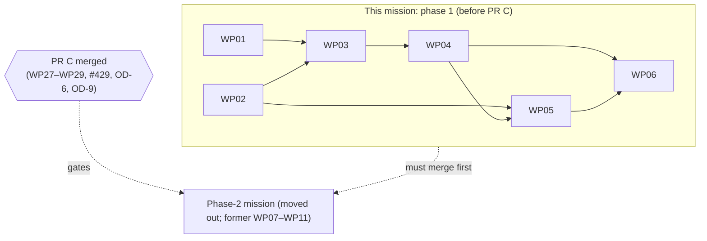

# Tasks: Step enhancements and prompt fragments in the charter service

**Mission:** `adr-0066-step-enhancement-service-alignment-01M6ZRYK` | **Plan:** [plan.md](plan.md) |
**Spec:** [spec.md](spec.md) | **Branch:** `issue-424-428-adr-0066-service-alignment`

Six work packages cover phase 1 of the plan: IC-01 to IC-04 and the phase-1 parts of IC-08. By operator ruling
(2026-11-09) the mission was split in two: **WP07–WP11 moved to the phase-2 mission** (tracked in #438,
created on its own branch), together with IC-05, IC-06, IC-07 and the phase-2 parts of IC-08. Subtask IDs T001–T030
are unchanged; T031–T051 left with WP07–WP11. Subtask rows below are references; completion is recorded with
`spec-kitty agent tasks mark-status <Txxx> --status done` (event log), never by editing this file.

## Phases

- **This mission = phase 1, before PR C (WP01–WP06):** the step enhancement is held, round-trips and composes
  (IC-01); the slot grammar (IC-03 pure); the enhancement and fragment rules (IC-02 pure); the load checks on the wire with the raised
  definition of OD-3 (a) (IC-02, IC-03, IC-04); the registration `diagnostics` (OD-7); the docs that need no PR C
  surface (IC-08 part: ADR-0053 OQ2, the guard/emit shape, the load-moment note, schema pages, rules page load
  rules). Phase 1 WPs never edit a PR C-owned file. Closes #428 on delivery; refers to #424.
- **Phase 2 = the phase-2 mission (moved out):** the compose checks (IC-06), the effective-prompt query and read with
  the contract delta B (IC-05, IC-07), the ADR-0066 d7/d8 annotations and the rest of the docs (IC-08). Blocked until
  PR C of `layer-merge-and-effective-reads-01M6R0J6` (WP27–WP29, including #429, the OD-6 E6 amendment and the OD-9
  shared "pack holds step" predicate) merges and this mission merges. It re-plans and re-tasks after PR C merges; the
  former WP07–WP11 prompts are parked as its input. Closes #424.

## MVP

WP01 alone unblocks open-packs#175: an `spdd`-shaped pack registers, round-trips and its enhancements are selectable
(US1, US2). WP01–WP05 complete the behaviour of this mission (US3); WP06 records it.

## Subtask Index

| ID | Subtask | WP | Parallel |
|---|---|---|---|
| T001 | Capture the NFR-001 digest baseline before any binding | WP01 | |
| T002 | Red scenarios: selection, registration, preset, sibling | WP01 | |
| T003 | Entity, fragment value, DSO and YAML format, round-trip test with mutant | WP01 | |
| T004 | Binding appended, deferred branch deleted, scaffolding and expected-red in one commit | WP01 | |
| T005 | Whole-pack store and round-trip comparators | WP01 | |
| T006 | URN in `defined`, same-id handling, NFR-001 positive control | WP01 | |
| T007 | `### Changed` fragment for the held kind | WP01 | |
| T008 | Red edge-case table and SlotId tests | WP02 | [P] |
| T009 | `SlotId` value | WP02 | [P] |
| T010 | `PromptSlots` parser | WP02 | [P] |
| T011 | Canonical-text corpus property test with mutant | WP02 | [P] |
| T012 | Red failing fixture + passing twin per rule | WP03 | |
| T013 | Facts value and fragment content rules (FR-004) | WP03 | |
| T014 | Structure rules (FR-005, D11) | WP03 | |
| T015 | Identity and target rules (FR-006, R-OVR), deterministic order | WP03 | |
| T016 | Red registration/read scenarios and unit tests at each moment | WP04 | |
| T017 | `PackFindingCode`, `PackPolicy`, raise and raised definition in one commit | WP04 | |
| T018 | Validate mode runs the rules | WP04 | |
| T019 | Load and registration as violations; precedence pinned | WP04 | |
| T020 | Contract text: reserved paragraph, C-07, `_shared`, `errors.feature` | WP04 | |
| T021 | Schema description, file-kinds comment, FR-012 control, fragments | WP04 | |
| T022 | Red `prompt-slots.feature` and the three moments | WP05 | |
| T023 | Slot finding codes and the raise in one commit | WP05 | |
| T024 | Load check in `assembly`, warnings list, validate mode | WP05 | |
| T025 | Registration result `diagnostics` member (OD-7) | WP05 | |
| T026 | Slot-code descriptions and fragments | WP05 | |
| T027 | ADR-0053 OQ2 annotation (D7) | WP06 | [P] |
| T028 | ADR-0066 annotations: guard/emit shape (D6) and the load-moment note (OD-3 (a), OD-7) | WP06 | [P] |
| T029 | Rules page load rules and schema pages | WP06 | [P] |
| T030 | Dated docs changelog page | WP06 | [P] |

`[P]` marks WPs whose subtasks can run in parallel with another WP: WP02 with WP01; WP06 is docs-only.

## Work packages

### WP01 — Phase 1 · The step enhancement is held, round-trips and composes

- **Prompt:** [tasks/WP01-step-enhancement-held.md](tasks/WP01-step-enhancement-held.md)
- **Phase:** Phase 1 (before PR C) · **Concern:** IC-01 · **Priority:** P1 (MVP)
- **Goal:** hold every step enhancement and its fragment companions, write them back by meaning, and let the URN
  compose and be selected directly and through presets. No prompt code raised.
- **Independent test:** register the two-pack `spdd`-shaped fixture, select `step_enhancement/spdd-plan` (`200`, beside
  a tactic `200`), write back and compare meaning including fragment bodies; packs without enhancements keep their
  pinned digests.
- **Dependencies:** none.
- **Subtasks:**

T001 Capture the NFR-001 digest baseline before any binding (WP01)
T002 Red scenarios: selection, registration, preset, sibling (WP01)
T003 Entity, fragment value, DSO and YAML format, round-trip test with mutant (WP01)
T004 Binding appended, deferred branch deleted, scaffolding and expected-red in one commit (WP01)
T005 Whole-pack store and round-trip comparators (WP01)
T006 URN in `defined`, same-id handling, NFR-001 positive control (WP01)
T007 `### Changed` fragment for the held kind (WP01)

- **Implementation sketch:** baseline commit first; red scenarios; entity/DSO/YAML; one commit for binding + deferred
  branch deletion + `GeneratedPackTree` + expected-red (OD-11 text) + OD-10 rows 1–3 and 10 (A5), the binding with its
  three companion overrides (fifth analysis A6); store and comparators, with the A2-harness place-aware write seam for
  `DomainRoundTrip` (listed edits on `FilesystemPackStore` and `DomainRepositoryService`); the composition test; the `### Changed` fragment, which claims only the selection `200`, the kept preset ids and the
  accepted registration, and says a selected step enhancement is reported not in force until PR C's E6 amendment.
- **Parallel opportunities:** runs in parallel with WP02.
- **Risks:** inserting instead of appending the binding moves digests; `DomainRoundTrip`'s pairing mask.

### WP02 — Phase 1 · The slot grammar in the kernel: PromptSlots and SlotId

- **Prompt:** [tasks/WP02-kernel-slot-grammar.md](tasks/WP02-kernel-slot-grammar.md)
- **Phase:** Phase 1 (before PR C) · **Concern:** IC-03 (pure part) · **Priority:** P1
- **Goal:** a pure parser of slot markers over canonical prompt text, with the full edge-case table and a corpus
  property test proving canonicalisation keeps every marker.
- **Independent test:** `:kernel:test` table rows; the corpus test finds 10 markers over 5 pinned built-in prompts and
  its mutant fails.
- **Dependencies:** none.
- **Subtasks:**

T008 Red edge-case table and SlotId tests (WP02)
T009 `SlotId` value (WP02)
T010 `PromptSlots` parser (WP02)
T011 Canonical-text corpus property test with mutant (WP02)

- **Implementation sketch:** table first; value; single forward-scan parser answering slots and typed faults
  (`MALFORMED`, `NOT_EMPTY`); packs-side corpus test.
- **Parallel opportunities:** runs in parallel with WP01.
- **Risks:** whitespace defined too broadly; backtracking regex.

### WP03 — Phase 1 · The step-enhancement and fragment rules, pure

- **Prompt:** [tasks/WP03-step-enhancement-rules.md](tasks/WP03-step-enhancement-rules.md)
- **Phase:** Phase 1 (before PR C) · **Concern:** IC-02 (pure part) · **Priority:** P1
- **Goal:** `StepEnhancementRules` answers typed faults for FR-004..006, each with a failing fixture and a passing twin,
  naming no refusal code.
- **Independent test:** `StepEnhancementRulesTest` (twins per rule, a multi-fault case with deterministic order).
- **Dependencies:** Depends on WP01, WP02.
- **Subtasks:**

T012 Red failing fixture + passing twin per rule (WP03)
T013 Facts value and fragment content rules (FR-004) (WP03)
T014 Structure rules (FR-005, D11) (WP03)
T015 Identity and target rules (FR-006, R-OVR), deterministic order (WP03)

- **Implementation sketch:** in-memory facts; three rule families; sort by (path, rule order).
- **Parallel opportunities:** none (needs WP01 and WP02).
- **Risks:** the stem rule folded into the generic duplicate-id rule; reading the target from the directory.

### WP04 — Phase 1 · Enhancement and fragment refusals at validate, load and registration; raised redefined

- **Prompt:** [tasks/WP04-fragment-refusals-wired.md](tasks/WP04-fragment-refusals-wired.md)
- **Phase:** Phase 1 (before PR C) · **Concerns:** IC-02 (wiring), IC-04 (part A) · **Priority:** P1
- **Goal:** `prompt_fragment_invalid` per file inside `422 validation_failed`, `500 pack_unreadable` naming the file on
  reads, both from one load seat (`DomainRepositoryService.assembly` given the graph read, plan erratum E-1); R-OVR
  wired, and on the relationship write (R-REL); OD-3 (a) raised definition (`prompt_fragment_invalid`, and `drg_schema_error`, whose flip is this WP's alone);
  the shared contract hot files' owner.
- **Independent test:** `prompt-fragment-refusals.feature` (multi-fault registration lists every fault at its path;
  read `500` beside a `200` twin); `ReservedRefusalCodesTest` green with the flags.
- **Dependencies:** Depends on WP03.
- **Subtasks:**

T016 Red registration/read scenarios and unit tests at each moment (WP04)
T017 `PackFindingCode`, `PackPolicy`, raise and raised definition in one commit (WP04)
T018 Validate mode runs the rules (WP04)
T019 Load and registration as violations; precedence pinned (WP04)
T020 Contract text: reserved paragraph, C-07, `_shared`, `errors.feature` (WP04)
T021 Schema description, file-kinds comment, FR-012 control, fragments (WP04)

- **Implementation sketch:** scenarios red; finding code + policy + YAML flags + amended definition + gate edits
  (OD-10 rows 8–9) in one commit; inspector (with the A8 fixture setup); the load seat in
  `DomainRepositoryService.assembly` (judged `PackRead` copy: companion faults remapped by file, A3; second same-id
  enhancement withheld, A2) and `WholePackStore.load`; contract prose (OD-10 rows 6–7); schema description (A1: id ≠
  stem is a schema violation) and its pinning test; `### Changed` and `### Breaking` fragments (R-OVR and R-REL lines
  included); after the raise, the R-REL refusal in `RelationshipRegistrationService` with its `operations` entry,
  `RefusalHandler` entry (its own per-operation map for `putPackRelationship`, fifth analysis A11) and the
  relationship path's `422` text; `PackFindingTest` (OD-10 row 11) and the two `errors.feature` table rows (OD-10 row
  6, fifth analysis A4) in the raise commit; the facts carried to validate mode on `PackContents` (A3); the staged-load
  orphan exclusion limited to refused or withheld enhancements (fifth analysis A5).
- **Parallel opportunities:** none.
- **Risks:** loosening the off-wire gate for `PACK_LEVEL_MISMATCH`; rebase conflicts with PR C hunks.

### WP05 — Phase 1 · Base-prompt slot checks behind the version gate, the warnings list and the registration diagnostics

- **Prompt:** [tasks/WP05-prompt-slot-load-checks.md](tasks/WP05-prompt-slot-load-checks.md)
- **Phase:** Phase 1 (before PR C) · **Concerns:** IC-03 (wiring), IC-04 (slot codes), OD-7 (registration) ·
  **Priority:** P1
- **Goal:** `prompt_slot_malformed` always, `prompt_slot_not_empty` at `schema_version: "1.0"`, a warning otherwise on
  a separate list, delivered in the registration result's new `diagnostics` member.
- **Independent test:** `prompt-slots.feature`; exactly 5 warnings on the pinned built-in, which composes without
  `pack_unreadable`.
- **Dependencies:** Depends on WP02, WP04.
- **Subtasks:**

T022 Red `prompt-slots.feature` and the three moments (WP05)
T023 Slot finding codes and the raise in one commit (WP05)
T024 Load check in `assembly`, warnings list, validate mode (WP05)
T025 Registration result `diagnostics` member (OD-7) (WP05)
T026 Slot-code descriptions and fragments (WP05)

- **Implementation sketch:** scenarios red; three finding codes + flags; check in `DomainRepositoryService.assembly`
  with the descriptor; validate mode with OD-10 row 12 (`FileSystemPackInspectorTest:670-679` expects the five
  warnings); warnings carried to the registration outcome, the old `RegistrationOutcome` constructor kept (fifth
  analysis A7); contract member and fragments.
- **Parallel opportunities:** none.
- **Risks:** a warning landing on the violation list breaks every read of built-in.

### WP06 — Phase 1 · Rulings recorded: ADR annotations, load rules, schema pages, changelog

- **Prompt:** [tasks/WP06-docs-phase-1.md](tasks/WP06-docs-phase-1.md)
- **Phase:** Phase 1 (before PR C) · **Concern:** IC-08 (part) · **Priority:** P2
- **Goal:** ADR-0053 OQ2 (layout kept), ADR-0066 dated annotations (guard/emit shape with #434; the load-moment note
  per OD-3 (a) and OD-7), rules page load rules, two schema pages, one dated changelog page. The d8 (OD-1) and d7
  (OD-2) annotations and the conceptual-model integrity note are the phase-2 mission's.
- **Independent test:** docs checks green; no generated hub touched.
- **Dependencies:** Depends on WP04, WP05.
- **Subtasks:**

T027 ADR-0053 OQ2 annotation (D7) (WP06)
T028 ADR-0066 annotations: guard/emit shape (D6) and the load-moment note (OD-3 (a), OD-7) (WP06)
T029 Rules page load rules and schema pages (WP06)
T030 Dated docs changelog page (WP06)

- **Implementation sketch:** annotations first, then reference pages, then the changelog page.
- **Parallel opportunities:** subtasks are independent of each other.
- **Risks:** describing phase-2 behaviour (compose refusals, the read) as shipped.

## Closeout (after WP06, before the PR)

Run by the run lead once WP01–WP06 are approved, in this order. None of it is a work package; each step is recorded
in the PR description.

1. **Pre-merge adversarial squad** (charter: plan point and pre-merge). Lenses: contract, architecture, test adequacy.
   Every finding gets a disposition (folded, rejected with reason, or escalated), then the **operator approves**
   before the PR leaves draft.
2. **`verifyAll` on Java 25**, once:
   `JAVA_HOME=/usr/lib/jvm/temurin-25 ./gradlew --no-daemon -PopenPacksDir=../spec-kitty-open-packs verifyAll :packs:wholePackRoundTrip --continue`. Never
   with `-Pcharter.javaVersion=21`, never with dependency verification off.
3. **`:packs:wholePackRoundTrip`** with `-PopenPacksDir=../spec-kitty-open-packs` (required through `CI gate / gate`):
   green with the `empty_kinds: step-enhancement` entry (#428, OD-11 text) and no other expected-red change.
4. **Docs checks:** `python3 scripts/docs/check_docs.py all`; `npx markdownlint-cli2@0.18.1` on `docs/**/*.md` and this
   mission's Markdown; `npx cspell@10.4.0 --no-progress "docs/**/*.md"`.
5. **Style gates:** `spotlessCheck` and `checkstyleMain checkstyleTest` for every touched module (`:kernel`, `:packs`,
   `:deployable`, `:web-transport`; fifth analysis A8), plus `:contracts:check`.
6. **Conformance issue (A17).** Done 2026-11-09: the orchestrator filed the draft of `research/grounding.md`,
   appendix A.7, as spec-kitty/spec-kitty-open-packs#177, and the placeholder was replaced in this mission's artifacts.
   The PR description cites #177 as well.
7. **Issue matrix verdicts** (PR description):

   | Issue | Verdict | Why |
   |---|---|---|
   | #428 | `Closes` | Every checklist item delivered, or ruled and recorded (guard/emit by the D6 shape and #434); SC-005. |
   | #424 | `Refs` | The compose checks and the effective-prompt read are the phase-2 mission's. |
   | #437 | `Closes` | This mission is phase 1. |
   | #438 | not applicable / `Refs` | The phase-2 mission's tracker; it stays open, blocked on this PR and PR C. |

## Shared hot files and their owners

`lanes.json` `write_scope` is regenerated by finalize from each WP's `owned_files` only, so a listed edit never appears
in another lane's write scope. This table is the complete record of listed edits; each WP prompt's "Files shared"
section names the same edits, and each such commit carries an `out-of-map: <file> — <why>` line.

| File | Owner | Listed edits by (what) |
|---|---|---|
| `contracts/charter/schemas/CharterRefusalCode.yaml` | WP04 | WP05 (the two slot codes' flags and descriptions, the reserved paragraph) |
| `service/deployable/.../ReservedRefusalCodesTest.java` | WP04 | — (WP05 makes no edit: the test reads the YAML flags, erratum E-2) |
| `contracts/charter/scenarios/errors.feature` | WP04 | WP05 (OD-10 row 6, two rows) |
| `service/deployable/.../bdd/ContractDescriptionsTest.java` | WP04 | — (WP04 pins only sentences WP05 keeps, fifth analysis A3) |
| `service/packs/.../infra/storage/DomainRepositoryService.java` | WP05 | WP01 (A2-harness: one package-private `saveArtifact(pack, artifact, place)` overload, with its private generic helper, through the place-aware write); WP04 (E-1: the graph-taking `assembly` form with the rule faults, its judged `PackRead` copy — store `companion` violations of `*.step-enhancement.yaml` files remapped to `prompt_fragment_invalid` (A3, E-4) and `STEM_REPEATED` files withheld from `collect` (A2) — and `assemble`'s graph read) |
| `service/packs/.../infra/storage/PackFileSet.java` | WP01 | — |
| `service/packs/.../infra/storage/KindBindings.java` | WP01 | — |
| `service/packs/.../infra/storage/WholePackStore.java` | WP01 | WP04 (graphs read before the assembly, the graph-taking form called, orphan reclassified in `loadStaged` except in a directory holding a refused or withheld enhancement, A4; a rule fault on a held enhancement does not exclude, fifth analysis A5); WP05 (the `warnings` argument, a new `LoadedPack` field with the shorter constructors kept, and through `loadStaged`, A8) |
| `service/packs/.../infra/storage/FileSystemPackInspector.java` | WP01 | WP04 (rules in FULL mode, orphans, companion faults); WP05 (slot check after the parse) |
| `service/packs/.../infra/storage/StepEnhancementBinding.java` | WP01 | — (A3, E-4: the binding cannot change the store's hard-coded `companion` kind; the mapping is WP04's hunk in `DomainRepositoryService`) |
| `service/packs/.../infra/storage/FilesystemPackStore.java` | none | WP01 (A2-harness: a place-aware form of `write`, :884-911, creating at a given pack-relative place instead of `newFile`, :1125-1145; refuses a place outside the pack, taken, or not named `<id>.<fileToken>.yaml`). `withCompanions` :785-819 keeps `"companion"` at :813 (A3, E-4) |
| `service/packs/.../infra/storage/KindBinding.java` | none | — (not edited in phase 1) |
| `service/packs/.../domain/StepEnhancement.java` | WP01 | WP03 (optional: the entry's slot typed as `SlotId`) |
| `service/packs/.../infra/storage/FileSystemPackInspectorTest.java` | WP01 | WP04 (OD-10 row 4 and its twin; A8 graph-document setup; the fifth-analysis A5 orphan twin, new cases only); WP05 (OD-10 row 12: :670-679 expects exactly the five `PROMPT_SLOT_NOT_EMPTY_UNVERSIONED` warnings, T024's commit) |
| `service/packs/.../infra/storage/WholePackStoreTest.java` | WP01 | WP04 (new cases only) |
| `PackFindingCode.java`, `PackPolicy.java` | WP04 | WP05 (the three slot finding codes and their mapping) |
| `service/packs/.../domain/PackContents.java` | none | WP04 (a `StepEnhancementFacts` component for validate mode, 9-argument constructor kept, A3); WP05 (the slot-parse component, the 9-argument and WP04's constructors kept, A3) |
| `service/packs/src/test/.../domain/PackFindingTest.java` | none | WP04 (OD-10 row 11: `PROMPT_FRAGMENT_INVALID` into `LOAD_PATH_BLOCKING`, T017's commit); WP05 (OD-10 row 11: the two slot codes into `LOAD_PATH_BLOCKING`, `PROMPT_SLOT_NOT_EMPTY_UNVERSIONED` into the warning set, the severity expectation and the :70 skip, T023's commit) |
| `service/packs/.../application/RelationshipRegistrationService.java`, `service/packs/src/test/.../application/RelationshipRegistrationServiceTest.java` | none (PR A's WP12; not PR C-owned) | WP04 (R-REL: the refusal before the commit; new test cases only) |
| `service/web-transport/.../web/RefusalHandler.java` | none (in no PR C lane) | WP04 (R-REL: `putPackRelationship` answers `prompt_fragment_invalid` as `422`, through its own copy of the registration map, fifth analysis A11; gated by `:web-transport:test` and its style checks, A8) |
| `contracts/charter/paths/packs_packId_relationships.yaml` | none (PR A's WP11; not PR C-owned) | WP04 (R-REL: the `422` description) |
| `composition-and-activation-rules.md`, the docs changelog page | WP06 | — |

Every listed edit is sequenced by `dependencies`, so no two WPs edit a shared file at the same time. The phase-2
mission edits several of these files after this mission merges (the parked WP07–WP11 prompts list which).

## Dependency graph

Critical path: WP01 → WP03 → WP04 → WP05 → WP06. The phase-2 mission starts only after this mission and PR C have
both merged.
