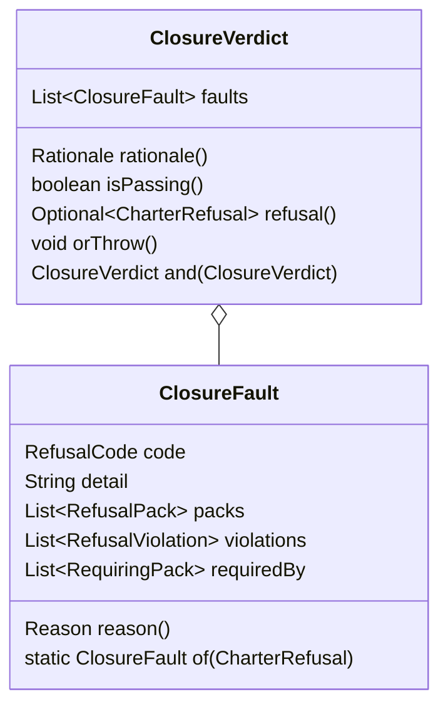
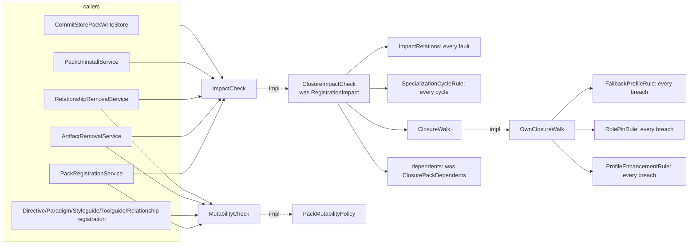

# Implementation Plan: The walk and closure checks behind ports (#556)

**Branch**: `feat/556-closure-checks-behind-ports` (Mission branch `kitty/mission-closure-checks-behind-ports-01M7TS43`)
| **Date**: 2026-11-19 | **Spec**: [spec.md](spec.md)
**Input**: Mission specification from `kitty-specs/closure-checks-behind-ports-01M7TS43/spec.md`

## Summary

The closure checks of a pack write move behind three ports in `packs.domain`: `ImpactCheck`, `ClosureWalk` and
`MutabilityCheck`. Each exposes a kernel `Rule`, and each is implemented in `packs.application` over the existing
machinery (`RegistrationImpact`, `ImpactRelations`, `FallbackProfileRule`, `RolePinRule`, `ProfileEnhancementRule`,
`SpecializationCycleRule`, `PackMutabilityPolicy`, and #517's dependents finders).

Every check stops returning `Optional<first>` and returns every fault, as a list of `ClosureFault`s. One mapping,
`ClosureVerdict.refusal()`, turns them into the write's one `CharterRefusal`: the first fault's code, every fault as a
violation, and the union of packs (D1).

The compose's qualified-reference phase collects in the same way (D2). `PackDependents` is absorbed into `ImpactCheck`
(D3), and `WritePolicyGate` is replaced by `MutabilityCheck` (D5). `pack-check`, `PackRulesets.closure()` and
`PackCheck` are not touched (S2).

## Technical Context

**Language/Version**: Java 25 (the toolchain of `./gradlew verifyAll`; CI never builds with `-Pcharter.javaVersion=21`)
**Primary Dependencies**: Spring Boot (the `packs` module's beans only); kernel `ai.speckitty.charter.kernel.validation`
(`Rule`, `Reason`, `ReasonCode`, `Rationale`); JSpecify, NullAway, Error Prone, palantir-java-format, Checkstyle
**Storage**: Files: the pack store under the configured roots, read through `StagedPackViews` sessions. No storage
change.
**Testing**: JUnit 5 unit tests per rule (one failing and one passing case per code, and multi-fault cases);
`@contract` Gherkin scenarios in `contracts/charter/scenarios/` on charter's own example packs (ADR-0070); the ArchUnit
gate in `deployable` (`HexagonalArchitectureTest`); PIT mutation floors (ADR-0062); the whole-pack round trip.
**Target Platform**: The charter service (Linux server, native packaging per ADR-0046).
**Project Type**: Multi-module Gradle service (`service/kernel`, `service/packs`, `service/pack-validation`,
`service/deployable`, …).
**Performance Goals**: No extra compose or read. Each closure a write joins is composed once, and each stored pack is
read once per `StagedPackViews` session (NFR-001), as today.
**Constraints**: No wire code added, removed or renamed (C-006). No ArchUnit rule widened (C-002). No legacy port beside
the new one (C-001). No change to `pack-check` (C-003).
**Scale/Scope**: About 15 main classes in `packs` change, 4 are deleted, about 6 are added, and about 40 test files are
touched. Estimate: 2.5k to 3.5k lines including tests.

## Charter Check

| Rule | How this plan holds it |
|------|------------------------|
| The charter's model is canonical; no legacy beside new | `WritePolicyGate`, `PackDependents`, `ClosurePackDependents` and the `Optional<Breach>` results are deleted in the same change that adds their replacements. |
| Tests and examples carry only the canonical shape | New example packs are invalid on purpose, to exercise refusals (the error-handling exception). Every valid fixture stays canonical. |
| Contract change follows ADR-0022 | Additive: the violations of the pack-write codes name every fault. A `Changed` change fragment, not `Breaking` (D1). |
| Adversarial review squad at the plan point and before merge | A plan-point squad (architect, patterns, code-shape lenses) reviews this plan before tasks. The pre-merge review is the independent adversarial review the orchestrator assigns. |
| Gates before merge | `./gradlew verifyAll` on Java 25 (round trip, ArchUnit, scenarios, style); docs checks for the ADR and change fragment edits. |
| Issue rules | #556 is closed by the PR. The parity bullet is closed with a note naming open-packs' `charter_service_check.py` (D6). Epic #549's slice-7 box is ticked. |

## Design

### The fault model (`packs.domain`)



- A `ClosureFault` is one fault as the refusal will name it. `reason()` is its kernel `Reason`, with the code's token
  from `PackCodes` (the one owner, `PACK_CODES_HAVE_ONE_OWNER`), so a port's `Rule` view returns plain kernel reasons.
- `ClosureFault.of(CharterRefusal)` lifts a compose refusal into the list unchanged: its own violations and
  `requiredBy` are kept (spec edge case 2).
- **`ClosureVerdict.refusal()` is the D1 mapping, and the only one:**
  - the code is the first fault's;
  - the violations are, per fault, its own violations when it carries any, else one violation `("", code, detail)`;
  - the packs are the union in first-seen order;
  - `requiredBy` is the first fault's;
  - the detail is the first fault's detail, plus ` (and N more fault(s))` when there is more than one. A single fault's
    detail is unchanged (SC-002).
  - The 100-item cap and its count stay `CharterRefusal`'s.

### The ports (`packs.domain`, no Spring)

| Port | Subject | Returns | `Rule` view |
|------|---------|---------|-------------|
| `ImpactCheck` | `PackChange`, a sealed type: `Registration(Replacement)`, `Write(PackIdentifier, UnaryOperator<PackCompositionFacts>, Optional<Pack>)`, `Removal(ConfiguredPack)` | `Impact(ClosureVerdict verdict, Notices notices)` | `Rule<PackChange>`: the verdict's reasons |
| `ClosureWalk` | `OwnClosure`: the declaring pack, its descriptor, and a domain view of its composed closure (`holds`, `winnerPackOf`, `isLocked`, the profile reader, the enhancement merge) | `ClosureVerdict` | `Rule<OwnClosure>` |
| `MutabilityCheck` | `Writes(Pack pack, List<Write> writes, boolean staged)` | `ClosureVerdict` | `Rule<Writes>` |

- `Replacement` and `Notices` move from `RegistrationImpact` into `packs.domain`, beside `ImpactCheck`. `Operation`
  and `Write` move from `WritePolicyGate` into `MutabilityCheck`.
- The `OwnClosure` view is a small domain interface that `ClosureView` implements, so the domain port names no
  application type (onion rule).
- **Removal reads in the port's own session.** The removal's descriptor and held URNs are read in the `ImpactCheck`
  implementation's session, which is the one session NFR-001 counts. `PackUninstallService` then stops opening a
  judging session of its own. It keeps its lock, its commit and its dry-run switch.

### The implementations (`packs.application`)



- **`ClosureImpactCheck`** (renamed from `RegistrationImpact`; it judges every change, not only a registration)
  keeps the session, closure-finding, notice and census logic.
  - It judges each closure the change joins, in the order `ClosureRoots` finds them.
  - It catches a closure's compose refusal as one `ClosureFault` (with `inClosure`'s rewording) and moves on to the
    next closure.
  - It then runs `ImpactRelations.check` and `SpecializationCycleRule.check`, each returning every violation. A
    closure that does not compose has no relations to judge.
  - It then runs `ClosureWalk` for each single-root closure, as `judgeFallbacksAndPins` does today, but for every
    pack instead of throwing at the first.
  - It calls `activations.requireComposable` only when the verdict passes, so the gate's refusal is the write's when
    nothing earlier failed (FR-009).
  - It returns `Impact(verdict, notices)`. For a removal it first lists the dependents (the finders of
    `ClosurePackDependents`, moved in). If there are any, it returns the `pack_has_dependents` verdict (one fault, its
    own violations being the dependents) and composes nothing, as ADR-0081 D7 and FR-004 require.
- **`ImpactRelations.check` returns `List<Violation>`.** Each of the seven rules returns a list, edges in order, and
  the rules run in the fixed order. The cycle finders collect every cycle, each reported once from its first node
  (a node on an already-reported cycle starts no new one), and stay iterative (NFR-002).
- **`FallbackProfileRule.check` returns `List<Breach>`.** `unknown` alone ends the list. Otherwise every one of
  `not_locked`, `not_role_neutral` and `not_agent` that holds is listed. `RolePinRule` and `ProfileEnhancementRule`
  return every breach in the same way.
- **`PackMutabilityPolicy`** implements `MutabilityCheck`. `authorize` and `authorizeStaged` become one judgement
  that returns every refused write as a `governance_policy_violation` fault, its detail as today. The callers that
  authorize two endpoints or several artifacts (`RelationshipRegistrationService`, `RelationshipRemovalService`,
  `ArtifactRemovalService`) judge all their writes at once and throw `verdict.orThrow()`.
  `PermissiveWritePolicyGate` becomes `PermissiveMutabilityCheck`.
- **The reference phase of the compose** (`PackCompositionResolver.checkReferences`, `checkQualifiedReference`,
  `refuseCaseOnlyMatches`):
  - each returns `List<Refusal>` (as `faults()` and `presetContests` already do since #554);
  - `OfferingReadService.composed` throws the collected phase as one `CharterRefusal`, through the same D1 mapping
    over `ClosureFault`s;
  - `EdgeIndex` and `CompositeComponentResolver`, which check one reference at a time, keep refusing their one fault
    through the same mapping.
- **The census** logs every fault of a pack's verdict (FR-011).

### The order of a verdict (FR-009)

1. The closures, in `ClosureRoots` order. Within each closure:
   1. the compose, or its refusal;
   2. the relations, in this order: `self_override`, `conflicting_relations`, `override_not_permitted` (edge),
      `override_not_permitted` (locked step), `override_cycle`, `enhances_cycle` (cycle), `enhances_cycle`
      (ungrounded), `specialization_cycle`;
   3. for a single-root closure, the closure walk: the fallback profile, the role pins, the profile enhancements.
2. The activations gate comes last, and only when nothing failed before it.

### Composition roots

- `deployable` wires the three ports through the `packs` beans (Spring `@Component`s implementing domain ports), as
  `WritePolicyGate` is wired today.
- `pack-validation` and `pack-check` name none of them (FR-010, C-003). `PACK_VALIDATION_IS_FRAMEWORK_FREE` and the onion
  rules hold unchanged.

### Contract and documents

- `contracts/charter/schemas/CharterRefusalCode.yaml`: the descriptions of the impact, fallback, role-pin, enhancement,
  reference and `governance_policy_violation` codes say that the refusal's violations name every fault, the first being
  the code's. The regenerated client sees no shape change.
- A change fragment, `contracts/charter/changes/2026-11-19-closure-refusals-name-every-fault.md`, under `### Changed`.
- `docs/adr/0068-*`: an amendment, "the rule runs behind `ClosureWalk` and reports every breach".
- `docs/adr/0075-*`: a slice-7 amendment covering the ports and their subjects, the S1 ambiguity flagged, A1 (no floor
  rule) and D6 (parity in open-packs).
- `docs/adr/0081-*`: a note that `ImpactCheck` absorbed `PackDependents`.

## Project Structure

### Documentation (this mission)

```text
kitty-specs/closure-checks-behind-ports-01M7TS43/
├── spec.md
├── plan.md
├── decisions/
├── research/            # plan-point squad findings
└── tasks/
```

### Source Code (repository root)

```text
service/packs/src/main/java/ai/speckitty/charter/packs/
├── domain/
│   ├── ImpactCheck.java          # new port (+ PackChange, Replacement, Notices, Impact)
│   ├── ClosureWalk.java          # new port (+ OwnClosure)
│   ├── MutabilityCheck.java      # new port, replaces WritePolicyGate.java (deleted)
│   ├── ClosureFault.java         # new
│   ├── ClosureVerdict.java       # new: the D1 mapping
│   ├── PackCodes.java            # gains the closure-check tokens
│   └── PackCompositionResolver.java   # reference phase collects
├── application/
│   ├── ClosureImpactCheck.java   # was RegistrationImpact.java
│   ├── OwnClosureWalk.java       # new, over FallbackProfileRule, RolePinRule, ProfileEnhancementRule
│   ├── ImpactRelations.java, SpecializationCycleRule.java, FallbackProfileRule.java,
│   │   RolePinRule.java, ProfileEnhancementRule.java     # collect every fault
│   ├── PackMutabilityPolicy.java, PermissiveMutabilityCheck.java
│   ├── PackDependents.java, ClosurePackDependents.java  # deleted, absorbed
│   └── callers: PackRegistrationService, ArtifactRemovalService, RelationshipRemovalService,
│       PackUninstallService, Directive/Paradigm/Styleguide/Toolguide/RelationshipRegistrationService,
│       OfferingReadService, EdgeIndex, CompositeComponentResolver
└── infra/storage/CommitStorePackWriteStore.java   # names ImpactCheck
contracts/charter/{schemas/CharterRefusalCode.yaml, changes/, scenarios/registration/*.feature}
service/packs/src/testFixtures/resources/example-packs/   # invalid example packs for the scenarios
docs/adr/{0068,0075,0081}-*.md
```

**Structure Decision**: Everything stays in the `packs` module, split by its rings: ports and the fault model in
`domain`, implementations in `application`. No new module.

## Complexity Tracking

No charter violation to justify.

## Implementation Concern Map

### IC-01 — The fault model and the one mapping

- **Purpose**: A fault type, a verdict and the D1 refusal mapping that every port and the compose share.
- **Relevant requirements**: FR-008, FR-009, C-006.
- **Affected surfaces**: `packs.domain` (`ClosureFault`, `ClosureVerdict`, `PackCodes`); kernel `CharterRefusal`
  (read only).
- **Sequencing/depends-on**: none.
- **Risks**: Changing a single fault's detail would break SC-002. Pin the detail of a single fault in a test.

### IC-02 — Relations and the closure walk collect every fault

- **Purpose**: `ImpactRelations`, `SpecializationCycleRule`, `FallbackProfileRule`, `RolePinRule` and
  `ProfileEnhancementRule` return every fault, and `ClosureWalk` is declared and implemented.
- **Relevant requirements**: FR-003, FR-005, NFR-002.
- **Affected surfaces**: the five rule classes, `ClosureWalk`, `OwnClosureWalk`, and their tests.
- **Sequencing/depends-on**: IC-01.
- **Risks**: A cycle collector that reports one cycle once per member would flood the answer. Report each cycle once.

### IC-03 — The impact check port, across closures and removals

- **Purpose**: `ImpactCheck` replaces direct calls of `RegistrationImpact`. It collects across closures, absorbs the
  dependents finder, returns the notices in one pass, and the census logs every fault.
- **Relevant requirements**: FR-002, FR-004, FR-009, FR-011, NFR-001.
- **Affected surfaces**: `RegistrationImpact` → `ClosureImpactCheck`, `PackDependents`, `ClosurePackDependents`,
  `PackUninstallService`, `PackRegistrationService`, `ArtifactRemovalService`, `RelationshipRemovalService`,
  `CommitStorePackWriteStore`, `StagedPackViews` (`Replacement` import), and their tests.
- **Sequencing/depends-on**: IC-01, IC-02.
- **Risks**:
  - The #517 dry run and its scenarios must keep their answers.
  - The uninstall's session moves into the port; pin NFR-001 with the existing counting test.

### IC-04 — Mutability check replaces the write policy gate

- **Purpose**: `MutabilityCheck` replaces `WritePolicyGate`, and a registration and multi-endpoint writes list every
  refused write.
- **Relevant requirements**: FR-007.
- **Affected surfaces**: `WritePolicyGate`, `PackMutabilityPolicy`, `PermissiveWritePolicyGate`, the per-kind
  registration services, `PackRegistrationService`, `ArtifactRemovalService`, `RelationshipRemovalService`, the wiring
  and about 26 test files.
- **Sequencing/depends-on**: IC-01. It touches `PackRegistrationService` and the removal services, like IC-03, so it
  is sequenced after IC-03 in one lane.
- **Risks**: A mechanical rename across many tests. Keep each test's assertion and change only the type.

### IC-05 — The reference phase of the compose collects

- **Purpose**: Every qualified-reference and case-only fault of a compose is in one refusal, on read and write.
- **Relevant requirements**: FR-006.
- **Affected surfaces**: `PackCompositionResolver`, `OfferingReadService`, `EdgeIndex`,
  `CompositeComponentResolver`, the effective-reference scenarios.
- **Sequencing/depends-on**: IC-01.
- **Risks**: The read path's single-fault answers must not change. The effective-reference `@contract` scenarios are
  the guard.

### IC-06 — Contract, scenarios and decision records

- **Purpose**: Record the change and prove it end to end.
- **Relevant requirements**: FR-012, FR-013, FR-014.
- **Affected surfaces**: `CharterRefusalCode.yaml`, `contracts/charter/changes/`,
  `contracts/charter/scenarios/registration/`, example packs, ADR-0068, ADR-0075 and ADR-0081.
- **Sequencing/depends-on**: IC-02 to IC-05.
- **Risks**: The docs checks (cspell, markdownlint, `check_docs.py`) and the ADR-0059 D1 scenario gate.
