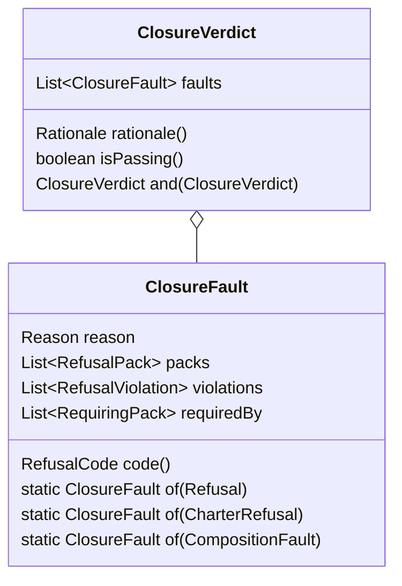
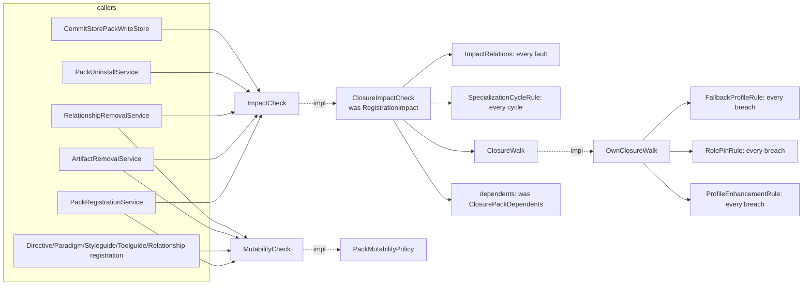

# Implementation Plan: The walk and closure checks behind ports (#556)

**Branch**: `feat/556-closure-checks-behind-ports` (Mission branch `kitty/mission-closure-checks-behind-ports-01M7TS43`)
| **Date**: 2026-11-19 | **Spec**: [spec.md](spec.md)
**Input**: Mission specification from `kitty-specs/closure-checks-behind-ports-01M7TS43/spec.md`

## Summary

The closure checks of a pack write move behind three ports in `packs.domain`: `ImpactCheck`, `ClosureWalk` and
`MutabilityCheck`. Each exposes a kernel `Rule`, and each is implemented in `packs.application` over the existing
machinery (`RegistrationImpact`, `ImpactRelations`, `FallbackProfileRule`, `RolePinRule`, `ProfileEnhancementRule`,
`SpecializationCycleRule`, `PackMutabilityPolicy`, and #517's dependents finders).

Every check stops returning `Optional<first>` and returns every fault, as a list of `ClosureFault`s. One mapping,
`ClosureVerdict.refusal()`, turns them into the write's one `CharterRefusal`: the first fault's code, every fault as a
violation, and the union of packs (D1).

The compose's qualified-reference phase collects in the same way (D2). `PackDependents` is absorbed into `ImpactCheck`
(D3), and `WritePolicyGate` is replaced by `MutabilityCheck` (D5). `pack-check`, `PackRulesets.closure()` and
`PackCheck` are not touched (S2).

## Technical Context

**Language/Version**: Java 25 (the toolchain of `./gradlew verifyAll`; CI never builds with `-Pcharter.javaVersion=21`)
**Primary Dependencies**: Spring Boot (the `packs` module's beans only); kernel `ai.speckitty.charter.kernel.validation`
(`Rule`, `Reason`, `ReasonCode`, `Rationale`); JSpecify, NullAway, Error Prone, palantir-java-format, Checkstyle
**Storage**: Files: the pack store under the configured roots, read through `StagedPackViews` sessions. No storage
change.
**Testing**: JUnit 5 unit tests per rule (one failing and one passing case per code, and multi-fault cases);
`@contract` Gherkin scenarios in `contracts/charter/scenarios/` on charter's own example packs (ADR-0070); the ArchUnit
gate in `deployable` (`HexagonalArchitectureTest`); PIT mutation floors (ADR-0062); the whole-pack round trip.
**Target Platform**: The charter service (Linux server, native packaging per ADR-0046).
**Project Type**: Multi-module Gradle service (`service/kernel`, `service/packs`, `service/pack-validation`,
`service/deployable`, …).
**Performance Goals**: No extra compose or read. Each closure a write joins is composed once, and each stored pack is
read once per `StagedPackViews` session (NFR-001), as today.
**Constraints**: No wire code added, removed or renamed (C-006). No ArchUnit rule widened (C-002). No legacy port beside
the new one (C-001). No change to `pack-check` (C-003).
**Scale/Scope**: About 15 main classes in `packs` change, 4 are deleted, about 6 are added, and about 40 test files are
touched. Estimate: 2.5k to 3.5k lines including tests.

## Charter Check

| Rule | How this plan holds it |
|------|------------------------|
| The charter's model is canonical; no legacy beside new | `WritePolicyGate`, `PackDependents`, `ClosurePackDependents` and the `Optional<Breach>` results are deleted in the same change that adds their replacements. |
| Tests and examples carry only the canonical shape | New example packs are invalid on purpose, to exercise refusals (the error-handling exception). Every valid fixture stays canonical. |
| Contract change follows ADR-0022 | Additive: the violations of the pack-write codes name every fault. A `Changed` change fragment, not `Breaking` (D1). |
| Adversarial review squad at the plan point and before merge | A plan-point squad (architect, patterns, code-shape lenses) reviews this plan before tasks. The pre-merge review is the independent adversarial review the orchestrator assigns. |
| Gates before merge | `./gradlew verifyAll` on Java 25 (round trip, ArchUnit, scenarios, style); docs checks for the ADR and change fragment edits. |
| Issue rules | #556 is closed by the PR. The parity bullet is closed with a note naming open-packs' `charter_service_check.py` (D6). Epic #549's slice-7 box is ticked. |

## Design

The plan-point squad's findings and their dispositions are in `research/squad-plan.md`. The design below includes
them.

### The fault model (`packs.domain`)



- **The fault.** A `ClosureFault` composes a kernel `Reason` (P4) with what the wire needs and a `Reason` cannot hold:
  the packs it names, its own violations, and `requiredBy`.
  - Its `RefusalCode` is derived from the reason's token.
  - The token comes from one lookup, `PackCodes.closure(RefusalCode)`, over a closed set of the codes the ports and
    the compose can raise. `PackCodes` stays the one owner (P3, A5). `ClosureFault` refuses any other code, and a test
    maps every code of the set.
- **One fault type.** Every rule returns `List<ClosureFault>`, and `ImpactRelations.Violation`,
  `FallbackProfileRule.Breach`, `RolePinRule.Breach` and `ProfileEnhancementRule.Breach` are deleted (P2).
  - `CompositionFault` is the exception. It stays, because #478's CLI consumes it (PR #608), and `of(CompositionFault)`
    lifts it. The two types are unified after #478 lands (P1; that deferral is put to the orchestrator).
- **A read failure is never a fault.** `pack_unreadable`, when not rewritten, propagates as today (A2).
- **The mapper.** `ClosureVerdict` holds no refusal mapping (P5). `PackRefusals.of(ClosureVerdict)` (public, in
  `packs.application`) is the closure edge's mapper. The ADR-0075 amendment names it beside `PackRefusals.of(Rationale)`
  and `PackVerdicts`. It maps as follows (D1, with P6 and P7):
  - **One fault** is answered exactly as today: its code, its detail, its packs, its own violations and its
    `requiredBy`.
  - **Two or more faults:**
    - the code is the first fault's;
    - for each fault, the violations are one header violation `("", code, detail)`, then the fault's own violations;
    - the packs are the union, in first-seen order;
    - `requiredBy` is the union, in first-seen order;
    - the detail is `<first detail> (N fault(s); every one is in violations)`.
  - The 100-item cap and its count stay `CharterRefusal`'s.

### The ports (`packs.domain`, no Spring)

| Port | Subject | Returns | `Rule` view |
|------|---------|---------|-------------|
| `ImpactCheck` | `PackChange`, a sealed type: `Registration(Replacement)`, `Write(PackIdentifier, UnaryOperator<PackCompositionFacts>, Optional<Pack>)`, `Removal(ConfiguredPack, Optional<PackDescriptor>, Set<Urn> held)` | `Impact(ClosureVerdict verdict, Notices notices)` | `Rule<PackChange>` |
| `ClosureWalk` | `OwnClosure(PackIdentifier declaring, PackDescriptor descriptor, ClosureFacts closure, Profiles profiles, Optional<ProfileEnhancementGateway> merge)` | `ClosureVerdict` | `Rule<OwnClosure>` |
| `MutabilityCheck` | `Writes`, a sealed type: `Live(Pack, List<Write>)`, `Staged(Pack, List<Write>)` (A7) | `ClosureVerdict` | `Rule<Writes>` |

- `Replacement` and `Notices` move from `RegistrationImpact` into `packs.domain`. `Operation` and `Write` move from
  `WritePolicyGate` into `MutabilityCheck`.
- **`ClosureFacts`** is a domain interface that `ClosureView` implements with domain types only (A1): `holds`,
  `winnerPackOf`, `isLocked`, the role facts that `RolePinRule` reads (the pins and their conflicts), and the profile
  enhancers and winners that `ProfileEnhancementRule` reads.
  - `ClosureRoleFacts` and `ProfileEnhancers` are reworked to read `ClosureFacts`, not `ClosureView` or `MergedView`.
  - A merge refusal while the facts are read is one `ClosureFault`.
  - This is the riskiest surface of the slice, and the first task of its concern.
- **The removal's session (A3).**
  - `ImpactCheck.judge(PackChange)` opens its own session.
  - `ClosureImpactCheck` also offers `judge(StagedPackViews.Session, PackChange)`, an application overload. The
    uninstall, which already holds a session for its 404, built-in and version reads, judges in that session. So #517's
    NFR-001 (one session per delete) holds, and a new counting test for the uninstall pins it.
  - `heldBy` keeps reading through the uninstall's loader.
- **Who consumes the `Rule` views (A4).** No surface composes them as rulesets today: the service calls the ports, and
  the validation edge has no judging port (2026-11-16 amendment). The views are the seams decision 6 asks for. The
  slice-7 amendment records this, and records that the references moved into the compose (FR-006) and the floor
  stayed in activations (A1 of the spec).

### The implementations (`packs.application`)



- **`ClosureImpactCheck`** is renamed from `RegistrationImpact`, because it judges every change, not only a
  registration. It keeps the session, closure-finding, notice and census logic, and judges in today's phase order
  (R3).
  - **Compose and relations, closure by closure.** It goes through each closure the change joins, in `ClosureRoots`
    order.
    - It composes the closure. A compose refusal (as `inClosure` rewords it) is one `ClosureFault`, or several when
      the compose phase collected them. A read failure propagates (A2).
    - Then it runs `ImpactRelations.check` and `SpecializationCycleRule.check`, each returning every fault.
    - Only a closure that composed and holds its relations gets its snapshot (`ClosureView`), its notices and, when
      single-rooted, its walk. A snapshot refusal is that closure's compose-step fault (R4).
  - **The walk.** It runs `ClosureWalk` for each single-root closure that passed, as `judgeFallbacksAndPins` does
    today, for every pack instead of throwing at the first.
  - **The activations gate.** It calls `activations.requireComposable` only when the verdict passes. The gate stays
    first-fault: it is the activations slice's own refusal (R10).
  - **What it returns.** It returns `Impact(verdict, notices)`.
    - For a removal it first lists the dependents, with the finders of `ClosurePackDependents` moved in.
    - If there are any, it returns the `pack_has_dependents` verdict and composes nothing (ADR-0081 D7, FR-004). That
      verdict is one fault, whose own violations are the dependents.
- **The mutability check runs before the impact check** in every caller, as today, and its `409` ends the write (R5).
- **`ImpactRelations.check` returns `List<ClosureFault>`.**
  - Each of the seven rules returns a list, in edge order, and the rules run in the fixed order.
  - Faults implied by an earlier one are dropped (R1):
    - each cycle is reported once, from its first node, and a node on a reported cycle starts no new one;
    - a place on a reported enhances cycle is not judged ungrounded;
    - a self-override edge is not an override cycle.
  - Every walk stays iterative (NFR-002).
- **`FallbackProfileRule`, `RolePinRule` and `ProfileEnhancementRule` return `List<ClosureFault>`.**
  `fallback_profile_unknown` alone ends the fallback's list. Otherwise every one of `not_locked`, `not_role_neutral`
  and `not_agent` that holds is listed.
- **`PackMutabilityPolicy`** implements `MutabilityCheck`.
  - It returns every refused write as a `governance_policy_violation` fault, its detail as today.
  - The callers that authorize two endpoints or several artifacts (`RelationshipRegistrationService`,
    `RelationshipRemovalService`, `ArtifactRemovalService`) judge all their writes at once, and throw
    `PackRefusals.of(verdict)` when it fails.
  - `PermissiveWritePolicyGate` becomes `PermissiveMutabilityCheck`.
- **Every compose phase collects (R6).** `PackCompositionResolver.resolve` (over `faults()`), the substep delegations,
  `checkReferences` with `checkQualifiedReference`, the step enhancement targets (`EnhancementCompose.targetHeld`),
  `presetContests` and `refuseCaseOnlyMatches` each yield every fault of their phase.
  - `OfferingReadService.composed` throws the first phase that fails, mapped by `PackRefusals.of`. The phases stay
    sequential.
  - `EdgeIndex` (a list per pack) and `CompositeComponentResolver` (one reference) map through the same mapper (R8).
  - Out of scope: `ReferenceSubjects.firstRefusal` (#355, the pack's own references, which `content()` already collects
    at a registration) and read failures.
- **The census** keeps one `Finding` per pack, which carries every fault and logs each one (R2).
- **`CommitStorePackWriteStore`** names only `ImpactCheck`. Its fallback that builds the concrete class goes, and the
  bean is wired by `deployable` and the test roots (A6).

### The order of a verdict (FR-009)

1. The mutability check runs first, in the caller. Its refusal (`409 governance_policy_violation`, every refused write)
   ends the write.
2. The impact check:
   1. every closure, in `ClosureRoots` order, gives its compose faults, or its relation faults in the order
      `self_override`, `conflicting_relations`, `override_not_permitted` (edge), `override_not_permitted` (locked step),
      `override_cycle`, `enhances_cycle` (cycle), `enhances_cycle` (ungrounded), `specialization_cycle`;
   2. then every single-root closure that passed gives its walk: the fallback profile, the role pins, the profile
      enhancements;
   3. then the activations gate runs, only when nothing failed.
3. For a removal, the dependents come before all of it, and end it.

### Composition roots

- `deployable` wires the three ports through the `packs` beans (Spring `@Component`s implementing domain ports), as
  `WritePolicyGate` is wired today.
- `pack-validation` and `pack-check` name none of them (FR-010, C-003). `PACK_VALIDATION_IS_FRAMEWORK_FREE` and the onion
  rules hold unchanged.

### Contract and documents

- `contracts/charter/schemas/CharterRefusalCode.yaml`: the descriptions of the impact, fallback, role-pin, enhancement,
  reference and `governance_policy_violation` codes say that the refusal's violations name every fault, the first being
  the code's. The regenerated client sees no shape change.
- A change fragment, `contracts/charter/changes/2026-11-19-closure-refusals-name-every-fault.md`, under `### Changed`.
- `docs/adr/0068-*`: an amendment, "the rule runs behind `ClosureWalk` and reports every breach".
- `docs/adr/0075-*`: a slice-7 amendment covering:
  - the ports, their subjects and their consumers (A4);
  - the closure edge's mapper (P5);
  - the S1 ambiguity, flagged;
  - spec A1 (no floor rule);
  - that `GraphWalk` and `Reachability` are not needed;
  - the activations gate staying first-fault (R10);
  - D6 (parity in open-packs);
  - the deferred `CompositionFault` unification (P1).
- `docs/adr/0081-*`: a note that `ImpactCheck` absorbed `PackDependents`.

## Project Structure

### Documentation (this mission)

```text
kitty-specs/closure-checks-behind-ports-01M7TS43/
├── spec.md
├── plan.md
├── decisions/
├── research/            # plan-point squad findings
└── tasks/
```

### Source Code (repository root)

```text
service/packs/src/main/java/ai/speckitty/charter/packs/
├── domain/
│   ├── ImpactCheck.java          # new port (+ PackChange, Replacement, Notices, Impact)
│   ├── ClosureWalk.java          # new port (+ OwnClosure)
│   ├── MutabilityCheck.java      # new port, replaces WritePolicyGate.java (deleted)
│   ├── ClosureFault.java         # new
│   ├── ClosureVerdict.java       # new: the D1 mapping
│   ├── PackCodes.java            # gains the closure-check tokens
│   └── PackCompositionResolver.java   # reference phase collects
├── application/
│   ├── ClosureImpactCheck.java   # was RegistrationImpact.java
│   ├── OwnClosureWalk.java       # new, over FallbackProfileRule, RolePinRule, ProfileEnhancementRule
│   ├── ImpactRelations.java, SpecializationCycleRule.java, FallbackProfileRule.java,
│   │   RolePinRule.java, ProfileEnhancementRule.java     # collect every fault
│   ├── PackMutabilityPolicy.java, PermissiveMutabilityCheck.java
│   ├── PackDependents.java, ClosurePackDependents.java  # deleted, absorbed
│   └── callers: PackRegistrationService, ArtifactRemovalService, RelationshipRemovalService,
│       PackUninstallService, Directive/Paradigm/Styleguide/Toolguide/RelationshipRegistrationService,
│       OfferingReadService, EdgeIndex, CompositeComponentResolver
└── infra/storage/CommitStorePackWriteStore.java   # names ImpactCheck
contracts/charter/{schemas/CharterRefusalCode.yaml, changes/, scenarios/registration/*.feature}
service/packs/src/testFixtures/resources/example-packs/   # invalid example packs for the scenarios
docs/adr/{0068,0075,0081}-*.md
```

**Structure Decision**: Everything stays in the `packs` module, split by its rings: ports and the fault model in
`domain`, implementations in `application`. No new module.

## Complexity Tracking

No charter violation to justify.

## Implementation Concern Map

### IC-01 — The fault model and the one mapping

- **Purpose**: A fault type, a verdict and the D1 refusal mapping that every port and the compose share.
- **Relevant requirements**: FR-008, FR-009, C-006.
- **Affected surfaces**: `packs.domain` (`ClosureFault`, `ClosureVerdict`, `PackCodes.closure`);
  `packs.application.PackRefusals` (`of(ClosureVerdict)`, public); kernel `CharterRefusal` (read only).
- **Sequencing/depends-on**: none.
- **Risks**:
  - Changing a single fault's detail would break SC-002. Pin the detail of a single fault in a test.
  - The closed code set of `PackCodes.closure` must cover every code the ports and the compose raise. A test maps
    each of them.

### IC-02 — Relations and the closure walk collect every fault

- **Purpose**: `ImpactRelations`, `SpecializationCycleRule`, `FallbackProfileRule`, `RolePinRule` and
  `ProfileEnhancementRule` return every fault as `ClosureFault`s (their `Violation` and `Breach` records go), and
  `ClosureWalk` is declared over the `ClosureFacts` domain view and implemented.
- **Relevant requirements**: FR-003, FR-005, NFR-002.
- **Affected surfaces**: the five rule classes, `ClosureWalk`, `OwnClosureWalk`, and their tests.
- **Sequencing/depends-on**: IC-01.
- **Risks**:
  - The `ClosureFacts` surface. `ClosureRoleFacts` and `ProfileEnhancers` must read domain types only. Do that
    first, with no behaviour change.
  - Implied faults (R1) must be dropped, with violation counts asserted.

### IC-03 — The impact check port, across closures and removals

- **Purpose**: `ImpactCheck` replaces direct calls of `RegistrationImpact`. It collects across closures, absorbs the
  dependents finder, returns the notices in one pass, and the census logs every fault.
- **Relevant requirements**: FR-002, FR-004, FR-009, FR-011, NFR-001.
- **Affected surfaces**: `RegistrationImpact` → `ClosureImpactCheck`, `PackDependents`, `ClosurePackDependents`,
  `PackUninstallService`, `PackRegistrationService`, `ArtifactRemovalService`, `RelationshipRemovalService`,
  `CommitStorePackWriteStore`, `StagedPackViews` (`Replacement` import), and their tests.
- **Sequencing/depends-on**: IC-01, IC-02.
- **Risks**:
  - The #517 dry run and its scenarios must keep their answers.
  - The uninstall judges in its own session through the application overload. Add a counting test for the
    uninstall (there is none today).
  - A read failure in a dry run must still rethrow (A2).

### IC-04 — Mutability check replaces the write policy gate

- **Purpose**: `MutabilityCheck` replaces `WritePolicyGate`, and a registration and multi-endpoint writes list every
  refused write.
- **Relevant requirements**: FR-007.
- **Affected surfaces**: `WritePolicyGate`, `PackMutabilityPolicy`, `PermissiveWritePolicyGate`, the per-kind
  registration services, `PackRegistrationService`, `ArtifactRemovalService`, `RelationshipRemovalService`, the wiring
  and about 26 test files.
- **Sequencing/depends-on**: IC-01. It touches `PackRegistrationService` and the removal services, like IC-03, so it
  is sequenced after IC-03 in one lane.
- **Risks**: A mechanical rename across many tests. Keep each test's assertion and change only the type.

### IC-05 — Every compose phase collects

- **Purpose**: Every fault of a compose phase (the resolver, the delegations, the references, the step enhancement
  targets, the presets, the case-only matches) is in one refusal, on read and write.
- **Relevant requirements**: FR-006.
- **Affected surfaces**: `PackCompositionResolver`, `EnhancementCompose`, `OfferingReadService`, `EdgeIndex`,
  `CompositeComponentResolver`, `composition.feature` and the effective-reference scenarios.
- **Sequencing/depends-on**: IC-01.
- **Risks**: The read path's single-fault answers must not change. The effective-reference `@contract` scenarios are
  the guard.

### IC-06 — Contract, scenarios and decision records

- **Purpose**: Record the change and prove it end to end.
- **Relevant requirements**: FR-012, FR-013, FR-014.
- **Affected surfaces**: `CharterRefusalCode.yaml`, `contracts/charter/changes/`,
  `contracts/charter/scenarios/registration/`, example packs, ADR-0068, ADR-0075 and ADR-0081.
- **Sequencing/depends-on**: IC-02 to IC-05.
- **Risks**: The docs checks (cspell, markdownlint, `check_docs.py`) and the ADR-0059 D1 scenario gate.
