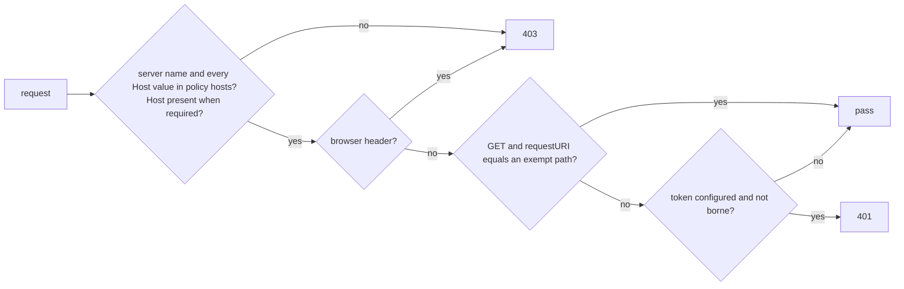

# Implementation Plan: Container guard, actuator and single-replica ruling

**Branch**: `feat/container-guard-and-actuator` | **Date**: 2026-11-05 | **Spec**: [spec.md](spec.md)
**Input**: Mission specification from `kitty-specs/container-guard-and-actuator-01M6P99A/spec.md`

## Summary

Four issues under epic #226, delivered as two pull requests:

- **Docs pull request:** the replica ruling as an ADR (#233).
- **Code pull request:**
  - the request guard gets a configured host list and a single token-exempt health path (#268, #232);
  - a new always-on start-up check holds the local loopback bind rule and the management exposure rules
    (#231, #232);
  - actuator is added with health as its only HTTP endpoint (#232);
  - the method-validation 400 mapping moves to the shared handler (#268 note).

The design follows ADR-0041 D2, D4, D6 and D7. The packs module stays profile-agnostic: the deployable decides
the guard's policy and passes it in through the constructor.

## Technical Context

**Language/Version**: Java 25 (toolchain), Spring Boot 4.1.1, Gradle with strict SHA-256 dependency verification
**Primary Dependencies**:
- Existing: spring-boot-starter-webmvc and spring-boot-starter-validation.
- New: `spring-boot-starter-actuator`, version from the Boot BOM. It is added to the catalog, and its
  verification-metadata entries are written per `docs/guides/service-build.md` "Change a dependency".

**Storage**: N/A (no state change; the replica ADR records the existing in-memory per-project state)
**Testing**:
- JUnit 5 and AssertJ.
- `ApplicationContextRunner` for the start-up rules.
- `MockHttpServletRequest` for the guard.
- `@SpringBootTest(webEnvironment = RANDOM_PORT)` or `SpringApplication` runs for the end-to-end health and
  exposure checks.
- `OutputCaptureExtension` for the secret-never-logged checks.

**Target Platform**: JVM jar and GraalVM native image (ADR-0046); a Linux container under the `container` profile
**Project Type**: single Gradle multi-module service (`service/packs`, `service/deployable`)
**Performance Goals**: none new; the guard adds one set lookup per request
**Constraints**:
- C-001 to C-006 of the spec.
- No `@Profile`; profiles are read at run time.
- Contract edits are limited to the 403 description and one fragment.

**Scale/Scope**: about 10 production files, 8 test files, 1 ADR, 2 changelog entries, 1 contract fragment, and the container guide

### Supply-chain check (DIRECTIVE_051, supply-chain-install-safety)

| Control | Result |
|---|---|
| Provenance | `org.springframework.boot:spring-boot-starter-actuator`, managed by the Spring Boot BOM already in use. Transitive: spring-boot-actuator, spring-boot-actuator-autoconfigure, micrometer-observation and micrometer-jakarta9 (metadata already partly present). |
| Pinning | Version from the BOM (4.1.1); no dynamic version. |
| Integrity | SHA-256 for every new artifact via `--write-verification-metadata sha256`; the diff is reviewed; no hand edit; no new trusted-artifact exemption. |
| Resolution route | Maven Central through Google's mirror (same artifacts, same checksums). |
| Install scripts | None (JVM jars). |
| Adversarial evidence | Pre-spec squad security lens, research.md R4 and R5. Exposure is constrained by configuration and refused at start if widened. |

## Charter Check

| Gate | Status |
|---|---|
| Divergence from the charter's own model | Not touched: no pack or domain change. |
| Contract versioning (ADR-0022) | 0.2.0-SNAPSHOT is unreleased; the description change is recorded by a fragment, with no bump and no tag. |
| Adversarial squad at plan and before merge (contract and architecture change) | Pre-spec squad done (research.md); the pre-PR squad is planned in closeout. |
| `verifyAll` on Java 25, style gates, docs checks | Planned per WP; CI runs Java 25. |
| No unverified dependency | Actuator under strict verification (table above). |
| Design as if core did not exist | Yes; no core prerequisite. |

Post-design re-check: no new gaps.

## Design

### Guard policy (packs, `infra/api`)

A new value type, `GuardPolicy`, holds:
- the accepted host names, normalized to lower case with `Locale.ROOT`;
- whether a `Host` header is required;
- the token-exempt `GET` paths.

Its factories:
- `GuardPolicy.loopback()`: today's names (`localhost`, `127.0.0.1`, `[::1]`, `::1`), no `Host` required, no
  exempt path;
- `GuardPolicy.named(Collection<String> hosts)`: the given names, `Host` required;
- `withTokenExemptGet(String path)`: adds an exempt path.

The packs module learns names and paths, never the profile.

`WorktreeGuard` gains a constructor that takes the policy. The existing three-argument constructor delegates
with `GuardPolicy.loopback()`, so the local behaviour stays identical.



The exempt path is compared with `getRequestURI()` exactly. That is the raw path, with no decoding and no
normalization, and the context path must be empty. Every variant therefore fails closed to the token check.

### Composition (deployable)

`GuardWiring.worktreeGuardRegistration` takes `ContainerWiring`:
- **Under the container profile:** `GuardPolicy.named(allowedHosts).withTokenExemptGet("/actuator/health")`.
- **Otherwise:** `GuardPolicy.loopback()`.

`ContainerProperties.allowedHosts` adds an element `@Pattern`, case-insensitive, accepting three forms:
- an LDH DNS name with no trailing dot;
- an IPv4 dotted quad;
- a bracketed IPv6 literal of hex digits, colons and dots.

The pattern rejects `0.0.0.0` and `[::]` by negative lookahead. The message names the property.

### Exposure start-up check (deployable, new, always on)

The check is `ExposureStartupCheck implements InitializingBean`, with a `LazyInitializationExcludeFilter`. It
reads the profile at run time:

- **Without `container`:** `server.address` is resolved with `InetAddress.getByName` and must be a loopback
  address. Blank and unset are refused, because Spring's default is all interfaces (FR-012).
- **Both profiles:**
  - `management.server.port` and `management.server.address` must be unset (FR-011).
  - `management.endpoints.web.base-path` must be unset or `/actuator`.
  - `management.endpoints.web.exposure.include` must be exactly `health`.
  - `management.endpoint.health.show-details` and `show-components` must be `never`.
  - `management.endpoint.env.show-values`, `management.endpoint.configprops.show-values` and
    `management.endpoint.quartz.show-values` must be `never` where set.
- **Under `container`:** `spring.mvc.log-request-details` must not be `true` (FR-016).

The messages name the property and never a value.

### Configuration

- **`application.yaml` (both profiles):**
  - `management.endpoints.web.exposure.include: health`;
  - `management.endpoints.web.discovery.enabled: false`;
  - `management.endpoint.health.show-details: never` and `show-components: never`;
  - `management.endpoint.env.show-values: never` and `management.endpoint.configprops.show-values: never`;
  - `management.endpoints.jmx.exposure.exclude: "*"` and `spring.jmx.enabled: false`;
  - `management.endpoints.access.default: none` with `management.endpoint.health.access: read-only`.
- **`application-container.yaml`:** `server.forward-headers-strategy: none`.

### 400 mapping (packs)

`ProblemHandler` gains an `@ExceptionHandler(ConstraintViolationException.class)`:
- It answers 400 `Problem` when every violation's property path ends in a `PARAMETER` (or `CROSS_PARAMETER`)
  node.
- Otherwise it answers the 500 `internal_error`, and logs it as `unexpected` does.

The local handler in `ArtifactController` is removed, and its test moves to the shared handler.

### Contract

The 403 text in `responses/Forbidden.yaml` and in the `charterWorktreeToken` security-scheme description now
reads: "a Host whose name is not localhost, 127.0.0.1 or [::1] (a containerized deployment compares against
its configured host list instead)". One fragment goes in `changes/2026-11-05-forbidden-configured-hosts.md`
under `### Changed`.

`/actuator/health` is not a contract operation (ADR-0041 D7). No contract path is added.

### Replica ADR

The ADR is `docs/adr/00NN-one-replica-per-deployment.md`. Its number is the next free one against `main` and
the open PRs; 0059 is taken by PR #376. It covers:
- the decision: one replica, and why (the ADR-0033 copy and the ADR-0018 ETags are in memory per project);
- what breaks with two replicas;
- when this is revisited (a hosting option is chosen);
- the follow-ups, which are #233's remaining scope items, deferred.

`run-in-a-container.md` says "single replica".

## Project Structure

### Documentation (this mission)

```
kitty-specs/container-guard-and-actuator-01M6P99A/
├── spec.md  plan.md  research.md  data-model.md  quickstart.md
├── checklists/requirements.md
└── tasks.md, tasks/  (from /spec-kitty.tasks)
```

### Source Code (repository root)

```
service/packs/src/main/java/ai/speckitty/charter/packs/infra/api/
  GuardPolicy.java (new), WorktreeGuard.java, ProblemHandler.java, ArtifactController.java
service/packs/src/test/java/ai/speckitty/charter/packs/infra/api/
  WorktreeGuardTest.java, GuardPolicyTest.java (new), ProblemHandlerTest.java (new or extended), ArtifactControllerTest.java
service/deployable/src/main/java/ai/speckitty/charter/deployable/
  GuardWiring.java, ContainerProperties.java, ExposureStartupCheck.java (new)
service/deployable/src/main/resources/application.yaml, application-container.yaml
service/deployable/src/test/java/ai/speckitty/charter/deployable/
  GuardWiringTest.java, ContainerPropertiesTest.java, ExposureStartupCheckTest.java (new),
  ContainerHealthTest.java (new, end-to-end both profiles), ContainerSecretsTest.java
service/deployable/build.gradle.kts, gradle/libs.versions.toml, gradle/verification-metadata.xml
contracts/charter/responses/Forbidden.yaml, contracts/charter/openapi.yaml, contracts/charter/changes/<fragment>.md
docs/adr/00NN-one-replica-per-deployment.md, docs/guides/run-in-a-container.md, deploy/compose/*, docs/changelog/*.md
```

**Structure Decision**: existing modules only. The guard policy lives beside the guard in the packs infra layer.
The profile decision lives in the deployable (ADR-0041 D2).

## Implementation Concern Map

| IC | Concern | Requirements | Delivery |
|---|---|---|---|
| IC-01 | Replica ADR and the guide's "single replica" | FR-019 | Docs PR (closes #233) |
| IC-02 | Guard policy: host list, Host required, exempt GET path; the 403 contract text | FR-001 to FR-007, FR-009, FR-010 | Code PR |
| IC-03 | Exposure start-up check: local bind, management rules, request-detail logging | FR-011 to FR-013, FR-016 | Code PR |
| IC-04 | Actuator dependency and configuration; end-to-end health and exposure tests | FR-008, FR-009, FR-011, FR-017, NFR-001 to NFR-003 | Code PR |
| IC-05 | Profile guard tests: never default, missing-secret start | FR-014, FR-015 | Code PR |
| IC-06 | Shared 400 mapping | FR-018 | Code PR |
| IC-07 | Guide, compose example and changelog | FR-020 | Code PR |

## Risks

- **Native image and actuator.** The native PR job proves it (NFR-002). If hints are missing, add them to
  `CharterRuntimeHints`.
- **Path-enumerating tests.** Contract or document tests may enumerate served paths and flag
  `/actuator/health`. They get a documented carve-out (ADR-0041 D7: not a contract operation).
- **Merge conflicts.** Session B may touch `ArtifactController` or the contract. The removal there is small, and
  the contract edit is limited to the 403 text. Rebase before review.
