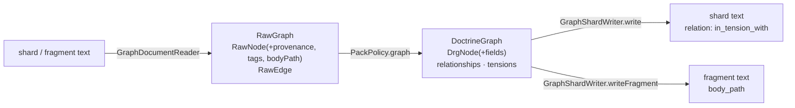

# Implementation Plan: DRG tension edges and node fields round-trip

**Branch**: `issue-235-236-drg-round-trip` | **Date**: 2026-10-31 | **Spec**: [spec.md](spec.md)
**Input**: Mission specification from `kitty-specs/drg-tension-and-node-fields-01M68A0T/spec.md`

## Summary

Two round-trip losses on the domain path of a graph document (reader → `PackPolicy.graph` → kernel
`DoctrineGraph` → `GraphShardWriter`):

- **#235**: `PackPolicy` reads an `in_tension_with` edge as `RelationType.IMPACTS` with strength −1, and
  the writer emits it as `impacts` with no strength. Fix:
  - a kernel `Tension` value, held in `DoctrineGraph` beside the structural relationships (ADR-0028
    D3; decision DM-01M68A2TYC1VMDPCJ8B76602YH);
  - `PackPolicy` binds `in_tension_with` to it;
  - the shard writer writes it back as `in_tension_with` (ADR-0036 D4).
- **#236**: `RawNode` and `DrgNode` have no `provenance`, `tags` or `body_path`, so the reader, the policy
  and the writer drop them. Fix: carry all three through, with `tags` an ordered list (ADR-0036 E10,
  E15), and add a fragment write so `body_path` is proven end to end.

The two expected-red entries leave once the gate reports them green. Records that state the −1 reading
are corrected: a new ADR, DIV-018, the `Relation` javadoc, and the `Relation.yaml` description text. No
contract path, schema, enum value or wire shape changes.

## Technical Context

**Language/Version**: Java 25 (Temurin; Gradle toolchain; `JAVA_HOME=/usr/lib/jvm/temurin-25`)
**Primary Dependencies**: SnakeYAML Engine (existing), JSON Schema validator (existing, `PackSchemas`); no dependency added, upgraded or removed
**Storage**: Pack files on disk (YAML graph documents); no store change
**Testing**: JUnit 5 + AssertJ, red-first. Unit tests in `:kernel` and `:packs`; the whole-pack gate (`:packs:wholePackRoundTrip`, tag `whole-pack`) against open-packs `5df92a5d`
**Target Platform**: Linux JVM service (Spring Boot deployable, unchanged)
**Project Type**: single (Gradle multi-module service under `service/`)
**Performance Goals**: no measurable change; graph reads stay linear in nodes and edges
**Constraints**:
- no HTTP contract change (C-001) and no pack-schema change (C-002);
- the kernel uses JDK types only (C-003);
- 0 new suppressions; complexity ≤ 15 per method.
**Scale/Scope**: about 10 production files across `:kernel` and `:packs`, plus their tests, two gate data files and docs

**Supply chain (DIRECTIVE_051)**: no dependency decision is made, so no control applies and no
adversarial evidence is owed for one.

## Charter Check

| Charter item | Check | Result |
| --- | --- | --- |
| Divergence from the charter's own model | Restores the model's meaning of tension (ADR-0028) and the round-trip of every declared field (ADR-0036) | Pass |
| Breaking the OpenAPI contract | No path, schema, enum or wire change. Only descriptive text in the unreferenced `Relation.yaml` is corrected, with a CHANGELOG line | Pass; logged as an open review item |
| Open-packs YAML round-trips without loss of meaning | This is the fix; the gate proves it | Pass |
| No unverified dependency | None added | Pass |
| Adversarial squad at the plan point for domain changes | A kernel type is added (`Tension`) and `DrgNode` grows. The plan-point squad runs before implementation; findings are folded or filed in `research.md` | Pass |
| Test first, no fake green | Every behaviour has a red test on the production path (reader → policy → writer), with same-fixture positive controls | Pass |
| DDD vocabulary | "tension", "relationship", "node" as in ADR-0028 and the glossary | Pass |
| Decision documentation | A new ADR records the domain representation that ADR-0028 D5 left open | Pass |
| A call made without review is logged | DM-01M68A2TYC1VMDPCJ8B76602YH is listed as an open review item in the PR | Pass |

No violations, so Complexity Tracking stays empty.

## Project Structure

### Documentation (this mission)

```text
kitty-specs/drg-tension-and-node-fields-01M68A0T/
├── spec.md
├── plan.md
├── research.md            # plan-phase decisions + squad dispositions
├── research/pre-spec-squad.md
├── data-model.md
├── quickstart.md
└── tasks/
```

### Source Code (repository root)

```text
service/kernel/src/main/java/ai/speckitty/charter/kernel/domain/
├── DrgNode.java            # + provenance, tags, bodyPath (2-arg constructor kept)
├── Tension.java            # NEW: the ADR-0028 tension between two rules
├── DoctrineGraph.java      # + tensions(), merge, equals/hashCode
├── Relation.java           # javadoc: IMPACTS no longer "replaces in_tension_with"
└── RelationType.java       # javadoc only
service/packs/src/main/java/ai/speckitty/charter/packs/
├── domain/PackContents.java      # RawNode + provenance, tags, bodyPath
├── domain/PackPolicy.java        # in_tension_with → Tension; node fields carried
└── infra/storage/
    ├── GraphDocumentReader.java  # reads provenance, tags, body_path
    ├── GraphShardWriter.java     # writes node fields + in_tension_with; + fragment write
    └── RelationshipMapper.java   # unchanged unless a tension mapper is placed here
service/packs/src/test/resources/whole-pack/expected-red.yaml   # two entries removed
docs/adr/00NN-*.md, docs/conformance/divergences.yaml, divergence-register.md,
contracts/charter/schemas/Relation.yaml (description), contracts/charter/CHANGELOG.md
```

**Structure Decision**: the existing modules (`:kernel`, `:packs`). No new module.

## Design



- **`Tension` (kernel record)**: `from: Urn`, `to: Urn`, `when: Optional<String>`,
  `rationale: Optional<String>`.
  - Record equality is the directed triple plus texts (ADR-0036: compared as written).
  - Its constructor refuses a self-loop and `null`s, like `Relationship`.
  - It carries no strength (ADR-0028 D1).
  - It is not a `Relationship`, so pair identity and `RelationshipMerge` never see it.
- **`DoctrineGraph`** gains `tensions()` and a three-argument constructor. The two-argument constructor
  means "no tensions". `merge` concatenates tensions; `equals` and `hashCode` include them.
- **`PackPolicy.edge`**: when the relation is `in_tension_with`, the result is a `Tension`. The checks
  keep today's order and texts:
  - `impacts` present → "an in_tension_with edge has no 'impacts'";
  - an endpoint that is not a URN;
  - a self-loop.
  - `LEGACY_TENSION_STRENGTH` and the IMPACTS mapping go.
  - The `in_tension_with` spelling stays a `PackPolicy` and storage constant (`TENSION`), not a kernel
    token.
- **`GraphShardWriter`**:
  - nodes are written as `urn, kind, label?, provenance?, tags?` (tags only when non-empty, the order of
    `GraphDocumentYaml`);
  - relationships as today, then each tension as `source, target, relation: in_tension_with, when?,
    reason?`;
  - a new `writeFragment(DoctrineGraph)` writes `id, kind (plural), title?, body_path?`, with edges.
- **Fragment kind plural**: `ArtifactKind` already holds the plural (used by `fromPlural`). `NodeKind`
  gains the inverse `plural()` for `ACTION` and `MISSION_TYPE` (`actions`, `mission_types`). PR-B
  changes `NodeKind.fromPlural`; the inverse is written so a rebase is mechanical.
- **Order in a written shard**: edges are compared as a set (ADR-0036), so tensions after relationships
  changes no meaning.

## Squad changes (plan point-cut; see research.md S1–S20)

- **Registered shard**: `PackPolicy.registeredGraph` reports a tension as a finding, and
  `RelationshipShard.read` uses it (S1).
- **Writer shape rules**: the fragment root and edge key set are fixed (S3, S5).
- **Gate adapter**: re-binds the written shard and compares the graphs (S10).
- **Production-path fixture**: provenance, tags, a tension with `when` and a coexisting `requires`
  (S2).
- **Equality guards**: in `DoctrineGraphTest` (S4).
- **Text-level absent-key assertions** (S9).
- **Records list**: completed (S8).

## Implementation Concern Map

### IC-01 — Node fields through the domain (#236)

- **Purpose**: keep shard node `provenance` and `tags` (ordered) and fragment node `body_path` from read to write.
- **Relevant requirements**: FR-005, FR-006, FR-007, FR-008
- **Affected surfaces**: `DrgNode`, `PackContents.RawNode`, `GraphDocumentReader`, `PackPolicy` (`shardNode`, `fragmentNode`), `GraphShardWriter` (+ `writeFragment`), `NodeKind`; tests `GraphDocumentReaderTest`, `PackPolicyGraphTest`, `DoctrineGraphTest`
- **Sequencing/depends-on**: none
- **Risks**:
  - `DrgNode` arity: keep a two-argument constructor so `GraphWalk`, `RelationshipShard` and the tests
    are unchanged.
  - Absent and empty tags are equal (`GraphDocument` rule), so tags are written only when non-empty.

### IC-02 — Tension relationship (#235)

- **Purpose**: read `in_tension_with` as the ADR-0028 tension, hold it beside the relationships, and write it back as written.
- **Relevant requirements**: FR-001, FR-002, FR-003, FR-004, FR-011
- **Affected surfaces**: new `Tension`; `RelationshipShard` + `PackPolicy.registeredGraph` (S1); `DomainRoundTrip.shard` re-bind (S10); `DoctrineGraph`; `PackPolicy.edge`, `graph`; `GraphShardWriter`; `VocabularyEqualityTest` (meaning of the extra spelling); `PackPolicyGraphTest`; orphaned load fixtures `shard-legacy-tension-is-impacts-minus-one`, `shard-impacts-on-legacy-tension-edge`
- **Sequencing/depends-on**: none (it shares `GraphShardWriter` and `PackPolicy` with IC-01, so it lands in the same lane)
- **Risks**: `PackPolicy.edge` returns `Object` (a `Relationship` or a finding). A third outcome type
  must keep the method readable and its complexity ≤ 15, so tension binding goes in a helper.

### IC-03 — Gate ratchet and records

- **Purpose**: remove both expected-red entries once the gate reports `UNEXPECTEDLY_GREEN`, and correct every record that states the −1 reading.
- **Relevant requirements**: FR-009, FR-010
- **Affected surfaces**: `expected-red.yaml`; new ADR (number picked at writing time, against main and open PRs); `docs/conformance/divergences.yaml` + `divergence-register.md` (DIV-018); kernel `Relation`/`RelationType` javadoc; `contracts/charter/schemas/Relation.yaml` description; `contracts/charter/CHANGELOG.md`; `docs/architecture/logical-model.md` if it states the old mapping; a `docs/changelog/` entry
- **Sequencing/depends-on**: IC-01, IC-02
- **Risks**:
  - The `Relation.yaml` text edit touches `contracts/charter/`. It is description only and is logged as
    an open review item.
  - The contract's breaking-change check must stay green.
