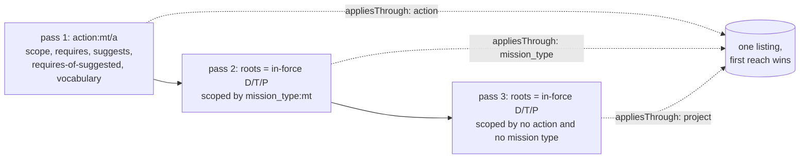

# Implementation Plan: Slice C, the effective step and action context

**Branch**: `kitty/mission-effective-step-and-action-context-01M774HB`, merging into `slice-c/effective-step-context`
(PR to `main`) | **Date**: 2026-11-12 | **Spec**: [spec.md](spec.md)
**Input**: `kitty-specs/effective-step-and-action-context-01M774HB/spec.md`; [research.md](research.md) R1 to R10.

## Summary

Three deliveries, one contract change set:

1. **The effective action context applies the ownership rule** (#450, operator ruling R1). The effective walk runs
   three passes (action, mission type, project-wide), and each item says through which with `appliesThrough`. ADR-0018
   D5 and rule E16 are amended, and the 16 directives of the evidence are explained.
2. **ADR-0066 phase 2** (#438). Three compose checks for step enhancements (`prompt_slot_missing`, target held,
   inherited lock) on reads and at registration, and the effective-prompt read
   `GET /activations/{activationId}/mission-types/{missionType}/actions/{action}/prompt` with
   `409 mission_type_not_in_force` (OD-5) and a `prompt` link on the context.
3. **R3 (#97) is decided and closed** (R6): docs only.

## Technical Context

**Language/Version**: Java 25 (Temurin), Gradle multi-project build (`./gradlew`, run with `--max-workers=1`, never
two runs at once)
**Primary Dependencies**: Spring Boot (web transport), the OpenAPI generator over `contracts/charter` (`charter-api`,
`skipDefaultInterface`), Jackson; no dependency is added (DIRECTIVE_051: no supply-chain decision in this mission)
**Storage**: Charter Packs on the file system, read through the `packs` storage ring; activations stored as documents
**Testing**: JUnit Jupiter, AssertJ, ArchUnit (`HexagonalArchitectureTest`), Cucumber-JVM contract scenarios under
`contracts/charter/scenarios/` (BDD first, C-004), the contract lint and its tests, the whole-pack round trip over the
example packs (ADR-0070), PIT on the slices it already covers
**Target Platform**: Linux server and native image (the `service-v*` line), Java 25
**Project Type**: single hexagonal service; slices `kernel`, `packs`, `activations`, `missions`, `missions-edge`,
`web-transport`, `deployable`
**Performance Goals**: the prompt read and the context stay linear in the enhancements and in the artifacts in force
(NFR-002, NFR-003: operation-count ratio at most 2.2 between 1,000 and 2,000)
**Constraints**: determinism (NFR-001, NFR-004: byte-identical across 100 reads and every permutation of three packs);
canonical shape only in tests (C-005); stay out of slice B's files (C-006)
**Scale/Scope**: about 12 contract files, 2 ADR amendments, 1 divergence entry, rules-page and glossary edits; code
in `packs` (application, domain, a new storage adapter), `activations` (application, domain, infra), `web-transport`
(refusal mapping)

## Charter Check

| Gate (charter.md) | How this plan meets it |
|---|---|
| Divergence from the charter's own model | The scoping rule is the operator's ruling on the charter's model (ADR-0018 D5); core's behaviour is cited as evidence and the one deliberate difference (mission-type scope honoured) is registered. |
| OpenAPI contract and its versioning | Every change has a dated fragment: `### Added` (read, schemas, `prompt` link, `appliesThrough`), `### Changed` (`prompt_slot_missing` raised, `override_not_permitted` broadened), `### Breaking` (new enum value `mission_type_not_in_force`; the context lists more; compose and registration refusals). 0.x line, ADR-0022. |
| Round trip by meaning | No holding or write-back changes (C-002). `:packs:wholePackRoundTrip` stays required and green. |
| Canonical model, no legacy readers | No old shape is read; example packs gain only canonical content. |
| Tests carry only canonical shape | Fixtures added in the canonical shape; invalid shapes only in refusal tests (twins per SC-002). |
| Adversarial squad at plan point and before merge | Plan-point squad on this plan; pre-merge squad after the rebase onto #501 (C-006). |
| Gates before merge | `verifyAll` runs in CI on Java 25; locally per-module tasks only, foreground, one at a time. Docs checks: `check_docs.py`, markdownlint, cspell. |
| Issues stay small | Squad minors folded or listed under "Not done"; #438, #450, #97 closed with evidence; #467 ticked. |

No violation to justify.

## Project Structure

### Documentation (this mission)

```
kitty-specs/effective-step-and-action-context-01M774HB/
├── spec.md, plan.md, research.md, data-model.md, quickstart.md
├── contracts/            # the contract delta of this mission (planning copy)
└── tasks/                # /spec-kitty.tasks
```

### Source Code (repository root)

```
contracts/charter/        paths/, schemas/, examples/, responses/, scenarios/, changes/, openapi.yaml
contracts/lint/           ruleset.yaml (the link-relation enum gains prompt)
service/packs/            application/ (ActionContextWalk, ClosureView, EffectivePromptQuery, ImpactRelations,
                          RegistrationImpact), domain/ (PromptSlotFacts port, EnhancementCompose rules),
                          infra/storage/ (a new StoredPromptSlotFacts adapter), testFixtures/ example packs
service/activations/      application/ (EffectiveReadService, PacksSession), domain/ (EffectiveContext, EffectiveTag,
                          EffectivePrompt), infra/packs/ (ClosureViewSession, ActivationImpactAdapter),
                          infra/api/ (ActivationController, EffectiveReadMapper, ActivationMapper)
service/kernel/           RefusalCode (MISSION_TYPE_NOT_IN_FORCE)
service/web-transport/    RefusalHandler (statuses and per-operation 422s)
docs/                     adr/0018, adr/0066, architecture/composition-and-activation-rules.md,
                          conformance/divergence-register.md, api/service-contract.md, glossary, changelog,
                          development/hypermedia-hateoas.md
```

**Structure Decision**: The existing hexagonal layout. The walk and the prompt query stay in `packs.application`,
served through `activations` as the context read is (`ACTIVATIONS_NAME_PACKS_ONLY_FROM_ADAPTER`). Slot facts are part
of `PackCompositionFacts` (research R9), the compose's one verified, staged-aware input. That needs **one additive hunk
in `DomainRepositoryService.compositionFacts`**, slice B's file, written after the rebase onto #501 and announced to the
orchestrator. No other slice-B file is edited: not `PackCommitStore`, `PackLocator`, `CommitStorePackWriteStore`,
`FileSystemPackSources`, `Loader`/`LoadedPack`, `CharterWiring` or `file-kinds.yaml`. The shared
`CharterRefusalCode.yaml` gains one enum value and edits to existing entries. The example packs are not edited; cases
they lack use scenario fixtures. The plan-point squad's findings and their dispositions are in
[research/plan-squad-2026-11-12.md](research/plan-squad-2026-11-12.md).

## Design

### The ownership rule in the walk (research R1 to R4)



- `ActionContextWalk` gains an effective form. The offering read keeps the five-step walk unchanged (ADR-0018 D1).
- One `Engine` runs the passes over one listing. Each entry carries its pass and, for passes 2 and 3, its root. Pass
  roots are seeded with explicit hops, so the engine never asks the hops of a node it did not reach (squad A7).
- A suggestion and its candidate carry the pass that lists them.
- First reach wins in every step, vocabulary included.
- Owners are every authored `scope` edge whose source kind is `action` or `mission_type`, held or not (research R2,
  squad A6). They are memoized once per merged index, which keeps the rule linear (NFR-003).
- `EffectiveContext.of` carries `appliesThrough` per item. The context's `enhancements` cover the artifacts of every
  pass (E12).

### Compose checks (FR-001, FR-002; research R7, R9)

| Check | Pure rule (packs.domain) | Reads (500) | Registration and impact-checked writes (422) | Activation writes (422) |
|---|---|---|---|---|
| C37 target held | the `enhances` target `action:M/s` of a step enhancement is held by a pack of its `depends_on` closure (`StepHolding.heldByPack`) | `pack_reference_pack_missing` / `pack_reference_artifact_missing`, in `OfferingReadService.composed` | the same, through `Views.over(staged)` | composes as reads |
| C22/C25 inherited lock | `mission_type:M` is `LOCKED` in the closure without the enhancing pack (`PerPackPolicy.levelIn`, as `judgedWithout`) | `pack_unreadable`, from `MergeInputs.merged()` | `override_not_permitted`, from `ImpactRelations` beside `notPermitted` | composes as reads |
| C38 slot declared | every slot an **in-force** enhancement names is declared by the prompt in force of its target (R8), from the prompt facts | `prompt_slot_missing`, from an explicit `ClosureView.requireSlots(states)` that the read session calls; `inForce` stays pure | through a new `ActivationImpact` gate method, called on every check path, per stored activation the change joins; never swallowed | `requireSlots` before the document is stored |

- E6's unheld-target branch now covers only the enhancer shapes C37 does not refuse. It is amended with its pinning
  tests (squad A5).
- On reads, the order is defined in F6: composition codes, then `pack_unreadable` (merge), then
  `prompt_slot_missing`.

### The effective-prompt read (FR-003 to FR-007; research R5, R8, R10)

- `packs.application.EffectivePromptQuery` takes a merged closure, in-force states, `M` and `s`. It answers:
  - the prompt in force: the stored companion at the merged winner's place of `action:M/s` (R8), read through
    `PackCompanionFiles.stepFiles` under the closure fingerprint check;
  - its slots, in declaration order, taken from the prompt facts;
  - per slot, the canonical fragment texts of the in-force enhancements whose sole target is `action:M/s`, ordered by
    level, pack descriptor name and enhancement id, compared by code point;
  - `prompt_slot_not_empty` diagnostics (OD-7, OD-8).
- In `activations`:
  - `EffectiveReadService.prompt` judges in the order of R10;
  - the tag is `EffectiveTag.Read.PROMPT`, and E17's separator moves to `v3`;
  - the read is served by `ActivationController.getEffectiveStepPrompt` and mapped by `EffectiveReadMapper.toPrompt`.
- The prompt read's links:
  - `self`;
  - `effective-artifact`: the step under the activation (squad R13: it can 404 for a step only a replaced version
    keeps; deferred to a follow-up);
  - `effective-context`.
- The context's `_links.prompt` is set when the mission type is in force.

## Complexity Tracking

None.

## Implementation Concern Map

### IC-01 — Contract delta and scenarios first

- **Purpose**: Write the contract changes and the BDD scenarios before code, so the generated interface and the
  scenarios drive the build (C-004).
- **Relevant requirements**: FR-001 to FR-009, C-001, C-004, SC-001 to SC-004.
- **Affected surfaces**:
  - New path: `contracts/charter/paths/activations_activationId_missionTypes_missionType_actions_action_prompt.yaml`.
  - New schemas: `schemas/EffectiveStepPrompt.yaml`, `EffectivePromptSlot.yaml`, `EffectivePromptFragment.yaml`,
    `SlotId.yaml`, `EffectiveContextArtifact.yaml`.
  - Changed schemas: `EffectiveActionContext.yaml`, and `CharterRefusalCode.yaml` (the enum value, the
    `prompt_slot_missing` operations map listing every 422 operation, and `override_not_permitted`).
  - Also: `openapi.yaml`, `schemas/_index.yaml`, the examples, and `contracts/lint/ruleset.yaml` (the `prompt` relation,
    in the same commit as the `RelationTableParityTest` row).
  - Change fragments under `changes/2026-11-12-*.md`: one `### Breaking` fragment naming every newly refusing operation
    and the item swap; `### Added` for the read and the link.
  - Scenarios:
    - `effective-step-prompt.feature`, including the three-levels ordering fixture (squad R1);
    - `step-enhancement-compose.feature`, with one twin per rule × surface;
    - `effective-context-scoping.feature`: the 16-directive table as its example table, the type-scoped, other-type,
      other-type-not-in-force and required-scoped-elsewhere cases (squad R2, R8);
    - rewrites of `effective-graph-and-context.feature` US5 AS4 and the #484 case (squad R3);
    - `errors.feature` raised-code rows and declaration pins;
    - the step vocabulary printing `appliesThrough`, with its binding in `EffectiveGraphSteps` and the scenarios README.
  - Tests: `WireTokenParityTest` pairs, and the contract-marks test gaining `PROMPT_SLOT_MISSING` and
    `MISSION_TYPE_NOT_IN_FORCE`.
- **Sequencing/depends-on**: none. The prompt path and its controller land together (IC-05).
- **Risks**: `CharterRefusalCode.yaml` is shared with slice B.

### IC-02 — The ownership rule in the effective walk

- **Purpose**: List every in-force directive, tactic and paradigm the ruling says applies, with `appliesThrough`.
- **Relevant requirements**: FR-008, FR-009, NFR-003, NFR-004, SC-004.
- **Affected surfaces**:
  - `packs/application`: `ActionContextWalk`, `EdgeIndex` (scope owners, memoized) and `ClosureView.actionContext`.
  - `activations`: `application/PacksSession`, `infra/packs/ClosureViewSession`, `domain/{ActionContext,
    EffectiveContext, EffectiveTag}` and `infra/api/EffectiveReadMapper`.
- **Sequencing/depends-on**: IC-01.
- **Risks**: The offering walk's tests must stay unchanged. The effective-read tests on example packs that list
  unscoped artifacts change meaning, and are audited and rewritten.

### IC-03 — Prompt facts in the composition facts

- **Purpose**: Give the compose checks and the read one verified source of declared slots, fragment slots and fragment
  text (research R9).
- **Relevant requirements**: FR-001, FR-003, FR-005.
- **Affected surfaces**: `packs/domain/PackCompositionFacts` (the new `prompts` member); the one hunk in
  `packs/infra/storage/DomainRepositoryService.compositionFacts`; `packs/application/WriteFacts` (keeping the member on
  write transforms); `CompositionFactsCacheTest`.
- **Sequencing/depends-on**: the rebase onto #501, for the `DomainRepositoryService` hunk. The record change can come
  first.
- **Risks**: The canonical render must equal the load rule's (A5); a test compares the facts with
  `PackContents.promptSlots`.

### IC-04 — Compose checks

- **Purpose**: Refuse a compose that would misplace or drop a fragment.
- **Relevant requirements**: FR-001, FR-002, FR-006, SC-002, SC-003.
- **Affected surfaces**:
  - `packs/domain`: pure rules (target held, inherited lock, slots declared).
  - `packs/application`: `OfferingReadService.composed` (C37), `ClosureView` (`MergeInputs.merged()` lock and
    `requireSlots`), `ImpactRelations`, `RegistrationImpact` (the gate on every path) and `ActivationImpact` (the gate
    method).
  - `activations`: `infra/packs/ActivationImpactAdapter` (implements the gate), `application/ActivationWrites` and
    `ActivationService` (`requireSlots` before storing).
  - `web-transport/RefusalHandler` (the 422 per operation) and `ReservedRefusalCodesTest`.
- **Sequencing/depends-on**: IC-01, IC-03.
- **Risks**: Each rule needs a failing fixture and a passing twin on every surface.

### IC-05 — The effective-prompt read

- **Purpose**: Serve the prompt in force and its ordered fragments, with `409 mission_type_not_in_force` and the
  context's `prompt` link.
- **Relevant requirements**: FR-003, FR-004, FR-005, FR-007, NFR-001, NFR-002, SC-001.
- **Affected surfaces**:
  - `packs/application`: `EffectivePromptQuery` and `ClosureView`.
  - `activations`: `application/{EffectiveReadService, PacksSession}`, `domain/{EffectivePrompt, EffectiveTag}` and
    `infra/{packs/ClosureViewSession, api/ActivationController, api/EffectiveReadMapper, api/ActivationMapper}`.
  - `kernel/RefusalCode` and `web-transport/RefusalHandler`.
- **Sequencing/depends-on**: IC-01, IC-03; IC-04 for `requireSlots`.
- **Risks**: The NFR-001 and NFR-002 gates.

### IC-06 — Records and docs

- **Purpose**: Make the records say what the service does.
- **Relevant requirements**: FR-010, FR-011, FR-012, SC-005.
- **Affected surfaces**:
  - ADR-0018: dated amendments on D2, D3 and D5, with `decision_status` and `updated` bumped.
  - ADR-0066: annotations on d4, d7, d8 and d9, a "now built" annotation, and the built marker on the Follow-ups.
  - The rules page (`composition-and-activation-rules.md`):
    - define the "Built (slice C)" label;
    - amend E6, E12, E16 (remove the ⚠ note), E17 (`v3`, `PROMPT`) and E18 (the `409`);
    - amend C22 and C25 for the inherited lock;
    - add C37 and C38;
    - amend F6 and G8, and fix the section 8 intro and its "reserved" paragraph;
    - add the section 7 status rows;
    - state the R-REL `relate` path.
  - The conceptual-model integrity note.
  - `divergence-register.md` and `divergences.yaml`: a dated note on DIV-244, the new DIV-245, and the block prose.
  - `docs/api/service-contract.md`: the R3 and R9 rows and the operation lists.
  - `docs/development/`: `hypermedia-hateoas.md`, `http-status-codes.md` and `rest-resource-conventions.md`.
  - The glossary: effective step prompt, project-wide artifact and scope owner; the effective action context
    definition amended.
  - `docs/changelog/2026-11-12-*.md` and its index.
  - `docs/plans/roadmap.md` and `next-slices-2026-11-11.md`: reword "match core".
- **Sequencing/depends-on**: IC-02, IC-04, IC-05.
- **Risks**: `RelationTableParityTest` and the docs checks pin the text.
