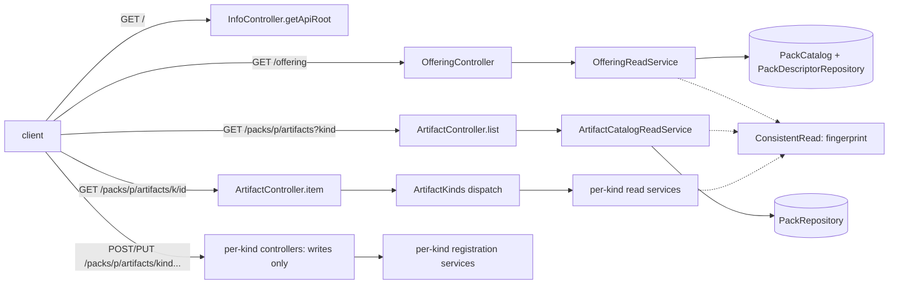

# Implementation Plan: Gate-A read surface: API root, offering, generic artifact routes and links

**Branch**: `issue-126-offering-reads` | **Date**: 2026-10-31 | **Spec**: [spec.md](spec.md)
**Input**: Mission specification from `kitty-specs/gate-a-read-surface-01M691ND/spec.md`

## Summary

This plan brings the charter contract and service onto ADR-0019's resource tree, inside the
unreleased `0.1.0-SNAPSHOT`.

- **New reads:**
  - an API root (`GET /`);
  - the offering pack list (`GET /offering`);
  - one generic artifact read family, `GET /packs/{packId}/artifacts` (paged, `?kind=`) and
    `GET /packs/{packId}/artifacts/{kind}/{artifactId}`, answering a closed `Artifact` envelope.
- **Moved writes.** The eight per-kind writes move to `POST /packs/{packId}/artifacts/<kind>` and
  `PUT /packs/{packId}/artifacts/<kind>/{id}`, keeping one typed operation per kind and answering
  the envelope. Every per-kind route is removed with no alias.
- **Links.** One `Links` component gives every JSON success answer `_links.self`. The closure
  checker exempts `Links` alone, and a lint rule checks relation keys against the hypermedia guide.
- **Fingerprint (#175).** It is required on the four verified GET 200s and declared nowhere else.
  The lint rules are narrowed and added to match.
- **500 examples (#176).** `OfferingUnreadable`'s examples name only raised codes. A scenario pins
  `pack_unreadable` on an item read.
- **Approach.** The work runs red-first (ATDD) in one lane of five work packages. Each leaves
  `verifyAll` green.

## Technical Context

**Language/Version**: Java 25 (Temurin; toolchain at `/usr/lib/jvm/temurin-25`), OpenAPI 3.1.0 contract, Gherkin scenarios.
**Primary Dependencies**:
- Spring Boot (web MVC);
- openapi-generator "spring" (`interfaceOnly`, `useTags`, `useBeanValidation`);
- vacuum (lint);
- oasdiff (release gate);
- Cucumber with JUnit Platform (contract scenarios);
- ArchUnit.

No dependency changes.
**Storage**: Files. Configured packs are read through the existing `DomainRepositoryService`. No storage change; one new domain port lists the configured packs.
**Testing**:
- Contract scenarios (`:deployable:test`, `CharterContractSuite`) are the acceptance tests, written first.
- Lint fixtures (`:contracts:lintFixtures`) and closure fixtures (`:contracts:test`) cover the contract rules.
- Unit tests cover the application services and the paging cursor.
- ArchUnit stays unchanged.
- `./gradlew verifyAll` is the full gate.
**Target Platform**: A local or hosted JVM service on Linux. The client is core's future generated client (#13).
**Project Type**: A single Gradle multi-module service plus the contract module (`contracts/`, `service/*`).
**Performance Goals**: One list page is one verified read of one pack. Pages hold at most 200 items (default 50).
**Constraints**:
- C-001 to C-009 of the spec;
- no new suppressions;
- method complexity ≤ 15;
- strict SHA-256 dependency verification;
- `info.version` stays `0.1.0-SNAPSHOT`.
**Scale/Scope**:
- 21 operations today, 15 after: `/info`, `/openapi.yaml`, the root, `/offering`, 2 artifact reads, 8 writes and the relationships write;
- about 46 existing files touched, plus about 20 new contract, fixture and scenario files.

## Charter Check

| Charter item | How this plan meets it |
|---|---|
| Divergence from the charter's own model (must never go wrong 1) | Answers are projected from the canonical `Pack` model and the existing per-kind domain types. No new representation of an artifact's content: the envelope embeds the existing schemas unchanged. |
| Breaking the OpenAPI contract (must never go wrong 2) | ADR-0022: the contract is unreleased 0.x, the breaks land under `0.1.0-SNAPSHOT` `### Breaking`, and the release gate has no baseline (no tag). No released contract is broken. |
| Adversarial squad at the plan point and before merge | A plan-point squad runs on this plan (contract/API, architecture and test lenses) before tasks. A pre-PR squad runs at closeout. |
| BDD / specification by example; test first | Every behaviour is pinned by a contract scenario or fixture that is seen failing first (C-007). The WP order puts scenarios before code within each WP. |
| Gates before merge | `verifyAll` on Java 25; style checks; docs checks (`check_docs.py all`, markdownlint, cspell) in WP05. |
| DDD vocabulary | Offering, pack, artifact, kind, served kind, links, as in `docs/context/` and ADR-0019/0020. |
| Boy-scout vs smallest diff | The #46 leftovers (`x-provisional` in old lint fixtures) are not touched: they are not on this path, and #46 is ruled out of scope. |
| Designing without regard to core | The seam change is stated for core's future client only. Nothing depends on core. |

No violations, so the Complexity Tracking table is empty.

## Project Structure

### Documentation (this mission)

```text
kitty-specs/gate-a-read-surface-01M691ND/
├── spec.md
├── plan.md               # this file
├── research.md           # plan-time decisions R-01..R-12
├── data-model.md         # resources, schemas, invariants
├── quickstart.md         # how to exercise the surface locally
├── occurrence_map.yaml   # bulk-edit classification (route move)
├── contracts/
│   └── gate-a-surface.sketch.yaml   # the OpenAPI shapes the WPs implement
└── tasks/                # created by /spec-kitty.tasks
```

### Source Code (repository root)

```text
contracts/
├── charter/openapi.yaml                   # paths map, tags
├── charter/paths/                         # root.yaml, offering.yaml, packs_packId_artifacts*.yaml (new); per-kind files removed
├── charter/schemas/                       # Links, Link, ApiRoot, Offering, OfferingPack, Artifact,
│                                          # ArtifactSummary, ArtifactPage, ArtifactKindToken (new);
│                                          # ServiceInfo, RelationshipRegistration gain _links;
│                                          # CharterRefusalCode gains kind_not_found
├── charter/headers/                       # CharterSourceFingerprint (required on reads), ServiceDescLink (new)
├── charter/parameters/                    # ArtifactKind, ArtifactId, ArtifactKindFilter (new); TacticId removed
├── charter/responses/                     # OfferingUnreadable examples; ArtifactNotFound (new); fingerprint dropped from refusals
├── charter/scenarios/                     # root.feature, offering.feature, artifacts.feature (new); kind features rewritten
├── charter/CHANGELOG.md                   # 0.1.0-SNAPSHOT ### Breaking
├── _shared/responses/Problem.yaml, _shared/VENDORED.md   # fingerprint dropped from the shared Problem
├── lint/ruleset.yaml, lint/fixtures/, lint/README.md      # narrowed headers rule, two fingerprint rules, _links rules
└── src/main/java/.../closure/ClosureChecker.java (+ test fixtures)   # Links exemption
service/kernel/.../RefusalCode.java                         # KIND_NOT_FOUND
service/packs/src/main/java/ai/speckitty/charter/packs/
├── domain/PackCatalog.java                                 # new port: configured packs
├── application/OfferingReadService.java, ArtifactCatalogReadService.java, ArtifactPosition (cursor)   # new
├── infra/api/ArtifactController.java, OfferingController.java, ArtifactKinds.java, Hypermedia.java (link building)   # new
├── infra/api/{Tactic,Directive,Styleguide,Paradigm,Toolguide}Controller.java   # reads removed; writes answer the envelope
├── infra/api/InfoController.java, RelationshipController.java, RefusalHandler.java
└── infra/storage/DomainRepositoryService.java              # implements PackCatalog
service/deployable/src/test/java/.../bdd/                   # CharterSteps fingerprint hook reads the contract; _links.self hook
docs/development/hypermedia-hateoas.md, docs/api/service-contract.md, docs/adr/0019-*.md, docs/adr/0026-*.md, docs/changelog/
```

**Structure Decision**: this is the existing layout. New adapter classes go in `packs.infra.api`,
new use cases in `packs.application`, and the one new port in `packs.domain` (ADR-0006 onion).

## Design overview



Every 2xx JSON answer is built with `Hypermedia` links, whose hrefs come from `charter.api.base-path`
(default `/api/v1`). Every verified read sets `Charter-Source-Fingerprint`, and nothing else does.

## Complexity Tracking

Empty: no charter violations.

## Implementation Concern Map

The plan-point squad's findings are folded in; dispositions are in `research.md`, under "Plan-point
adversarial squad". There is one lane, and the WPs run in order. Each WP leaves `verifyAll` green, and
inside each WP the scenarios and fixtures are written red first.

### IC-01 — Headers, refusals, links infrastructure (#175, #176, kind_not_found)

**Contract**

- The fingerprint is `required: true` on the existing verified read 200s, and is removed from:
  - every refusal and write;
  - the shared `Problem` (with a `VENDORED.md` change-list entry).
- `OfferingUnreadable`: examples `pack_unreadable` and `stale_input`, and a description naming only raised
  codes.
- `kind_not_found` is added (`raised: true`, 404).
- `Links` and `Link` are added (R-15), not yet referenced.

**Lint**

- `charter-headers-on-every-response` is narrowed to the two always-on headers. The orphaned
  `.missing-fingerprint` fixture is replaced.
- Two new rules, `fingerprint-on-verified-reads` and `fingerprint-only-on-verified-reads`, each with planted
  fixtures. The README table is updated.

**Contracts unit tests**

- The closure exemption (R-02 revised), with the passing fixture and three lookalike fixtures.
- The check that refusal examples name raised codes (R-22), with a planted fixture.

**Harness**

- `ContractConformance` validates map values and matches on path and method (R-14).
- The fingerprint hook rule is unchanged except for the root exemption (R-08 revised).

**Service**

- `RefusalCode.KIND_NOT_FOUND`, with `notFound()`, the `RefusalHandler` title and status, and the parity
  test.

### IC-02 — Generic artifact reads, added beside the per-kind routes

**Contract**

- `listPackArtifacts` (`kind`, `pageSize`, `pageCursor`) answering `ArtifactPage`.
- `getPackArtifact` answering `Artifact`, with `ETag` (`required: false`) for the writable kinds.
- `ArtifactNotFound` (404: `pack_not_found`, `kind_not_found`, and the per-kind codes).
- `ArtifactKindToken`.
- `PageInfo` gets its citation (R-16).
- The per-kind routes stay for now.

**Service**

- `ArtifactReadService` (R-19), including the pack-refusal rewrite.
- The cursor value type.
- `ArtifactController`, with the converter and the 400s (R-17).
- The `Hypermedia` and `Relation` link builders.

**Scenarios**

- `artifacts.feature`: the list and item reads for each served kind, the filter, the paging cases (R-21),
  the kind refusals, an unknown pack, and the envelope's links.
- New steps (R-21).

**Tests**

- `ArtifactControllerTest`.
- Application unit tests.
- The generator spike for `nextPageCursor`.

### IC-03 — Writes moved; every per-kind route removed

**Contract**

- The 8 writes move to `POST /packs/{packId}/artifacts/<kind>` and
  `PUT /packs/{packId}/artifacts/<kind>/{artifactId}`, under their per-kind tags, answering `Artifact`.
- Every per-kind path file is removed, along with the `Tactics` tag, `TacticNotFound.yaml` and
  `TacticId.yaml`.

**Service**

- The per-kind controllers keep only the writes and answer the envelope. `Location` sits under the new
  path.
- `TacticController` and the read methods of the other four controllers are removed, with their tests
  migrated into `ArtifactControllerTest`.

**Scenarios**

- The kind features and journeys are migrated, with a removed-to-new mapping table and the
  `CharterContractSuite` count before and after (R-23).
- The removed-route outline and the 405 cases (R-21).
- #176: `pack_unreadable` on a tactic item read, through the missing-directory state.

### IC-04 — API root and offering

**Contract**

- `GET /` (`getApiRoot`, Service tag) answering `ApiRoot`.
- `GET /offering` (`getOffering`, Offering tag) answering `Offering`/`OfferingPack`, with `level` as a
  `$ref` to `PackLevel`, and `name` and `version` optional.
- `ServiceInfo._links` (`self`, `service-desc`).
- The `Link` header on the info 200 only.

**Service**

- `PackCatalogRepository` and `ConfiguredPack`, with the storage implementation (R-18).
- `OfferingReadService` and `OfferingController`.
- `getApiRoot`.
- The `Link` header.

**Scenarios**

- `root.feature` and `offering.feature`, with the R-18 cases.
- `service.feature`, updated.

### IC-05 — Every answer linked and checked; records

**Contract**

- `RelationshipRegistered` (R-13).
- Lint rules `success-schemas-carry-links`, `link-relations-are-known` and
  `success-responses-have-link-examples` (R-03 revised), with planted fixtures.
- `clean.yaml` and every existing fixture gain `_links` where the rules need it.
- A `_links` example on every 2xx response.

**Harness**

- The `self`, link-resolution and `Location` assertions (R-20).
- The `@AfterAll` operation-coverage check.
- The relation-table parity tests.
- The service's `Relation` set is checked against the table.

**Docs**

- The guide table: rows for `service-desc`, `first` and `next`, and the "On" column corrected for
  `collection` and `artifacts`; the "none is in the contract yet" note removed.
- `docs/api/service-contract.md`.
- ADR-0019 implementation note, and ADR-0026 D1.2 amendment note (paths only).
- The scenarios README and the lint README.
- `docs/architecture/architectural-patterns-applied.md`, `docs/architecture/packs-resource-model.md` and
  `docs/plans/roadmap.md`.
- A `docs/changelog/` entry.

**CHANGELOG** (`0.1.0-SNAPSHOT` `### Breaking`)

- Every removed and new operation.
- The required `_links`.
- The fingerprint and refusal changes.
- `kind_not_found`.
- That registration is not yet advertised by a link.
- The seam change for core.
- A line for each scenario change.

**Checks**

- `check_docs.py all`, markdownlint and cspell.

**Closeout task (not a WP)**: update the #126 issue body with the offering reads chosen for this minor.
