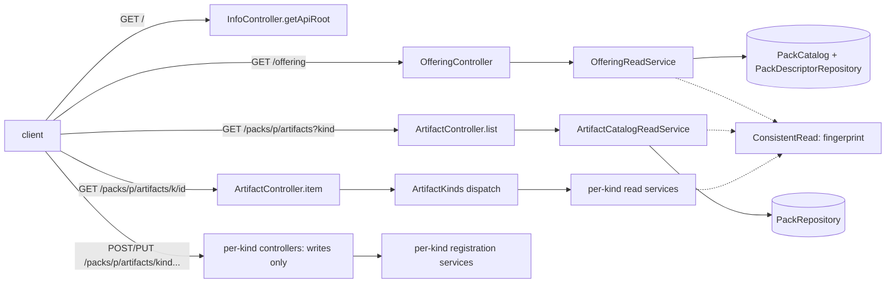

# Implementation Plan: Gate-A read surface: API root, offering, generic artifact routes and links

**Branch**: `issue-126-offering-reads` | **Date**: 2026-10-31 | **Spec**: [spec.md](spec.md)
**Input**: Mission specification from `kitty-specs/gate-a-read-surface-01M691ND/spec.md`

## Summary

This plan brings the charter contract and service onto ADR-0019's resource tree, inside the
unreleased `0.1.0-SNAPSHOT`.

- **New reads:**
  - an API root (`GET /`);
  - the offering pack list (`GET /offering`);
  - one generic artifact read family, `GET /packs/{packId}/artifacts` (paged, `?kind=`) and
    `GET /packs/{packId}/artifacts/{kind}/{artifactId}`, answering a closed `Artifact` envelope.
- **Moved writes.** The eight per-kind writes move to `POST /packs/{packId}/artifacts/<kind>` and
  `PUT /packs/{packId}/artifacts/<kind>/{id}`, keeping one typed operation per kind and answering
  the envelope. Every per-kind route is removed with no alias.
- **Links.** One `Links` component gives every JSON success answer `_links.self`. The closure
  checker exempts `Links` alone, and a lint rule checks relation keys against the hypermedia guide.
- **Fingerprint (#175).** It is required on the four verified GET 200s and declared nowhere else.
  The lint rules are narrowed and added to match.
- **500 examples (#176).** `OfferingUnreadable`'s examples name only raised codes. A scenario pins
  `pack_unreadable` on an item read.
- **Approach.** The work runs red-first (ATDD) in one lane of five work packages. Each leaves
  `verifyAll` green.

## Technical Context

**Language/Version**: Java 25 (Temurin; toolchain at `/usr/lib/jvm/temurin-25`), OpenAPI 3.1.0 contract, Gherkin scenarios.
**Primary Dependencies**:
- Spring Boot (web MVC);
- openapi-generator "spring" (`interfaceOnly`, `useTags`, `useBeanValidation`);
- vacuum (lint);
- oasdiff (release gate);
- Cucumber with JUnit Platform (contract scenarios);
- ArchUnit.

No dependency changes.
**Storage**: Files. Configured packs are read through the existing `DomainRepositoryService`. No storage change; one new domain port lists the configured packs.
**Testing**:
- Contract scenarios (`:deployable:test`, `CharterContractSuite`) are the acceptance tests, written first.
- Lint fixtures (`:contracts:lintFixtures`) and closure fixtures (`:contracts:test`) cover the contract rules.
- Unit tests cover the application services and the paging cursor.
- ArchUnit stays unchanged.
- `./gradlew verifyAll` is the full gate.
**Target Platform**: A local or hosted JVM service on Linux. The client is core's future generated client (#13).
**Project Type**: A single Gradle multi-module service plus the contract module (`contracts/`, `service/*`).
**Performance Goals**: One list page is one verified read of one pack. Pages hold at most 200 items (default 50).
**Constraints**:
- C-001 to C-009 of the spec;
- no new suppressions;
- method complexity ≤ 15;
- strict SHA-256 dependency verification;
- `info.version` stays `0.1.0-SNAPSHOT`.
**Scale/Scope**:
- 22 operations today, 16 after: 2 service reads, the root, `/offering`, 2 artifact reads, 8 writes, the relationships write and `/openapi.yaml`;
- about 46 existing files touched, plus about 20 new contract, fixture and scenario files.

## Charter Check

| Charter item | How this plan meets it |
|---|---|
| Divergence from the charter's own model (must never go wrong 1) | Answers are projected from the canonical `Pack` model and the existing per-kind domain types. No new representation of an artifact's content: the envelope embeds the existing schemas unchanged. |
| Breaking the OpenAPI contract (must never go wrong 2) | ADR-0022: the contract is unreleased 0.x, the breaks land under `0.1.0-SNAPSHOT` `### Breaking`, and the release gate has no baseline (no tag). No released contract is broken. |
| Adversarial squad at the plan point and before merge | A plan-point squad runs on this plan (contract/API, architecture and test lenses) before tasks. A pre-PR squad runs at closeout. |
| BDD / specification by example; test first | Every behaviour is pinned by a contract scenario or fixture that is seen failing first (C-007). The WP order puts scenarios before code within each WP. |
| Gates before merge | `verifyAll` on Java 25; style checks; docs checks (`check_docs.py all`, markdownlint, cspell) in WP05. |
| DDD vocabulary | Offering, pack, artifact, kind, served kind, links, as in `docs/context/` and ADR-0019/0020. |
| Boy-scout vs smallest diff | The #46 leftovers (`x-provisional` in old lint fixtures) are not touched: they are not on this path, and #46 is ruled out of scope. |
| Designing without regard to core | The seam change is stated for core's future client only. Nothing depends on core. |

No violations, so the Complexity Tracking table is empty.

## Project Structure

### Documentation (this mission)

```text
kitty-specs/gate-a-read-surface-01M691ND/
├── spec.md
├── plan.md               # this file
├── research.md           # plan-time decisions R-01..R-12
├── data-model.md         # resources, schemas, invariants
├── quickstart.md         # how to exercise the surface locally
├── occurrence_map.yaml   # bulk-edit classification (route move)
├── contracts/
│   └── gate-a-surface.sketch.yaml   # the OpenAPI shapes the WPs implement
└── tasks/                # created by /spec-kitty.tasks
```

### Source Code (repository root)

```text
contracts/
├── charter/openapi.yaml                   # paths map, tags
├── charter/paths/                         # root.yaml, offering.yaml, packs_packId_artifacts*.yaml (new); per-kind files removed
├── charter/schemas/                       # Links, Link, ApiRoot, Offering, OfferingPack, Artifact,
│                                          # ArtifactSummary, ArtifactPage, ArtifactKindToken (new);
│                                          # ServiceInfo, RelationshipRegistration gain _links;
│                                          # CharterRefusalCode gains kind_not_found
├── charter/headers/                       # CharterSourceFingerprint (required on reads), ServiceDescLink (new)
├── charter/parameters/                    # ArtifactKind, ArtifactId, ArtifactKindFilter (new); TacticId removed
├── charter/responses/                     # OfferingUnreadable examples; ArtifactNotFound (new); fingerprint dropped from refusals
├── charter/scenarios/                     # root.feature, offering.feature, artifacts.feature (new); kind features rewritten
├── charter/CHANGELOG.md                   # 0.1.0-SNAPSHOT ### Breaking
├── _shared/responses/Problem.yaml, _shared/VENDORED.md   # fingerprint dropped from the shared Problem
├── lint/ruleset.yaml, lint/fixtures/, lint/README.md      # narrowed headers rule, two fingerprint rules, _links rules
└── src/main/java/.../closure/ClosureChecker.java (+ test fixtures)   # Links exemption
service/kernel/.../RefusalCode.java                         # KIND_NOT_FOUND
service/packs/src/main/java/ai/speckitty/charter/packs/
├── domain/PackCatalog.java                                 # new port: configured packs
├── application/OfferingReadService.java, ArtifactCatalogReadService.java, ArtifactPosition (cursor)   # new
├── infra/api/ArtifactController.java, OfferingController.java, ArtifactKinds.java, Hypermedia.java (link building)   # new
├── infra/api/{Tactic,Directive,Styleguide,Paradigm,Toolguide}Controller.java   # reads removed; writes answer the envelope
├── infra/api/InfoController.java, RelationshipController.java, RefusalHandler.java
└── infra/storage/DomainRepositoryService.java              # implements PackCatalog
service/deployable/src/test/java/.../bdd/                   # CharterSteps fingerprint hook reads the contract; _links.self hook
docs/development/hypermedia-hateoas.md, docs/api/service-contract.md, docs/adr/0019-*.md, docs/adr/0026-*.md, docs/changelog/
```

**Structure Decision**: this is the existing layout. New adapter classes go in `packs.infra.api`,
new use cases in `packs.application`, and the one new port in `packs.domain` (ADR-0006 onion).

## Design overview



Every 2xx JSON answer is built with `Hypermedia` links, whose hrefs come from `charter.api.base-path`
(default `/api/v1`). Every verified read sets `Charter-Source-Fingerprint`, and nothing else does.

## Complexity Tracking

Empty: no charter violations.

## Implementation Concern Map

### IC-01 — Headers, refusals and links infrastructure (#175, #176, kind_not_found, Links)

- **Contract**:
  - fingerprint required on the existing read 200s and removed from every refusal and write and
    from the shared Problem;
  - `OfferingUnreadable` examples and description;
  - `kind_not_found` in `CharterRefusalCode` (`raised: true`, 404);
  - the `Links` and `Link` schemas, not yet referenced.
- **Lint**: the narrowed headers rule, plus `fingerprint-on-verified-reads` and
  `fingerprint-only-on-verified-reads`, each with planted fixtures. `clean.yaml` is updated.
- **Closure**: the `Links` exemption, with the passing and lookalike fixtures.
- **Service**:
  - `RefusalCode.KIND_NOT_FOUND` and its `RefusalHandler` mapping;
  - the scenario fingerprint hook reads whether the contract declares the header.
- **Docs touched**: the lint README rows, the `VENDORED.md` change list, the `CharterSourceFingerprint`
  description.
- **Red first**: the planted fixtures fail before the rules exist; the closure fixture fails before
  the exemption; the wire-token parity test fails before the kernel code.

### IC-02 — API root and offering

- **Contract**:
  - `GET /` (`getApiRoot`, Service tag) answering `ApiRoot`;
  - `GET /offering` (`getOffering`, Offering tag) answering `Offering` (`OfferingPack` entries);
  - `ServiceInfo._links` (`self`, `service-desc`);
  - the `Link` response header on the info 200.
- **Service**:
  - the `PackCatalog` port and its implementation;
  - `OfferingReadService`;
  - `OfferingController`;
  - `getApiRoot` on `InfoController`;
  - the `Hypermedia` link builder;
  - the `Link` header.
- **Scenarios** (new `root.feature`, `offering.feature`; `service.feature` updated):
  - root links that resolve;
  - offering order and `pack_unreadable`;
  - the `service-desc` link and header.

### IC-03 — Generic artifact reads (removing the per-kind reads)

- **Contract**:
  - `GET /packs/{packId}/artifacts` (`listPackArtifacts`, Artifacts tag: `kind`, `pageSize`,
    `pageCursor`) answering `ArtifactPage`;
  - `GET /packs/{packId}/artifacts/{kind}/{artifactId}` (`getPackArtifact`) answering `Artifact`
    with an ETag for writable kinds;
  - the 404 `ArtifactNotFound` response with `pack_not_found`, `kind_not_found` and the per-kind
    codes;
  - remove `listPack*` and `getPack*` for all five kinds and the `Tactics` tag.
- **Service**:
  - `ArtifactCatalogReadService` and the cursor;
  - `ArtifactKinds` dispatch;
  - `ArtifactController`;
  - `TacticController` removed; the read methods removed from the other four.
- **Scenarios**:
  - the kind features rewritten onto the generic reads;
  - new `artifacts.feature`: paging, filter, kind refusals, and every removed read path answering a
    404 without a code;
  - `pack_unreadable` on a tactic item (#176).

### IC-04 — Writes moved into the tree; every answer linked

- **Contract**:
  - the 8 writes at `/packs/{packId}/artifacts/<kind>` and `/packs/{packId}/artifacts/<kind>/{id}`
    under their per-kind tags, answering `Artifact`;
  - `RelationshipRegistration._links`;
  - the old write paths removed;
  - lint `success-schemas-carry-links` (every 2xx JSON schema requires `_links`) and
    `link-relations-are-known` (relation keys in examples are in the table), with fixtures.
- **Service**:
  - the per-kind controllers answer the envelope, with `Location` under the new path;
  - `ToolguideRegistrationBodyAdvice` re-targeted;
  - `RelationshipController` links.
- **Scenarios**:
  - the registration scenarios and journeys moved to the new paths;
  - the old write paths answer a 404;
  - the harness hook checks `_links.self` and the relation keys on every 2xx JSON answer.

### IC-05 — Records

- **CHANGELOG** `0.1.0-SNAPSHOT` `### Breaking`: removed operations and paths, the new operations,
  the required `_links`, the fingerprint and refusal changes, `kind_not_found`, the seam change for
  core, and the scenario lines.
- **Docs**:
  - the hypermedia guide (table: `service-desc`, `first`, `next`; state: "in the contract");
  - `docs/api/service-contract.md`;
  - ADR-0019 (implementation note);
  - ADR-0026 (D1.2 amendment note, paths only);
  - the scenarios README;
  - a `docs/changelog/` entry;
  - the glossary, if the terms are new.
- **Checks**: `check_docs.py all`, markdownlint and cspell.
