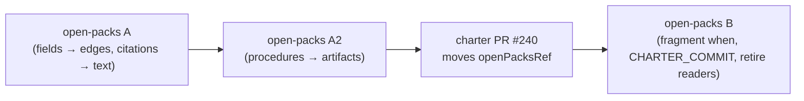

# open-packs migration for charter #240 (draft)

The charter stops reading relationship fields on artifacts (ADR-0063). The packs in
`spec-kitty/spec-kitty-open-packs` still author references in those fields, so their content moves
into the graph documents (`*.graph.yaml` in `packs/built-in`, `drg/fragment.yaml` in the other
packs) before this mission's PR moves `openPacksRef`. This session has no push access to
open-packs: the parent session files the pull requests, and the operator merges them.

## What is here

| File | Purpose |
|---|---|
| `open-packs-part-a.patch` | Part A, one commit (`git am`) on open-packs `dad323f` (the current pin): reference fields into graph edges, citations into text. |
| `open-packs-part-a2.patch` | Part A2, one commit on top of A: directive `procedures` into procedure artifacts. |
| `migrate.py`, `citations.py` | The generators of part A, in that order; rerunnable on a fresh copy. |
| `a2_spec.py`, `a2_gen.py`, `a2-step-map.json` | The generator of part A2 and its step-to-procedure map. |
| `open-packs-migration-report.json` | `migrate.py`'s report, the evidence behind the part A tables below. |
| `map_refs.py`, `dropped-reference-map.md` | Every dropped reference and the live edge or text that replaces it (operator's Q2/Q3 condition). |
| `open-packs-issue-draft.md` | The issue body to file on open-packs. |
| `graphwalk-follow-up-issue-draft.md` | The charter follow-up for retiring `GraphWalk` (out of scope here). |

## Sequencing

1. **A and A2 land on open-packs first**, in that order. A2 is separate so A stays a mechanical,
   generated change and A2's authored content gets its own review. Both are forward-compatible:
   they pass open-packs' validator under the contract it pins today (`85c20fa`), and A + A2 also pass
   this branch's `contracts/packs`. A alone does not pass the new contract (directives still carry
   `procedures`), which is why both precede the pin move.
2. **This PR then moves `openPacksRef`** to the merged A2 commit (task T013). Until then CI on the PR
   fails the pin guard and the PR stays draft.
3. **Part B follows on open-packs**, after this PR merges, because it needs the new contract.

The known-failure list the brief suggested was not used: every pinned pack is affected, and the
six `verifyAll` corpus tests never read such a list (research R6).

## Does any dropped reference lose its effect?

No. The operator asked whether the dropped references are replaced by live edges.
`dropped-reference-map.md` answers per reference, against the graph documents the service reads:

| Outcome | Count |
|---|---|
| A live edge already authored on the pair, same direction | 699 |
| A live edge already authored on the pair, other direction (ADR-0027: one edge per pair) | 44 |
| An edge the migration adds (29 in A; 192 procedure steps reach their procedure through 50 edges in A2) | 222 |
| A citation that names no artifact, now in the artifact's text | 20 |
| Unresolved | 0 |

Where a field named a relation different from the graph edge already on the pair (142 cases), the
graph's relation stands. The field's relation came from the interim per-kind mapping that the ruling
retires (mostly `suggests`), while the graph edge is the authored one. This is the one place where a
reader of the references can see a different relation on a pair than before: each case is listed in
`open-packs-migration-report.json` (`relation_differs`) for the curator to confirm.

## Part A: rules

- Remove the edge-authoring fields from every artifact file, by text edit so comments and layout
  stay: `references` on directives, paradigms, tactics (and tactic steps), procedures, styleguides,
  toolguides and mission types (and mission steps); `directive_refs` on paradigms. No pack authors
  `relationships`.
- For each removed reference, look up its unordered pair in the pack's graph documents
  (ADR-0027: one structural edge per unordered pair):
  - no edge on the pair → **add** one to the source kind's shard (`built-in`) or to
    `drg/fragment.yaml` (other packs), with the field's `when`/`reason`;
  - an edge in the same direction → keep the graph's relation; **merge** the field's `when` or
    `reason` into it only when the edge has none;
  - only a reverse edge → **add nothing**; the pair is already related.
- A styleguide/toolguide citation that names a pack artifact becomes, or already is, an edge; one that
  names no artifact moves into the styleguide's text (operator ruling, option C).
- Restamp `packs/built-in/pack-manifest.yaml`, record the new `packs/built-in` tree digest in
  `packs/built-in.source.yaml`, and regenerate `docs/packs/*.md`
  (`CHARTER_CONTRACT_DIR=<charter 85c20fa>/contracts/packs python3 scripts/docs/gen_pack_reference.py`).

### Counts

| Outcome | Count |
|---|---|
| Artifact files edited (fields) | 206 |
| Styleguides given their citations in text | 11 |
| Edges added | 29 (28 from fields, 1 for the Drupal "See also" pair) |
| `reason` merged into an existing edge | 31 |
| `when` merged into an existing edge | 0 (the one candidate pair already carries it on its `suggests` edge) |
| Field reference already covered by a reverse edge (not added) | 9 |
| Field relation differs from the graph's (graph kept) | 142 |
| Field `when`/`reason` differs from the graph's (graph kept) | 49 |
| Fragment `when` deferred to part B | 27 |
| References that resolved to no artifact | 0 |
| Manifests restamped | 1 (`built-in`) |

## Part A2: directive procedures (operator ruling Q1)

- 41 directives' 192 prose steps become 47 procedure artifacts: 44 in `packs/built-in/procedures/`,
  3 in `packs/internal/procedures/`. Every step is placed exactly once (checked by the generator).
- 6 procedures are shared between directives where the steps are the same practice:
  `keep-change-local`, `tidy-first-campsite-clean`, `touched-area-cleanup` (DIRECTIVE_024/025 and
  RECONCILE_CHANGE_SCOPE_TENSIONS), `test-first-cycle` (034, 039), `red-first-bug-reproduction`
  (034, 041), `declare-page-audience` (042, 047). A directive that shares a procedure now also
  reaches the steps its partner contributed to it.
- 50 `requires` edges from each directive to its procedures: 47 in `packs/built-in/directive.graph.yaml`
  (with `when` and `reason`), 3 in `packs/internal/drg/fragment.yaml` (with `reason`; an org-fragment
  edge takes no `when` until part B).
- The directive's `procedures` block is removed; the rest of each file is byte-identical.
- Step text is verbatim except: OPERATOR_SIGNAL_CONTRACT step 1, which the source cut short by an
  unquoted `#` (the procedure carries the full sentence); four RECONCILE steps whose "above"/"step 1"
  pointers now name their target; DIRECTIVE_052's "1."–"5." prefixes.
- No existing procedure was reused: `refactoring` lacks two of DISCIPLINED_REFACTORING's steps and
  already has an edge to that directive; `test-first-bug-fixing` lacks two of 034's steps.

## Validation

| Check | A | A + A2 |
|---|---|---|
| `validate_pack_schemas.py --cross-pack`, charter contract `85c20fa` (open-packs' pin) | ok | ok |
| the same, this branch's `contracts/packs` | fails only on directive `procedures` | ok, 0 violations |
| `scripts/ci/check-built-in.sh` | ok | ok |
| `gen_pack_reference.py --check` | no drift | no drift |
| `pytest tests/ci` | 56 passed | 56 passed |
| charter `./gradlew verifyAll -PopenPacksRef=<A2>` on this branch | — | BUILD SUCCESSFUL |

Not run here: the open-packs docsite build.

## Part B (after this PR merges)

- Add `when` to the 27 fragment edges listed below; the org-fragment edge schema gains `when` in
  this branch's `contracts/packs`.
- Move `CHARTER_COMMIT` in `scripts/ci/validate_pack_schemas.py` (line 50) to the merged charter
  commit.
- Remove the readers of the dropped fields: `TYPED_REFERENCE_SCHEMAS`, `BARE_ID_LISTS` and
  `written_references` (`validate_pack_schemas.py` lines 749-860), their test table
  (`tests/ci/test_validate_pack_schemas.py` from line 457) and the `directive_refs` mention in
  `docs/artefacts/index.md` (line 74).
- Regenerate `docs/packs/*.md` against the new `CHARTER_COMMIT`.

## Evidence (part A)

### Edges added (28)

| Pack | Graph document | Edge | `when` | Field it replaces |
|---|---|---|---|---|
| cave-kitty | `cave-kitty/drg/fragment.yaml` | `mission_type:cave-dev` -scope-> `directive:CAVE_001` | — | `cave-kitty/missions/cave-dev/cave-dev.mission-type.yaml references` |
| cave-kitty | `cave-kitty/drg/fragment.yaml` | `mission_type:cave-dev` -scope-> `styleguide:cave-sty-001-communication` | — | `cave-kitty/missions/cave-dev/cave-dev.mission-type.yaml references` |
| event-driven | `event-driven/drg/fragment.yaml` | `tactic:evd-projection-replay` -suggests-> `directive:EVD_005` | — | `event-driven/tactics/evd-projection-replay.tactic.yaml references` |
| internal | `internal/drg/fragment.yaml` | `styleguide:executive-debrief` -suggests-> `tactic:branded-deliverable` | — | `internal/styleguides/executive-debrief.styleguide.yaml references` |
| internal | `internal/drg/fragment.yaml` | `styleguide:executive-debrief` -suggests-> `toolguide:branded-document-generation` | — | `internal/styleguides/executive-debrief.styleguide.yaml references` |
| internal | `internal/drg/fragment.yaml` | `styleguide:report-writing` -suggests-> `built-in::styleguide:planning-and-tracking` | — | `internal/styleguides/report-writing.styleguide.yaml references` |
| qa | `qa/drg/fragment.yaml` | `mission_type:qa` -scope-> `directive:QA_001` | — | `qa/missions/qa/qa.mission-type.yaml references` |
| qa | `qa/drg/fragment.yaml` | `mission_type:qa` -scope-> `directive:QA_002` | — | `qa/missions/qa/qa.mission-type.yaml references` |
| qa | `qa/drg/fragment.yaml` | `mission_type:qa` -scope-> `directive:QA_003` | — | `qa/missions/qa/qa.mission-type.yaml references` |
| qa | `qa/drg/fragment.yaml` | `mission_type:qa` -scope-> `directive:QA_004` | — | `qa/missions/qa/qa.mission-type.yaml references` |
| qa | `qa/drg/fragment.yaml` | `mission_type:qa` -scope-> `directive:QA_005` | — | `qa/missions/qa/qa.mission-type.yaml references` |
| qa | `qa/drg/fragment.yaml` | `mission_type:qa` -scope-> `directive:QA_006` | — | `qa/missions/qa/qa.mission-type.yaml references` |
| qa | `qa/drg/fragment.yaml` | `procedure:qa-coverage-gap-analysis` -suggests-> `directive:QA_001` | — | `qa/procedures/qa-coverage-gap-analysis.procedure.yaml references` |
| qa | `qa/drg/fragment.yaml` | `procedure:qa-defect-triage-ritual` -suggests-> `directive:QA_002` | — | `qa/procedures/qa-defect-triage-ritual.procedure.yaml references` |
| qa | `qa/drg/fragment.yaml` | `procedure:qa-description-to-acceptance-ci` -suggests-> `directive:QA_003` | — | `qa/procedures/qa-description-to-acceptance-ci.procedure.yaml references` |
| qa | `qa/drg/fragment.yaml` | `procedure:qa-description-to-acceptance-ci` -suggests-> `tactic:qa-promise-elicitation` | — | `qa/procedures/qa-description-to-acceptance-ci.procedure.yaml references` |
| qa | `qa/drg/fragment.yaml` | `procedure:qa-description-to-acceptance-ci` -suggests-> `styleguide:qa-promise-page` | — | `qa/procedures/qa-description-to-acceptance-ci.procedure.yaml references` |
| qa | `qa/drg/fragment.yaml` | `procedure:qa-description-to-acceptance-ci` -suggests-> `toolguide:qa-promise-trace-lint-guide` | — | `qa/procedures/qa-description-to-acceptance-ci.procedure.yaml references` |
| qa | `qa/drg/fragment.yaml` | `procedure:qa-go-no-go-readiness-review` -suggests-> `directive:QA_004` | — | `qa/procedures/qa-go-no-go-readiness-review.procedure.yaml references` |
| qa | `qa/drg/fragment.yaml` | `procedure:qa-test-plan-review-workshop` -suggests-> `directive:QA_001` | — | `qa/procedures/qa-test-plan-review-workshop.procedure.yaml references` |
| qa | `qa/drg/fragment.yaml` | `tactic:qa-boundary-equivalence-partitioning` -suggests-> `directive:QA_004` | — | `qa/tactics/qa-boundary-equivalence-partitioning.tactic.yaml references` |
| qa | `qa/drg/fragment.yaml` | `tactic:qa-exploratory-charter-writing` -suggests-> `directive:QA_006` | — | `qa/tactics/qa-exploratory-charter-writing.tactic.yaml references` |
| qa | `qa/drg/fragment.yaml` | `tactic:qa-flaky-test-quarantine` -suggests-> `directive:QA_003` | — | `qa/tactics/qa-flaky-test-quarantine.tactic.yaml references` |
| qa | `qa/drg/fragment.yaml` | `tactic:qa-pairwise-test-reduction` -suggests-> `directive:QA_004` | — | `qa/tactics/qa-pairwise-test-reduction.tactic.yaml references` |
| qa | `qa/drg/fragment.yaml` | `tactic:qa-promise-elicitation` -suggests-> `styleguide:qa-promise-page` | — | `qa/tactics/qa-promise-elicitation.tactic.yaml references` |
| qa | `qa/drg/fragment.yaml` | `tactic:qa-regression-suite-selection` -suggests-> `directive:QA_001` | — | `qa/tactics/qa-regression-suite-selection.tactic.yaml references` |
| qa | `qa/drg/fragment.yaml` | `tactic:qa-risk-based-test-prioritization` -suggests-> `directive:QA_005` | — | `qa/tactics/qa-risk-based-test-prioritization.tactic.yaml references` |
| qa | `qa/drg/fragment.yaml` | `tactic:qa-test-data-minimization` -suggests-> `directive:QA_003` | — | `qa/tactics/qa-test-data-minimization.tactic.yaml references` |

### Field references already covered by a reverse edge (9, not added)

| Pack | Field reference | Existing graph edge(s) |
|---|---|---|
| built-in | `styleguide:plain-language -> mission_type:documentation` | `mission_type:documentation -scope-> styleguide:plain-language` |
| event-driven | `tactic:evd-event-bridge-port -> directive:EVD_002` | `directive:EVD_002 -requires-> tactic:evd-event-bridge-port` |
| event-driven | `tactic:evd-event-bridge-port -> directive:EVD_005` | `directive:EVD_005 -requires-> tactic:evd-event-bridge-port` |
| event-driven | `tactic:evd-event-versioning-and-upcasting -> directive:EVD_001` | `directive:EVD_001 -requires-> tactic:evd-event-versioning-and-upcasting` |
| event-driven | `tactic:evd-event-versioning-and-upcasting -> directive:EVD_004` | `directive:EVD_004 -requires-> tactic:evd-event-versioning-and-upcasting` |
| event-driven | `tactic:evd-idempotent-consumer -> directive:EVD_005` | `directive:EVD_005 -requires-> tactic:evd-idempotent-consumer` |
| event-driven | `tactic:evd-idempotent-consumer -> tactic:evd-projection-replay` | `tactic:evd-projection-replay -suggests-> tactic:evd-idempotent-consumer` |
| event-driven | `tactic:evd-projection-replay -> tactic:evd-event-versioning-and-upcasting` | `tactic:evd-event-versioning-and-upcasting -suggests-> tactic:evd-projection-replay` |
| qa | `tactic:qa-promise-elicitation -> directive:QA_007` | `directive:QA_007 -suggests-> tactic:qa-promise-elicitation` |

### `reason` merged into an existing edge (31)

| Pack | Graph document | Edge (source → target) | Key |
|---|---|---|---|
| built-in | `built-in/procedure.graph.yaml` | `procedure:bdd-scenario-lifecycle` → `styleguide:given-when-then-authoring` | reason |
| internal | `internal/drg/fragment.yaml` | `procedure:charter-offering-scenario-extraction` → `styleguide:feature-and-scenario-authoring` | reason |
| internal | `internal/drg/fragment.yaml` | `procedure:charter-offering-scenario-extraction` → `directive:NO_FULL_HEAVY_SUITES_IN_MISSION` | reason |
| internal | `internal/drg/fragment.yaml` | `procedure:charter-offering-scenario-extraction` → `built-in::procedure:adversarial-squad-deployment` | reason |
| internal | `internal/drg/fragment.yaml` | `procedure:charter-offering-scenario-extraction` → `built-in::styleguide:test-desiderata-and-boundaries` | reason |
| internal | `internal/drg/fragment.yaml` | `procedure:cloud-session-dispatch` → `built-in::directive:DIRECTIVE_025` | reason |
| internal | `internal/drg/fragment.yaml` | `procedure:cloud-session-dispatch` → `built-in::directive:RECONCILE_CHANGE_SCOPE_TENSIONS` | reason |
| internal | `internal/drg/fragment.yaml` | `procedure:cloud-session-dispatch` → `built-in::procedure:refactoring` | reason |
| internal | `internal/drg/fragment.yaml` | `procedure:cloud-session-dispatch` → `built-in::procedure:test-first-bug-fixing` | reason |
| internal | `internal/drg/fragment.yaml` | `procedure:cloud-session-dispatch` → `procedure:test-suite-quality-assessment` | reason |
| internal | `internal/drg/fragment.yaml` | `procedure:cloud-session-dispatch` → `directive:NO_FULL_HEAVY_SUITES_IN_MISSION` | reason |
| internal | `internal/drg/fragment.yaml` | `procedure:semi-auto-delivery` → `directive:NO_FULL_HEAVY_SUITES_IN_MISSION` | reason |
| internal | `internal/drg/fragment.yaml` | `procedure:semi-auto-delivery` → `directive:OPERATOR_SIGNAL_CONTRACT` | reason |
| internal | `internal/drg/fragment.yaml` | `procedure:semi-auto-delivery` → `built-in::procedure:mission-wrap-up-sequence` | reason |
| internal | `internal/drg/fragment.yaml` | `procedure:semi-auto-delivery` → `built-in::procedure:test-first-bug-fixing` | reason |
| internal | `internal/drg/fragment.yaml` | `procedure:semi-auto-delivery` → `built-in::procedure:adversarial-squad-deployment` | reason |
| internal | `internal/drg/fragment.yaml` | `procedure:semi-auto-delivery` → `built-in::tactic:clean-linear-commit-history` | reason |
| internal | `internal/drg/fragment.yaml` | `procedure:test-suite-quality-assessment` → `built-in::styleguide:test-desiderata-and-boundaries` | reason |
| internal | `internal/drg/fragment.yaml` | `procedure:test-suite-quality-assessment` → `built-in::styleguide:testing-principles` | reason |
| internal | `internal/drg/fragment.yaml` | `procedure:test-suite-quality-assessment` → `built-in::directive:DIRECTIVE_041` | reason |
| internal | `internal/drg/fragment.yaml` | `procedure:test-suite-quality-assessment` → `built-in::procedure:development-assist-test-cleanup` | reason |
| internal | `internal/drg/fragment.yaml` | `procedure:test-suite-quality-assessment` → `built-in::procedure:adversarial-squad-deployment` | reason |
| internal | `internal/drg/fragment.yaml` | `procedure:test-suite-quality-assessment` → `toolguide:test-quality-triage` | reason |
| internal | `internal/drg/fragment.yaml` | `procedure:test-suite-quality-assessment` → `directive:NO_FULL_HEAVY_SUITES_IN_MISSION` | reason |
| internal | `internal/drg/fragment.yaml` | `procedure:tracker-organisation-workflow` → `tactic:tracker-backlog-iterative-deepening` | reason |
| internal | `internal/drg/fragment.yaml` | `procedure:tracker-organisation-workflow` → `built-in::tactic:moscow-scoping-lens` | reason |
| internal | `internal/drg/fragment.yaml` | `procedure:tracker-organisation-workflow` → `built-in::procedure:issue-triage-state-machine` | reason |
| internal | `internal/drg/fragment.yaml` | `procedure:tracker-organisation-workflow` → `built-in::styleguide:planning-and-tracking` | reason |
| internal | `internal/drg/fragment.yaml` | `procedure:tracker-organisation-workflow` → `built-in::toolguide:github-tracker` | reason |
| qa | `qa/drg/fragment.yaml` | `procedure:qa-description-to-acceptance-ci` → `directive:QA_007` | reason |
| qa | `qa/drg/fragment.yaml` | `procedure:qa-description-to-acceptance-ci` → `directive:QA_008` | reason |

### Part B: fragment `when` texts (27)

| Pack | Edge (source → target) | `when` |
|---|---|---|
| event-driven | `directive:EVD_001` → `tactic:evd-event-versioning-and-upcasting` | when a contract has to change |
| event-driven | `directive:EVD_001` → `styleguide:evd-event-naming-and-payload` | when deciding what goes in the envelope and what in the payload |
| event-driven | `directive:EVD_002` → `tactic:evd-event-bridge-port` | when wiring producers to the writer |
| event-driven | `directive:EVD_003` → `styleguide:evd-event-naming-and-payload` | when naming an event or shaping its payload |
| event-driven | `directive:EVD_003` → `built-in::tactic:domain-event-capture` | when deciding which state changes deserve an event at all |
| event-driven | `directive:EVD_004` → `directive:EVD_001` | the version this rule depends on |
| event-driven | `directive:EVD_004` → `tactic:evd-event-versioning-and-upcasting` | when writing the upcaster chain |
| event-driven | `directive:EVD_005` → `tactic:evd-event-bridge-port` | when separating the pure core from adapters |
| event-driven | `directive:EVD_005` → `tactic:evd-idempotent-consumer` | when writing the consumer that performs the effect |
| event-driven | `directive:EVD_006` → `styleguide:evd-event-naming-and-payload` | when writing the published contract |
| event-driven | `directive:EVD_006` → `built-in::tactic:anti-corruption-layer` | when a consumer must translate a foreign contract into its own model |
| event-driven | `tactic:evd-event-bridge-port` → `tactic:evd-idempotent-consumer` | when writing the subscribers that perform effects |
| event-driven | `tactic:evd-event-bridge-port` → `built-in::tactic:reference-architectural-patterns` | when deciding whether ports-and-adapters fits the system at all |
| event-driven | `tactic:evd-event-versioning-and-upcasting` → `tactic:evd-projection-replay` | to prove the change against real history |
| event-driven | `tactic:evd-projection-replay` → `directive:EVD_005` | when separating replay from live delivery |
| event-driven | `tactic:evd-projection-replay` → `tactic:evd-idempotent-consumer` | when a projection is also fed by live, possibly redelivered, events |
| internal | `tactic:spec-kitty-ratchet-cost` → `built-in::tactic:frozen-baseline-shrink-only-ratchet` | The repository-agnostic mechanics this tactic prices. |
| internal | `tactic:tracker-backlog-iterative-deepening` → `procedure:tracker-organisation-workflow` | Sequencing the tracker-wide organisation sweep into widening rings. |
| internal | `tactic:tracker-backlog-iterative-deepening` → `built-in::tactic:moscow-scoping-lens` | Scoping what an emergent epic must, should, could, or won't carry once a ring surfaces it. |
| qa | `tactic:qa-boundary-equivalence-partitioning` → `directive:QA_004` | when the exit criteria frozen before execution require boundary/equivalence-partition coverage of a requirement's input domain, so the partitioned test-case set must be fully derived before that freeze point |
| qa | `tactic:qa-exploratory-charter-writing` → `directive:QA_006` | when writing a charter before a timeboxed exploratory session |
| qa | `tactic:qa-flaky-test-quarantine` → `directive:QA_003` | when a flaky test's false-fail result would otherwise corrupt a run's recomputed verdict |
| qa | `tactic:qa-pairwise-test-reduction` → `directive:QA_004` | when the exit criteria frozen before execution require pairwise parameter coverage, so the covering set must be generated before that freeze point |
| qa | `tactic:qa-promise-elicitation` → `styleguide:qa-promise-page` | when writing the page for each candidate |
| qa | `tactic:qa-regression-suite-selection` → `directive:QA_001` | when selecting, for a specific change, exactly the regression tests that trace to the requirements the change could affect |
| qa | `tactic:qa-risk-based-test-prioritization` → `directive:QA_005` | when ranking test cases by risk before a time-boxed execution pass |
| qa | `tactic:qa-test-data-minimization` → `directive:QA_003` | when a minimized test case's re-run result must be verified rather than assumed, so reduced test data cannot silently produce a false-pass result that reads as preserved coverage |

### Citations (26 entries in styleguide and toolguide `references`)

| Kind of entry | Count | Outcome |
|---|---|---|
| Path to an agent profile (`drupal-conventions`, `drupal-security-performance`, `java-conventions`) | 3 | live edge already authored (`styleguide:… -suggests-> agent_profile:…`) |
| Path to the structural-lint config of `common-docs` | 1 | live edge `styleguide:common-docs -requires-> asset:common-docs-structural-lint` |
| "See also" between the two Drupal styleguides | 2 | one edge added: `styleguide:drupal-conventions -suggests-> styleguide:drupal-security-performance` |
| URL or repository path that names no artifact | 20 | moved into the styleguide's text (option C): inline `(source: …)` on the principle it backs, or a closing `Sources: …` sentence on the last principle; the toolguide's URL was already in its guide's References |

`citations.py` places them; `dropped-reference-map.md` lists each one with its new home.
