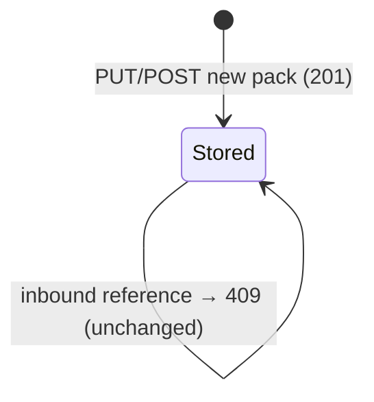

# Data Model: Layer merge, pack registration and effective reads

Vocabulary: a pack has a **level** (built-in, org, project). Levels merge in **merge order** (built-in, then org,
then project), and the winner is **the level that applies** (ADR-0048 d7).

## Packs slice: registration (PR A)

### PackRegistration (the result of a whole-pack write; contract `PackRegistration`)

| Field | Type | Rules |
|---|---|---|
| packId | configured identifier | the directory name; the path segment of `PUT`, or the stored pack's id or the descriptor `name` for `POST` |
| descriptorPackId | ULID | the archive's `pack_id`; equal to the stored pack's on a replace |
| name | slug | the descriptor `name`; unique among the configured packs |
| version | semver | the descriptor `pack_version` |
| level | `org` \| `project` | the descriptor `pack_level`; never `built-in`; equal to the stored level on a replace |
| revision | `sha256:` hex | `PackRevision` v2 over the stored tree (research R4); the `ETag` |
| outcome | `created` \| `replaced` \| `unchanged` | reported in the status of a `succeeded` registration (A5) |
| notices | `floorAdded`, `floorRemoved`, `locksAdded`, `locksRemoved`, `activationsAffected` | B4; `activationsAffected` from PR B |
| source | absent \| PackSourceRecord | absent for `PUT`; for `POST`, what was fetched |

**PackSourceRecord.** It holds `kind` (`https_archive` \| `git` \| `filesystem`) and the locator as sent (`url`,
`ref`, `path`). For git it also holds the resolved `commit`. It is answered and never persisted: there is no lockfile
in this cut.

**Invariants**

- **Whole replacement.** After a successful replace, the pack holds exactly the staged tree. A file, artifact, edge
  or preset absent from the archive is absent from the pack (SC-003).
- **The version rule.**
  - The same `version` and the same `revision` change nothing.
  - The same `version` with another `revision` is `409 pack_version_conflict`.
  - Any other `version` replaces.
- **Fixed identity.** `descriptorPackId` and `level` never change for a `packId`.
- **All or nothing.** A refused or failed write changes zero stored files (FR-007).
- **Reserved shard and closed files (plan delta squad, finding 3, 2026-11-07).** An archived `registered.graph.yaml`
  without the registration stamp (`generated_by: charter-registration`) is refused as a reserved shard
  (`FileSystemPackInspector` ~643); a stamped one is accepted, and the replace drops every registered edge the archive
  leaves out. A removed field is refused as an unknown field (ADR-0064 D5). A preset with `activated_kinds`, or an item
  id outside the id grammar, is refused. Each is `422 validation_failed` at registration, as is a `PACK_UNREADABLE` of
  the load of a staging directory.

### PackRegistrationStatus (contract; the status resource of A5)

| Field | Type | Rules |
|---|---|---|
| registrationId | ULID | in the status URI |
| state | `pending` \| `running` \| `succeeded` \| `refused` | moves only forward |
| packId | configured identifier | the target |
| result | absent \| PackRegistration | present when `succeeded` |
| problem | absent \| Problem | present when `refused`; the refusal the synchronous API would have answered |
| acceptedAt, finishedAt | instant | kept 1 hour after `finishedAt`, at most 1,000 entries |

### PackVersionHistory (internal, per pack; B1)

- A list of `(pack_version, revision, registeredAt)`, appended in the same swap as the pack and kept on `DELETE`.
- Invariant: a `pack_version` maps to one revision for the life of the `packId`.

### PackSource (request of `POST /packs`; contract `PackSource`, one closed object)

Common fields: `kind` (`https_archive` \| `git` \| `filesystem`), `packId` (required, `^[a-z0-9][a-z0-9-]{0,62}$`),
and the optional `sha256` (https archive) or `commit` (git).

| Kind | Fields | Guard |
|---|---|---|
| `https_archive` | `url`, `sha256?` | `https`, port 443, exact host on `charter.pack-sources.https.allowed-hosts`, global unicast, checked hops, 32 MiB, archive media type and magic bytes |
| `git` | `url`, `ref`, `commit?` | `https`, host on `charter.pack-sources.git.allowed-hosts` (empty by default), ref grammar (research R9), pinned address, system git ≥ 2.50.1, no work tree |
| `filesystem` | `path` | relative; resolved through `toRealPath()` under `charter.pack-sources.filesystem.root` |

### StagedPack (internal value, `packs.infra.archive`)

- A temporary directory, owner-only, beside the pack domain, on the same filesystem as the swap.
- **ArchiveLimits:** `maxBodyBytes` 32 MiB, `maxExpandedBytes` 32 MiB, `maxEntries` 10,000. They are configurable
  downward only.
- **Entry rules:**
  - regular files and directories only;
  - a relative path of `/`-separated segments, none empty, `.` or `..`;
  - no NUL, no backslash, no drive letter;
  - at most 4,096 bytes;
  - unique after NFC and case folding;
  - not encrypted.
- One common leading directory is stripped.
- Zip and tar are both read with Commons Compress. A zip entry's type comes from `ZipArchiveEntry`
  (`isUnixSymlink()`, the Unix mode), and only the `STORED` and `DEFLATED` methods are accepted.
- A violation is a `PackElementViolation`-shaped entry (`file`, `reason`) in the `422` body. At most 100 are listed.

### Removal requests

- **ArtifactRemoval:** `(packId, kind, artifactId, ifMatch?)`. When it applies:
  - the artifact file and its companions are removed;
  - every edge whose source is the artifact is removed from `registered.graph.yaml`. A `DELETE` never rewrites an
    author-written graph document (`DM-01M6TQ62HXYF362GAFS2BZ3PGF`, applied to the artifact `DELETE` by decision
    `DM-01M6TR1KDAJ64GMJD6AYNZKT59`): an edge from the artifact or a node declaration of it in a source shard or `drg/fragment.yaml`
    refuses the removal with `409 registration_conflict`;
  - every preset item naming it is removed. Every preset list has `minItems: 1`, so when the last item of a key goes,
    the **key is deleted** from the preset file ("reads as not listed"). Writing `[]` would make the pack unreadable.
  - the closures after the removal must still compose (PR A stays strict, `DM-01M6TQ67C9ZTNGZB9CY28JS54F`): else
    `422`, and nothing is written.
- **RelationshipRemoval:** `(packId, from, to, ifMatch?)`. It is keyed by the unordered `{from, to}` pair, as the
  registration is (ADR-0026 D1.3). It removes the edge **only from `registered.graph.yaml`**
  (`DM-01M6TQ62HXYF362GAFS2BZ3PGF`). Outcomes: removed (`204`); no edge on the pair in any graph document and no
  derived relation (`404 relationship_not_found`); an edge on the pair only in an author-written document or only as
  a derived relation (a guard's `implemented_by`, ADR-0064 D7) (`409 relationship_not_registered`).

### InboundReference (internal value)

- `(referringPack, referringArtifact?, reference as written)`, resolved by `PackCompositionResolver.holderOf` over
  the referring pack's `compositionClosure` as it will be after the change (B3): a referrer the same request removes
  does not count. Another pack's preset item naming the artifact counts (A10).
- **Where the three parts come from (plan delta squad, finding 4, 2026-11-07).** `PackCompositionFacts.references`
  holds both ends of every edge, with no source attached (`DomainRepositoryService` ~494-501), and
  `CharterArtifact.writtenReferences()` holds derived relations only (`CharterArtifact.java` ~74). Neither can name a
  referrer, so `InboundReferences` (new, WP14) is built from:
  - `PackCompositionFacts.edges()` of every configured pack: each edge's target (and a foreign source) is attributed to
    the artifact at its source end, which is `referringArtifact`, and to the pack that holds the edge;
  - the presets of every configured pack: each item naming the artifact, with `referringArtifact` absent;
  - the descriptor `overrides` entries (`PackDescriptor.overrides()`): an entry whose `artifact` names it.
- **Not inbound references:** the data-only fields of ADR-0064 D11, namely an agent profile's `directive-references`
  and its tactic, toolguide and styleguide references, a skill's `enhances` and `overrides`, a mission step's
  delegations and a glossary term's `see_also`.
- A non-empty set refuses the removal with `409 artifact_referenced`. The `packs` member names the referring packs
  and `violations` the referring artifacts, at most 100 each.

## Packs slice: the merge (PR B)

### MergedClosure (value of `ClosureView.merged()`)

| Element | Type | Meaning |
|---|---|---|
| winners | `Map<Urn, Winner>` | per held URN, the version in force after sibling settlement and the layer merge |
| layerOverrides | `List<LayerOverride>` | every replaced version, in merge order |
| edges | merged `EdgeIndex` | edges re-homed through the winners |
| languages | `Map<Urn, Set<String>>` | each winner's `applies_to_languages`; empty when it declares none |

**Winner:** `(urn, packId, descriptorPackId, level, policy)`. `policy` is the mutability level along the closure
(`PerPackPolicy.levelIn`).

**LayerOverride (record):** `(urn, winner: (packId, level), loser: (packId, level))`. There is one record per losing
version, so an id held at all three levels yields two records.

**Invariants**

- **One version per id.** Each held URN has exactly one winner.
- **Merge order.** Levels merge built-in, then org, then project. Within a level, a contest is either settled by a
  descriptor `overrides` entry, which puts its `member` in force (#357), or refused by the compose
  (`pack_sibling_conflict`), as today.
- **Whole replacement.** The winner's artifact is read alone; no field of a loser is consulted (ADR-0059 D3).
- **Edges.** No edge starts at a losing place. Every edge that ended at a losing place ends at the winner's place
  (FR-010).
- **Mutability.** A layer override of an artifact whose level, along the closure without the winning pack, is
  `extendable` or `locked` refuses the merge with `pack_unreadable` (FR-011).
- **One verified read.** The merge is built from the facts of the verified read it belongs to, and never reads again
  (NFR-007).
- **Writes are untouched.** `/offering`, `listActivationPacks` and the writes never call the merge (FR-023).

### PackCompositionFacts (extended)

- It gains `languages: Map<String, List<String>>`, from bare URN to `applies_to_languages`, read in the same assembly
  as `defined` and `edges`. The kinds that carry it are tactic, styleguide, toolguide, procedure and agent profile.

## Activations slice: the reads (PR B, PR C)

### MergedSnapshot (value; the adapter's copy of `MergedClosure`)

- `winners`: URN text → `(kind, id, packId, level, policy)`.
- `languages`: URN text → set.
- `overrides`: the `overrides` edges among the winners, as `(source URN, target URN)`.
- `enhances`: the `enhances` edges among the winners, as `(source URN, target URN)`.
- `layerOverrides`.
- `missionTypes`: the mission types held.
- `stepBinding`: URN text → mission type, for step contracts and step enhancers.

No packs type crosses (C-002).

### EffectiveArtifact (one closure artifact under an activation)

| Field | Type | Rules |
|---|---|---|
| kind, artifactId | ActivatableKind, id | one entry per winning id |
| state | `active` \| `inactive` \| `excluded` | see the precedence below |
| reason | EffectiveArtifactReason | the first rule that decided the state |
| required | boolean | a governing preset requires it or a pack locks it; it no longer implies `active` (research R11) |
| satisfiedBy | absent \| ArtifactReference | present only for a required artifact that is out of force: the active artifact that overrides it (new; never an enhancer, operator Q8) |
| policy | `open` \| `extendable` \| `locked` | the winner's level along the closure |
| packId | configured identifier | the winner's pack (new) |
| level | PackLevel | the winner's level (new) |

**EffectiveArtifactReason:** `selected`, `required`, `locked`, `deactivated`, `not_selected`, (`kind_not_activated` removed by IC-20)
`language_filtered`, `overridden` (new), `mission_type_not_in_force` (new) and `enhanced_target_not_in_force` (new). `kind_default` is removed
(ADR-0053 d10).

**Precedence.** The first rule that holds decides the state and reason (research R11):

| # | Rule | State | Reason |
|---|---|---|---|
| 1 | Locked along the closure | active | `locked` |
| 2 | (removed by IC-20: no kind gate) | — | — |
| 3 | Filtered by `languages` | inactive | `language_filtered` |
| 4 | Bound to a mission type not in force | inactive | `mission_type_not_in_force` |
| 5 | Denied in `deactivated` | excluded | `deactivated` |
| 6 | Not in `selected` | inactive | `not_selected` |
| 7 | Target of `overrides` from an active artifact | inactive | `overridden` |
| 8 | An enhancer none of whose targets is in force (not a step enhancer) | inactive | `enhanced_target_not_in_force` |
| 9 | Otherwise | active | `selected` |

**The requirement is judged after the table.** A required artifact (rule 1 does not apply to it) is then judged
once:

- **active by the table:** its reason becomes `required`;
- **out of force, and an in-force artifact overrides it:** it keeps its state and reason (`overridden`, or
  `deactivated` when the deny entry was accepted under R12), with `satisfiedBy` naming the overriding artifact;
- **otherwise:** it is put in force (`active`, `required`), and a deny entry on it is listed in `denyNotApplied`. An
  enhancer of it never satisfies it (Q8);
- **except** when it cannot stand in force: a required enhancer none of whose targets is in force
  (`DM-01M6R4W3ZMSESETMQ0ZQTCZCFJ`) or a required artifact bound to a mission type not in force
  (`DM-01M6RFGFW3S0YJ222QMHD2W11B`). It stays out of force with its reason (`enhanced_target_not_in_force` or
  `mission_type_not_in_force`), keeps `required: true`, and is listed in `requiredNotInForce`.

The requirement step and the pruning of rule 8 and of the binding repeat until nothing changes (a fixed point,
`DM-01M6RA7M56M1409EV9JX1EW83K`): a required artifact whose overrider is pruned is judged again. An override cycle
among the base set and the unsatisfied required artifacts refuses with `500 pack_unreadable`
(`DM-01M6RN6BWE6SVZZE8ERQ8Z9MV6`).

Rule 8 is applied after the requirement step, repeating down enhancer chains. An enhancer it removes that also
overrides withdraws its overrides, and the strata run again until nothing changes (research R13, which replaced the
earlier "one re-run, a second change refuses" rule; A2 `DM-01M6RA7M56M1409EV9JX1EW83K`). Only an answer with no
stable fixed point refuses with `pack_unreadable` (rules page E7, as built in PR B).

The `overrides` of the artifacts this step puts in force then apply once more. An override never hides a locked
artifact (rule 1): it is listed in `overrideNotApplied`. An `overrides` cycle among active artifacts refuses with
`500 pack_unreadable`.

**Summary** (`ActivationSummary`): it counts the whole set, not the page. `skipped` is the number of entries across
every bucket of the skipped report.

### EffectiveSkippedReport (the read's `SkippedReport`)

Every artifact the document names that is not in force appears once, in the bucket of its first deciding rule.
`denyNotApplied` and `overrideNotApplied` list rules that were not applied, not artifacts out of force.

| Bucket | Entry | Holds |
|---|---|---|
| `staleIds` (new) | ArtifactReference | the ids in `selected` or `deactivated` (`mission_type` included, IC-20) that the merged closure does not hold (ADR-0059 D4) |
| `denyNotApplied` (new) | `{kind, artifactId, reason: required \| locked}` | the deny entries not applied (ADR-0013 D2): on a locked artifact, or on a required one nothing else satisfies |
| `enhancedTargetNotInForce` (new) | `{kind, artifactId, targets: [ArtifactReference]}` | the selected enhancers none of whose targets is in force (operator, Q8) |
| `overrideNotApplied` (new) | `{kind, artifactId, overriddenBy: ArtifactReference}` | an active `E overrides T` not applied because `T` is locked; `T` and `E` are both in force (operator, Q6) |
| `requiredNotHeld` (new) | ArtifactReference | must-have items of a governing preset that no pack of the closure holds (A10) |
| `requiredNotInForce` (new) | `{kind, artifactId, reason: enhanced_target_not_in_force \| mission_type_not_in_force}` | required artifacts that cannot stand in force (the exception above) |
| `pinNotHeld` (new) | `{packId, version}` | version pins of the document that no pack satisfies (B1) |
| `languageFiltered` (new) | ArtifactReference | the selected artifacts the language filter excludes |
| `missionTypeNotInForce` (new) | ArtifactReference | the selected artifacts bound to a mission type not in force; in an action context, the mission type itself (`kind: mission_type`) |
| `skippedDeactivated` | SkippedDeactivated | the selected and denied artifacts. At read, `viaRequires` is `false` and `requiredBy` is `[]` |
| `overridden` (new) | `{kind, artifactId, overriddenBy: ArtifactReference}` | the artifacts hidden by an active `E overrides T` |
| `unreachedBehindDeactivated`, `skippedShared`, `skippedByScope` | as today | always empty at read; a write's report (`skippedByScope` is the `cascade` scope's report, kept: `DM-01M6RN5MTWC98PXEVJNFQSRRJX`) |

A write's `ActivationChange.skipped` answers the new buckets empty. Lists are sorted by `ArtifactRef`, so the answer
is byte-stable.

### EffectiveGraph

- `nodes`: the in-force URNs with their kind.
- `edges`: the merged edges whose endpoints are both in force (FR-018).
- `layerOverrides` (new, required): the `LayerOverride` records whose artifact is in force, as
  `{artifact: Urn, winner: {packId, level}, loser: {packId, level}}`.

### EffectiveActionContext

- `artifacts`: what the action-context walk (ADR-0018's five steps, `depth` 0 or 1 `suggests` hops) reaches from
  `action:<missionType>/<action>` over the in-force merged graph. Each listed artifact's active enhancers are added,
  both ways (FR-015).
- A mission type not in force: `artifacts` is `[]`, and `skipped.missionTypeNotInForce` names it.
- An unknown mission type is `404 mission_type_not_found`; an unknown action is `404 action_not_found`.

### EffectiveTag

- `sha256:` over `charter-effective-read\0v1\n`, the read (list, skipped report or activation), the revision, the
  closure-scoped fingerprint (`ClosureSnapshot.closureFingerprint()`: the closure packs' configured ids, levels and
  files, taken in the same verified read) and the normalized query (`state`, `kind`, cursor, resolved `pageSize`), so
  two representations never share a tag and a pack outside the closure leaves it unchanged (as built in PR B, WP24;
  research R5 note). `getActivation`'s strong `ETag` is the `activation` variant (operator decision
  `01M6Y11E55YP5TG1EJ1MDKCFRP`).
- Weak comparison for `If-None-Match` answers `304`, with the `ETag` and no body.

## State transitions (a pack, PR A)

Each transition runs under `RegistryWriteLock`, then the pack's lock, and ends in one atomic directory swap, or
changes nothing. The write generation is odd during the swap (research R-lock).

### Write coordination (packs.application, research R-lock)

- **`RegistryWriteLock`.** One fair lock for the pack domain. Every pack write takes it before the pack's
  `PackWriteLocks` entry. Readers never take it.
- **`PackWriteGeneration`.** An `AtomicLong`: even at rest, odd while a swap or create is in progress.
  `ConsistentRead` answers `STALE_INPUT` when the generation is odd or changes across a read.
- **Invariant.** Every cross-pack check (inbound scan, `pack_id` and name uniqueness, gate, compose,
  relationship target) and the swap it guards run under one hold of `RegistryWriteLock`.

## Activation write rule (PR B, research R12)

- **Deny entry on a required, not locked `T`.** Accepted when an override of `T` is active in the document as
  stored after the write, judged by `EffectiveSet` over the `MergedSnapshot`. Otherwise `409 artifact_required`.
- **Deny entry on a locked `T`.** Always `409 artifact_locked`.
- **Scope.** Create and replace judge every deny entry of the document. The per-artifact and preset writes judge
  only the deny entries they add.

## Fold of 2026-11-06 (ruleset rulings)

- **ActivationChange** gains `warnings: [{code, artifact}]` (B6/B7), codes `enhanced_target_not_in_force`,
  `overridden` (`kind_not_activated` is dropped, IC-20); and drops an unsatisfiable pin into `droppedPins:
  [{packId, version}]` on replace, the per-artifact writes and apply-preset (B1). `createActivation` keeps `422
  version_not_held` for a pin in its own body (`DM-01M6RN5Y406SB4KA13QYMQ2P8J`).
- **Activation** gains `denyNotApplied: [urn]` (B4).
- **SkippedReport** gains `pinNotHeld`, `requiredNotHeld` and `requiredNotInForce` (B1, A10, the bound and ungrounded
  floor).
- **The floor** is the union of the must-have items of every governing copy of a preset id, restricted to held ids
  (A1, A10). **Locks** of a pack's policy apply to the pack and its `depends_on`/lineage ancestors only, never to the
  pack itself (A15, B8).
- **In force** is the stratified fixed point of research R13, computed in `packs.domain.InForceResolution`.

## Kind model revision (IC-20, A7)

- **ActivationDocument v2:** `schemaVersion: 2`; `selected` and `deactivated` hold every kind, `mission_type`
  included; `activatedKinds` and `missionTypes` are gone (`422` on write). A v1 document is upgraded on read:
  `missionTypes` → `selected.mission_type`, every selection kept, `activatedKinds` discarded (decision `DM-01M6RMJHDKNTXAM055Q8WR6SDN`).
- **Kind:** one enum and one kernel registry (`ActivatableKind` and `SelectableKind` merged); `MISSION_TYPE` is
  requirable; presets name any kind.
- **Binding:** an artifact bound to mission type M (its steps `action:M/s` included) is in force only while M is;
  selecting M cascades to its steps.
- **Removed:** reason `kind_not_activated`, the read-side meaning of `SkippedReport.skippedByScope` (the member stays
  as the write report of the `cascade` scope, `DM-01M6RN5MTWC98PXEVJNFQSRRJX`), the `mts` derivation.
